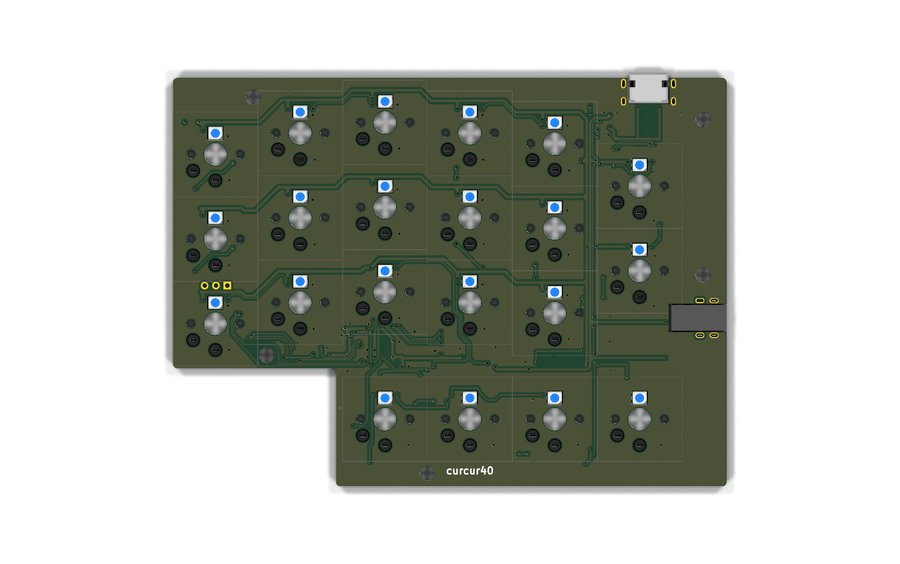
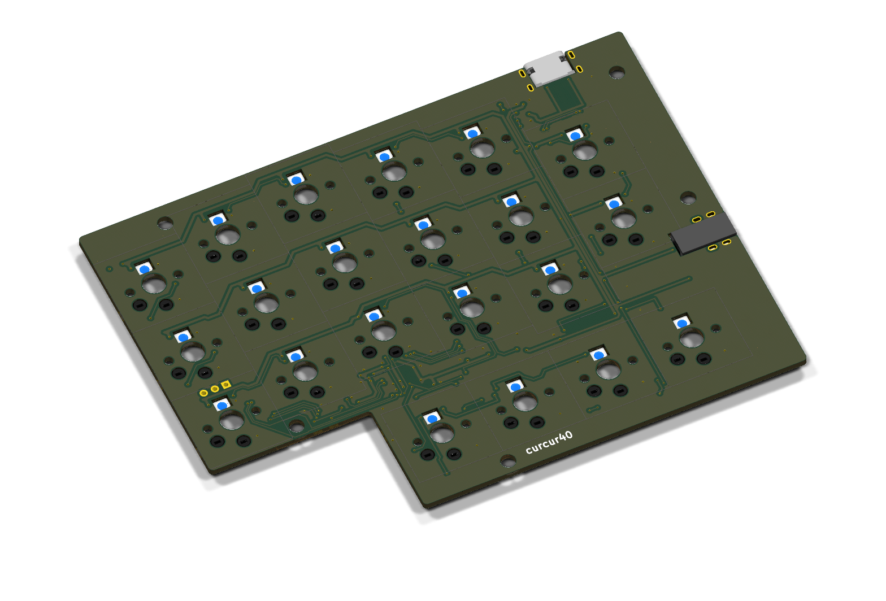
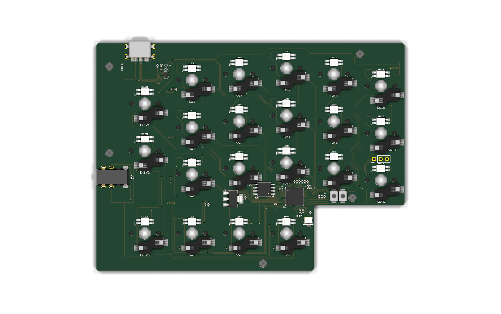
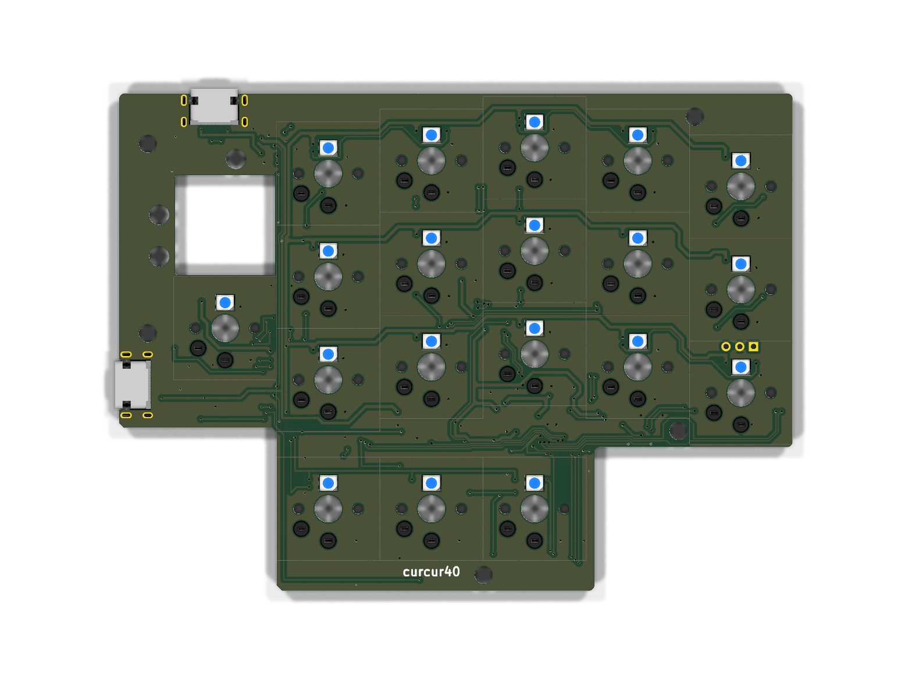
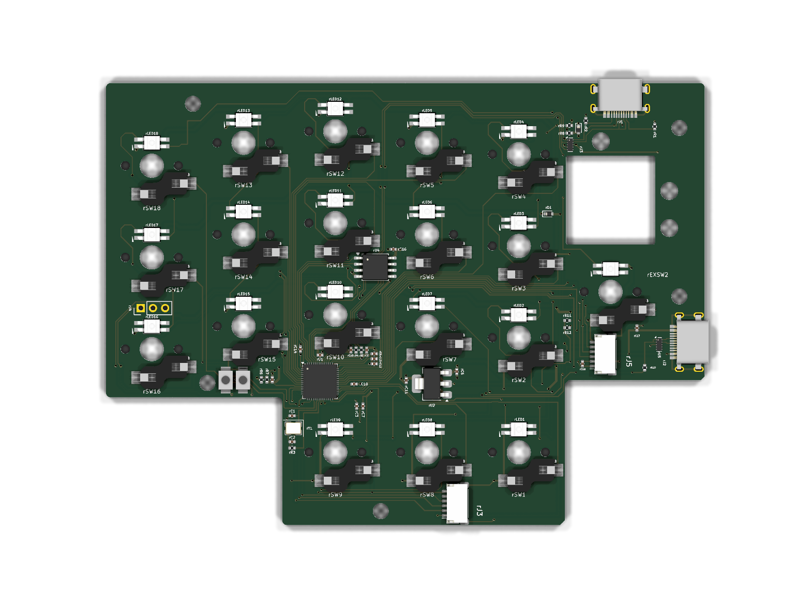
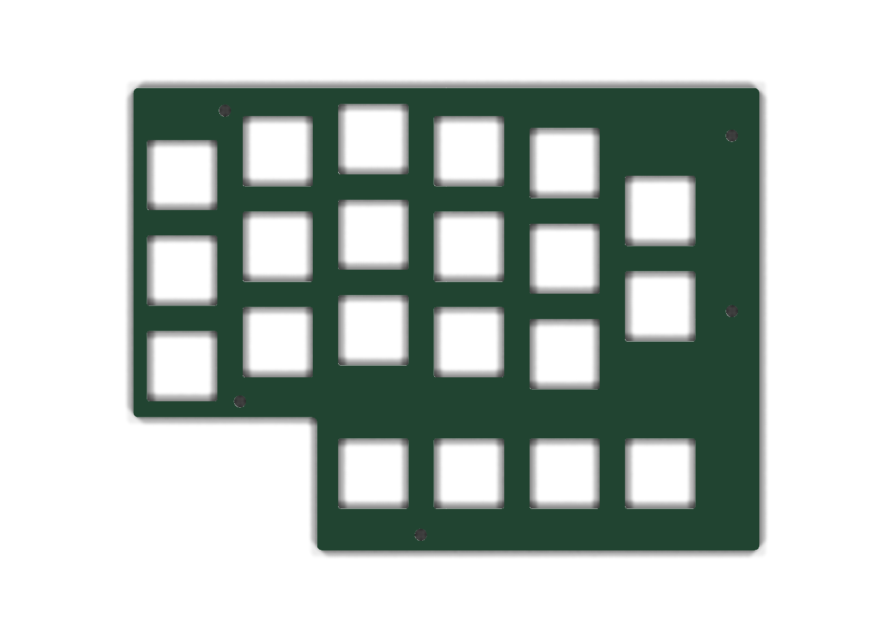
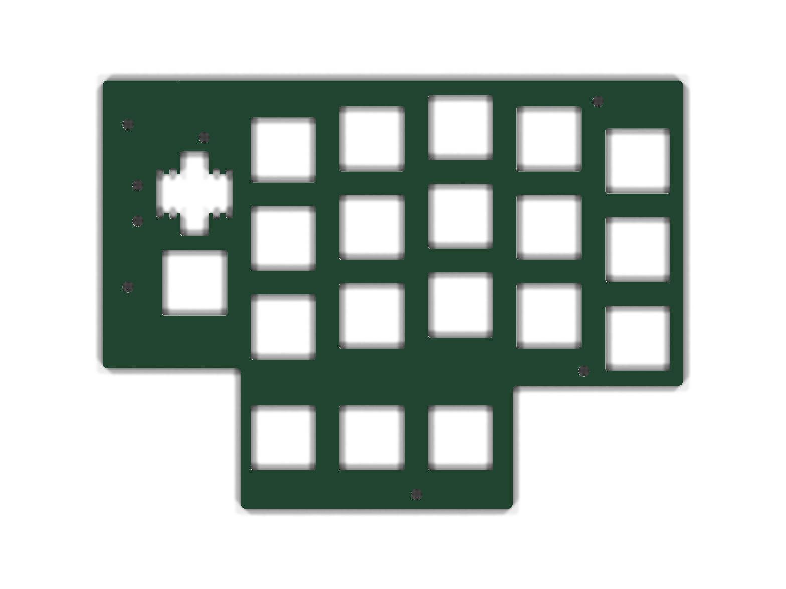
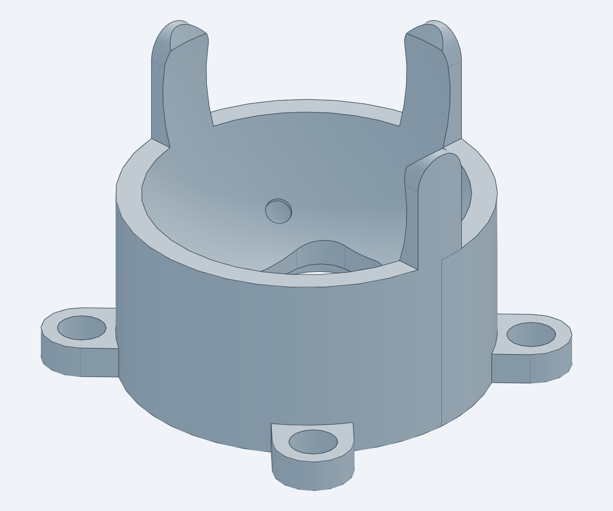
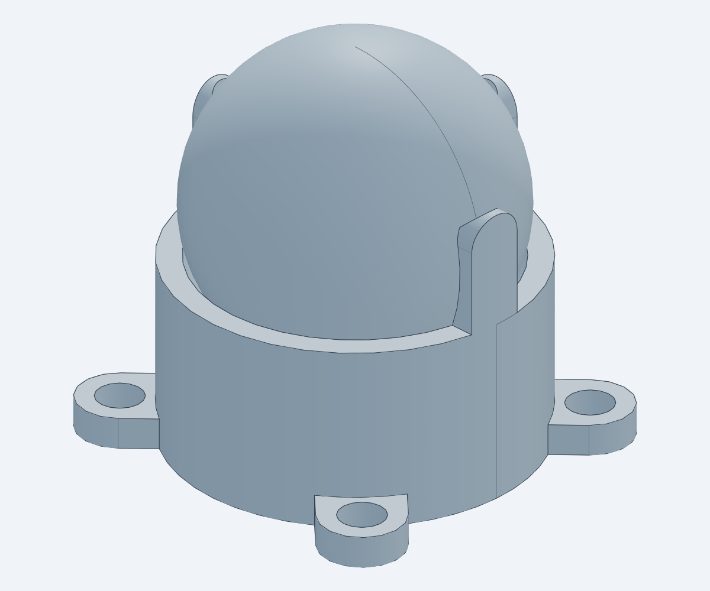

# curcur40

**curcur40** は、[Corne Keyboard (crkbd v4)](https://github.com/foostan/crkbd) をベースに、Kailh Choc V1/V2 ロープロファイルスイッチ専用の **40キー左右分割レイアウト**、右手親指内側の **$\varnothing 25\,\text{mm}$ 光学式トラックボール（PMW3360DM-T2QU 低プロファイル分離センサーサブ基板）**、および右手人差し指内側の **沈み込み型パッシブ磁気慣性ホイール（`SUS304` 金属カップ型フライホイール ＋ `AS5600` 非接触12bit磁気角度センサ ＋ ツインスナップカバー）** を融合したカスタム分割エルゴノミクスキーボードです。


---

## 主な特徴 (Key Features)

- **40キー + 25mm トラックボール + パッシブ磁気慣性ホイール**:
  - **左手 (21キー)**: メイン $3\times 5$ (15キー) ＋ 内側縦2キー (`EXSW1`, `EXSW2`) ＋ 親指4キー (`SW1`, `SW8`, `SW9`, `EXSW3`)
  - **右手 (19キー + 2デバイス)**: メイン $3\times 5$ (15キー) ＋ 内側下段1キー (`rEXSW2`) ＋ 親指外側3キー (`rSW1`, `rSW8`, `rSW9`) ＋ **沈み込み型パッシブ磁気慣性ホイール（静音中クリック付）** ＋ **$\varnothing 25\,\text{mm}$ トラックボール (`PMW3360DM-T2QU` + `LM19-LSI`)**
- **電磁クラッチ不要・渦電流ゼロの「パッシブ磁気慣性ホイール」沈み込み搭載**:
  - カップ型 `SUS304` ステンレス削り出しフライホイール（単体 $5.66\,\text{g}$、内蔵9球ラチェットハブ込みロータ質量 **$6.58\,\text{g}$**）と脱脂ミニチュアベアリング、非導電ハブ内 `SUJ2` 磁性鋼球9個による非接触磁気デテント、および `AS5600` 12-bit ホール磁気角度センサ（`0.8 mm` 極小 PCBA 基板 `curcur40-wheel-sensor`）を組み合わせ、**「普段は心地よい磁気ノッチ感があり、指で弾けば数秒間フリースピンで回り続け、指で触れれば瞬時にピタッと止まる」** 純物理慣性スクロールを実現。
  - 専用沈み込みベース枠（`wheel-base-frame-sunk.step`）で回転軸中心をトッププレート天面（$Z = -2.00\,\text{mm}$）に一致させ、$180^\circ$ 回転対称のツインスナップカバー（`wheel-cover.step` × 2個、頂点 $Z = +2.68\,\text{mm}$）で軸受とセンサー基板を美しく目隠し。右メイン基板裏面の JST SH 6ピンコネクタ `rJ5` へワンタッチ接続。
- **低プロファイル沈み込みトラックボール & ビルトインテンティングケース**:
  - トラックボールカップの円形リム天面（$Z_{\text{rel}} = +14.00\,\text{mm}$）をトッププレート表面（$Z = -2.00\,\text{mm}$）と同一平面に揃えて **$-11.80\,\text{mm}$ 低プロファイル化**（キーキャップ頂点 $Z = +3.60\,\text{mm}$ から 25mm ボール頂点 $Z = +14.80\,\text{mm}$ までの突出量を **$+11.20\,\text{mm}$** に短縮）。
  - PMW3360 光学センサー回路を独立サブ基板（[`curcur40-pmw3360`](./pcbs/pmw3360/curcur40-pmw3360.kicad_pcb), $Z = -16.00\,\text{mm}$）に分離し、右手メイン基板（[`curcur40-right`](./pcbs/right/curcur40-right.kicad_pcb), $Z = -4.20\,\text{mm}$）の `rJ3`（西向き）とセンサー基板の `J1`（東向き）を正対配置した **JST SH 1.0mm ピッチ 6ピンコネクタ（`SM06B-SRSS-TB`）＆ハーネス** でワンタッチ接続。
  - 左右ボトムケースは外底面と平行な**均一肉厚 $2.40\,\text{mm}$ の傾斜内底面＋円筒ネジ座面ボス（$\varnothing 6.80\,\text{mm}$）構造**を採用。小指側外端を全高 $10.00\,\text{mm}$（$Z = -10.00\,\text{mm}$、内底面 $Z = -8.00\,\text{mm}$）、親指側内端を全高 $26.90\,\text{mm}$（$Z = -26.90\,\text{mm}$、**ビルトインテンティング角 $\theta_{\text{tent}} = 7.47^\circ$**）とすることで、テーブルからキーキャップまでの高さを抑えつつ自然な手首角度とセンサー・ホイール収納空間を両立。
- **全14箇所 M2 5.50mm スペーサー統一による高剛性締結アーキテクチャ**:
  - 左手外周 5箇所（`L1`〜`L5`）＋ 右手外周 5箇所（`R1`〜`R5`、`L5` と `R5` は $(\pm 62.0000, 64.6000)$ で完全左右対称）＋ トラックボールカップ固定耳 4箇所（`TB1`〜`TB4`）の **全 14箇所すべてに共通の M2 5.50mm メス-メス スペーサー（外径 $\varnothing 3.0\,\text{mm}$、計 14個）** を配置し、上下の **M2 × 4.0mm ネジ（28本 ＋ 沈み込みホイール枠固定 3本 ＝ 計 31本）** で締結。
  - ケースの傾斜内底面から立ち上がる円筒ボス（外周10箇所は上面 $Z = -9.10\,\text{mm}$、トラックボール4箇所は上面 $Z = -17.60\,\text{mm}$）に 5.50mm スペーサーが着座し、各基板の **$\varnothing 3.30\,\text{mm}$ 貫通穴**を通って外周 10箇所ではトッププレート下面（$Z = -3.60\,\text{mm}$）を直接支持、トラックボール部 4箇所ではセンサー基板をサンドイッチしつつカップ固定耳（高さ $5.50\,\text{mm}$、下部 $3.90\,\text{mm}$ は $\varnothing 3.30\,\text{mm}$ スペーサー穴、上部 $1.60\,\text{mm}$ は $\varnothing 2.40\,\text{mm}$ ネジ穴）へ進入して締結。全 14箇所ともケース側のネジ締結肉厚 **$2.40\,\text{mm}$**・上部締結肉厚 **$1.60\,\text{mm}$**・スペーサー内ネジ間隙間 **$1.50\,\text{mm}$** に完全統一され、ケース底面外側の **$\varnothing 4.60\,\text{mm}$ ディープザグリ穴**によってネジ頭が底面から一切突出しない構造。
- **3爪スリムアーチ保持・3点セラミック球支持トラックボールカップ**:
  - $\varnothing 2.0\,\text{mm}$ G5 窒化ケイ素（$\text{Si}_3\text{N}_4$）セラミックベアリング球 3個（入口スロート径 $\varnothing 1.95\,\text{mm}$ のスナップイン球面座）で $\varnothing 25.0\,\text{mm}$ ボールを低摩擦支持し、上部のスリムアーチ3爪（スロート径 $\varnothing 24.59\,\text{mm}$、食い込み量 $0.205\,\text{mm}$）で逆さにしても落下しないスナップイン保持と全方位の指クリアランスを両立。
- **RP2040 オンボード & デュアル USB-C・複合ポインティング搭載 QMK / Vial 完全対応**:
  - 左右とも `RP2040` + `16MB` QSPI Flash (`W25Q128JVSIQ`) をオンボード実装し、ダイオードレスのダイレクトピン接続を採用。PC接続（北側 `J1`/`rJ1`）および左右間接続（親指内側 `J2`/`rJ2`、ESD保護・コールドソケット誤挿し保護搭載）ともに USB Type-C を採用。
  - ファームウェアには **AS5600 非接触ホール磁気慣性ホイール駆動**（1 kHz ポーリング、`Shift` / `WHL_HRZ` 水平スクロール切替）と **PMW3360 トラックボールの 2D 慣性高速ドラッグスクロール**（フリック惰性継続＆親指タッチ即停止、`SCRL_MO` / `SCRL_TG` / `SCRL_SL` / `WHL_HRZ` カスタムキー対応）を統合した複合ポインティングドライバを搭載し、Vial GUI からリアルタイムにキー配置変更可能。

---

## ドキュメント・設計仕様書 (Documentation)

| ドキュメント | 内容 |
| :--- | :--- |
| **[ビルドガイド (`docs/buildguide_jp.md`)](./docs/buildguide_jp.md)** | 必要パーツ一覧（BOM）、JLCPCB / JLC3DP / JLCCNC 発注手順、PMW3360 ＆ パッシブ磁気慣性ホイールの組み立て手順、ケース締結・ファームウェア書き込み手順 |
| **[ケース・機構設計仕様書 (`docs/case_spec.md`)](./docs/case_spec.md)** | Z軸スタックアップ定義、14箇所 M2 5.50mm スペーサー＋ホイール吊り下げ締結仕様、外周ポート開口（USB-C）、トラックボールカップ＆光学距離（$2.40\,\text{mm}$）仕様 |
| **[PCB・回路図設計仕様書 (`docs/pcb_spec.md`)](./docs/pcb_spec.md)** | 左右メイン基板＆2種のセンサーサブ基板の回路構成、RP2040 GPIO ピンアサイン表、`rJ3`/`rJ5` JST SH 6ピン接続仕様、カスタムライブラリ一覧、DRC/ERC 検証基準 |
| **[パッシブ磁気慣性ホイール設計仕様書 (`docs/passive_inertia_wheel_spec.md`)](./docs/passive_inertia_wheel_spec.md)** | 3層モジュール設計（共通コア／オンボード評価ポッド／キーボード沈み込み＋ツインカバー）、渦電流ゼロ磁気デテント原理、CAD・BOM 詳細 |
| **[慣性ホイール単体評価ポッド ビルドガイド (`docs/inertia_wheel_eval_buildguide_jp.md`)](./docs/inertia_wheel_eval_buildguide_jp.md)** | ホイール単体デスクトップ評価ポッド（`curcur40-wheel-eval`）の調達・ベアリング脱脂・磁力チューニング・メイン基板への移植手順 |
| **[生成スクリプト一覧 (`scripts/README.md`)](./scripts/README.md)** | 3Dモデル（ケース・カップ・慣性ホイール・フルアセンブリ）、トッププレート、JLCPCB 発注データ、図版・プレビュー画像の再現生成スクリプト（全10本）の説明 |

---

## 3D プレビュー・完成イメージギャラリー (3D Preview Gallery)

KiCad 10.0 Raytracing（`kicad-cli pcb render`）および `cadgen` 3D CAD レンダラーで出力した完成イメージ一覧です。

### 1. フルアセンブリ（3Dプリントケース + メイン基板 + トッププレート + 25mmトラックボール + 沈み込みパッシブ磁気慣性ホイール）

#### 斜視図（アイソメトリックビュー）


#### 上面図（トップビュー）


#### 底面図（ボトムビュー：14箇所 Ø4.6mm ザグリ穴、L1〜L5 ＆ R1〜R5 左右対称配置）


---

### 2. 左手メイン基板 (`curcur40-left`)
- **構成**: 21キー（メイン $3\times 5$ + 内側 1u×2 + 親指 1u×4）
- **制御回路**: `RP2040`（QFN-56）+ `W25Q128JVSIQ`（16MB QSPI Flash）+ デュアル USB Type-C（北側 PC接続 `J1`・内側 左右間接続 `J2`、ともに ESD保護 `TPD4E05U06DQAR`・VBUS逆流防止ダイオード `ZD1` 搭載）
- **外周固定穴**: 5箇所（$\varnothing 3.30\,\text{mm}$ 貫通穴、M2 5.50mm スペーサー挿通用。右手外周 5箇所 `R1`〜`R5` と完全左右対称）

#### 表面（スイッチ差し込み面 / `F.Cu`）


#### 斜視図（アイソメトリックビュー）


#### 裏面（部品実装面 / `B.Cu`）


---

### 3. 右手メイン基板 (`curcur40-right`) ＆ 2種のセンサーサブ基板 (`curcur40-pmw3360` / `curcur40-wheel-sensor`)
- **構成**: 19キー（メイン $3\times 5$ + 内側下段 1u×1 + 親指外側 1u×3）+ **沈み込みパッシブ磁気慣性ホイール窓**（中心 $(14.2875, 0.0000)\,\text{mm}$, $18.50 \times 18.50\,\text{mm}$ 角穴 ＋ $\varnothing 3.70\,\text{mm}$ ポスト穴 3箇所 `W1`〜`W3`）+ **25mm トラックボール光学センサーサブ基板**（中心 $(9.5250, 52.3875)\,\text{mm}$）
- **サブ基板分離・JST SH 6ピン接続アーキテクチャ**:
  - トラックボールを $-11.80\,\text{mm}$ 低プロファイル化するため、`PMW3360DM-T2QU`（`U1`）および `1.8V` LDO（`U2`: `TLV74318PDBVR`）回路を独立サブ基板 [`curcur40-pmw3360`](./pcbs/pmw3360/curcur40-pmw3360.kicad_pcb)（$Z = -17.60 \sim -16.00\,\text{mm}$）に分離し、右メイン基板 `rJ3`（$(46.5000, 63.0000)$）とセンサー基板 `J1`（$(19.2000, 52.3875)$）を **JST SH 6ピン両端同方向フラットケーブル** で真っ直ぐ接続。
  - パッシブ磁気慣性ホイールの非接触角度センサ `AS5600-ASOT` 回路は板厚 `0.80 mm` の極小サブ基板 [`curcur40-wheel-sensor`](./pcbs/inertia-wheel-sensor/curcur40-wheel-sensor.kicad_pcb)（西側 `#20` カバー内に垂直格納）に PCBA 実装し、静音中クリックスイッチとともに右メイン基板裏面の **`rJ5`**（$(15.8000, 32.0000)$, 西向き JST SH 6ピン、`I2C0` 4.7kΩ プルアップ `rR11`/`rR12` 内蔵）へ接続。
  - TBセンサー基板裏面（`B.Cu`）の電圧選択ジャンパ `JP1` は、**Pad 1（`+3V3R`）– Pad 2（`/V_{IO}`）間が基板の銅箔パターンで最初から直結（`SolderJumper_3_Bridged12`）** されており、手作業でのブリッジは不要。
  - `R4`（28kΩ）、`C5`（22nF）、およびデバッグ端子 `J4` / `rJ4` は **DNP（未実装）** 指定。
- **固定穴・光学開口**:
  - 右メイン基板外周スペーサー貫通穴 5箇所（`R1`〜`R5`、$\varnothing 3.30\,\text{mm}$）+ ホイール枠ポスト穴 3箇所（`W1`〜`W3`、$\varnothing 3.70\,\text{mm}$）+ TBセンサーサブ基板スペーサー貫通穴 4箇所（`TB1`〜`TB4`、$\varnothing 3.30\,\text{mm}$）
  - TBセンサーサブ基板中央に PMW3360 光学窓＆LM19-LSI レンズ脚部用の矩形開口（$8.70 \times 16.90\,\text{mm}$）

#### 表面（スイッチ搭載面 / `F.Cu`）


#### 斜視図（アイソメトリックビュー）


#### 右メイン基板 裏面（SMD部品・JST SH コネクタ `rJ3`, `rJ5` 実装面 / `B.Cu`）


#### トラックボールセンサーサブ基板 (`curcur40-pmw3360`) ＆ ホイールセンサー基板 (`curcur40-wheel-sensor`) プレビュー
| TBセンサー基板 表面 (`F.Cu`) | TBセンサー基板 裏面 (`B.Cu`) | ホイールセンサー基板 表面 (`0.8mm` Top PCBA) | ホイールセンサー基板 裏面 |
| :---: | :---: | :---: | :---: |
|  |  |  |  |

---

### 4. FR-4 トッププレート (`plate-top-left` / `plate-top-right`)
- **材質・板厚**: FR-4（ガラスエポキシ基板材）、板厚 $1.60\,\text{mm}$（$Z = -3.60 \sim -2.00\,\text{mm}$）
- **ネジ穴仕様**: すべて **$\varnothing 2.40\,\text{mm}$ ストレート貫通穴（ザグリなし）**（左手外周 5箇所 `L1`〜`L5`、右手外周 5箇所 `R1`〜`R5` ＋ 慣性ホイール枠固定 3箇所 `W1`〜`W3`）。
- **右手プレート形状**: 沈み込みパッシブ磁気慣性ホイール＆ツインスナップカバー用の36頂点段付きスナップ開口、および親指内側のトラックボールカップ領域を切り欠いた L字ノッチ形状（ケース内壁クリアランス $0.30\,\text{mm}$、カップ耳クリアランス $0.3125\,\text{mm}$）。

#### 左手トッププレート (`plate-top-left`)


#### 右手トッププレート (`plate-top-right`)


---

### 5. トラックボールカップ・光学スタックアップ検証モデル
[`cases/`](./cases/) 直下の3Dプリント用単体モデルおよび [`cases/assemblies/`](./cases/assemblies/) 配下の光学検証アセンブリモデルです。5つの光学・フルアセンブリ STEP には、GUI（CAD Viewer等）の計測ツールで直接選択してボール底面（$Z_{\text{rel}} = +5.80\,\text{mm}$ / グローバル $Z = -10.2000\,\text{mm}$）との距離（設計値 **$2.40\,\text{mm}$**）を計測できるよう、レンズ側光学距離基準点（**`Lens_Optical_Ref_Point`**, $Z_{\text{rel}} = +3.40\,\text{mm}$ / グローバル $Z = -12.6000\,\text{mm}$）が独立オブジェクトとしてプロットされています。

| トラックボールカップ単体 (`cases/trackball-cup.step`) | 25mmボール・レンズ組込 (`cases/assemblies/trackball-cup-with-ball.step`) |
| :---: | :---: |
|  |  |

---

### 6. パッシブ磁気慣性ホイール ＆ 単体デスクトップ評価ポッド (`cases/inertia_wheel/`)
[`cases/inertia_wheel/`](./cases/inertia_wheel/) 配下の製造用データ（`SUS304` カップ型フライホイール＋SLA 樹脂部品）およびアセンブリイメージです。ホイールコアユニットはベースフレームの差し替え（`#04A` ⇔ `#04B`）により、単体 USB-C 評価ポッドと `curcur40-right` 沈み込み実装の双方で完全共通に動作します。

| 右手沈み込み＋ツインカバー実装 (`curcur40-right-with-inertia-wheel-sunk.step`) | 単体 USB-C 評価ポッド (`inertia-wheel-eval-pod-assembly.step`) |
| :---: | :---: |
|  |  |

---

## リポジトリ構成と発注用データ (Repository Structure & Production Files)

```text
curcur40/
├── cases/                        # 3Dプリント・CNC切削用実部品 & 検証アセンブリ (STEP / STL)
│   ├── left.step / left.stl      # 左手トレイ型ボトムケース（トッププレート水平基準）
│   ├── left-desk.step / .stl     # 左手トレイ型ボトムケース（ケース外底面＝デスク水平基準・JLC3DP推奨）
│   ├── right.step / right.stl    # 右手トレイ型ボトムケース（トッププレート水平基準）
│   ├── right-desk.step / .stl    # 右手トレイ型ボトムケース（ケース外底面＝デスク水平基準・JLC3DP推奨）
│   ├── trackball-cup.step / .stl # 25mmトラックボール用スナップインカップ
│   ├── inertia_wheel/            # パッシブ磁気慣性ホイール実部品 7種（JLCCNC SUS304 + JLC3DP SLA）
│   │   ├── sus304-flywheel.step/.stl       # #01 カップ型 SUS304 フライホイール (JLCCNC)
│   │   ├── ratchet-hub.step/.stl           # #02 内蔵9球ラチェットハブ
│   │   ├── wheel-carriage.step/.stl        # #03 スリム丸耳・一体揺動キャリッジ
│   │   ├── wheel-base-frame-sunk.step/.stl # #04B キーボード沈み込みベース枠（curcur40-right 本番用）
│   │   ├── wheel-cover.step/.stl           # #20 180°対称ツインスナップカバー（×2個使用）
│   │   ├── wheel-base-frame.step/.stl      # #04A オンボードベース枠（テスト基板・汎用実装用）
│   │   └── eval-pod-stand.step/.stl        # #05 単体評価ポッド卓上ケース
│   └── assemblies/               # 光学距離・干渉・クリアランス検証用アセンブリモデル 9種 (STEP / STL)
│       ├── assembly-full.step                         # 全134パーツ統合フルアセンブリ（トッププレート水平基準）
│       ├── assembly-full-desk.step                    # 全134パーツ統合フルアセンブリ（ケース底面＝デスク面 Z=0 基準）
│       ├── curcur40-right-with-inertia-wheel-sunk.step # 右手＋沈み込み慣性ホイール検証アセンブリ（55パーツ）
│       ├── inertia-wheel-module-sunk-assembly.step    # ホイールコア＋#04B＋#20カバー単体アセンブリ
│       ├── inertia-wheel-module-assembly.step         # ホイールコア＋#04A単体アセンブリ
│       ├── inertia-wheel-eval-pod-assembly.step       # 単体デスクトップ評価ポッド全体アセンブリ
│       ├── trackball-cup-with-ball.step/.stl          # カップ＋25mm球＋光学基準点アセンブリ
│       ├── pmw3360-lens-pcb-assembly.step             # PMW3360＋LM19レンズ＋サブ基板光学モジュール
│       └── trackball-sensor-assembly.step             # カップ＋25mm球＋センサーサブ基板統合アセンブリ
├── pcbs/                         # KiCad 10.0 全5基板 & JLCPCB PCBA 発注データ
│   ├── left/                     # 左手メイン基板 (curcur40-left, 1.6mm Bottom PCBA)
│   ├── right/                    # 右手メイン基板 (curcur40-right, 1.6mm Bottom PCBA)
│   ├── pmw3360/                  # トラックボールセンサーサブ基板 (curcur40-pmw3360, 1.6mm Bottom PCBA)
│   ├── inertia-wheel-sensor/     # 慣性ホイール極小センサー基板 (curcur40-wheel-sensor, 0.8mm Top PCBA)
│   ├── inertia-wheel-eval/       # 慣性ホイール単体評価キャリア基板 (curcur40-wheel-eval, 1.6mm Top PCBA)
│   └── common/kbd/               # プロジェクト固有 KiCad シンボル・フットプリント・3Dモデルライブラリ
├── plates/                       # FR-4 トッププレート KiCad PCB / Gerber & レーザーカット用 SVG
│   ├── pcb/                      # plate-top-left.kicad_pcb, plate-top-right.kicad_pcb
│   └── svg/                      # plate-curcur40.svg, foam-curcur40.svg
├── kbd_firmware/                 # QMK / Vial ファームウェアソース (curcur40 & curcur40_wheel_eval)
├── docs/                         # ビルドガイド・設計仕様書・図版アセット
│   ├── buildguide_jp.md
│   ├── case_spec.md
│   ├── pcb_spec.md
│   ├── passive_inertia_wheel_spec.md
│   ├── inertia_wheel_eval_buildguide_jp.md
│   └── assets/
└── scripts/                      # 3Dモデル・プレート・JLCPCBデータ・プレビュー画像の公式生成スクリプト群（10本）
```

---

## ライセンス・謝辞 (License & Credits)

本プロジェクトは、以下のオープンソースハードウェア／ソフトウェアプロジェクトの成果をベースに派生・統合して作成されています。各オリジナル作者の皆様に深く感謝いたします。

| 対象領域 / ファイル | 派生元リポジトリ・原著作者 | 適用ライセンス | 改変履歴・表示事項（CC BY 4.0 Sec. 3(a) / CERN-OHL-P v2 Sec. 3.3 準拠） |
| :--- | :--- | :--- | :--- |
| **基板・プレート・ケース・慣性ホイール・ドキュメント・スクリプト**<br>(`pcbs/`, `plates/`, `cases/`, `docs/`, `scripts/`) | **[foostan/crkbd](https://github.com/foostan/crkbd)**<br>(Original Author: `foostan` / Kosuke Adachi) | **[MIT License](./LICENSE_MIT)** ＆<br>**[CC BY 4.0](./LICENSE_CC)** | Corne v4 (`corne-chocolate`) をベースに、40キー配列化・親指クラスタ再配置・右手 PMW3360 トラックボール（低プロファイルサブ基板分離）＆沈み込みパッシブ磁気慣性ホイール（`AS5600` + `SUS304` カップロータ）統合・KiCad 10.0 対応・3Dプリントケース＆トラックボールカップ新規設計を実施（`2026-10`） |
| **プロジェクト固有 KiCad ライブラリ（Corne 由来）**<br>(`pcbs/common/kbd/kicad-symbols/kbd.kicad_sym`, `kbd.pretty/`, `kicad-packages3D/kbd.3dshapes/`) | **[foostan/kbd](https://github.com/foostan/kbd)**<br>(Original Author: `foostan`) | **[MIT License](./pcbs/common/kbd/LICENSE)** | `2026-10`: 未使用シンボル・フットプリント・3Dモデルを整理し、KiCad 10.0 標準シンボルとのピン名・フィルタ整合、`YS-SK6812MINI-E` Pin 2 (`DOUT`) 電気タイプ修正、`keyswitch_choc12_hotswap_1u` の旧 Corne V3 由来 $\varnothing 0.40\,\text{mm}$ NPTH 穴削除、環境非依存の3Dモデル相対パス化を実施 |
| **PMW3360 回路図シンボル・フットプリント**<br>(`pcbs/common/kbd/kicad-symbols/pmw3360_pcb.kicad_sym`, `PMW3360DM-T2QU_16Pin.kicad_mod`) | **[siderakb/pmw3360-pcb](https://github.com/siderakb/pmw3360-pcb)**<br>(Original Author: `siderakb` / `ziteh`) | **[CERN-OHL-P v2](./LICENSE_CERN_OHL_P_V2)**<br>(Permissive) | `2026-10`: 未使用の `TXS0108E-QPWRQ1` シンボルを削除、`PMW3360DM-T2QU` Pin 3 (`VDDPIX`) を `power_out` に変更、および `PMW3360DM-T2QU_16Pin.kicad_mod` のスルーホールパッド層定義を KiCad 10.0 向けに補完し専用センサーサブ基板 `curcur40-pmw3360` へ統合 |
| **ファームウェア定義 (`kbd_firmware/`)**<br>(`kbd_firmware/keyboards/curcur40/`, `curcur40_wheel_eval/`) | **[foostan/kbd_firmware](https://github.com/foostan/kbd_firmware)**<br>**[QMK Firmware](https://github.com/qmk/qmk_firmware)** / **[Vial-QMK](https://github.com/vial-kb/vial-qmk)** | **GPL-2.0-or-later**<br>(`SPDX-License-Identifier: GPL-2.0-or-later`) | `crkbd/rev4_1/mini` の設定をベースに、40キーマトリックス、I2C0 `AS5600` パッシブ磁気慣性ホイール＆SPI1 `PMW3360` トラックボール（1200 CPI・2D慣性ドラッグスクロール対応）複合ポインティングドライバおよび単体評価ファームウェアとして改変 |
