# curcur40

**curcur40** は、[Corne Keyboard (crkbd v4)](https://github.com/foostan/crkbd) をベースに、**39キー（論理 40入力）左右分割ロープロファイル配列**、右手親指の **25 mm 光学式トラックボール**、右手人差し指内側の **アンダープレート パッシブ磁気慣性ホイール**、および **ビルトイン 11.8° テンティング（折りたたみスタンド併用で 24° / 34° 切替対応）密閉ケース** を統合したカスタムエルゴノミクスキーボードです。

> 製作・部品調達・発注手順は **[ビルドガイド (`docs/buildguide_jp.md`)](./docs/buildguide_jp.md)**、各部の設計仕様書は **[3. ドキュメントインデックス](#3-ドキュメントインデックス-documentation-index)** を参照してください。

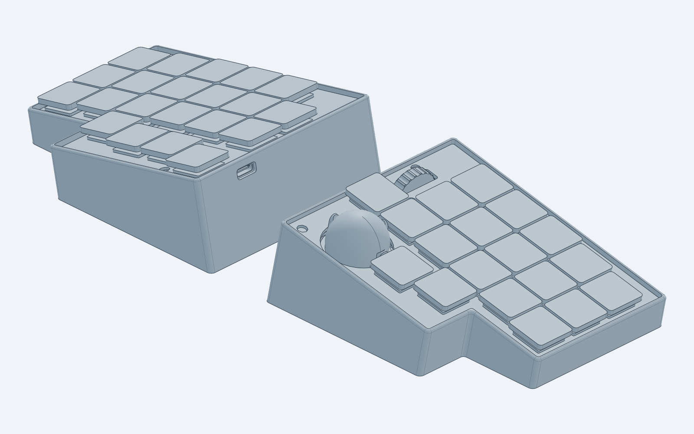

---

## 1. 外部仕様 (External Specifications)

### 1.1 ギャラリー (Gallery)

- **[3D 組み立てアニメーション動画 (`docs/assets/assembly_animation.mp4`, 1080p 60fps)](./docs/assets/assembly_animation.mp4)**

#### 本体外観（上面・底面）

| 上面ビュー | 底面ビュー（密閉底面・折りたたみスタンド収納ポケット） |
| :---: | :---: |
| 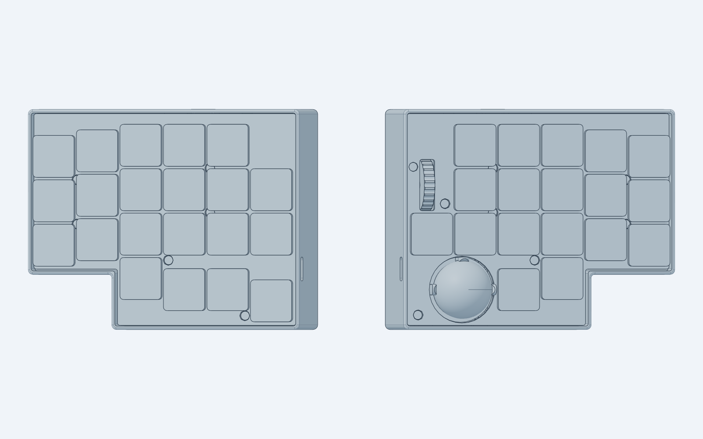 | 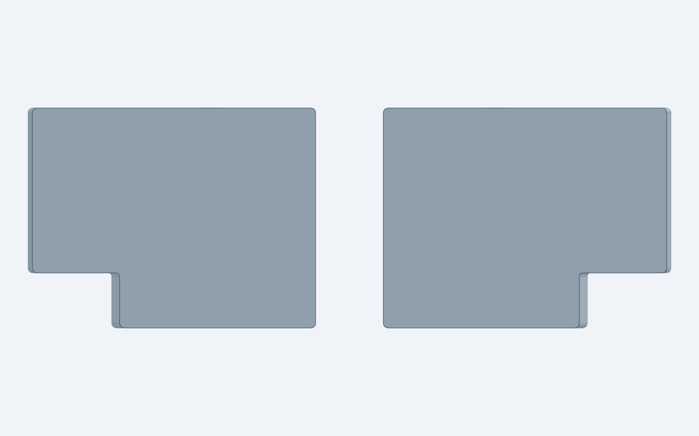 |

#### ポインティング機構（25mm トラックボール ＆ アンダープレート慣性ホイール）

| 右手ホイール実装外観 | 慣性ホイールモジュール単体 |
| :---: | :---: |
|  | 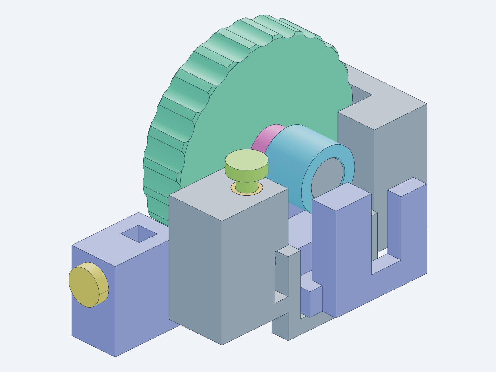 |

| トラックボールカップ単体 | 25mm ボール・光学系組込 |
| :---: | :---: |
|  | 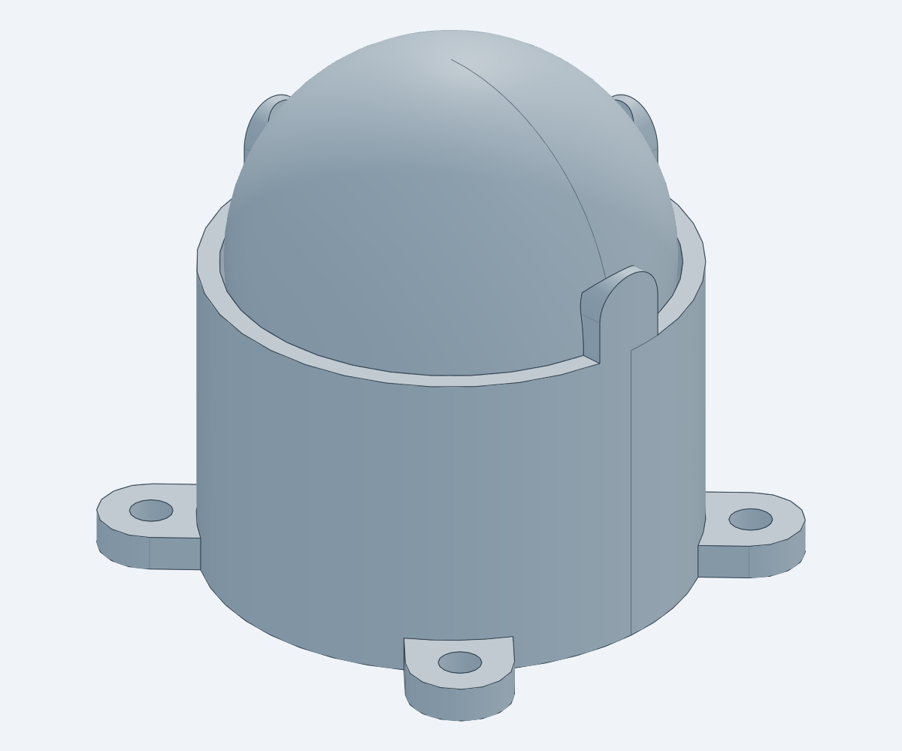 |

> 機構の動作をブラウザ上で体験できるインタラクティブ図解：
> - **[慣性ホイールの 3つのしくみ (`docs/wheel_mechanism_guide.html`)](./docs/wheel_mechanism_guide.html)**
> - **[キャリングボックスの浅角カムフタ開閉機構 (`docs/carrying_box_lid_guide.html`)](./docs/carrying_box_lid_guide.html)**

#### 基板・トッププレート外観

| 左メイン基板 表面 (`F.Cu`) | 左メイン基板 斜視 | 左メイン基板 裏面 (`B.Cu`) |
| :---: | :---: | :---: |
| 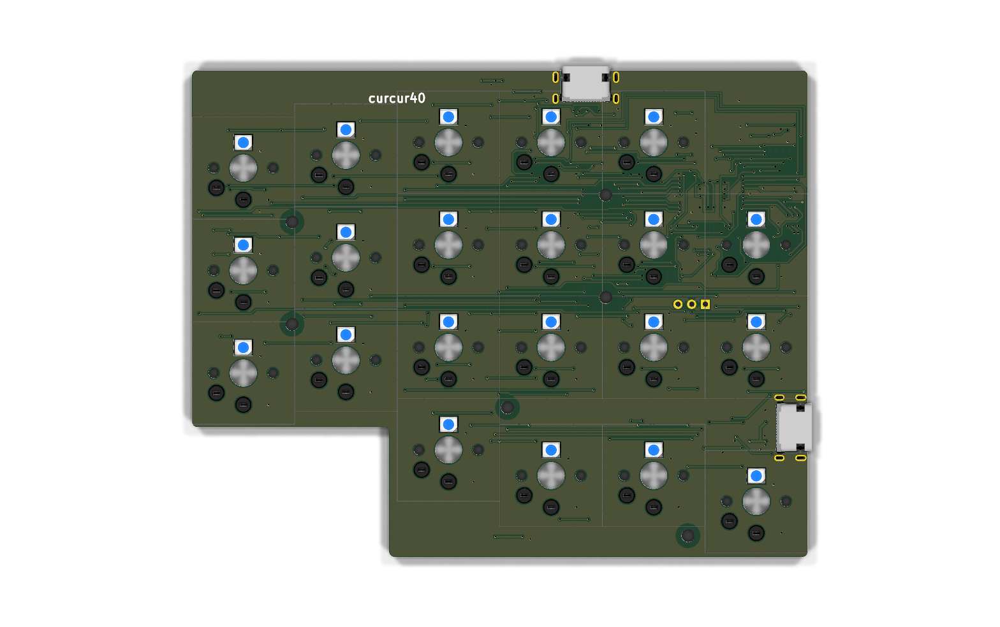 |  | 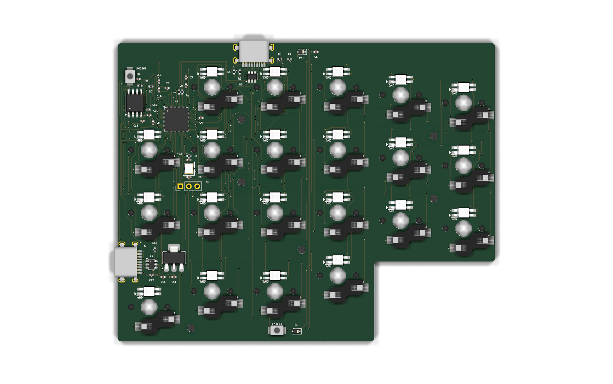 |

| 右メイン基板 表面 (`F.Cu`) | 右メイン基板 斜視 | 右メイン基板 裏面 (`B.Cu`) |
| :---: | :---: | :---: |
|  |  |  |

| 左トッププレート | 右トッププレート | TBセンサー基板 表 (`F.Cu`) | TBセンサー基板 裏 (`B.Cu`) |
| :---: | :---: | :---: | :---: |
| 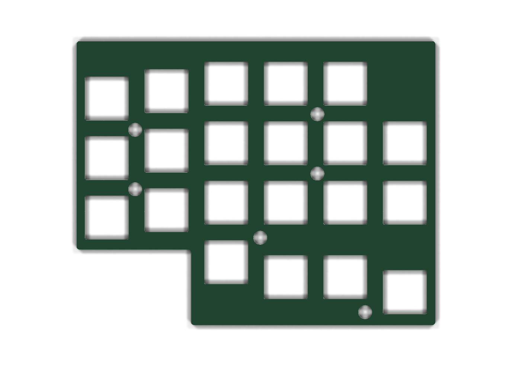 |  |  |  |

#### 持ち運び用キャリングボックス（オプション）

| フタ装着時（6面フルカバー収納） | フタ取り外し・スライド挿入時 |
| :---: | :---: |
| 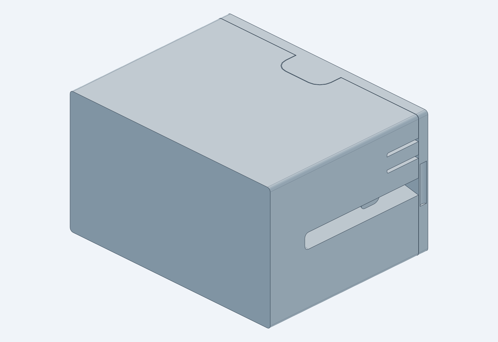 |  |

| ボックス本体 | 差込口断面（ゴム足フローティングレール＆TBキーパー） |
| :---: | :---: |
| 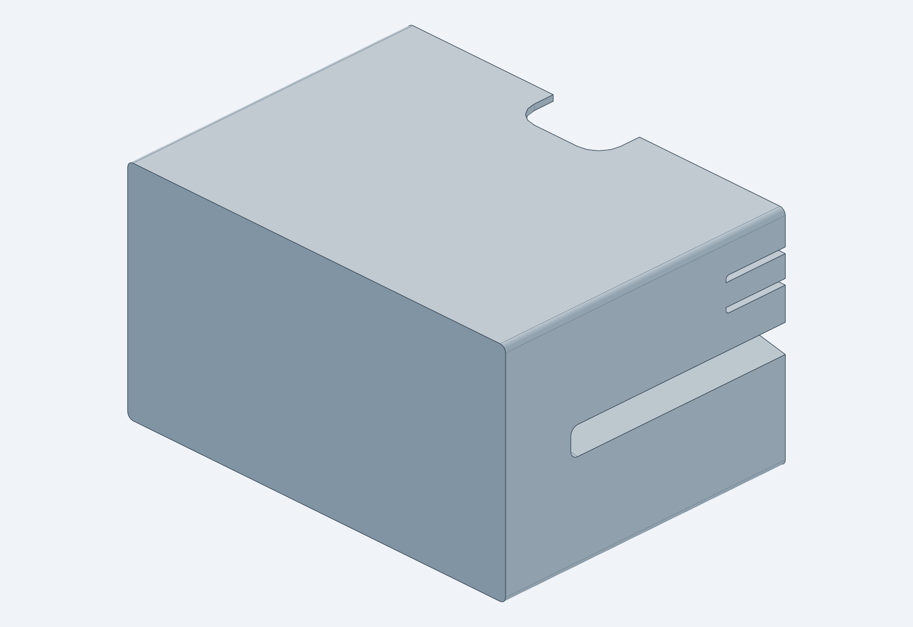 | 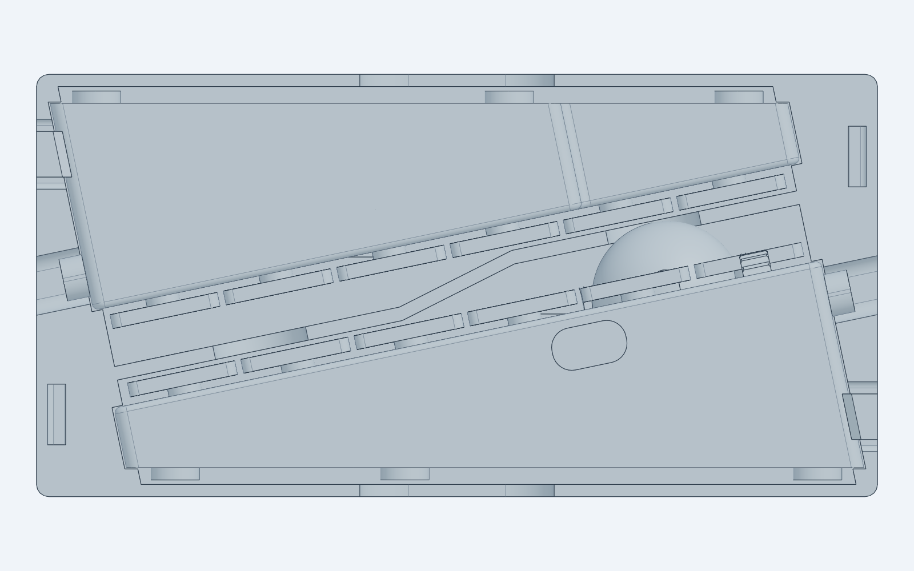 |

---

### 1.2 ハードウェア仕様 (Hardware Specifications)

| 項目 | 仕様 |
| :--- | :--- |
| **フォームファクタ** | 左右分割型 カラムスタッガード配列（全キー 1u・ホットスワップ対応） |
| **キー数・入力構成** | **計 40 論理スイッチ入力**（Kailh Choc V2 キースイッチ **39個** ＋ ホイール押し込み静音中クリック **1入力**） ・**左手 (21キー)**: メイン `3 × 5` (15) ＋ 人差し指内側縦 2キー ＋ 親指 4キー ・**右手 (18キー + 2ポインティング)**: メイン `3 × 5` (15) ＋ 人差し指内側下段 1キー ＋ 親指外側 2キー ＋ **慣性ホイール** ＋ **25 mm トラックボール** |
| **対応キースイッチ / キャップ** | Kailh Choc V2（`CPG1353` シリーズ）専用 ／ ロープロファイル MX 十字ステム 1u キーキャップ（`18.5 × 18.5 mm` 以下） |
| **本体外形寸法（片側）** | 幅 **`118.81 mm`** × 奥行 **`94.40 mm`** × ケース高 **`14.20 mm`（小指外端）〜 `39.02 mm`（親指内端）** |
| **テンティング角度** | ・標準（ケース単体 / スタンド収納時）: **`11.80°`** ビルトインテンティング ・底面埋め込み折りたたみスタンド展開時（任意）: **約 `24°`（1段目）／ 約 `34°`（2段目）** |
| **トラックボール（右手親指）** | **直径 `⌀25.0 mm` 光学式**（`800 CPI` / `1000 Hz` ポーリング、3点セラミック球支持、素手着脱可能な 3本爪スナップ保持） |
| **スクロールホイール（右手内側）** | **外径 `⌀22.0 mm × 幅 4.65 mm` 炭素鋼フライホイール**（質量 `13.20 g`、1周 **24ノッチ** 非接触磁気ラチェット［無段階強弱調整可］、長時間慣性フリースピン・指触れ即停止、静音ミドルクリック対応） |
| **接続インターフェース** | ・**PC接続**: 左右どちらでも接続可能な北面 USB Type-C（マスター自動認識） ・**左右間接続**: 内側側面 USB Type-C（パッシブ USB 2.0 C-to-C ケーブル使用、PC/充電器誤挿し保護付） |
| **LED ライティング** | 各キー独立 RGB バックライト（計 39灯、QMK RGB Matrix 対応） |
| **キャリングボックス（任意）** | 外寸 **`140.20 × 110.44 × 80.25 mm`**（上下リバーシブル 6面フルカバー直方体、トラックボール・折りたたみスタンド・高さ `≤ 3.0 mm` ゴム足・USB-C マグネット端子を装着したまま収納可能） |

---

### 1.3 ソフトウェア仕様 (Firmware & Keymap Specifications)

#### 基本仕様・特殊キー動作

- **対応ファームウェア**: QMK Firmware / VIA / **Vial（推奨・最大 6レイヤー、GUI リアルタイム編集対応）**
- **ポインティング ＆ スクロール専用カスタムキーコード**（Vial / VIA の `User` / `Custom` タブから任意キーへ配置可能）:

| キーコード (Vial表示) | 機能 |
| :--- | :--- |
| **`SCRL_MO` (`USER00`)** | 押している間、トラックボールが **2D 慣性高速ドラッグスクロール** に切り替わる（離すと即座にブレーキがかかり通常カーソル移動へ復帰） |
| **`SCRL_TG` (`USER01`)** | トラックボールの **2D 慣性高速ドラッグスクロール** をトグル切り替え |
| **`SCRL_SL` (`USER02`)** | 押している間、慣性を無効化した **低速精密 2D ドラッグスクロール** に切り替わる |
| **`WHL_HRZ` (`USER03`)** | 押している間、慣性ホイールの回転出力を **水平スクロール（横スクロール）** に切り替える（※`Shift` キー併用時は OS 標準の `Shift + 縦スクロール` として動作） |

- **ポインティング補助挙動**:
  - **Layer 3 自動スクロール連動**: デフォルトで **Layer 3 が有効な間も自動的に 2D 慣性ドラッグスクロールモード** になります。
  - **タッチ即停止 ＆ ズーム誤爆ガード**: 2D 慣性スクロールの惰走中にトラックボールへ軽く触れるかマウスクリックすると即座に停止します。また惰走中に `Ctrl` / `Alt` / `GUI` を押した場合も自動で慣性を停止し、意図しないブラウザ拡大縮小を防ぎます。
  - **ホイールクリック時ブランキング**: ホイール押し込み（中クリック）前後 `25 ms` の微小角度揺れをマスクし、クリックと同時の誤スクロールを抑止します。
- **ケース解体不要のブートローダ起動（DFU / `RPI-RP2` マウント）**:
  - **Bootmagic**: USB を抜いた状態で、**左手は左上端キー（`Tab` 位置 `[0, 1]`）、右手は右上端キー（`Q` 位置 `[4, 1]`）を押したまま USB を接続**。
  - キーマップ上の `QK_BOOT` キー押下でも即座に書き込みモードへ移行可能。

#### デフォルトキーマップ（Vial 標準構成：全 4レイヤー定義済）

Eucalyn 系をベースにした 40入力レイアウトに、右手内側のマウスクリック（上段＝ホイール押し込み `BTN3`、下段キー＝`BTN1`）と Tap-Hold（`Permissive Hold` ＋ `Hold On Other Key Press` 有効）を組み合わせています。

- **Layer 0（ベースレイヤー）**

| 行 | 左手 1 | 左手 2 | 左手 3 | 左手 4 | 左手 5 | 左手 内側 | 右手 内側 | 右手 5 | 右手 4 | 右手 3 | 右手 2 | 右手 1 |
| :-: | :---: | :---: | :---: | :---: | :---: | :---: | :---: | :---: | :---: | :---: | :---: | :---: |
| **上段** | `Tab` | `W` | `E` | `R` | `F` | `-` | **`BTN3` (Wheel押込)** | `J` | `U` | `I` | `O` | `Q` |
| **中段** | `A` | `S` | `D` | `T` | `G` | `Shift+;` | **`BTN1`** | `H` | `Y` | `K` | `L` | `P` |
| **下段** | `LShift` | `Z` | `X` | `C` | `V` | *(なし)* | *(TB領域)* | `B` | `N` | `M` | `,` | `.` |
| **親指** | | | `LGUI` | `Alt / 無変換` | `Ctrl / Esc` | **`LT(1, Space)`** | *(TB領域)* | *(なし)* | **`LT(2, Enter)`** | **`LT(3, 変換)`** | | |

- **Layer 1（ファンクション・括弧・ナビゲーション：`LT(1, Space)` ホールド）**
  - 左手: 上段 `F2`, `F4`, `F12`, `F11` ／ 中段 `[` (JIS `@`), `Del`, `Enter`, `Bksp`, `Macro 0` (`Win+Alt+Space`) ／ 下段・親指 `Alt + ←/↑/→/↓`
  - 右手: 各種括弧・記号類（`&`, `(`, `)`, `-`, `\`, `~`, `]`, `}`, `_`, `$`, `<`, `>`, `+`）
- **Layer 2（カーソル矢印・編集記号：`LT(2, Enter)` ホールド）**
  - 右手: 矢印キー（`I/J/K/L` 周辺に `↑` / `←` `↓` `→`）および `Bksp`, `Del`, 引用符・イコール・セミコロン類
- **Layer 3（テンキー・PageUp/Down ＋ トラックボール 2D慣性スクロール自動有効：`LT(3, 変換)` ホールド）**
  - 左手: `PageUp` / `Home`, `PageDown`, `End`、`#`
  - 右手: 3×3 テンキー（`0`〜`9`）および四則演算記号
- **Vial 初期プリセット（GUI から自由に変更・無効化可能）**:
  - **コンボ**: `BTN1` ＋ `H` 同時押し → **`BTN2`（右クリック）**
  - **Key Overrides（11種）**: JIS 環境向けのシフト記号リマップや修飾キー組み合わせ補正をプリセット収録。

---

## 2. ライセンス・謝辞 (License & Credits)

本プロジェクトは以下のオープンソースプロジェクトをベースに派生・設計されています。各オリジナル作者の皆様に深く感謝いたします。

| 対象領域 | 派生元・原著作者 | 適用ライセンス | 改変時期・主な改変内容（CC BY 4.0 Sec. 3(a) / CERN-OHL-P v2 Sec. 3.3 準拠） |
| :--- | :--- | :--- | :--- |
| **基板・プレート・ケース・ホイール・ドキュメント・スクリプト** (`pcbs/`, `plates/`, `cases/`, `docs/`, `scripts/`) | **[foostan/crkbd](https://github.com/foostan/crkbd)** (`foostan` / Kosuke Adachi) | **[MIT License](./LICENSE_MIT)** ＆ **[CC BY 4.0](./LICENSE_CC)** | `2026-10`〜`2026-11`: Corne v4 をベースに 39キー＋中クリック配列化、右手 25mm トラックボール（低プロファイル分離サブ基板）＆アンダープレート パッシブ磁気慣性ホイール（`45# Steel` ローター＋オンボード `TMAG5273`）統合、KiCad 10.0 対応、ヒートセット密閉テンティングケース・キャリングボックス新規設計 |
| **KiCad カスタムライブラリ** (`pcbs/common/kbd/` 内 `kbd.*`) | **[foostan/kbd](https://github.com/foostan/kbd)** (`foostan`) | **[MIT License](./pcbs/common/kbd/LICENSE)** | `2026-10`: 未使用定義の整理、KiCad 10.0 標準シンボル整合、`YS-SK6812MINI-E` Pin 2 (`DOUT`) 電気属性修正、`Kailh_Square_Silent_6.2x6.2mm` 追加、相対 3Dモデルパス化 |
| **PMW3360 シンボル・フットプリント** (`pmw3360_pcb.kicad_sym`, `PMW3360DM-T2QU_16Pin.kicad_mod`) | **[siderakb/pmw3360-pcb](https://github.com/siderakb/pmw3360-pcb)** (`siderakb` / `ziteh`) | **[CERN-OHL-P v2](./LICENSE_CERN_OHL_P_V2)** | `2026-10`: 未使用の `TXS0108E-QPWRQ1` シンボル削除、`PMW3360DM-T2QU` Pin 3 (`VDDPIX`) を `power_out` へ修正、KiCad 10.0 スルーホールパッド層補完、専用サブ基板 `curcur40-pmw3360` へ統合 |
| **ファームウェア (`kbd_firmware/`)** (`kbd_firmware/keyboards/curcur40/`) | **[foostan/kbd_firmware](https://github.com/foostan/kbd_firmware)** **[QMK](https://github.com/qmk/qmk_firmware)** / **[Vial-QMK](https://github.com/vial-kb/vial-qmk)** | **GPL-2.0-or-later** | `2026-10`〜`2026-11`: 40入力マトリクス、`I2C0` `TMAG5273`/`TLV493D-A1B6` 3Dホール慣性ホイール駆動 ＆ `SPI1` `PMW3360` 2D慣性ドラッグスクロール複合ポインティングドライバへ改変 |

---

## 3. ドキュメントインデックス (Documentation Index)

| ドキュメント | 対象読者・内容 |
| :--- | :--- |
| **[ビルドガイド (`docs/buildguide_jp.md`)](./docs/buildguide_jp.md)** | **製作・発注する方向け**: 購入パーツ一覧（BOM・URL）、JLCPCB / JLC3DP / JLCCNC の実発注手順とノウハウ、熱圧入・組立・FW書き込み手順 |
| **[ケース・プレート設計仕様書 (`docs/case_spec.md`)](./docs/case_spec.md)** | **内部設計**: 垂直 Z軸スタックアップ、全 19箇所インサート座標、トッププレート、ボトムケース・スタンドポケット・USB-C 受け棚の設計根拠 |
| **[PCB・回路設計仕様書 (`docs/pcb_spec.md`)](./docs/pcb_spec.md)** | **内部設計**: 全3基板＋3-in-1 パネル仕様、電源/ESD/左右判定/センサー回路の設計根拠、RP2040 ピンアサイン、SMD 部品（LCSC）一覧 |
| **[トラックボール設計仕様書 (`docs/trackball_spec.md`)](./docs/trackball_spec.md)** | **内部設計**: PMW3360 + LM19 光学距離（`2.40 mm`）設計、55° セラミック支持球の乗り上げ防止力学、2D慣性ドラッグスクロール FW 処理 |
| **[慣性ホイール設計仕様書 (`docs/wheel_spec.md`)](./docs/wheel_spec.md)** | **内部設計**: `⌀2.00 H7` 中心貫通穴 `45# Steel` フライホイール、平行ピン＆シム内輪支持、Cクリップシーソー機構、無段階磁気デテント、オンボード 3Dホール角度復調 FW 処理 |
| **[キャリングボックス設計仕様書 (`docs/carrying_box_spec.md`)](./docs/carrying_box_spec.md)** | **内部設計**: 互い違いウェッジ相殺配置、ゴム足フローティングレール、長スパン浅角カム式スナップフタの力学設計 |
| **[体験型 HTML 図解: 慣性ホイール (`docs/wheel_mechanism_guide.html`)](./docs/wheel_mechanism_guide.html)** | ブラウザで動かせる慣性スピン・磁気ノッチ調整・シーソークリックのインタラクティブ解説 |
| **[体験型 HTML 図解: スナップフタ (`docs/carrying_box_lid_guide.html`)](./docs/carrying_box_lid_guide.html)** | ブラウザで動かせるキャリングボックス浅角カムスナップフタの開閉力学解説 |
| **[スクリプト・自動検証リファレンス (`scripts/README.md`)](./scripts/README.md)** | **開発・検証向け**: 3D CAD・プレート・JLCPCB データ・プレビュー生成スクリプト（全 12本）の実行方法と DFM / 6-DOF / 干渉ゼロ検証基準 |
| **[ファームウェア README (`kbd_firmware/readme.md`)](./kbd_firmware/readme.md)** | QMK / Vial ビルドコマンドおよびカスタムキーコード概要（英語） |
