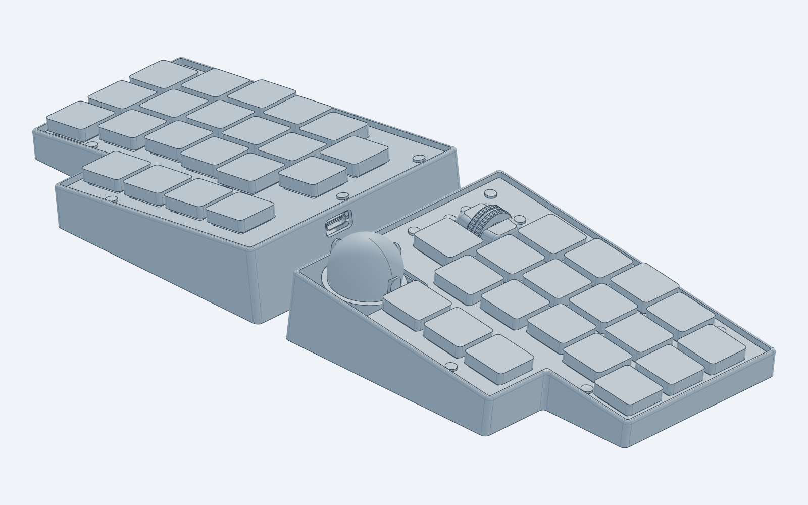
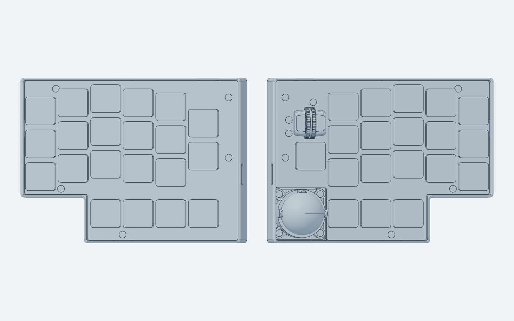
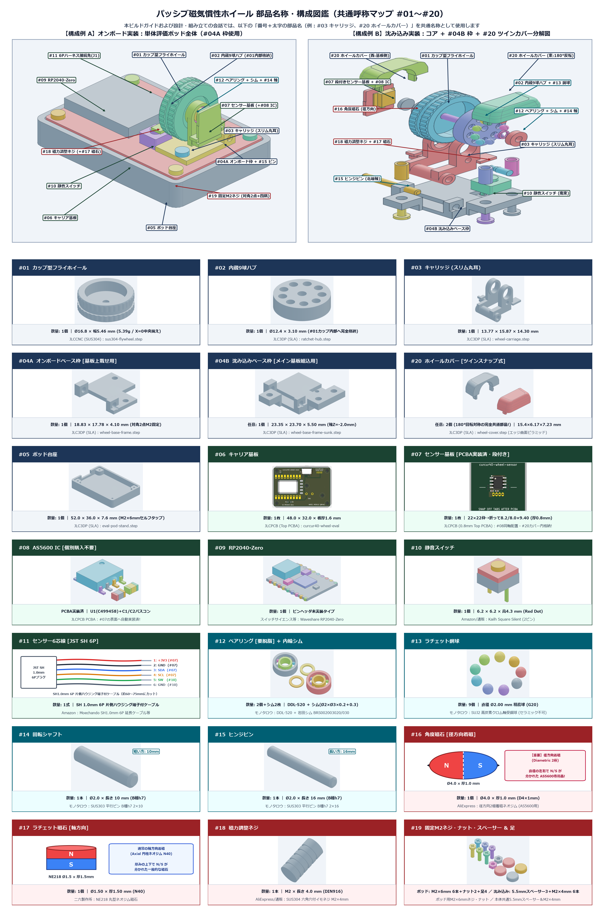
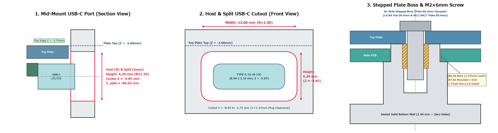
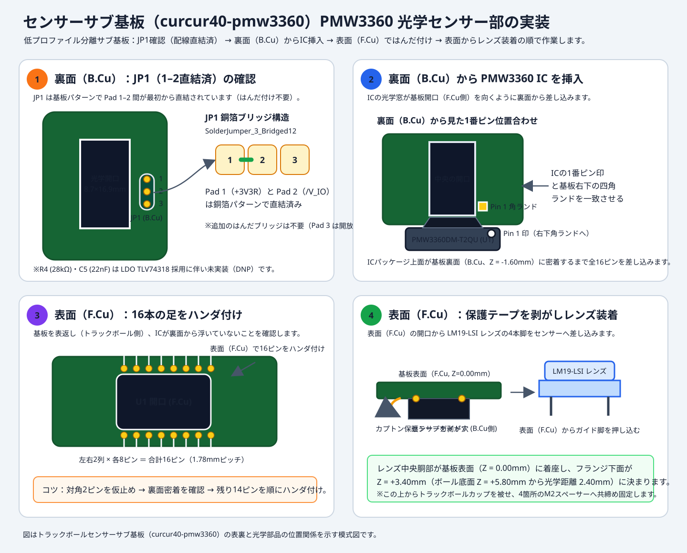
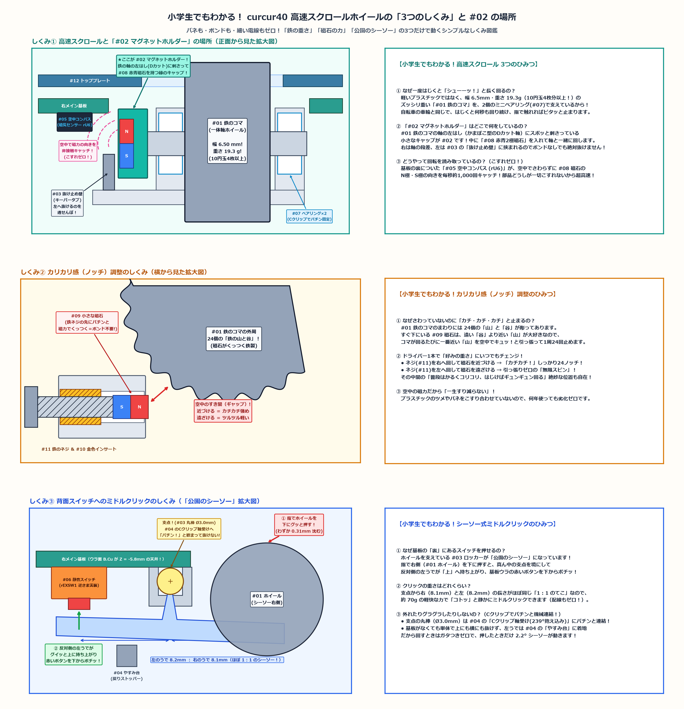
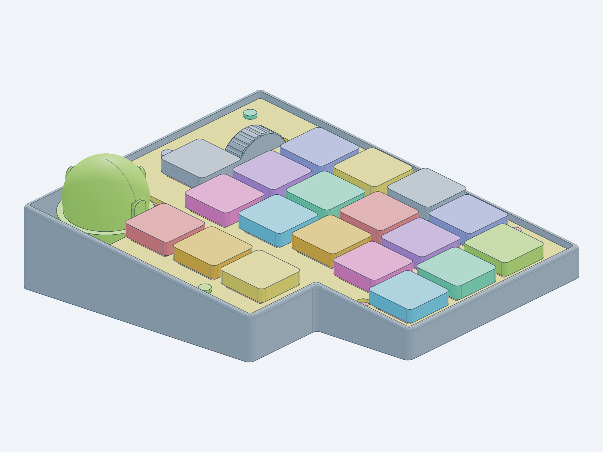
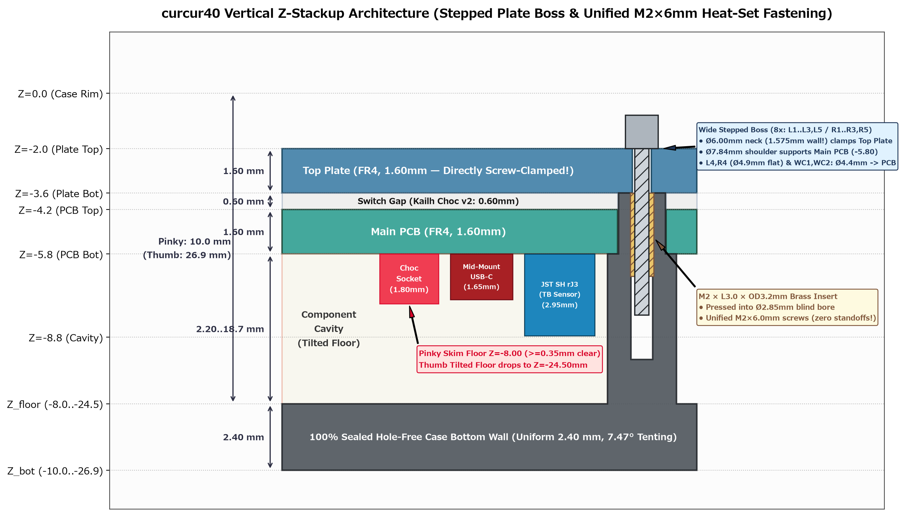

# curcur40 ビルドガイド

**curcur40** は、Corne Chocolate v4 をベースに全キー 1u 化（計40キー：左21キー＋右19キー）、右手人差し指内側に **アンダープレート一体軸パッシブ磁気慣性ホイール（`45# Steel` 1ピース削り出しホイール ＋ 基板直実装 `TMAG5273` 3Dホールセンサ ＋ 接着剤＆シム＆配線ゼロ構造）**、右手親指上部に **25mm トラックボール（`PMW3360DM-T2QU` 低プロファイル分離センサーサブ基板）** を搭載し、筐体全体を **真鍮ヒートセットインサート × 統一 `M2 × 6.0mm` ネジ（100% 密閉・底面穴なしケース）** でまとめた左右分割型ロープロファイルキーボードです。



| 上面ビュー（トッププレート・キー配列・カバー不要ホイール） | 底面ビュー（100% 密閉・ネジ穴＆ザグリ穴ゼロのフラット底面） |
| :---: | :---: |
|  |  |

---

## 目次

- **[Step 1: 資材一覧と入手経路・発注ガイド](#step-1-資材一覧と入手経路発注ガイド)**
  - [1-1. 全体構成の概要](#1-1-全体構成の概要)
  - [1-2. JLCPCB に発注するもの（PCB / PCBA / トッププレート：全5アイテム・すべて1.6mm）](#1-2-jlcpcb-に発注するものpcb--pcba--トッププレート全5アイテムすべて16mm)
  - [1-3. JLC3DP / JLCCNC に発注するもの（PA12 3Dプリント6種 ＆ 45#鋼ホイール切削1個）](#1-3-jlc3dp--jlccnc-に発注するものpa12-3dプリント6種--45鋼ホイール切削1個)
  - [1-4. 別で入手・購入するパーツ一覧](#1-4-別で入手購入するパーツ一覧)
  - [1-5. 発注前チェックリスト](#1-5-発注前チェックリスト)
- **[Step 2: 組み立て・ハンダ付け・ファームウェア書き込み手順](#step-2-組み立てハンダ付けファームウェア書き込み手順)**
  - [2-1. 必要な工具](#2-1-必要な工具)
  - [2-2. Phase 1: ファームウェアのビルドと書き込み（事前動作確認）](#2-2-phase-1-ファームウェアのビルドと書き込み事前動作確認)
  - [2-3. Phase 2: 真鍮ヒートセットインサートの熱圧入（計17箇所）](#2-3-phase-2-真鍮ヒートセットインサートの熱圧入計17箇所)
  - [2-4. Phase 3: 手ハンダ作業（わずか2箇所！）＆ トラックボールカップ準備](#2-4-phase-3-手ハンダ作業わずか2箇所-トラックボールカップ準備)
  - [2-5. Phase 4: アンダープレート慣性ホイールの組み立て（接着剤・シム・配線ゼロ）](#2-5-phase-4-アンダープレート慣性ホイールの組み立て接着剤シム配線ゼロ)
  - [2-6. Phase 5: ケースへの統合締結（全箇所共通 M2×6.0mm ネジ）](#2-6-phase-5-ケースへの統合締結全箇所共通-m260mm-ネジ)
  - [2-7. Phase 6: 動作確認・キーマップ設定（VIA / Vial）](#2-7-phase-6-動作確認キーマップ設定via--vial)
  - [2-8. トラブルシューティング・注意事項](#2-8-トラブルシューティング注意事項)

---

# Step 1: 資材一覧と入手経路・発注ガイド

## 1-1. 全体構成の概要

curcur40 を1台組み立てるために必要な資材は、以下の **4つのルート** でシンプルに揃います（選定型番・購入先リンクの完全なリファレンスは **[`docs/parts_spec.md`](./parts_spec.md)** もあわせて参照してください）。

1. **JLCPCB への発注（PCBA 付き基板 × 3種 ＋ FR-4 トッププレート × 2種 ＝ 計5アイテム、すべて標準 `1.6 mm` 厚）**
   - 左右メイン基板（`curcur40-left`, `curcur40-right`）およびトラックボールセンサーサブ基板（`curcur40-pmw3360`）は、RP2040 マイコン、Flash、Kailh Choc ソケット、RGB LED、デュアル USB-C、JST SH コネクタ（`rJ3`, `J1`）、**慣性ホイール用 3Dホール磁気センサ `rU6`（`TMAG5273A1QDBVR`）**、および PMW3360 周辺 SMD 部品まで **すべて裏面（`B.Cu`）に PCBA 自動実装** されて届きます（ホイール用の別基板や `0.8 mm` 薄板発注は不要です）。
2. **JLC3DP への発注（MJF / SLS `PA12` ナイロン 3Dプリント部品 × 6種・各1個）**
   - 左右の 100% 密閉底面ボトムケース（`left-desk`, `right-desk`）、25mm トラックボールカップ（`trackball-cup`）、および慣性ホイールの樹脂3部品（`magnet-holder`, `wheel-rocker`, `wheel-cradle`）をすべて耐久・耐熱性に優れた `PA12` ナイロンで一括造形できます。
3. **JLCCNC への発注（1ピース一体軸 `45# Steel` フライホイール × 1個）**
   - 外径 $\varnothing 22.00 \times \text{幅 } 6.50\,\text{mm}$ リム（24溝）・内輪段付き肩・Dカット回転軸を1ピース一体削り出しにした強磁性鋼ホイール（[`steel-flywheel.step`](../cases/inertia_wheel/steel-flywheel.step)、質量 $19.31\,\text{g}$、慣性モーメント $J \approx 1160\,\text{g}\cdot\text{mm}^2$、無電解ニッケルめっき仕上げ）を製作します。
4. **別途購入するパーツ（スイッチ、キーキャップ、PMW3360＋レンズ、25mm球、JST SH ケーブル1本、ホイール用ベアリング2個・磁石2個・静音SW1個、真鍮インサート17個、統一 `M2×6.0mm` ネジ17本）**
   - スペーサー、シムリング、平行ピン、ラチェット鋼球、瞬間接着剤、ホイール手配線ハーネスは **すべて廃止（不要）** となりました。手ハンダも「右メイン基板の静音スイッチ `rEXSW1`（2ピン）」と「TBセンサー基板の `PMW3360`（16ピン）」の2部品のみです。

---

## 1-2. JLCPCB に発注するもの（PCB / PCBA / トッププレート：全5アイテム・すべて1.6mm）

JLCPCB（[https://jlcpcb.com/](https://jlcpcb.com/)）には、**PCBA 付き基板 3種** と **PCB のみ（FR-4 トッププレート）2種** の **計5アイテム** を発注します。すべて標準板厚 **`1.6 mm`** です。

### 発注ファイル一覧

| 対象 | 発注種別 | 最小発注数 | ガーバーファイル (ZIP) | BOM (部品表 CSV) | CPL (座標データ CSV) |
| :--- | :---: | :---: | :--- | :--- | :--- |
| **① 左メイン基板**<br>(`curcur40-left`) | **PCB + PCBA**<br>（裏面 `B.Cu` / **1.6mm**） | 5枚<br>（PCBAは2枚〜可） | [GERBER-curcur40-left.zip](../pcbs/left/jlcpcb/production_files/GERBER-curcur40-left.zip) | [BOM-curcur40-left.csv](../pcbs/left/jlcpcb/production_files/BOM-curcur40-left.csv) | [CPL-curcur40-left.csv](../pcbs/left/jlcpcb/production_files/CPL-curcur40-left.csv) |
| **② 右メイン基板**<br>(`curcur40-right`) | **PCB + PCBA**<br>（裏面 `B.Cu` / **1.6mm**） | 5枚<br>（PCBAは2枚〜可） | [GERBER-curcur40-right.zip](../pcbs/right/jlcpcb/production_files/GERBER-curcur40-right.zip) | [BOM-curcur40-right.csv](../pcbs/right/jlcpcb/production_files/BOM-curcur40-right.csv) | [CPL-curcur40-right.csv](../pcbs/right/jlcpcb/production_files/CPL-curcur40-right.csv) |
| **③ TBセンサーサブ基板**<br>(`curcur40-pmw3360`) | **PCB + PCBA**<br>（裏面 `B.Cu` / **1.6mm**） | 5枚<br>（PCBAは2枚〜可） | [GERBER-curcur40-pmw3360.zip](../pcbs/pmw3360/jlcpcb/production_files/GERBER-curcur40-pmw3360.zip) | [BOM-curcur40-pmw3360.csv](../pcbs/pmw3360/jlcpcb/production_files/BOM-curcur40-pmw3360.csv) | [CPL-curcur40-pmw3360.csv](../pcbs/pmw3360/jlcpcb/production_files/CPL-curcur40-pmw3360.csv) |
| **④ 左トッププレート**<br>(`plate-top-left`) | **PCB のみ**<br>（FR-4 **1.6mm**） | 5枚 | [GERBER-plate-top-left.zip](../plates/pcb/jlcpcb/production_files/GERBER-plate-top-left.zip) | 不要（PCBAなし） | 不要（PCBAなし） |
| **⑤ 右トッププレート**<br>(`plate-top-right`) | **PCB のみ**<br>（FR-4 **1.6mm**） | 5枚 | [GERBER-plate-top-right.zip](../plates/pcb/jlcpcb/production_files/GERBER-plate-top-right.zip) | 不要（PCBAなし） | 不要（PCBAなし） |

> **補足（スイッチ嵌合保持トッププレート・ネジ頭沈み込み設計およびレーザーカット用 SVG について）**:
> - 板厚 $1.60\text{ mm}$ の FR-4 基板として製造します。外周10箇所（`L1`〜`L5`, `R1`〜`R5`）およびホイールクレードル2箇所（`WC1`, `WC2`）の **全12箇所すべてでトッププレートを $\varnothing 4.40\text{ mm}$ ネジ頭逃げ穴** としており、統一 `M2 × 6.0mm` ネジ頭がメイン基板 `F.Cu`（$Z = -4.20\text{ mm}$）に着座してプレート表面（$Z = -2.00\text{ mm}$）より下に完全沈み込みます。そのためキーを押下した際にキーキャップ裾がネジ頭に干渉する心配が一切なく、小指南東の `L4` / `R4` もキー間（$(\mp 100.50, 21.50)\text{ mm}$）へスマートに配置されています。
> - トッププレート自体は全40個の Kailh Choc キースイッチ（左21個・右19個）のラッチ嵌合によってメイン基板と一体に保持されます（案1A）。また右トッププレートのホイール窓は南側キー `rEXSW2` と左右中心軸を完全一致させたカバー不要のシンプルな $7.70 \times 22.00\text{ mm}$ 角丸長穴です。
> - アクリル等のレーザーカット用データとして [plate-curcur40.svg](../plates/svg/plate-curcur40.svg) および [foam-curcur40.svg](../plates/svg/foam-curcur40.svg) も同梱しています。

### JLCPCB 推奨発注オプション

- **Base Material / Layers / PCB Thickness**: `FR-4` / `2 Layers` / 全5アイテムとも **`1.6 mm`**
- **PCB Color**: お好みの色（`Black` / `Matte Black` / `White` など）
- **Remove Order Number**: トッププレートは表面に製造番号が入らないよう **`Yes`**（または `Specify a location`）を推奨します。
- **PCBA Assembly Side（①〜③すべて裏面 `Bottom Side`）**:
  - 左メイン基板 (`curcur40-left`)：**`Bottom Side`**（81点実装 / 20 BOMグループ）
  - 右メイン基板 (`curcur40-right`)：**`Bottom Side`**（83点実装 / 24 BOMグループ、オンボード3Dホール `rU6: TMAG5273A1QDBVR` `C3716049`・`rR13: 0Ω`・トラックボール用 JST SH `rJ3: C160405` 含む）
  - TBセンサーサブ基板 (`curcur40-pmw3360`)：**`Bottom Side`**（9点実装 / 7 BOMグループ、1.8V LDO `U2`・受動部品・JST SH `J1` 含む）
- **意図的に PCBA から除外されている部品（プレビューで Unplaced となって正常なもの）**:
  - **手ハンダ THT 部品（計2個）**: 右メイン基板の静音中クリックスイッチ **`rEXSW1`（`Kailh Square Silent`）**、および TBセンサー基板の光学センサー **`U1`（`PMW3360DM-T2QU`）**
  - **銅箔パターン直結済みジャンパ**: TBセンサー基板の **`JP1`（Pad 1–2 直結済）**
  - **DNP（未実装）部品**: TBセンサー基板の **`R4` / `C5`**、左右メイン基板の予備端子 **`J4` / `rJ4`**
- **JLCPCB Component Placement（DFM プレビュー）画面での確認ポイント**:
  1. **ミッドマウント USB-C コネクタ（`J1`/`J2`, `rJ1`/`rJ2`: `TYPE-C-31-M-13C`）**: 基板外周切り欠きに落とし込む部品のため、プレビュー画面で部品をドラッグし、12本のSMDピン＋4箇所のシールド長穴に端子が重なる位置（差込口が外向き）へ合わせてください。
  2. **1番ピン・極性確認**: `RP2040`, `W25Q128JVSIQ`, `NCP1117`, `TPD4E05U06`, `TMAG5273` (`rU6`), `TLV74318`, ダイオード（`ZD1`/`D1`）、逆付け RGB LED（`YS-SK6812MINI-E`）、JST SH コネクタ（`rJ3`, `J1`）の1番ピン丸印・カソードマークがシルク印字と一致していることを確認してください。

---

## 1-3. JLC3DP / JLCCNC に発注するもの（PA12 3Dプリント6種 ＆ 45#鋼ホイール切削1個）

### ① JLC3DP（MJF / SLS `PA12` 3Dプリント造形：計6種・各1個）
JLC3DP（[https://jlc3dp.com/](https://jlc3dp.com/)）にて、以下の **6ファイル（各1個・計6個）** を発注します。真鍮ヒートセットインサートを綺麗にはんだごて熱圧入でき、かつ靱性・摺動性に優れる **MJF（PA12 ナイロン）** または **SLS（PA12 ナイロン）** を推奨します。

| 対象パーツ | 数量 | アップロード用ファイル (STEP 推奨) | STL ファイル | 推奨素材・方式 |
| :--- | :---: | :--- | :--- | :--- |
| **① 左手用ボトムケース** | **1個** | [left-desk.step](../cases/left-desk.step) | [left-desk.stl](../cases/left-desk.stl) | **MJF (PA12)** / **SLS (PA12)** |
| **② 右手用ボトムケース** | **1個** | [right-desk.step](../cases/right-desk.step) | [right-desk.stl](../cases/right-desk.stl) | **MJF (PA12)** / **SLS (PA12)** |
| **③ 25mm トラックボールカップ** | **1個** | [trackball-cup.step](../cases/trackball-cup.step) | [trackball-cup.stl](../cases/trackball-cup.stl) | **MJF (PA12)** / **SLS (PA12)** / **SLA** |
| **④ `#02` ホイール用マグネットホルダー** | **1個** | [magnet-holder.step](../cases/inertia_wheel/magnet-holder.step) | [magnet-holder.stl](../cases/inertia_wheel/magnet-holder.stl) | **MJF (PA12)** / **SLS (PA12)** |
| **⑤ `#03` ホイール用シーソーロッカー** | **1個** | [wheel-rocker.step](../cases/inertia_wheel/wheel-rocker.step) | [wheel-rocker.stl](../cases/inertia_wheel/wheel-rocker.stl) | **MJF (PA12)** / **SLS (PA12)** |
| **⑥ `#04` ホイール用アンダーPCBクレードル** | **1個** | [wheel-cradle.step](../cases/inertia_wheel/wheel-cradle.step) | [wheel-cradle.stl](../cases/inertia_wheel/wheel-cradle.stl) | **MJF (PA12)** / **SLS (PA12)** |

### ② JLCCNC（1ピース一体軸フライホイール CNC 切削：1個）
JLCCNC（[https://jlccnc.com/](https://jlccnc.com/) — JLCPCB / JLC3DP と共通アカウント）で、1ピース一体軸ホイールを金属切削で発注します。

| 対象パーツ | 数量 | アップロード用ファイル | 推奨材質・表面処理指定 |
| :--- | :---: | :--- | :--- |
| **⑦ `#01` 一体軸スチールホイール** | **1個** | [steel-flywheel.step](../cases/inertia_wheel/steel-flywheel.step) | 材質: **`45# Steel`（S45C 強磁性機械構造用炭素鋼 ※必須）**<br>表面処理: **`Electroless Nickel Plating`（無電解ニッケルめっき：防錆＆高品位サテン金属光沢）**<br>公差: `ISO 2768-m (Standard)`、タップ穴・追加工なし<br>⚠️ **注意**: 24溝で磁気ラチェットを働かせるため、非磁性の `SUS304` やアルミではなく必ず強磁性の **`45# Steel`** を選択してください。 |



---

## 1-4. 別で入手・購入するパーツ一覧

すべての購入部材・型番・URL の詳細は **[`docs/parts_spec.md`](./parts_spec.md)** に収録しています。

### ① キースイッチ・キーキャップ
| 品名 | 必要数 | 仕様・備考 | 主な入手先 |
| :--- | :---: | :--- | :--- |
| **Kailh Choc V1 / V2 キースイッチ** | **40個** | 左手21個 ＋ 右手19個。ロープロファイルスイッチ。 | 遊舎工房 / Talp Keyboard / AliExpress 等 |
| **Choc 用 1u キーキャップ** | **40個** | **全キー 1u サイズ（40個）**。 | 遊舎工房 / Booth / AliExpress 等 |

### ② 右手アンダープレート慣性ホイール関連（わずか4品目！接着剤・シム・配線・鋼球すべて不要）
| 呼称・品名 | 必要数 | 型番・仕様・注意点 | 主な入手先 |
| :--- | :---: | :--- | :--- |
| **`#06` 静音ミドルクリックスイッチ (`rEXSW1`)** | **1個** | **`Kailh Square Silent 6.2×6.2×4.3mm`**（2ピン静音角形マウススイッチ `Red Dot`）。右メイン基板 `B.Cu` へ直接ハンダ付けします。 | Amazon (`B0FF9Y9DB8`) / 遊舎工房 / AliExpress |
| **`#07` ミニチュアベアリング（★要脱脂）** | **2個** | NMB ミネベアミツミ **`DDL-520ZZ`**（標準両シールド形：内径 $\varnothing 2.0 \times$ 外径 $\varnothing 5.0 \times$ **幅 $2.30\text{ mm}$**）。一体段付き軸のため**シムリングは不要**です。組み立て前にパーツクリーナーで脱脂洗浄します。 | モノタロウ (`09538365`) |
| **`#08` 角度検出用ネオジム磁石（★径方向2極着磁）** | **1個** | 直径 **$\varnothing 4.0 \times \text{厚さ } 1.0\text{ mm}$ (`D4x1mm`) 円盤型・径方向2極着磁（Diametric）**。`magnet-holder` ポケットへ入れるだけで接着剤ゼロで固定されます。<br>⚠️ **重要**: 必ず円盤の左右で N/S が分かれた **径方向着磁（Diametric）** 品を選んでください。 | AliExpress (`1005010201889003`: `D4x1mm`) |
| **`#09` ラチェット用ネオジム磁石（軸方向着磁）** | **1個** | **二六製作所 `NE280`** 等、直径 **$\varnothing 2.0 \times \text{長さ } 2.0\text{ mm}$ 円柱型・通常の軸方向着磁**。鉄製 `M2×6.0mm` ネジ先端に磁力で自己吸着するため接着剤不要です。 | 二六製作所 (`NE280`) |

### ③ 右手トラックボール・PMW3360 センサー関連
| 品名 | 必要数 | 仕様・備考 | 主な入手先 |
| :--- | :---: | :--- | :--- |
| **25mm トラックボール球** | **1個** | **Perixx PERIPRO-303 25mm** 等、直径 25mm 交換球。 | Amazon / 遊舎工房 / Booth |
| **$\varnothing 2.0\text{ mm}$ セラミック支持球** | **3個** | `trackball-cup` 内部の3箇所にスナップイン圧入する $\varnothing 2.0\text{ mm}$ $\text{ZrO}_2$ / $\text{Si}_3\text{N}_4$ ベアリング球。 | Amazon / モノタロウ / AliExpress |
| **PMW3360DM-T2QU IC ＋ LM19-LSI レンズ** | **1セット** | TBセンサーサブ基板（`curcur40-pmw3360`）の `U1` に実装。 | AliExpress / Tindie / Booth |
| **JST SH 1.0mm 6ピン両端コネクタ付ケーブル** | **1本** | 長さ **50mm** 程度、**両端同方向フラット（`1-6, 2-5, 3-4, 4-3, 5-2, 6-1` 結線）**。右メイン `rJ3` ⇔ TBセンサー基板 `J1` 接続用（[Pimoroni JST-SH 6-pin 50mm](https://shop.pimoroni.com/en-jp/products/jst-sh-cable-6-pin?variant=39292536455251) 等）。 | Pimoroni / 秋月電子 / Amazon |

### ④ 真鍮ヒートセットインサート・統一 M2×6.0mm ネジ・ゴム足・USBケーブル類
| 品名 | 必要数 | 仕様・備考 | 主な入手先 |
| :--- | :---: | :--- | :--- |
| **真鍮ヒートセットインサート (`M2 × L3.0 × OD3.2mm`)** | **17個** | **左ケース 5個 ＋ 右ケース 9個（外周5＋TB4）＋ ホイールクレードル 2個 ＋ ホイールロッカー南 1個 ＝ 計 17個（全箇所完全共通）**。ローレット外径 $\varnothing 3.2\text{ mm}$・長さ $3.0\text{ mm}$。 | Amazon / AliExpress / モノタロウ |
| **統一 `M2 × 6.0mm` 精密小ねじ（★鉄／鋼製推奨）** | **17本** | **キーボード全体の全 17箇所すべて同一サイズの `M2 × 6.0mm` ネジ！**（頭径 $\varnothing 3.5 \sim 4.0\text{ mm}$ のなべ頭または低頭）。<br>💡 **ポイント**: 磁石がくっつく一般的な **鉄／ニッケルめっき鋼（または黒染め鋼）** のネジを選ぶと、ホイール南のラチェット調整ネジ（1本）としても `#09` 磁石がそのまま自己吸着して一石二鳥です！ | モノタロウ / Amazon / 秋月電子 |
| **貼り付け式ゴム足** | **8〜10個** | 直径 6〜8mm、厚み 1.5〜2mm 程度（穴のないフラットなケース底面の四隅等に自由に貼付可能）。 | Amazon / ホームセンター |
| **左右間接続用 USB 2.0 Type-C to C ケーブル** | **1本** | `D+` データ線結線あり・E-Marker 非搭載の柔らかいパッシブケーブル（15〜30cm L字推奨）。 | Amazon / 遊舎工房 |
| **PC 接続用 USB Type-C ケーブル** | **1本** | データ通信対応 USB-C ケーブル。 | Amazon / 家電量販店 |

---

## 1-5. 発注前チェックリスト

- [ ] **JLCPCB（計5アイテム・すべて `1.6mm`）**:
  - [ ] `curcur40-left`（PCB + PCBA / Bottom実装 / 1.6mm）
  - [ ] `curcur40-right`（PCB + PCBA / Bottom実装 / 1.6mm — `rU6: TMAG5273` 実装済）
  - [ ] `curcur40-pmw3360`（PCB + PCBA / Bottom実装 / 1.6mm）
  - [ ] `plate-top-left` ＆ `plate-top-right`（PCBのみ / 1.6mm / 注文番号削除推奨）
- [ ] **JLC3DP（PA12 ナイロン 6種・各1個） ＆ JLCCNC（1個）**:
  - [ ] `left-desk.step`, `right-desk.step`, `trackball-cup.step`（各1個）
  - [ ] `magnet-holder.step`, `wheel-rocker.step`, `wheel-cradle.step`（各1個）
  - [ ] JLCCNC: `steel-flywheel.step`（**`45# Steel` ＋ `Electroless Nickel Plating`**）× 1個
- [ ] **別調達パーツ**:
  - [ ] Kailh Choc スイッチ × 40個 ＆ 1u キーキャップ × 40個
  - [ ] 慣性ホイール市販品：`Kailh Square Silent` × 1、NMB `DDL-520ZZ` × 2（＋パーツクリーナー）、`D4×1mm` **径方向着磁**磁石 × 1、`NE280` ($\varnothing 2\times 2\text{ mm}$) 軸方向磁石 × 1
  - [ ] トラックボール市販品：25mm球 × 1、$\varnothing 2.0\text{ mm}$ セラミック球 × 3、`PMW3360DM-T2QU`＋`LM19-LSI` × 1、JST SH 6P 同方向ケーブル (50mm) × 1
  - [ ] 共通ファスナ：`M2 × L=3.0 × OD=3.2mm` 真鍮ヒートセットインサート × **17個**、強磁性鋼 `M2 × 6.0mm` ネジ × **17本**、ゴム足、USB-C ケーブル × 2本

---
---

# Step 2: 組み立て・ハンダ付け・ファームウェア書き込み手順

## 2-1. 必要な工具

| 工具名 | 用途・推奨スペック |
| :--- | :--- |
| **普通のはんだごて（温度調節付き推奨）** | ① 真鍮ヒートセットインサートの熱圧入（**220〜250℃** に下げて使用）<br>② `rEXSW1`（2ピン）と `PMW3360`（16ピン）のはんだ付け（**320〜350℃** で使用）<br>※専用のヒートセット用コテ先は不要で、標準の円錐（B型・I型）コテ先でそのまま綺麗に圧入できます！ |
| **ヤニ入りハンダ・ニッパー・ピンセット** | はんだ付け、飛び出しピン先端の平切り、2mm支持球・小磁石の保持に使用します。 |
| **精密プラスドライバー（`#0` / `#00`）** | 全17箇所すべて同一の `M2 × 6.0mm` ネジ1種類を回すだけで組み立て・ラチェット調整まで完結します。 |
| **パーツクリーナー（ブレーキクリーナー）** | `DDL-520ZZ` ベアリング2個の内部グリス脱脂洗浄に使用します（※瞬間接着剤は一切不要です！）。 |

---

## 2-2. Phase 1: ファームウェアのビルドと書き込み（事前動作確認）

ハンダ付けや組み込みの前に、JLCPCB から届いた左右メイン基板（`curcur40-left`, `curcur40-right`）単体で PC に接続し、ファームウェア（`.uf2`）を書き込みます。

### ① ファームウェア（`.uf2`）のビルド

#### A. Vial 対応ファームウェアをビルドする場合（推奨）
```sh
FIRMWARE=./curcur40/kbd_firmware
VIAL_QMK=./vial-qmk

mkdir -p "$VIAL_QMK/keyboards/curcur40/rev1/keymaps/vial"
cp -a "$FIRMWARE/keyboards/curcur40/qmk/qmk_firmware/rev1/." \
  "$VIAL_QMK/keyboards/curcur40/rev1/"
cp -a "$FIRMWARE/keyboards/curcur40/vial-kb/vial-qmk/keymaps/vial/." \
  "$VIAL_QMK/keyboards/curcur40/rev1/keymaps/vial/"

cd "$VIAL_QMK"
util/docker_build.sh curcur40/rev1:vial
```
ビルドが完了すると `$VIAL_QMK/.build/curcur40_rev1_vial.uf2` が出力されます。

#### B. VIA（標準 QMK）対応ファームウェアをビルドする場合
```sh
FIRMWARE=./curcur40/kbd_firmware
QMK_FIRMWARE=./qmk_firmware

mkdir -p "$QMK_FIRMWARE/keyboards/curcur40/rev1/keymaps/via"
cp -a "$FIRMWARE/keyboards/curcur40/qmk/qmk_firmware/rev1/." \
  "$QMK_FIRMWARE/keyboards/curcur40/rev1/"
cp -a "$FIRMWARE/keyboards/curcur40/qmk/qmk_firmware/keymaps/via/." \
  "$QMK_FIRMWARE/keyboards/curcur40/rev1/keymaps/via/"

cd "$QMK_FIRMWARE"
SKIP_FLASHING_SUPPORT=1 util/docker_build.sh curcur40/rev1:via
```

### ② 左右メイン基板への書き込み手順
1. 基板裏面（`B.Cu`）の **`BOOT`（`SMDSW1` / `rSMDSW1`）を押したまま**、基板北側の PC 接続用 USB-C ポート（`J1` / `rJ1`）を PC に接続します。
2. 認識された **`RPI-RP2`** ドライブへ `.uf2` ファイルをドラッグ＆ドロップします（左右両方の基板に同じ `.uf2` を書き込みます）。

---

## 2-3. Phase 2: 真鍮ヒートセットインサートの熱圧入（計17箇所）



はんだごての温度を **220〜250℃**（PA12 ナイロンの軟化適温）に設定し、3Dプリント部品の **$\varnothing 2.85\text{ mm}$ 下穴（計17箇所）** へ `M2 × L=3.0 × OD=3.2mm` 真鍮インサートを押し込みます。

1. **圧入する場所（合計 17個 — すべて段差のないフラットなボス天面へそのままツライチ圧入！）**:
   - **左手ケース (`left-desk`)**: 外周ボス **5箇所（`L1`〜`L5`）**（全5箇所ともメイン基板裏面を受ける均一な $\varnothing 5.20\text{ mm}$ フラット円筒ボス天面［片側肉厚 $1.175\text{ mm}$］へ、狭い首部を通過することなく上からそのままツライチ圧入できます）
   - **右手ケース (`right-desk`)**: 外周ボス **5箇所（`R1`〜`R5`：均一な $\varnothing 5.20\text{ mm}$ フラット円筒ボス天面）** ＋ トラックボール下段ボス **4箇所（`TB1`〜`TB4`, $\varnothing 6.00\text{ mm}$）** ＝ **計9箇所**
   - **ホイールクレードル (`wheel-cradle`)**: 対角ボス上面 **2箇所（`WC1`, `WC2`）**
   - **ホイールロッカー (`wheel-rocker`)**: 南側ボスの水平穴の **南側入口 1箇所**
2. **普通のはんだごてで綺麗に圧入するコツ**:
   - 下穴の入口にインサートを指またはピンセットで真っ直ぐ載せ、温めたコテ先をインサート穴の上から軽く当てて自重＋わずかな力でじわっと垂直に押し込みます。
   - インサート天面がボス上面とほぼツライチになる手前（残り $0.2\text{ mm}$ ほど）でコテ先を抜き、すぐに平らな金属面（精密ドライバーの軸腹や定規の平らな面）で上から2〜3秒軽く押さえると、ボス天面と完全に水平・ツライチに美しく仕上がります。

---

## 2-4. Phase 3: 手ハンダ作業（わずか2箇所！）＆ トラックボールカップ準備

はんだごてを通常のハンダ付け温度（320〜350℃）に戻し、残る2つのスルーホール部品をハンダ付けします。

### ① 右メイン基板（`curcur40-right`）への静音スイッチ `rEXSW1` 実装
1. 右メイン基板の**裏面（`B.Cu`：部品実装面）**にあるホイール窓西側の **`rEXSW1`** ランド（`(-2.0125, -2.00)`）へ、`Kailh Square Silent`（$6.2 \times 6.2 \times 4.3\text{ mm}$）の2本のピンを差し込み、スイッチ底面を基板裏面にぴったり密着させます。
2. **表面（`F.Cu`：スイッチソケット差し込み面）**に出た2本のピンをはんだ付けします。
3. 💡 **飛び出しピン先端の平切り（重要）**: 表面 `F.Cu` とトッププレート裏面の間隔（Switch Gap）は $0.60\text{ mm}$ です。プレート裏面にピン先が当たらないよう、はんだ山のすぐ上でニッパーを使ってピン先端を短く平切りしてください。

### ② TBセンサーサブ基板（`curcur40-pmw3360`）への `PMW3360` ＆ `LM19-LSI` 実装



1. `JP1` は基板内銅箔パターンで Pad 1–2 直結済み、`R4`/`C5` は DNP のため触る必要はありません。
2. センサーサブ基板の**裏面（`B.Cu`）**から `PMW3360DM-T2QU`（`U1`）の16ピンを差し込み（1番ピン＝四角ランド）、**表面（`F.Cu`）**で16ピンすべてをはんだ付けした後、レンズフランジと干渉しないようピン先端をニッパーで短く切り揃えます。
3. 光学窓のカプトン保護テープを剥がし、**表面（`F.Cu`）**から専用レンズ `LM19-LSI` の4本の脚を角穴へ通してセンサーICへ奥まで差し込みます。

### ③ トラックボールカップへの $\varnothing 2.0\text{ mm}$ セラミック支持球（×3個）圧入
- `trackball-cup` 内壁の3箇所の球面座ディンプル（入口径 $\varnothing 1.95\text{ mm}$）へ、$\varnothing 2.0\text{ mm}$ セラミック支持球を1個ずつ「パチン」と奥まで押し込みます。

---

## 2-5. Phase 4: アンダープレート慣性ホイールの組み立て（接着剤・シム・配線ゼロ）

> 💡 **ホイールの「高速スクロール・ノッチ調整・背面スイッチ中クリック」の3つのしくみと `#02` マグネットホルダーの役割** については、ブラウザで実際にホイールを弾いたりノッチネジや中クリックを動かして体験できる **[さわって動かせる！インタラクティブ図解 (`docs/wheel_mechanism_guide.html`)](./wheel_mechanism_guide.html)**、および **[`docs/passive_inertia_wheel_spec.md` 第0節](./passive_inertia_wheel_spec.md#0-やさしい図解小学生でもわかる3つのしくみと-02-の場所)** をあわせてご覧ください。





1. **`DDL-520ZZ` ベアリング（×2個）の脱脂洗浄（★フリースピン性能の要）**
   - 小瓶やトレイに `DDL-520ZZ`（両シールド形・幅 $2.30\text{ mm}$）を2個入れ、パーツクリーナーを吹きかけて振り洗いし、内部の防錆グリスを溶かし出します（両シールドの隙間から洗浄液が十分浸透します）。乾燥後、指で弾いてシャーッと軽く空転することを確認します。
2. **ローターの組み立て（工具・接着剤・シム不要、約30秒！）**
   - `#01` 一体軸スチールホイール（`steel-flywheel`：外径 $\varnothing 22.00 \times \text{幅 } 6.50\text{ mm}$・質量 $19.31\text{ g}$）の左右軸に、脱脂した `DDL-520ZZ` ベアリングを1個ずつ奥の一体段付き肩（$\varnothing 2.90\text{ mm}$）に当たるまで差し込みます。
   - 西側の Dカット軸先端に `#02` `magnet-holder` の東側 D穴を奥まで押し込み、ホルダー西側の丸ポケットに **`#08` `D4×1mm` 径方向2極着磁磁石** をパチンと入れます（鋼製軸端への磁力吸着と `#03` 西側の一体キーパータブで確実に抜け止めされるため、接着剤は一切不要です）。
3. **ロッカーとクレードルの Cクリップスナップイン一体連結 ＆ 磁気デテント調整ネジの装着**
   - `#03` `wheel-rocker` の左右 Cクリップ軸受座（開口幅 $4.56\text{ mm}$）へ、ベアリング付きホイールを上から「パチン」と押し込みます（Cクリップ形状によりベアリングの上抜けが機械的にロックされます）。
   - 続けて、`#04` `wheel-cradle` の左右 **Cクリップヒンジ座（内径 $\varnothing 3.06\text{ mm}$・入口幅 $2.66\text{ mm}$・抱き角 $239^\circ$）** へ `#03` ロッカー北側の左右 $\varnothing 3.00\text{ mm}$ トラニオン支点軸を押し込み、「パチン！」とスナップイン連結させます。これで基板に取り付ける前の単体状態でもロッカーとクレードルが外れず一体になり、滑らかなシーソー揺動だけを行うようになります。
   - 強磁性（鉄製）の **`M2 × 6.0mm` ネジ 1本** をロッカー南ボスの真鍮インサートへ南からねじ込み、ボス内側に出たネジ先端へ **`#09` $\varnothing 2.0 \times 2.0\text{ mm}$ 円柱磁石（`NE280`）** を近づけてパチンと自己吸着させます（接着剤不要）。
   - ホイールを指で弾きながら南のネジを回し、好みの感触（浅く戻せば数秒間回り続ける軽快フリースピン、深く締めれば24溝の明快なラチェットノッチ感）に調整します。

---

## 2-6. Phase 5: ケースへの統合締結（全箇所共通 M2×6.0mm ネジ）



1. **右メイン基板裏面へのホイールユニット組み付け（`WC1`, `WC2`）**
   - 右メイン基板を裏返し（`B.Cu` 上向き）、十字形ホイール窓へ一体連結済みのホイールユニット（`#03` ロッカー ＋ `#04` クレードル）を差し込み、クレードルの対角2箇所のボスを `WC1`, `WC2` 穴に合わせます。
   - 基板表側（`F.Cu`）から **`M2 × 6.0mm` ネジ × 2本** で `WC1`, `WC2` を締め込みます。ホイールを指で回して空転すること、上から押して Cクリップ支点を中心にシーソー揺動し `rEXSW1` が「コトッ」と静音クリックすることを確認します。
2. **トッププレートとキースイッチの装着**
   - 左右のトッププレート（`plate-top-left`, `plate-top-right`）とメイン基板を合わせ、全40個の Kailh Choc キースイッチ（左21個・右19個）を差し込みます。右手では南側キー `rEXSW2` の真上に揃った $7.70 \times 22.00\text{ mm}$ 長穴から幅 $6.50\text{ mm}$ スチールホイールの頂部だけがスマートに顔を出します（カバー部品の装着は不要です）。
3. **右手トラックボール部の固定（`TB1`〜`TB4`）**
   - 先に TBセンサーサブ基板裏面の `J1` コネクタへ **JST SH 6ピン両端同方向フラットケーブル** の片端を挿しておきます。
   - TBセンサーサブ基板と `trackball-cup`（高さ $2.00\text{ mm}$ フラット耳）を右手ケース下段の4箇所のインサートボス（`TB1`〜`TB4`）に載せ、上から **`M2 × 6.0mm` ネジ × 4本** で固定します。
4. **左右メイン基板＋トッププレートの着地と外周 10箇所の固定（`L1`〜`L5`, `R1`〜`R5`）**
   - 右手では TBセンサー基板から伸びる JST SH ケーブルの反対側を右メイン基板裏面の **`rJ3`** へ真っ直ぐ差し込みます（接続ケーブルはこの1本だけです！）。
   - 左右のプレート＋メイン基板ユニットを真上からケースへ降ろします。外周10箇所すべて（左 `L1`〜`L5`・右 `R1`〜`R5`）でトッププレートの $\varnothing 4.40\text{ mm}$ ネジ頭逃げ穴から統一 **`M2 × 6.0mm` ネジ × 10本** を差し込み、メイン基板表面をケースの $\varnothing 5.20\text{ mm}$ フラットインサートボスへ直接締め込みます（ネジ頭はすべてトッププレート天面下に綺麗に沈み込み、トッププレート自体はキースイッチ嵌合でしっかり保持されます）。
5. **仕上げ**
   - 全40キーに 1u キーキャップを取り付け、25mm トラックボール球をカップへ押し込み、フラットなケース底面にゴム足を貼って完成です！

---

## 2-7. Phase 6: 動作確認・キーマップ設定（VIA / Vial）

1. **接続順序**: 先に親指内側の左右間ポート（`J2` ⇔ `rJ2`）をパッシブ USB 2.0 C-to-C ケーブルで繋いでから、北側の PC 接続ポート（`J1` または `rJ1`）を PC に接続します。
2. **全40キー ＋ ホイール静音中クリック確認**: [Vial Web (https://vial.rocks/)](https://vial.rocks/) または VIA の Matrix Tester で全キーおよびホイール押し込み（`[4, 6]`, デフォルト `BTN3`）を確認します。
3. **アンダープレート一体軸慣性ホイールの高速スクロール確認**:
   - $19.31\text{ g}$ の幅広 $6.50\text{ mm}$ `45# Steel` フライホイール（$J \approx 1160\,\text{g}\cdot\text{mm}^2$）とオンボード `TMAG5273` の `XZX` 擬似同時サンプリングにより、普段は 24溝と 1:1 同期した心地よいノッチスクロール（1回転 24ノッチ）、指で弾けば数秒間なめらかに回り続けるフリースピン、指を添えれば瞬時にピタッと物理停止する直感操作が楽しめます。
   - `Shift` キーまたは **`WHL_HRZ`** キー（Layer 1 のホイール直下キー `rEXSW2` に配置）を押しながら回すと水平スクロールに切り替わります。
4. **25mm トラックボール ＆ 2D慣性ドラッグスクロール確認**:
   - 通常時はカーソル移動、`SCRL_MO` / `SCRL_TG` 操作時は親指フリックで惰性スクロール＆親指タッチ即停止する 2D 慣性ドラッグスクロール（`SCRL_SL` で低速精密スクロール）が利用できます。

---

## 2-8. トラブルシューティング・注意事項

| 症状 | 主な原因と確認・対処方法 |
| :--- | :--- |
| **片側のキーボードが反応しない** | 両基板に `.uf2` を書き込んだか、PCケーブルが北側 `J1`/`rJ1` に、左右間ケーブル（データ通信対応パッシブ USB 2.0 C-to-C）が内側 `J2`⇔`rJ2` に刺さっているか確認してください。 |
| **慣性ホイールのスクロールが反応しない** | `#02` `magnet-holder` に入れた `#08` `D4×1mm` 磁石が **径方向2極着磁（Diametric）** 品であるか確認してください（一般的な上下厚み方向着磁の円盤磁石では回転磁界が変化せず角度を検出できません）。 |
| **慣性ホイールのクリックが固い／戻らない** | `rEXSW1` の表面 `F.Cu` 側にはんだ付けした2本のピン先端が長く残ってトッププレート裏面に当たっていないか（平切りされているか）、および `WC1`/`WC2` の2本のネジでクレードルが基板裏面に密着固定されているか確認してください。 |
| **ホイールの空転時間が短い／ノッチが強すぎる** | ① `DDL-520ZZ` ベアリングをパーツクリーナーで十分脱脂洗浄したか確認してください。<br>② 右メイン基板をケースから持ち上げ、`wheel-rocker` 南ボスの `M2×6.0mm` ラチェット調整ネジを反時計回りに少し緩めて磁石と24溝の距離を広げてください。 |
| **トラックボールのカーソルが動かない** | TBセンサー基板の `PMW3360` 光学窓の保護テープ剥がし忘れ、`LM19-LSI` レンズの差し込み深さ、表面16ピンの足切り、および `rJ3`⇔`J1` 間の JST SH 6P 同方向ケーブル（`1-6` 結線）の差し込みを確認してください。 |
