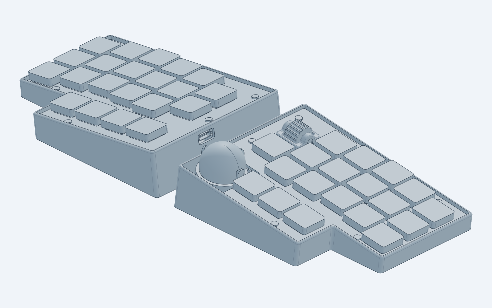
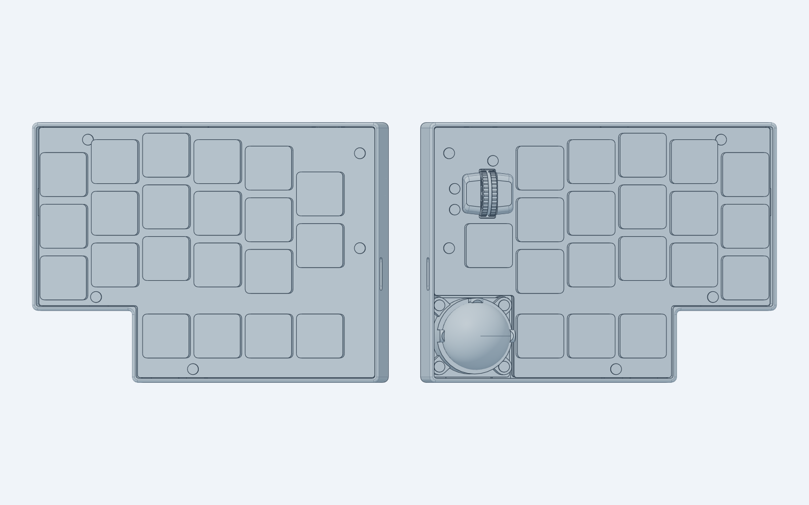
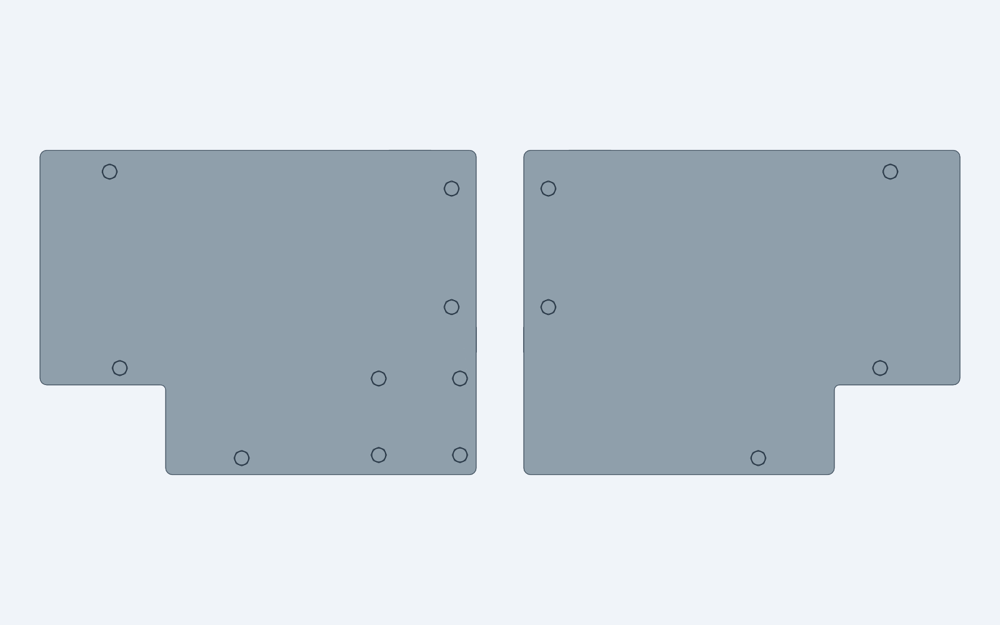
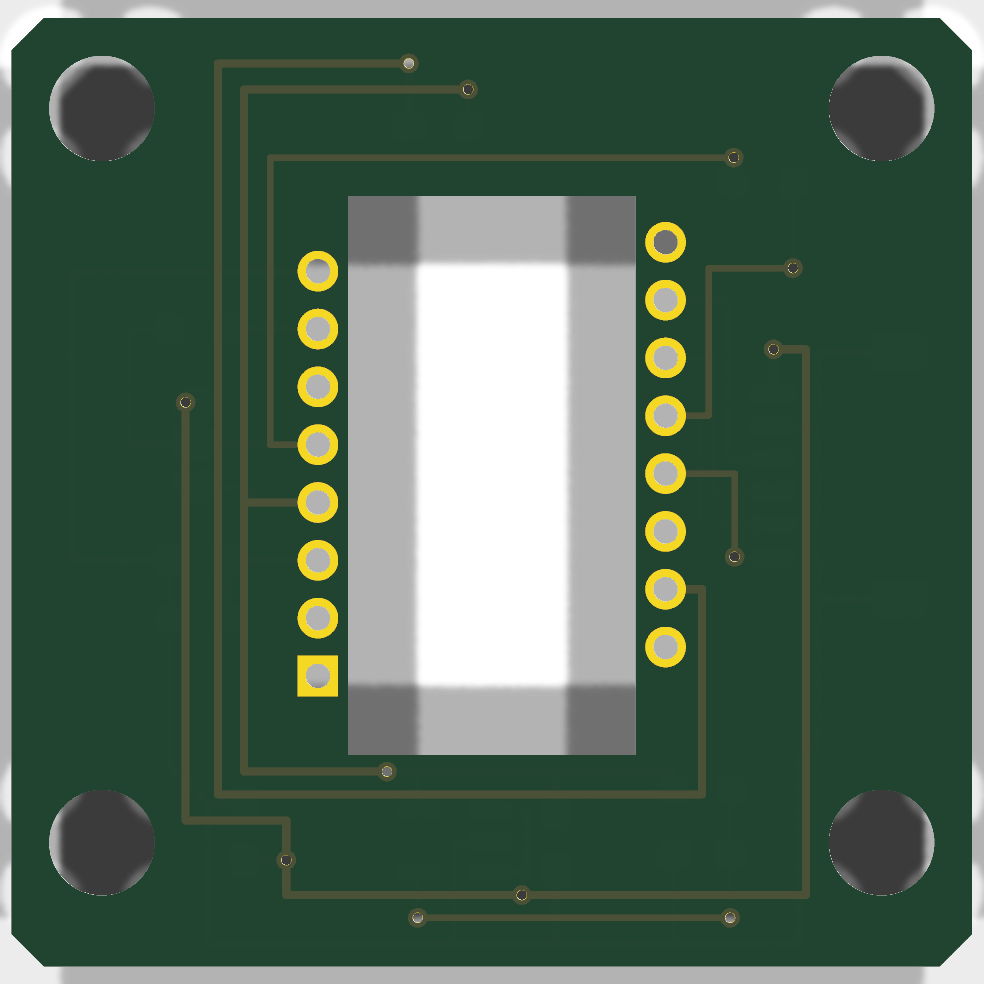
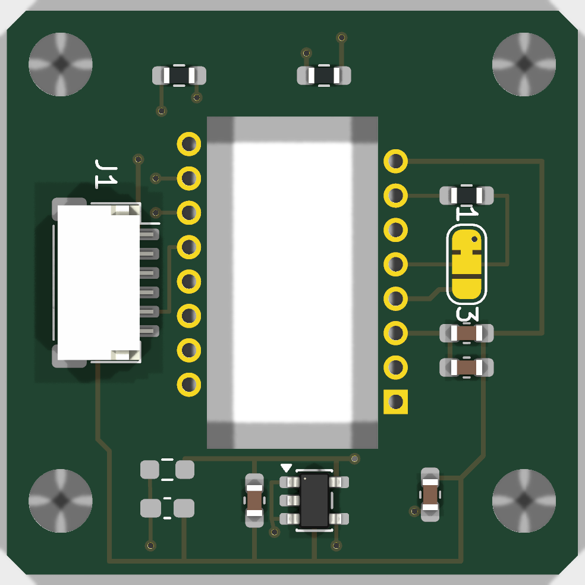
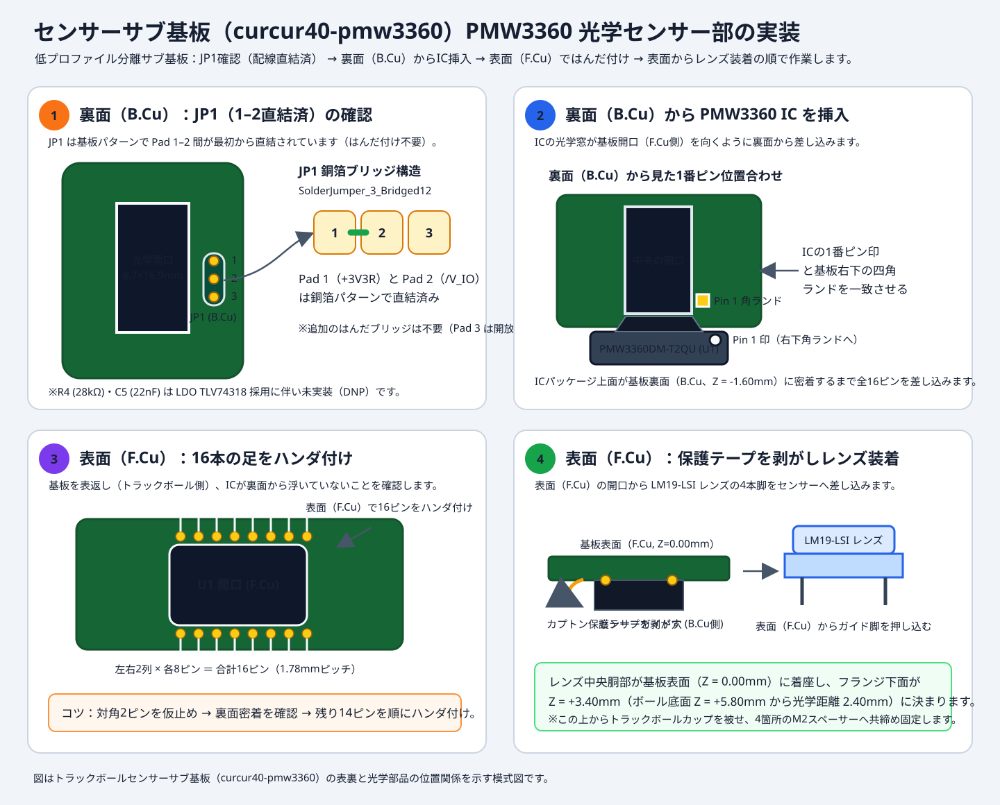
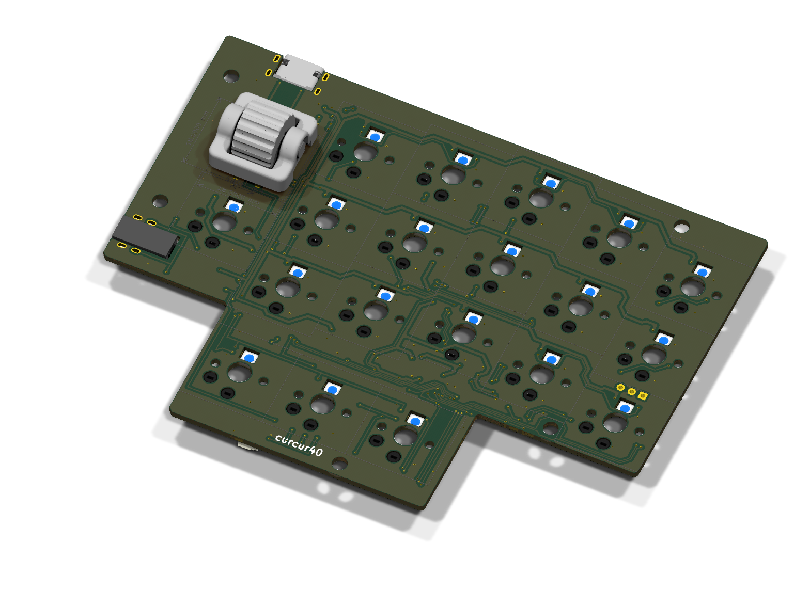
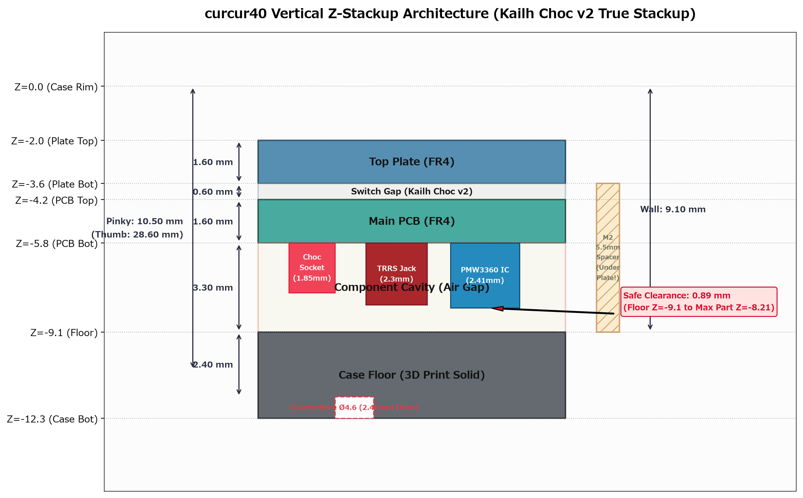

# curcur40 ビルドガイド

**curcur40** は、Corne Chocolate v4 をベースに全キー 1u 化（計40キー：左21キー＋右19キー）、右手人差し指内側に水平スクロールエンコーダ（**CKW12**）、右手親指上部に **25mm トラックボール（PMW3360DM-T2QU 低プロファイル分離センサーサブ基板）** を搭載した左右分割型ロープロファイルキーボードです。



| 上面ビュー（トッププレート・キー配列） | 底面ビュー（14箇所ザグリ穴・ケース底面） |
| :---: | :---: |
|  |  |

---

## 目次

- **[Step 1: 資材一覧と入手経路・発注ガイド](#step-1-資材一覧と入手経路発注ガイド)**
  - [1-1. 全体構成の概要](#1-1-全体構成の概要)
  - [1-2. JLCPCB に発注するもの（PCB / PCBA / トッププレート）](#1-2-jlcpcb-に発注するものpcb--pcba--トッププレート)
  - [1-3. JLC3DP に発注するもの（3Dプリント造形）](#1-3-jlc3dp-に発注するもの3dプリント造形)
  - [1-4. 別で入手・購入するパーツ一覧](#1-4-別で入手購入するパーツ一覧)
  - [1-5. 発注前チェックリスト](#1-5-発注前チェックリスト)
- **[Step 2: 組み立て・ハンダ付け・ファームウェア書き込み手順](#step-2-組み立てハンダ付けファームウェア書き込み手順)**
  - [2-1. 必要な工具](#2-1-必要な工具)
  - [2-2. Phase 1: ファームウェアのビルドと書き込み（事前動作確認）](#2-2-phase-1-ファームウェアのビルドと書き込み事前動作確認)
  - [2-3. Phase 2: 手ハンダ作業（センサーサブ基板：PMW3360 ＆ 右メイン基板：CKW12）](#2-3-phase-2-手ハンダ作業センサーサブ基板pmw3360--右メイン基板ckw12)
  - [2-4. Phase 3: トラックボールカップの準備（支持球圧入）](#2-4-phase-3-トラックボールカップの準備支持球圧入)
  - [2-5. Phase 4: スペーサー・トッププレート・ケースの組み立て](#2-5-phase-4-スペーサートッププレートケースの組み立て)
  - [2-6. Phase 5: 動作確認・キーマップ設定（VIA / Vial）](#2-6-phase-5-動作確認キーマップ設定via--vial)
  - [2-7. トラブルシューティング・注意事項](#2-7-トラブルシューティング注意事項)

---

# Step 1: 資材一覧と入手経路・発注ガイド

## 1-1. 全体構成の概要

curcur40 を1台組み立てるために必要な資材は、以下の **3つのルート** で揃えます。

1. **JLCPCB への発注（PCBA 付き基板 × 3種 ＋ FR-4 トッププレート × 2種）**
   - 左右メイン基板（`curcur40-left`, `curcur40-right`）およびトラックボールセンサーサブ基板（`curcur40-pmw3360`）は、マイコン（RP2040）、Flash メモリ、Kailh Choc ホットスワップソケット、RGB LED、USB-C、TRRS ジャック、JST SH 6ピンコネクタ（`rJ3`, `J1`）、およびセンサーサブ基板側の PMW3360 周辺 SMD 部品（1.8V LDO `TLV74318PDBVR`、コンデンサ・抵抗類）まで **すべて各基板の裏面（`B.Cu`）に PCBA 実装** されます。
2. **JLC3DP への発注（3Dプリントケース × 2種 ＋ トラックボールカップ × 1種）**
   - 左右の専用トレイ型ボトムケースと、25mm トラックボールを保持する専用カップを 3D プリントで造形します。
3. **別途購入するパーツ（スイッチ、キーキャップ、PMW3360IC＋レンズ、トラックボール球、JST SH 6ピンケーブル、CKW12、M2スペーサー・ネジ類）**
   - PCBA で実装されない手ハンダ部品（センサーサブ基板の `PMW3360DM-T2QU` 光学センサーIC と、右メイン基板の `CKW12` エンコーダのみ）と、組み立て用の機構部品・外装パーツを国内ショップや通販で揃えます。

---

## 1-2. JLCPCB に発注するもの（PCB / PCBA / トッププレート）

JLCPCB（[https://jlcpcb.com/](https://jlcpcb.com/)）には、**PCBA 付き基板 3種** と **PCB のみ（FR-4 トッププレート）2種** の **計5アイテム** を発注します。

### 発注ファイル一覧

| 対象 | 発注種別 | 最小発注数 | ガーバーファイル (ZIP) | BOM (部品表 CSV) | CPL (座標データ CSV) |
| :--- | :---: | :---: | :--- | :--- | :--- |
| **① 左メイン基板**<br>(`curcur40-left`) | **PCB + PCBA**<br>（裏面 `B.Cu` 実装） | 5枚<br>（PCBAは2枚〜可） | [GERBER-curcur40-left.zip](../pcbs/left/jlcpcb/production_files/GERBER-curcur40-left.zip) | [BOM-curcur40-left.csv](../pcbs/left/jlcpcb/production_files/BOM-curcur40-left.csv) | [CPL-curcur40-left.csv](../pcbs/left/jlcpcb/production_files/CPL-curcur40-left.csv) |
| **② 右メイン基板**<br>(`curcur40-right`) | **PCB + PCBA**<br>（裏面 `B.Cu` 実装） | 5枚<br>（PCBAは2枚〜可） | [GERBER-curcur40-right.zip](../pcbs/right/jlcpcb/production_files/GERBER-curcur40-right.zip) | [BOM-curcur40-right.csv](../pcbs/right/jlcpcb/production_files/BOM-curcur40-right.csv) | [CPL-curcur40-right.csv](../pcbs/right/jlcpcb/production_files/CPL-curcur40-right.csv) |
| **③ センサーサブ基板**<br>(`curcur40-pmw3360`) | **PCB + PCBA**<br>（裏面 `B.Cu` 実装） | 5枚<br>（PCBAは2枚〜可） | [GERBER-curcur40-pmw3360.zip](../pcbs/pmw3360/jlcpcb/production_files/GERBER-curcur40-pmw3360.zip) | [BOM-curcur40-pmw3360.csv](../pcbs/pmw3360/jlcpcb/production_files/BOM-curcur40-pmw3360.csv) | [CPL-curcur40-pmw3360.csv](../pcbs/pmw3360/jlcpcb/production_files/CPL-curcur40-pmw3360.csv) |
| **④ 左トッププレート**<br>(`plate-top-left`) | **PCB のみ**<br>（FR-4 1.6mm） | 5枚 | [GERBER-plate-top-left.zip](../plates/pcb/jlcpcb/production_files/GERBER-plate-top-left.zip) | 不要（PCBAなし） | 不要（PCBAなし） |
| **⑤ 右トッププレート**<br>(`plate-top-right`) | **PCB のみ**<br>（FR-4 1.6mm） | 5枚 | [GERBER-plate-top-right.zip](../plates/pcb/jlcpcb/production_files/GERBER-plate-top-right.zip) | 不要（PCBAなし） | 不要（PCBAなし） |

> **補足（トッププレートおよびレーザーカット用 SVG について）**:
> - **トッププレートの仕様**:
>   - 板厚 $1.60\text{ mm}$ の FR-4 基板として製造します。ネジ穴（左手 5箇所 `L1`〜`L5`、右手 5箇所 `R1`〜`R5`、完全左右対称）はすべて **$\varnothing 2.40\text{ mm}$ ストレート貫通穴（ザグリ加工不要）** です。
>   - ボトムプレートは 3D プリント製トレイ型ボトムケース（`cases/left.step`, `right.step`）に統合されたため不要です。
>   - アクリル等のレーザーカットでトッププレートやスイッチポロンフォームを製作する場合は、[plate-curcur40.svg](../plates/svg/plate-curcur40.svg) および [foam-curcur40.svg](../plates/svg/foam-curcur40.svg) を使用できます。

### JLCPCB 推奨発注オプション

- **Base Material**: `FR-4`
- **Layers**: `2 Layers`
- **PCB Thickness**: **`1.6 mm`**（左右メイン基板・センサーサブ基板・左右トッププレートすべて `1.6 mm`）
- **PCB Color**: お好みの色（`Black` / `Matte Black` / `White` など）
- **Surface Finish**: `HASL(with lead)` または `LeadFree HASL` / `ENIG`
- **Remove Order Number**: **`Specify a location`** または **`Yes`（有料オプション）** ※特にトッププレートは表面に製造番号が入らないよう `Remove Order Number: Yes` を推奨します。
- **PCBA Assembly Side**:
  - 左メイン基板 (`curcur40-left`)：**`Bottom Side`**（78点実装 / 21 BOMグループ）
  - 右メイン基板 (`curcur40-right`)：**`Bottom Side`**（75点実装 / 22 BOMグループ、JST SH 6ピンコネクタ `rJ3` 含む）
  - センサーサブ基板 (`curcur40-pmw3360`)：**`Bottom Side`**（9点実装 / 7 BOMグループ、1.8V LDO `U2`・受動部品 `C1`〜`C4`, `R1`〜`R3`・JST SH 6ピンコネクタ `J1` 含む）
- **PCBA 実装内容と未実装（DNP / 手ハンダ）部品の確認**:
  - 左右メイン基板には RP2040 マイコン、Flash メモリ、水晶振動子、3.3V LDO、Kailh Choc ホットスワップソケット（左21個・右19個）、ダイオード、RGB LED、USB Type-C コネクタ、TRRS ジャック、RESET/BOOT タクトスイッチ（`SMDSW1`/`SMDSW2`, `rSMDSW1`/`rSMDSW2`）、JST SH 6ピンコネクタ（`rJ3`）が実装されます。また、センサーサブ基板（`curcur40-pmw3360`）には 1.8V LDO（`U2`: TLV74318PDBVR）、受動部品（`C1`〜`C4`, `R1`〜`R3`）、JST SH 6ピンコネクタ（`J1`）がすべて裏面（`B.Cu`）に実装されます。
  - 以下の部品は意図的に PCBA（BOM/CPL）から除外されています（JLCPCB のプレビュー画面で Unplaced となっても正常です）：
    - **手ハンダ部品**: センサーサブ基板の **`U1`（PMW3360DM-T2QU）** および 右メイン基板の **`rEXSW1`（CKW12 エンコーダ）**
    - **基板内パターン直結済みジャンパ**: センサーサブ基板の **`JP1`（`SolderJumper_3_Bridged12`：Pad 1–2 間が銅箔パターンで直結済み）**
    - **DNP（未実装）部品**: センサーサブ基板の **`R4`（28kΩ）**・**`C5`（22nF）**（LDO TLV74318 採用に伴い不要）、および左右メイン基板の予備端子 **`J4` / `rJ4`**
- **JLCPCB Component Placement（DFM プレビュー）画面での向き・位置確認**:
  - BOM と CPL をアップロードした後の部品配置プレビュー画面にて、IC（`RP2040`, `W25Q128JVSIQ`, `NCP1117`, `TLV74318`, `TPD4E05U06`）、ダイオード（`ZD1`, `D1`）、RGB LED（`YS-SK6812MINI-E`）、およびコネクタ・ソケット・タクトスイッチ（`TYPE-C-31-M-13C`, `PJ-398A-5A`, `CPG135001S30`, `TS-1088R-02026`）の向きとパッド位置が合っているか目視確認し、JLCPCB 側のモデル基準で回転・オフセットのズレが表示された場合は画面上で合わせてから発注を確定してください。
  - また、USB-C コネクタ（`J1` / `rJ1`）の4箇所のシールドスルーホール脚にハンダが充填されていない状態で届いた場合は、コネクタ補強のため表側から追いハンダをしておくと安心です。

---

## 1-3. JLC3DP に発注するもの（3Dプリント造形）

JLC3DP（[https://jlc3dp.com/](https://jlc3dp.com/)）または手持ちの 3D プリンタで、以下の **3つのパーツ** を造形します（JLC3DP へは曲面精度の高い `.step` ファイルのアップロードを推奨します）。

| 対象パーツ | 数量 | アップロード用ファイル (STEP 推奨) | STL ファイル（スライサー用） | 推奨素材・方式 |
| :--- | :---: | :--- | :--- | :--- |
| **① 左手用ボトムケース** | **1個** | [left-desk.step](../cases/left-desk.step) / [left.step](../cases/left.step) | [left-desk.stl](../cases/left-desk.stl) / [left.stl](../cases/left.stl) | **MJF (PA12 ナイロン)** / **SLS (PA12)**<br>または **SLA (タフレジン / Black Resin)** |
| **② 右手用ボトムケース** | **1個** | [right-desk.step](../cases/right-desk.step) / [right.step](../cases/right.step) | [right-desk.stl](../cases/right-desk.stl) / [right.stl](../cases/right.stl) | **MJF (PA12 ナイロン)** / **SLS (PA12)**<br>または **SLA (タフレジン / Black Resin)** |
| **③ 25mm トラックボールカップ** | **1個** | [trackball-cup.step](../cases/trackball-cup.step) | [trackball-cup.stl](../cases/trackball-cup.stl) | **SLA (高精細レジン)** または **MJF (PA12)**<br>※直径2mm支持球を圧入するため寸法精度の高い方式を推奨 |

> **💡 ケースの設計特徴（傾斜内底面＋円筒ネジ座面ボスによる低ハイト 7.47° テンティング ＆ 全14箇所締結肉厚 $2.40\text{ mm}$ 統一）**:
> - 左右ケースは外底面と平行な**肉厚 $2.40\text{ mm}$ の傾斜内底面**を持ち、小指側外端が全高 **$10.00\text{ mm}$**（$Z = -10.00\text{ mm}$、内底面 $Z = -8.00\text{ mm}$）、親指側内端が全高 **$26.90\text{ mm}$**（$Z = -26.90\text{ mm}$、テンティング角 **$7.47^\circ$**）の低ハイト・ビルトインテンティング構造です。
> - 全 14箇所（左手外周 5箇所 `L1`〜`L5` ＋ 右手外周 5箇所 `R1`〜`R5` ＋ トラックボール固定 4箇所 `TB1`〜`TB4`）すべてに傾斜内底面から立ち上がる円筒ボス（$\varnothing 6.80\text{ mm}$）を設け、ボス上面からザグリ天井までの締結肉厚を **$2.40\text{ mm}$** に統一しています。これにより、全 14箇所とも共通の **M2 5.50mm スペーサー** と **M2 × 4.0mm ネジ** で確実に締結でき、ネジ頭はすべてケース底面内部に収まります。

> **オプション（CKW12 の 3D プリントパーツを自前で造形する場合）**:
> 「CKW12 キット」を Booth で購入する場合は、キット内に 3D プリントパーツが含まれているため発注不要です。電子部品のみを個別購入して自作する場合は、[pcbs/common/kbd/3dmodels/](../pcbs/common/kbd/3dmodels/) 内の以下の3ファイル（または本家 [kumamuk-git/CKW12](https://github.com/kumamuk-git/CKW12) のデータ）を SLA レジン等で造形してください。
> - ハウジング: [ckw12_housing.stp](../pcbs/common/kbd/3dmodels/ckw12_housing.stp) × 1個
> - ホイール: [ckw12_wheel.stp](../pcbs/common/kbd/3dmodels/ckw12_wheel.stp) × 1個
> - ステム: [ckw12_stem.stp](../pcbs/common/kbd/3dmodels/ckw12_stem.stp) × 1個

---

## 1-4. 別で入手・購入するパーツ一覧

JLCPCB / JLC3DP 以外で、キーボードショップ・電子部品通販・Amazon 等から入手するパーツの一覧です。

### キースイッチ・キーキャップ

| 品名 | 必要数 | 仕様・備考 | 主な入手先 |
| :--- | :---: | :--- | :--- |
| **Kailh Choc V1 / V2 キースイッチ** | **40個** | 左手21個 ＋ 右手19個。<br>Kailh Choc V1 または Choc V2 ロープロファイルスイッチに対応。 | 遊舎工房 / Talp Keyboard / Daily Craft Keyboard / AliExpress 等 |
| **Choc 用 1u キーキャップ** | **40個** | **全キー 1u サイズ（40個）** です。<br>※選ぶスイッチ（Choc V1 / Choc V2）に適合するロープロファイルキーキャップを用意してください。 | 遊舎工房 / Booth / Talp Keyboard / AliExpress 等 |

### 右手スクロールエンコーダ（CKW12）関連

右手人差し指内側（`rEXSW1`）に搭載する水平ロータリーエンコーダです。**方法A（キット購入）** が最も簡単で確実です。

#### 方法A：キットを購入する場合（推奨）
| 品名 | 必要数 | 仕様・備考 | 主な入手先 |
| :--- | :---: | :--- | :--- |
| **CKW12 水平ロータリーエンコーダキット** | **1セット** | エンコーダ、タクトスイッチ、専用サブ基板（`CKW12_top`）、コンスルーピン（5本）、M2×3.5mmネジ（4本）、3Dプリントパーツ一式がすべて揃ったキット。 | Booth（[kumamuk 氏のショップ](https://kumamuk.booth.pm/items/6771437)） |

#### 方法B：部品を個別に揃える場合（キット在庫切れ時など）
| 品名 | 必要数 | 型番・仕様 | 主な入手先 |
| :--- | :---: | :--- | :--- |
| **中空軸ロータリーエンコーダ** | **1個** | Alps Alpine **`EC05E1220202`** | 秋月電子 / Mouser / DigiKey |
| **横押しタクトスイッチ** | **1個** | Alps Alpine **`SKQYACE010`**（または `SKQGAFE010`） | Mouser / DigiKey / AliExpress |
| **CKW12 サブ基板 (`CKW12_top`)** | **1枚** | 板厚 0.5mm〜0.8mm（[kumamuk-git/CKW12](https://github.com/kumamuk-git/CKW12) の `pcb/` データ） | JLCPCB 等 |
| **コンスルー（スプリングピンヘッダ）** | **5ピン分** | 2.54mmピッチ、高さ 2.0mm または 2.5mm（12ピン等をニッパーで1ピンずつ5個に切り分けて使用） | 遊舎工房 / 千石電商 / 秋月電子 |
| **M2 × 3.5mm ネジ（CKW12 サブ基板固定用）** | **4本** | `CKW12_top` サブ基板裏側から CKW12 ハウジング四隅へネジ止め | ホームセンター / Amazon / モノタロウ |

### 右手トラックボール・PMW3360 センサー関連

| 品名 | 必要数 | 仕様・備考 | 主な入手先 |
| :--- | :---: | :--- | :--- |
| **25mm トラックボール球** | **1個** | 直径 **25mm** のトラックボール交換球。<br>定番は **Perixx（ペリックス）PERIPRO-303 25mm**、または Keyball / killerwhale 用 25mm 球。 | Amazon（Perixx公式）/ 遊舎工房 / Booth |
| **直径 2.0mm（$\varnothing 2.0\text{ mm}$）支持球** | **3個** | `trackball-cup` 内部の3つのくぼみ（入口スロート径 $\varnothing 1.95\text{ mm}$）にスナップイン圧入してトラックボールを滑らかに支えるベアリング球。<br>**$\varnothing 2.0\text{ mm}$ セラミック球（$\text{ZrO}_2$ ジルコニア または $\text{Si}_3\text{N}_4$ 窒化ケイ素）** または高精密ステンレス球。 | Amazon / モノタロウ / AliExpress / Booth |
| **PMW3360DM-T2QU センサーIC ＋ レンズ（LM19-LSI）** | **1セット** | 光学センサー IC 本体（16-pin DIP）と専用レンズ（`LM19-LSI`）のセット。センサーサブ基板（`curcur40-pmw3360`）の `U1` に実装します。 | AliExpress / Tindie / Booth |
| **JST SH 1.0mmピッチ 6ピン両端コネクタ付ケーブル** | **1本** | 長さ **5cm〜10cm** 程度（ストレート結線 / 同方向 `1-1, 2-2, ..., 6-6`）。右メイン基板の裏面コネクタ `rJ3` とセンサーサブ基板の裏面コネクタ `J1`（ともに `SM06B-SRSS-TB` は PCBA 実装済み）をワンタッチで接続します。 | Amazon / 秋月電子 / 千石電商 / AliExpress |

### ネジ・スペーサー・ゴム足・ケーブル類

curcur40 は **全 14箇所（左手外周 5箇所 `L1`〜`L5` ＋ 右手外周 5箇所 `R1`〜`R5` ＋ トラックボールカップ固定耳 4箇所 `TB1`〜`TB4`）すべてに共通の M2 5.50mm メス-メス スペーサー（計 14個）** と **M2 × 4.0mm ネジ（計 28本）** を使用する締結構造を採用しています。

| 品名 | 必要数 | 仕様・備考 | 主な入手先 |
| :--- | :---: | :--- | :--- |
| **M2 メス-メス スペーサー（長さ 5.50mm）** | **14個** | **左手外周 5個（`L1`〜`L5`）＋ 右手外周 5個（`R1`〜`R5`）＋ 右手トラックボール部 4個（`TB1`〜`TB4`）＝ 計 14個（全箇所共通）**。<br>外径 $\varnothing 3.0\text{ mm}$（丸型中空スペーサー推奨）。外周10箇所はボス上面（$Z = -9.10\text{ mm}$）からトッププレート下面（$Z = -3.60\text{ mm}$）を支持し、トラックボール部4箇所はボス上面（$Z = -17.60\text{ mm}$）からセンサー基板（$\varnothing 3.30\text{ mm}$ 穴）を通ってカップ固定耳（高さ $5.50\text{ mm}$）内部の段差面（$Z = -12.10\text{ mm}$）まで到達します。 | 遊舎工房 / Hirosugi-Net（廣杉計器）/ Amazon / AliExpress |
| **M2 × 4.0mm ネジ** | **28本** | **底面側 14本 ＋ 上面側 14本 ＝ 計 28本**（頭径 $\varnothing 4.0\text{ mm}$ 以下の精密低頭ネジまたはなべ頭ネジ、頭厚 $0.80\text{ mm}$ 以下推奨）。 | 遊舎工房 / Amazon / モノタロウ / 秋月電子 |
| **ゴム足（クッションゴム）** | **8〜10個** | 直径 6mm〜8mm、厚み 1.5mm〜2mm 程度の貼り付け式ゴム足（左右ケース底面の四隅＋トラックボール下部に貼付）。 | Amazon / 100円ショップ / ホームセンター |
| **TRRS / TRS ケーブル（3.5mm ミニプラグ）** | **1本** | 左右分割キーボード間を接続するケーブル（基板上のジャック `PJ-398A-5A` は Tip=`+5V`, Ring=`/TX`, Sleeve=`GND` の3極接続のため、**4極 TRRS ケーブル・3極 TRS ケーブルのどちらも使用可能**です）。<br>⚠️ **通電中の抜き差し（活線挿抜）は `+5V` と `GND` がショートするため厳禁です。** | 遊舎工房 / Amazon |
| **USB Type-C ケーブル** | **1本** | PC との接続用（データ通信対応のもの）。 | Amazon / 家電量販店 |

---

## 1-5. 発注前チェックリスト

- [ ] **JLCPCB（計5アイテム）**:
  - [ ] `curcur40-left`（PCB + PCBA / Bottom実装 / 1.6mm）
  - [ ] `curcur40-right`（PCB + PCBA / Bottom実装 / 1.6mm）
  - [ ] `curcur40-pmw3360`（PCB + PCBA / Bottom実装 / 1.6mm）
  - [ ] `plate-top-left`（PCBのみ / 1.6mm / 注文番号削除推奨）
  - [ ] `plate-top-right`（PCBのみ / 1.6mm / 注文番号削除推奨）
- [ ] **JLC3DP（計3アイテム）**:
  - [ ] `left-desk.step`（または `left.step`）× 1（7.47° テンティング / 5箇所 $\varnothing 4.6\text{ mm}$ ザグリ・締結肉厚 $2.40\text{ mm}$）
  - [ ] `right-desk.step`（または `right.step`）× 1（7.47° テンティング / 9箇所 $\varnothing 4.6\text{ mm}$ ザグリ・締結肉厚 $2.40\text{ mm}$）
  - [ ] `trackball-cup.step` × 1（3爪スリムアーチ保持 / 4箇所固定耳 高さ $5.50\text{ mm}$ 段付き穴：下部 $\varnothing 3.30\text{ mm}$・上部 $\varnothing 2.40\text{ mm}$）
- [ ] **別調達パーツ**:
  - [ ] Kailh Choc スイッチ × 40個 ＆ 1u キーキャップ × 40個
  - [ ] CKW12 キット × 1セット
  - [ ] 25mm トラックボール球 × 1個 ＆ $\varnothing 2.0\text{ mm}$ 支持球 × 3個
  - [ ] PMW3360DM-T2QU センサーIC ＋ LM19-LSI レンズ × 1セット
  - [ ] JST SH 1.0mmピッチ 6ピン両端コネクタ付ケーブル（5cm〜10cm） × 1本
  - [ ] M2 メス-メス スペーサー（長さ 5.50mm、外径 3.0mm）× 14個、M2 × 4.0mm ネジ × 28本、ゴム足
  - [ ] 3.5mm TRRS（または TRS）ケーブル × 1本 ＆ USB-C ケーブル × 1本

---
---

# Step 2: 組み立て・ハンダ付け・ファームウェア書き込み手順

ここからは、届いた基板とパーツを使って **curcur40** を完成させるまでの手順をステップバイステップで解説します。

## 2-1. 必要な工具

| 工具名 | 用途・推奨スペック |
| :--- | :--- |
| **ハンダごて** | 温度調節機能付き推奨（設定目安：鉛入りハンダ 320℃ / 鉛フリーハンダ 350℃）。 |
| **ハンダ** | ヤニ入りハンダ（太さ $\varnothing 0.6\text{ mm} \sim 0.8\text{ mm}$ 推奨）。 |
| **ピンセット** | 2mmセラミック支持球の配置や保護テープ剥がしに使います。 |
| **ニッパー** | コンスルーピンの切り分けに使います。 |
| **精密ドライバー** | M2 ネジ用のプラスドライバー（`#0` または `#00`）。 |

---

## 2-2. Phase 1: ファームウェアのビルドと書き込み（事前動作確認）

ハンダ付けやケースへの組み込みを始める前に、JLCPCB から届いた左右のメイン基板（`curcur40-left`, `curcur40-right`）単体で PC に接続し、ファームウェアの書き込みと初期動作確認を行います。

### ① ファームウェア（`.uf2`）のビルド

本リポジトリの [`kbd_firmware/`](../kbd_firmware/) ディレクトリには、**VIA（QMK）版** と **Vial 版** の両方のファームウェア定義が含まれています。トラックボール用のマウスボタンやエンコーダ設定を専用アプリから即座に変更できる **Vial 版** が特におすすめです。

#### A. Vial 対応ファームウェアをビルドする場合（推奨）
```sh
FIRMWARE=./curcur40/kbd_firmware
VIAL_QMK=./vial-qmk

# 基板定義とVialキーマップをVial-QMKのkeyboardツリーへコピー
mkdir -p "$VIAL_QMK/keyboards/curcur40/rev1/keymaps/vial"
cp -a "$FIRMWARE/keyboards/curcur40/qmk/qmk_firmware/rev1/." \
  "$VIAL_QMK/keyboards/curcur40/rev1/"
cp -a "$FIRMWARE/keyboards/curcur40/vial-kb/vial-qmk/keymaps/vial/." \
  "$VIAL_QMK/keyboards/curcur40/rev1/keymaps/vial/"

# Vial-QMKのDockerビルドを実行
cd "$VIAL_QMK"
util/docker_build.sh curcur40/rev1:vial
```
ビルドが完了すると、`$VIAL_QMK/.build/curcur40_rev1_vial.uf2` に `.uf2` ファイルが出力されます。左右のメイン基板には同じファイルを書き込みます。

#### B. VIA（標準 QMK）対応ファームウェアをビルドする場合
```sh
FIRMWARE=./curcur40/kbd_firmware
QMK_FIRMWARE=./qmk_firmware

# 基板定義とVIAキーマップをQMKのkeyboardツリーへコピー
mkdir -p "$QMK_FIRMWARE/keyboards/curcur40/rev1/keymaps/via"
cp -a "$FIRMWARE/keyboards/curcur40/qmk/qmk_firmware/rev1/." \
  "$QMK_FIRMWARE/keyboards/curcur40/rev1/"
cp -a "$FIRMWARE/keyboards/curcur40/qmk/qmk_firmware/keymaps/via/." \
  "$QMK_FIRMWARE/keyboards/curcur40/rev1/keymaps/via/"

# QMKのDockerビルドを実行
cd "$QMK_FIRMWARE"
SKIP_FLASHING_SUPPORT=1 util/docker_build.sh curcur40/rev1:via
```
ビルドが完了すると、`$QMK_FIRMWARE/.build/curcur40_rev1_via.uf2` に `.uf2` ファイルが出力されます。

---

### ② 左右メイン基板への書き込み手順

左手基板（`curcur40-left`）と右手基板（`curcur40-right`）の **両方** に、同じ `.uf2` ファイルを以下の手順で書き込みます。

1. **ブートローダーモードで接続する**
   - まだ TRRS ケーブルは繋がず、片方の基板だけを手元に置きます。
   - 基板裏面（部品実装面 `B.Cu`）にあるタクトスイッチ **`BOOT`（左手は `SMDSW1`、右手は `rSMDSW1`）を押したまま**、USB Type-C ケーブルを PC に接続します。
   - （※すでに USB 接続している場合は、`BOOT` を押しながら隣の `RESET`（`SMDSW2` / `rSMDSW2`）を1回押して離すか、`RESET` ボタンを素早く2回ダブルタップするとブートローダーに入ります。）
2. **`RPI-RP2` ドライブへのコピー**
   - PC 上に **`RPI-RP2`** という名前の USB ストレージが認識されます。
   - ビルドした `.uf2` ファイル（`curcur40_rev1_vial.uf2` または `curcur40_rev1_via.uf2`）を `RPI-RP2` ドライブへドラッグ＆ドロップします。
3. **自動再起動と認識確認**
   - コピーが完了すると自動的にドライブがアンマウントされ、キーボード（`curcur40`）として認識され、RGB LED が点灯します。
   - USB ケーブルを抜き、**もう片方の基板にもまったく同じ手順で `.uf2` を書き込みます**。

---

## 2-3. Phase 2: 手ハンダ作業（センサーサブ基板：PMW3360 ＆ 右メイン基板：CKW12）

> 💡 **左手メイン基板（`curcur40-left`）について**:
> 左手基板はすべての部品が JLCPCB の PCBA で実装されているため、**左手基板へのハンダ付け作業は一切ありません**。

手ハンダが必要なのは **① センサーサブ基板（`curcur40-pmw3360`）の `U1`: PMW3360DM-T2QU 光学センサー** と **② 右メイン基板（`curcur40-right`）の `rEXSW1`: CKW12 エンコーダ** の **計2部品のみ** です。

---

### Step 2-3-1: センサーサブ基板（`curcur40-pmw3360`）への PMW3360 センサーIC ＆ LM19-LSI レンズの取り付け

| センサーサブ基板 表面（`F.Cu`：レンズ着座面） | センサーサブ基板 裏面（`B.Cu`：IC・LDO・`J1` コネクタ面） |
| :---: | :---: |
|  |  |

以下の図に沿って、センサーサブ基板（`curcur40-pmw3360`）の裏面（`B.Cu`）からのセンサー IC 挿入、表面（`F.Cu`）での16ピンはんだ付け、表面（`F.Cu`）からのレンズ装着を順に行います。



1. **電圧選択ジャンパ `JP1` の確認（ハンダ作業不要）**
   - センサーサブ基板（`curcur40-pmw3360`）の裏面（`B.Cu`）にある 3パッドジャンパ **`JP1`** は、**Pad 1（`+3V3R`）と中央の Pad 2（`/V_{IO}`）が基板の銅箔パターンで最初から直結（`SolderJumper_3_Bridged12`）** されています。
   - 手作業でのハンダブリッジは不要です（Pad 3 側はオープンのままにします）。
   - また、基板裏面の `R4`（28kΩ）と `C5`（22nF）は LDO `TLV74318PDBVR` 採用に伴い未実装（DNP）となっているため、空パッドのままで正常です。

2. **PMW3360DM-T2QU センサー IC（`U1`）の挿入とハンダ付け**
   - センサー IC 本体の **1番ピン（パッケージ角の面取り／丸印側）** を確認します。
   - **センサーサブ基板（`curcur40-pmw3360`）の裏側（`B.Cu`：SMD部品と JST SH コネクタ `J1` が実装されている面）** から、中央の光学開口（$8.70 \times 16.90\text{ mm}$）を跨ぐようにセンサー IC の 16本の足を差し込みます。
     - **1番ピンが基板の四角ランド（Pin 1 パッド）** に一致する向きで挿入してください。
     - センサー上面（光学窓側）が基板裏面（`B.Cu`）に隙間なく密着するまで差し込みます。
   - IC が浮かないよう指やマスキングテープで押さえ、**基板の表側（`F.Cu`：トラックボール側）に出た 16本のピンをすべてハンダ付け** します。
   - 💡 **ピンの足切り（重要）**: ハンダ付け後、表面（`F.Cu`）に飛び出している 16本のピン先端が上方の `LM19-LSI` レンズフランジ下面（$Z_{\text{rel}} = +3.40\text{ mm}$）やトラックボールカップ底面に干渉しないよう、ハンダ山の上でニッパーを使って短く切り揃えておきます。

3. **専用レンズ（`LM19-LSI`）の装着**
   - センサーの光学窓に貼られている黄色（またはオレンジ色）の保護カプトンテープをピンセットで剥がします（※ホコリが入らないよう、レンズ装着の直前に剥がしてください）。
   - **センサーサブ基板の表側（`F.Cu`：トラックボール側）** から、透明な専用レンズ（`LM19-LSI`）の 4本の脚（丸ガイドポスト 2本＋角脚 2本）を基板の矩形開口（$8.70 \times 16.90\text{ mm}$）に通し、裏面側のセンサー IC のガイド穴へ奥までしっかり差し込みます。
   - これにより、レンズ中央胴部がセンサーサブ基板表面（`F.Cu`, $Z_{\text{rel}} = 0.00\text{ mm}$ / グローバル $Z = -16.00\text{ mm}$）に着座し、レンズフランジ下面が $Z_{\text{rel}} = +3.40\text{ mm}$（グローバル $Z = -12.60\text{ mm}$、25mm ボール底面 $Z = -10.20\text{ mm}$ から設計通りの光学距離 **$2.40\text{ mm}$**）に正確に位置決めされます。

---

### Step 2-3-2: 右メイン基板への水平エンコーダ（`CKW12`）の組み付け



右手人差し指内側（`rEXSW1`: $(14.2875, 0.0000)\text{ mm}$）に水平スクロールエンコーダ **CKW12** を組み立てて取り付けます。

1. **CKW12 本体の組み立て**（詳細は [CKW12 公式ビルドガイド](https://github.com/kumamuk-git/CKW12) も参照）
   - **コンスルーピンの準備**：コンスルーをニッパーで **1ピンずつ × 5個** に切り分けます。
   - **ホイールとエンコーダの合体**：六角形のシャフト（`ckw12_stem`）を、ホイール（`ckw12_wheel`）の中心穴と中空軸エンコーダ（`EC05E1220202`）の中心穴に貫通させます。
   - **ハウジングへの収納とサブ基板（`CKW12_top`）の固定**：ハウジング（`ckw12_housing`）の所定の位置に横押しタクトスイッチ（`SKQYACE010`）をはめ込み、続けてホイール＋エンコーダ＋ステムを収納します。その底面にキット付属の専用サブ基板（`CKW12_top`）を合わせ、**`CKW12_top` の裏側から M2 × 3.5mm ネジ × 4本** でハウジング四隅をネジ止めします。
   - **コンスルー5ピンの挿入**：`CKW12_top` サブ基板の5つのスルーホールに、切り分けたコンスルーピン5個を差し込み、ハウジング内部のエンコーダ（3端子）とタクトスイッチ（2端子）の側面電極にコンスルーのバネ側がしっかり接触するように収めます。

2. **右メイン基板（`rEXSW1`）への装着とハンダ付け**
   - 右メイン基板の **表側（`F.Cu`：キースイッチを挿す面）** の `rEXSW1` 位置に組み立てた CKW12 ユニットを載せ、`CKW12_top` から下に出た 5本のコンスルーピンをメイン基板の5つのスルーホール（`A, B, C, S1, S2`）に通します（メイン基板自体へのネジ止め穴はなく、5本のピンで保持されます）。
   - **基板の裏側（`B.Cu`）に出たコンスルーの5本の足（または `CKW12_top` 側パッド）をハンダ付け** します（※内部バネにハンダが流れ込まないよう、少量のハンダで素早く1〜2秒でハンダ付けしてください。裏面へ長く飛び出たピン足がある場合はケース底面と干渉しないようニッパーで短くカットします）。

---

## 2-4. Phase 3: トラックボールカップの準備（支持球圧入）

1. **$\varnothing 2.0\text{ mm}$ 支持球（×3個）の圧入**
   - 3Dプリントしたトラックボールカップ（`trackball-cup.step`）の内壁にある **3箇所の球面座ディンプル（方位角 $30^\circ, 150^\circ, 270^\circ$、俯角 $52^\circ$、入口スロート径 $\varnothing 1.95\text{ mm}$）** に、直径 2.0mm のセラミック支持球を1個ずつ載せ、ピンセットの柄や硬い平らなもので「パチン」と奥まで押し込んでスナップイン固定します。
   - 25mm トラックボール球を3本の保持爪（北 $90^\circ$・西 $180^\circ$・東 $0^\circ$）の間から押し込み、3つの支持球の上でカップ内壁と干渉せず（均一クリアランス $+0.35\text{ mm}$）スルスルと回転すること、および逆さにしても保持爪のスロート（$\varnothing 24.59\text{ mm}$）によって落下しないことを確認します（確認後、ネジ止め作業のため一度ボールを取り外します）。

---

## 2-5. Phase 4: スペーサー・トッププレート・ケースの組み立て



curcur40 の筐体は、**外周 10箇所（左手 5箇所 `L1`〜`L5` ＋ 右手外周 5箇所 `R1`〜`R5`、完全左右対称）およびトラックボールカップ固定耳 4箇所（`TB1`〜`TB4`）の全 14箇所すべてを共通の M2 5.50mm メス-メス スペーサー（計 14個）** と上下の **M2 × 4.0mm ネジ（計 28本）** で締結する統一構造です。また、左右ケースの内壁4箇所（東西南北）にはメイン基板下面（$Z = -5.80\text{ mm}$）を下から受ける爪（Ledge）が一体造形されており、スイッチ押し込み時の基板のたわみを防止します。

1. **3Dプリントケースに M2 5.50mm スペーサー（計 14個）を取り付ける**
   - 左手ケース（`left`）の外周円筒ボス天面（$Z = -9.10\text{ mm}$）**5箇所（`L1`〜`L5`）**、右手ケース（`right`）の外周円筒ボス天面（$Z = -9.10\text{ mm}$）**5箇所（`R1`〜`R5`）**、および右手下段のトラックボール円筒ボス天面（$Z = -17.60\text{ mm}$）**4箇所（`TB1`〜`TB4`）** の **全 14箇所** に、**M2 メス-メス スペーサー（長さ 5.50mm, 外径 3.0mm）× 計 14個** を立てます。
   - ケース底面外側の **$\varnothing 4.60\text{ mm}$ ディープザグリ穴（全 14箇所すべてクランプ肉厚 $2.40\text{ mm}$ 統一）** から **M2 × 4.0mm ネジ × 14本** を差し込み、各スペーサー下端へねじ込んで固定します（全箇所でネジが $1.60\text{ mm}$ 確実に噛み合い、ネジ頭はすべてケース底面内部に収まります）。

2. **トッププレートとメイン基板にキースイッチを取り付ける**
   - 左右のトッププレート（`plate-top-left`, `plate-top-right`）の表側から、四隅の数箇所に Kailh Choc キースイッチをはめ込みます。
   - メイン基板の **表側（`F.Cu`）** をプレートの裏面に合わせ、キースイッチの2本の金属ピンが Kailh ホットスワップソケットにまっすぐ刺さるように押し込み、残りすべてのキースイッチ（左21個・右19個）を取り付けます（プレート下面 $Z = -3.60\text{ mm}$ とメイン基板上面 $Z = -4.20\text{ mm}$ の間はスイッチのツバ厚 $0.60\text{ mm}$ となり、全スイッチとソケットの嵌合によってメイン基板が一体保持されます）。

3. **センサーサブ基板・トラックボールカップ・JST SH ケーブル・メイン基板をケースに固定する（物理的に組み立てやすい推奨順序）**
   - **① センサーサブ基板にケーブル片端を挿す**：先に `PMW3360`＋`LM19-LSI` レンズを装着した **センサーサブ基板（`curcur40-pmw3360`）** 裏面（`B.Cu`）の東向きコネクタ `J1` に、**JST SH 6ピン両端同方向フラットケーブル** の片端を差し込みます。
   - **② センサーサブ基板とトラックボールカップを先にネジ止めする（`TB1`〜`TB4`）**：**右メイン基板を載せる前に**、センサーサブ基板の 4箇所の $\varnothing 3.30\text{ mm}$ 貫通穴を右手ケース下段の `TB1`〜`TB4` の 5.50mm スペーサーに通してボス天面（$Z = -17.60\text{ mm}$）に着座させ、その上から **トラックボールカップ（`trackball-cup`）** を被せてセンサーサブ基板をサンドイッチします。
     - `TB1`〜`TB4` の 5.50mm スペーサー上部 $3.90\text{ mm}$ がカップ固定耳（高さ $5.50\text{ mm}$、下部 $3.90\text{ mm}$ は $\varnothing 3.30\text{ mm}$ ソケット穴・上部 $1.60\text{ mm}$ は $\varnothing 2.40\text{ mm}$ ネジ貫通穴）の内部へ進入するため、まだメイン基板がない見通しの良い状態のまま、真上からドライバーで **M2 × 4.0mm ネジ × 4本** を差し込んでスペーサー上端へねじ込み固定します（ネジ噛み合い長 $2.40\text{ mm}$、上下ネジ先端間クリアランス $1.50\text{ mm}$）。
     - カップ底面の2段レンズポケット（メイン室 $19.60 \times 22.20\text{ mm}$、深さ $4.85\text{ mm}$）が `LM19-LSI` レンズフランジを干渉ゼロで収容し、センサーサブ基板上面（$Z = -16.00\text{ mm}$）にカップ底面が密着します。
   - **③ メイン基板へ JST SH ケーブルを繋ぎ、上から垂直に降ろして外周 10箇所（`L1`〜`L5`, `R1`〜`R5`）を固定する**：
     - 右手では、センサーサブ基板 `J1` から伸びている JST SH 6ピンケーブルの反対側を、**右メイン基板（`curcur40-right`）** 裏面（`B.Cu`）の西向きコネクタ `rJ3`（`J1` と正対配置・北〜南の信号順一致）に、**ケーブルをひねらず真っ直ぐ伸ばしたまま** 差し込みます。
     - 左右それぞれの「トッププレート＋メイン基板」ユニットを真上からケースへ降ろします。右手では、先に固定したトラックボールカップの東側固定耳（`TB2`, `TB4`、上端 $Z = -10.50\text{ mm}$）はメイン基板下面（$Z = -5.80\text{ mm}$）より $4.70\text{ mm}$ 低い位置にあり、カップ円筒胴部（外半径 $14.00\text{ mm}$）もメイン基板・トッププレートの切り欠き内を干渉ゼロ（クリアランス $\ge 0.30\text{ mm}$）で通過するため、傾けずに真上からそのまま着地できます。
     - 外周 10箇所の $\varnothing 3.30\text{ mm}$ 貫通穴を M2 5.50mm スペーサーが通過し、メイン基板外周下面（$Z = -5.80\text{ mm}$）はケース内壁 4箇所（東西南北）の受け爪に着座します。5.50mm スペーサーの上端（$Z = -3.60\text{ mm}$）にトッププレート下面が直接着座するため、トッププレート表側の **$\varnothing 2.40\text{ mm}$ ストレート貫通穴** から **M2 × 4.0mm ネジ × 10本**（左5本 `L1`〜`L5` ＋ 右5本 `R1`〜`R5`）を差し込み、スペーサー上端へねじ込んで固定します（噛み合い深さ $2.40\text{ mm}$）。

4. **キーキャップ・トラックボール球・ゴム足の取り付け**
   - 全40個のキースイッチに **1u キーキャップ（40個）** を取り付けます。
   - 右手のトラックボールカップに **25mm トラックボール球** を上から「パチン」と押し込んで装着します。
   - 左右ケース裏面の四隅（および右手トラックボール下部）に **ゴム足（クッションゴム）** を貼り付けて完成です！

---

## 2-6. Phase 5: 動作確認・キーマップ設定（VIA / Vial）


### 1. ケーブル接続の鉄則（最重要！）

> ⚠️ **【絶対厳守】TRRS / TRS ケーブルの活線挿抜（ホットプラグ）禁止**
> PC に USB ケーブルが刺さって通電している状態で 3.5mm（TRRS / TRS）ケーブルを抜き差しすると、プラグ端子の構造上 `+5V` と `GND` が一瞬ショートし、マイコン（RP2040）やダイオード・LDO が破損する恐れがあります。
> **必ず「先に左右を 3.5mm ケーブルでしっかり繋いでから、最後に USB Type-C ケーブルを PC に挿す」** ようにしてください。外すときも **「先に USB を抜いてから 3.5mm ケーブルを抜く」** を徹底してください。

### 2. 動作テスト項目

1. **全40キーの入力確認**
   - [Vial Web (https://vial.rocks/)](https://vial.rocks/) または [VIA (https://usevia.app/)](https://usevia.app/) の「Key Tester（Matrix Tester）」を開き、左手21キー・右手19キー（および CKW12 ホイールの押し込みクリック）がすべて反応するか確認します。
2. **CKW12 水平スクロールエンコーダの回転確認**
   - 右手人差し指内側のホイールを上下に転がし、デフォルトでは音量上下（レイヤー1では `PageUp` / `PageDown`）が入力されるか確認します。
3. **25mm トラックボールのカーソル移動確認**
   - トラックボールを転がして、マウスカーソルが上下左右にスムーズに動くか確認します。
   - デフォルトキーマップでは、以下の位置にマウスクリック（左クリック `BTN1`・右クリック `BTN2`・中クリック `BTN3`）が配置されています：
     - **Layer 0（デフォルト）**: 右手人差し指内側の中段キー（`rEXSW2`）に `BTN3`（中クリック）
     - **Layer 1（左親指 `MO(1)` 長押し中）**:
       - 左手ホームポジション：F キー位置に `BTN1`（左クリック）、D キー位置に `BTN2`（右クリック）
       - 右手下段：N キー位置に `BTN1`（左クリック）、M キー位置に `BTN2`（右クリック）

### 3. Vial / VIA でのキーマップ変更方法

- **Vial を使う場合（推奨）**:
  - `curcur40_rev1_vial.uf2` を書き込んでいれば、[https://vial.rocks/](https://vial.rocks/) にアクセス（または Vial デスクトップアプリを起動）するだけで、JSON ファイルの読み込み不要で即座に `curcur40` が自動認識され、全40キー・エンコーダ・コンボ・タップダンス・RGB を GUI でリアルタイムに書き換えられます。
- **VIA を使う場合**:
  - `curcur40_rev1_via.uf2` を書き込んだ場合は、[https://usevia.app/](https://usevia.app/) を開き、Settings タブで **`Show Design tab`** を ON にします。
  - Design タブから、本リポジトリの [`kbd_firmware/keyboards/curcur40/the-via/curcur40.json`](../kbd_firmware/keyboards/curcur40/the-via/curcur40.json) を Load するとキーマップ編集画面が開きます。

---

## 2-7. トラブルシューティング・注意事項

| 症状 | 主な原因と確認・対処方法 |
| :--- | :--- |
| **片側のキーボードが反応しない** | ① 両方の基板に `.uf2` ファームウェアを書き込んだか確認してください。<br>② 3.5mm（TRRS または TRS）ケーブルが両側のジャックの奥までしっかり刺さっているか確認してください。 |
| **特定のキーだけ反応しない** | キースイッチの足が曲がってソケットに入っていない可能性があります。一度スイッチを引き抜き、ピンをまっすぐに伸ばしてから垂直に挿し直してください。 |
| **エンコーダ（CKW12）の回転またはクリックが効かない** | ① コンスルーピンが CKW12 ハウジング内のエンコーダ側面端子・タクトスイッチ端子にしっかり接触しているか確認してください。<br>② `CKW12_top` サブ基板およびメイン基板の5箇所のコンスルー足が確実に導通・ハンダ付けされているか確認してください。 |
| **トラックボールを転がしてもカーソルが動かない** | ① センサーサブ基板（`curcur40-pmw3360`）の `U1`（PMW3360DM-T2QU）が裏面（`B.Cu`）から正しい向き（1番ピン＝四角ランド）で差し込まれ、表面（`F.Cu`）の16ピンすべてが確実にハンダ付けされているか、またピン先端がレンズフランジと干渉していないか確認してください。<br>② 右メイン基板の `rJ3` とセンサーサブ基板の `J1` を繋ぐ **JST SH 6ピンケーブル** が両端とも奥までしっかり差し込まれているか確認してください。<br>③ センサーの光学窓の保護テープ（黄色いカプトンテープ）を剥がし忘れていないか、表面（`F.Cu`）から専用レンズ（`LM19-LSI`）が奥までしっかり装着されているか確認してください。 |
