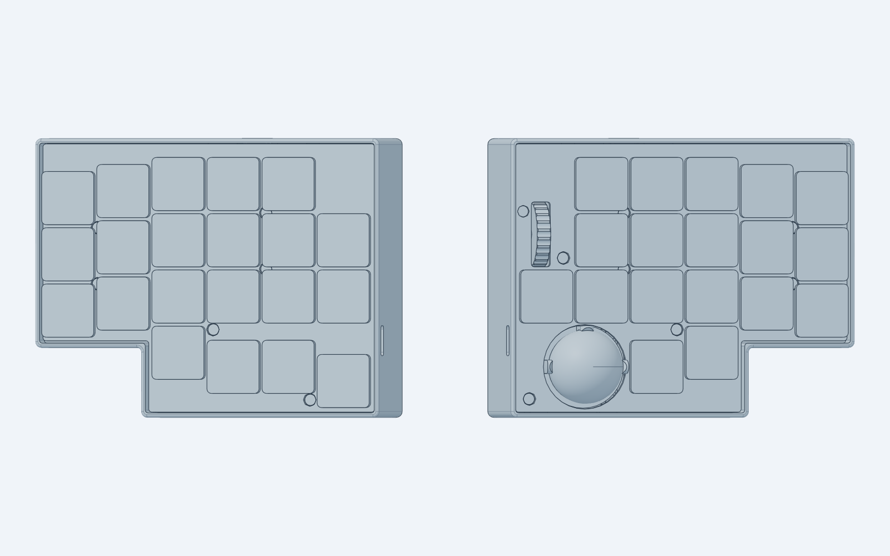
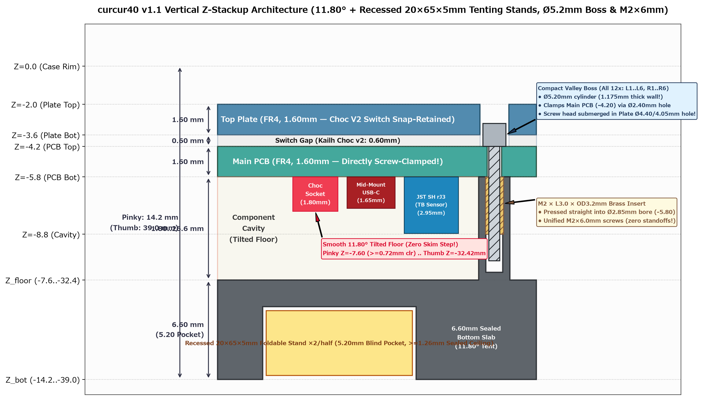

# curcur40 ビルドガイド・部品調達・発注ガイド (`buildguide_jp.md`)

本書は **curcur40** を 1台製作するための **購入部材リスト（BOM・購入先 URL）**、**JLCPCB / JLC3DP / JLCCNC への発注手順と実戦ノウハウ**、および **組み立て・ファームウェア書き込み手順** をまとめた総合ガイドです。


### 3D 組み立てアニメーション（全体フロー）

[](./assets/assembly_animation.mp4)

> トラックボール・慣性ホイールのサブ組立から、ケース・基板・トッププレート・スイッチ・キーキャップの積み上げまでを通しで確認できます（クリックで 1080p 60fps 動画 [`docs/assets/assembly_animation.mp4`](./assets/assembly_animation.mp4) を再生します）。

| 上面ビュー（トッププレート・キー配列・ホイールスロット） | 底面ビュー（100% 密閉・折りたたみスタンドポケット付き底面） |
| :---: | :---: |
|  |  |

---

## 目次

- **[Step 1: 資材一覧・発注手順・実発注ノウハウ](#step-1-資材一覧発注手順実発注ノウハウ)**
  - [1-1. 調達の全体像（4ルート）](#1-1-調達の全体像4ルート)
  - [1-2. JLCPCB 発注ガイド（基板・PCBA・トッププレート）](#1-2-jlcpcb-発注ガイド基板pcbaトッププレート)
  - [1-3. JLC3DP 発注ガイド（3Dプリント造形：必須 6種 ＋ 任意 2種）](#1-3-jlc3dp-発注ガイド3dプリント造形必須-6種--任意-2種)
  - [1-4. JLCCNC 発注ガイド（一体軸スチールホイール切削：1個）](#1-4-jlccnc-発注ガイド一体軸スチールホイール切削1個)
  - [1-5. 市販購入パーツ一覧（BOM・型番・購入先リンク）](#1-5-市販購入パーツ一覧bom型番購入先リンク)
  - [1-6. 発注前チェックリスト](#1-6-発注前チェックリスト)
- **[Step 2: 組み立て・はんだ付け・ファームウェア書き込み手順](#step-2-組み立てはんだ付けファームウェア書き込み手順)**
  - [2-1. 必要な工具とサイズ条件](#2-1-必要な工具とサイズ条件)
  - [2-2. Phase 1: ファームウェアのビルドと書き込み](#2-2-phase-1-ファームウェアのビルドと書き込み)
  - [2-3. Phase 2: 真鍮ヒートセットインサートの熱圧入（計19箇所）](#2-3-phase-2-真鍮ヒートセットインサートの熱圧入計19箇所)
  - [2-4. Phase 3: 手ハンダ作業（2箇所）＆ トラックボールカップ準備](#2-4-phase-3-手ハンダ作業2箇所-トラックボールカップ準備)
  - [2-5. Phase 4: アンダープレート慣性ホイールの組み立て](#2-5-phase-4-アンダープレート慣性ホイールの組み立て)
  - [2-6. Phase 5: ケースへの統合締結（M2×6.0mm ネジ統一）](#2-6-phase-5-ケースへの統合締結m260mm-ネジ統一)
  - [2-7. Phase 6: 動作確認・キーマップ設定（Vial / VIA）](#2-7-phase-6-動作確認キーマップ設定vial--via)
  - [2-8. トラブルシューティング](#2-8-トラブルシューティング)
  - [2-9. 【オプション】持ち運び用キャリングボックスの使い方](#2-9-オプション持ち運び用キャリングボックスの使い方)

---

# Step 1: 資材一覧・発注手順・実発注ノウハウ

## 1-1. 調達の全体像（4ルート）

1. **JLCPCB（基板製造 ＋ PCBA 実装）**:
   - 左メイン基板・右メイン基板・TBセンサーサブ基板の 3枚を 1枠にまとめた **3-in-1 統合 PCBA パネル（1種）** と **FR-4 トッププレート（左右 2種）** の計 3アイテムを発注します（すべて標準板厚 `1.6 mm`）。
   - RP2040、Flash、Choc ソケット、RGB LED、USB-C、JST SH コネクタ、および慣性ホイール用 3Dホールセンサー `rU6`（`TMAG5273`）まで裏面（`Bottom Side`）に一括自動実装されて届きます。
2. **JLC3DP（3Dプリント造形：必須 6種 ＋ 任意 2種）**:
   - 左右ボトムケース、トラックボールカップ、慣性ホイール樹脂パーツ 3種を造形します（JLC3DP と JLCCNC は JLCPCB と共通アカウントで利用可能）。
3. **JLCCNC（CNC 金属切削：1個）**:
   - 1ピース一体軸 `45# Steel` フライホイール（`Blackening` 黒染め仕上げ）を、同梱の同名 2D 公差図面 PDF とセットで発注します。
4. **市販購入パーツ（通販）**:
   - キースイッチ・キーキャップ、25 mm 球、セラミック支持球、PMW3360＋レンズ、JST SH ケーブル、ベアリング 2個、磁石 2個、静音スイッチ 1個、真鍮インサート 19個、統一 `M2 × 6.0 mm` ネジ 19本を揃えます（スペーサー、シムリング、平行ピン、接着剤は一切不要です）。手ハンダ作業も `rEXSW1`（2ピン）と `PMW3360`（16ピン）の 2部品のみです。

---

## 1-2. JLCPCB 発注ガイド（基板・PCBA・トッププレート）

JLCPCB（[https://jlcpcb.com/](https://jlcpcb.com/)）にて、以下の **★①〜③ の計 3アイテム** をカートに入れて発注します（単体基板ごとに分割発注したい場合のみ ④〜⑥ を使用）。

### 発注ファイル一覧

| 対象 | 発注種別 | 最小発注数 | ガーバー (ZIP) | BOM (部品表 CSV) | CPL (座標 CSV) |
| :--- | :---: | :---: | :--- | :--- | :--- |
| **★① 3-in-1 統合パネル（推奨）**<br>(`curcur40-panel-3in1`) | **PCB + PCBA**<br>(`Bottom Side` / `1.6 mm`) | 5枚<br>(PCBAは2枚〜) | [GERBER-curcur40-panel-3in1.zip](../pcbs/panel/jlcpcb/production_files/GERBER-curcur40-panel-3in1.zip) | [BOM-curcur40-panel-3in1.csv](../pcbs/panel/jlcpcb/production_files/BOM-curcur40-panel-3in1.csv) | [CPL-curcur40-panel-3in1.csv](../pcbs/panel/jlcpcb/production_files/CPL-curcur40-panel-3in1.csv) |
| **★② 左トッププレート**<br>(`plate-top-left`) | **PCB のみ**<br>(`1.6 mm`) | 5枚 | [GERBER-plate-top-left.zip](../plates/pcb/jlcpcb/production_files/GERBER-plate-top-left.zip) | 不要 | 不要 |
| **★③ 右トッププレート**<br>(`plate-top-right`) | **PCB のみ**<br>(`1.6 mm`) | 5枚 | [GERBER-plate-top-right.zip](../plates/pcb/jlcpcb/production_files/GERBER-plate-top-right.zip) | 不要 | 不要 |
| *(単体参考)* ④ 左メイン基板 | PCB + PCBA | 5枚 | [GERBER-curcur40-left.zip](../pcbs/left/jlcpcb/production_files/GERBER-curcur40-left.zip) | [BOM-curcur40-left.csv](../pcbs/left/jlcpcb/production_files/BOM-curcur40-left.csv) | [CPL-curcur40-left.csv](../pcbs/left/jlcpcb/production_files/CPL-curcur40-left.csv) |
| *(単体参考)* ⑤ 右メイン基板 | PCB + PCBA | 5枚 | [GERBER-curcur40-right.zip](../pcbs/right/jlcpcb/production_files/GERBER-curcur40-right.zip) | [BOM-curcur40-right.csv](../pcbs/right/jlcpcb/production_files/BOM-curcur40-right.csv) | [CPL-curcur40-right.csv](../pcbs/right/jlcpcb/production_files/CPL-curcur40-right.csv) |
| *(単体参考)* ⑥ TBセンサー基板 | PCB + PCBA | 5枚 | [GERBER-curcur40-pmw3360.zip](../pcbs/pmw3360/jlcpcb/production_files/GERBER-curcur40-pmw3360.zip) | [BOM-curcur40-pmw3360.csv](../pcbs/pmw3360/jlcpcb/production_files/BOM-curcur40-pmw3360.csv) | [CPL-curcur40-pmw3360.csv](../pcbs/pmw3360/jlcpcb/production_files/CPL-curcur40-pmw3360.csv) |

> アクリルやスイッチフォームを自作レーザーカットする場合は [`plate-curcur40.svg`](../plates/svg/plate-curcur40.svg) / [`foam-curcur40.svg`](../plates/svg/foam-curcur40.svg) を利用できます。

### 実発注画面でのオプション指定と注意点（実戦ノウハウ）

1. **★① 3-in-1 統合パネル (`GERBER-curcur40-panel-3in1.zip`) の設定**:
   - **Base Material / Layers / PCB Thickness**: `FR-4` / `2` / **`1.6mm`**
   - **Different Design / Delivery Format**: **`Different Design: 3`** / **`Single PCB`**
     - *ノウハウ*: パネル内にマウスバイトで区切られた 3種類の基板（Left・Right・PMW3360）が入っているため、`Different Design: 1` のまま決済すると CAM 審査時に異種面付け差額（約 25 USD）の追加支払い待ちで一時停止します。最初から `3` を選んでおくとスムーズに製造へ進みます。
   - **PCB Color / Surface Finish**: お好みの色（`Black` 等）、表面処理は手ハンダ箇所にはんだが乗りやすい **`LeadFree HASL`** または **`HASL(with lead)`** 推奨（`OSP` は酸化しやすいため避けてください）。
   - **PCBA Type / Assembly Side**: **`Standard`** / **`Bottom Side`**（PCBA Qty は `2`〜選択可）
     - *ノウハウ*: `SK6812MINI-E`（`C5149201`）と `TYPE-C-31-M-13C`（`C2848620`）が JLCPCB 側で `[Standard Only]` 指定となっているため、`Economic` ではなく **`Standard`** を選択してください（`Economic` のまま進むと BOM 画面で多くの行が未選択になります）。
   - **Edge Rails/Fiducials**: **`Added by Customer`**
     - *ノウハウ*: パネルのガーバー自体に `5.00 mm` 外周捨て基板レール・フィデューシャル（`FID1`〜`FID3`）・ツール穴（`TH1`〜`TH4`）が組み込み済みです。`Added by JLCPCB` にすると外側に二重レールが追加されてしまうため `Added by Customer` を選びます。
   - **Confirm Parts Placement**: **`Yes` 推奨**（工場エンジニアが最終補正した配置図を製造前に確認できます）。
2. **BOM 画面・DFM プレビュー・カート投入時のポイント**:
   - **Choc ソケット（`C5333465`）が在庫不足（shortfall）になった場合**: 人気部品のため一時的に在庫切れになることがあります。虫眼鏡アイコンで互換在庫がなければ、その行だけチェックを外して発注し、別途購入した Choc ソケットを手ハンダ（大きな 2ピンパッドなので簡単です）するか、Parts Manager で事前取り寄せ（Pre-order）してください。
   - **意図的に未実装（空パッド）で正常な箇所**: 手ハンダ対象の `rEXSW1`（2ピン）と `pU1`（`PMW3360` 16ピン）、銅箔直結済みの `pJP1`、および DNP の `J4` / `rJ4` / `pR4` / `pC5` は空のままで正常です。
   - **プレビュー上の部品向き・USB-C 位置**:
     - `rU6`（`TMAG5273`）、`U3`/`U5`/`rU3`/`rU5`（`USBLC6-2SC6`）、`rJ3`・`pJ1`（JST SH 6P、白いスリット差込口が切り欠き側を向くこと）、RGB LED の 1番ピン向きを確認します。
     - ミッドマウント USB-C（`J1`, `J2`, `rJ1`, `rJ2`）は CPL 座標をシールドピン中心へ正規化済みです。JLCPCB ビューアの 3Dモデル原点差でわずかにズレて見えることがありますが、4本のシールド足と 12本の SMD ピン列が合っていれば正常です。
   - **`Baking Required` ダイアログ**: カート追加時に `SK6812MINI-E`（吸湿レベル MSL 5 以上）の乾燥工程（約 7.94 USD）の確認ダイアログが出ます。リフロー時の LED 破損を防ぐ必須工程なので、そのまま **`Confirm`** を押して進めます。
3. **★②・③ 左右トッププレート (`GERBER-plate-top-left.zip` / `right.zip`) の設定**:
   - **Layers / Thickness / Color**: `2` / **`1.6mm`** / お好みの色（`Black` 等）、`PCB Assembly` は **OFF**。
   - **Mark on PCB**: 表面に製造番号が入らないよう **`Remove Mark`（注文番号削除）** 推奨。
   - *ノウハウ*: 裏面にレジスト被覆された極小 `B.Cu` マーカーと `B.SilkS` ラベルを入れてあるため、アップロード時に外形サイズ `114.85 × 90.95 mm` が自動認識されます。必要に応じて `PCB Remark` に `Switch plate only — bare FR-4 plate as intended.` と添えるとより確実です。

---

## 1-3. JLC3DP 発注ガイド（3Dプリント造形：必須 6種 ＋ 任意 2種）

JLC3DP（[https://jlc3dp.com/](https://jlc3dp.com/)）にて、以下の STEP ファイルをアップロードして発注します。

| 区分 | 対象パーツ | 数量 | アップロードファイル | 推奨 3D Technology / Material / 設定 |
| :---: | :--- | :---: | :--- | :--- |
| 必須① | **左手ボトムケース** | **1個** | [left-desk.step](../cases/left-desk.step) | **白無塗装**: `SLS(Nylon)` → **`3301PA Nylon`** (`White` / `Thread: No`)※1<br>**黒・グレー系**: `MJF(Nylon)` → **`PA12-HP Nylon`** (`Black` or `Natural Gray`) |
| 必須② | **右手ボトムケース** | **1個** | [right-desk.step](../cases/right-desk.step) | 同上（インサート熱圧入のため熱可塑性ナイロン必須・**SLAレジン不可**） |
| 必須③ | **25mm トラックボールカップ** | **1個** | [trackball-cup.step](../cases/trackball-cup.step) | **靭性重視**: `MJF(Nylon)` (`PA12-HP`) または `SLS(Nylon)` (`3301PA`)<br>**滑らかさ・低価格**: `SLA(Resin)` → `Imagine Black` (**`Surface Finish: No`** 必須※2) |
| 必須④ | **`#02` ホイール用マグネットホルダー** | **1個** | [magnet-holder.step](../cases/inertia_wheel/magnet-holder.step) | `MJF(Nylon)` → **`PA12-HP Nylon`** (`Natural Gray` or `Black`)<br>または `SLS(Nylon)` → **`3301PA Nylon`**（`Surface Finish: No` / `Thread: No`） |
| 必須⑤ | **`#03` ホイール用シーソーロッカー** | **1個** | [wheel-rocker.step](../cases/inertia_wheel/wheel-rocker.step) | 同上（熱圧入＋Cクリップ弾性のため **PA12 必須・SLA不可**） |
| 必須⑥ | **`#04` ホイール用クレードル** | **1個** | [wheel-cradle.step](../cases/inertia_wheel/wheel-cradle.step) | 同上（熱圧入＋Cクリップヒンジ弾性のため **PA12 必須・SLA不可**） |
| 任意⑦ | **キャリングボックス本体** | 1個 | [carrying-box.step](../cases/carrying-box.step) | `SLS(Nylon)` (`3301PA`) または `MJF(Nylon)` (`PA12-HP`) |
| 任意⑧ | **キャリングボックス用フタ** | 1個 | [carrying-box-lid.step](../cases/carrying-box-lid.step) | 同上（スナップ爪の弾性のため **PA12 必須**） |

### JLC3DP 実発注ノウハウ・注意点
- **※1 白ケースの素材選び**: 現行 JLC3DP では `3201PA-F` は `GrayishBlack` のみとなっています。塗装剥がれのない「白い無塗装ナイロン」で、かつ真鍮インサートの熱圧入をしっかり行いたい場合は **`SLS(Nylon)` → `3301PA Nylon`（Color: White）** が靭性・圧入性ともに最も扱いやすくおすすめです（より硬質な剛性を求める場合は `1172Pro Nylon` も可。ガラスビーズ入りの `3401GB` や熱硬化性の `SLA(Resin)` は熱圧入できないためケース・ホイール部品には使わないでください）。
- **※2 カップを SLA（`Imagine Black`）で頼む場合**: カップにはインサート熱圧入がないため安価な SLA レジンでも造形できますが、**`Surface Finish` は必ず `No`（研磨なし）** にしてください（`General Sanding` を選ぶと内側の `⌀2.0 mm` 支持球ポケットが削れて緩くなったり研磨粉が残る恐れがあります。またレジンは PA12 より粘りが低いため、ボール着脱時に斜めへ無理にこじらないよう扱ってください）。
- **`< 0.8mm wall thickness detected` 警告が出た場合**: `trackball-cup.step`（爪先端の面取りエッジ・支持球リップ）および `wheel-rocker.step`（Cクリップ開口や穴フチの鋭角交差エッジ）で自動メッシュチェッカーの `< 0.8mm` 警告が表示されますが、構造壁厚はすべて基準以上（`≥ 1.20 mm`）確保されています。そのままリスク承諾（`Accept` / `Proceed`）で進めて問題ありません。

---

## 1-4. JLCCNC 発注ガイド（一体軸スチールホイール切削：1個）

JLCCNC（[https://jlccnc.com/](https://jlccnc.com/)）にて、以下の **STEP ファイルと同名 2D 公差図面 PDF の 2点** をアップロードします。

- **3D モデル**: [`cases/inertia_wheel/steel-flywheel.step`](../cases/inertia_wheel/steel-flywheel.step)（数量: **1個**）
- **2D 公差図面**: [`cases/inertia_wheel/steel-flywheel.pdf`](../cases/inertia_wheel/steel-flywheel.pdf)（`Tightest Tolerance` 下の `+ Upload Drawing` に添付）

### JLCCNC 実発注画面での指定項目（重要）
- **Material / Type of Steel Alloy**: `Steel Alloy` → **`45# Steel`**（外周 24溝で磁気デテントを発生させるため強磁性炭素鋼が必須です。非磁性のアルミや `SUS304` は不可）
- **Surface Finish**: `Yes` → **`Blackening`**（黒染め：膜厚 `≤ 2 µm` のためめっき太りせず防錆できます）
- **Tightest Tolerance ＆ CNC Remark（★最重要）**:
  - 画面上の選択肢は上限の **`±0.05mm`** を選択し、`+ Upload Drawing` に **`steel-flywheel.pdf`** をアップロードします。
  - そのままだと軸径が `+0.05 mm` 振れた際にベアリング（内径 `2.00 mm`）へ入らなくなる恐れがあるため、**`CNC Remark` 欄に以下を必ずコピー＆ペースト**してください：
    > `Please follow the shaft tolerance Ø1.97 ±0.02 mm specified in steel-flywheel.pdf (needs to fit into a 2.00 mm ID bearing).`
- **Appearance / Threads / Sub-assembly**: `Standard` / `No` / `No`
- **Product Desc（通関用分類）**: `Shaft Category` → **`Carbon steel Rotating Solid Shaft - HS Code 732690`**


---

## 1-5. 市販購入パーツ一覧（BOM・型番・購入先リンク）

### ① 共通ファスナ・ケーブル・外装部材

| 品名・推奨規格 | 必要数 | 仕様・選定の注意点 | 主な購入先リンク |
| :--- | :---: | :--- | :--- |
| **真鍮ヒートセットインサート**<br>(`M2 × L3.0 × OD3.0mm` 推奨 / `OD3.2mm` 可) | **19個** | ネジ径 `M2`・長さ `3.0 mm`・**外径 `OD 3.0 mm`（流通が多く入手容易、下穴 `⌀2.85 mm` に対して安全に圧入可能）** または `OD 3.2 mm`。<br>※内訳：左ケース 6 ＋ 右ケース 10 ＋ クレードル 2 ＋ ロッカー南 1。<br>⚠️ **`OD 3.5 mm` は不可**: 下穴 `⌀2.85 mm` に対して食い込み過多となり、肉厚 `1.03 〜 1.18 mm` のボスが割れる恐れがあります。 | Amazon / AliExpress / モノタロウ（「`インサートナット M2 3mm 3.0mm`」等で検索） |
| **統一 `M2 × 6.0 mm` 精密なべ小ねじ**<br>（★鉄・鋼製 / 頭径 `⌀3.5 mm` 推奨） | **19本** | 全 19箇所すべて同一サイズ。<br>⚠️ **頭径注意**: 右プレート `WC1` 逃げ穴（`⌀4.05 mm`）に擦れないよう、標準の **JIS M2 なべ小ねじ（頭径 `⌀3.5 mm`、最大 `≤ ⌀3.8 mm`）** を選んでください（頭径 `⌀4.0 mm` の幅広超低頭ネジは非推奨）。<br>⚠️ **材質注意**: ホイール南ボスのデテント磁石を先端へ磁力吸着させるため、磁石がつく **鉄製（ニッケルメッキ・三価クロメート・黒染め等）** を選んでください（非磁性の SUS304 ステンレスは磁石がつきません）。 | モノタロウ / Amazon / 秋月電子 / 遊舎工房 |
| **Kailh Choc V2 キースイッチ (`CPG1353`)** | **39個** | 左 21個 ＋ 右 18個（予備込み 40個パック推奨）。 | 遊舎工房 / Talp Keyboard / AliExpress |
| **Choc V2 対応 ロープロファイル 1u キーキャップ** | **39個** | MX 十字ステム対応のロープロファイル 1u キャップ（外寸 `18.5 × 18.5 mm` 以下 ※背の高い通常 Cherry/OEM プロファイルは干渉するため不可）。 | 遊舎工房 / Booth / AliExpress |
| **貼り付け式ゴム足** | **4〜8個** | 直径 `6〜8 mm`、高さ **`1.5〜3.0 mm`**（`carrying-box` のレール掘り込みは `4.0 mm` あるため、高さ `3.0 mm` ゴム足でも干渉せず収納可能）。 | Amazon / ホームセンター |
| **左右間 USB 2.0 Type-C to C ケーブル** | **1本** | `D+` データ線結線あり・E-Marker 非搭載の柔らかいパッシブケーブル（15〜30 cm L字推奨）。 | Amazon / 遊舎工房 |
| **PC接続用 USB Type-C ケーブル** | **1本** | データ通信対応ケーブル。 | Amazon / 家電量販店 |
| **（任意）折りたたみテンティングスタンド**<br>(`20 × 65 × 5 mm`) | **4個**<br>(2個組×2) | ミニ亜鉛合金折りたたみスタンド（幅 `20 × 長さ 65 × 厚さ 5.0 mm`、両面テープ付）。ケース底面ポケットへツライチ収納し、展開時 約 `24° / 34°` に切替可能。 | Amazon / AliExpress（「`ノートパソコン スタンド 折りたたみ ミニ 6.5cm 2cm 0.5cm`」等） |

### ② 右手 アンダープレート慣性ホイール市販部材（4品目）

| 呼称・品名 | 必要数 | 型番・仕様・注意点 | 購入先リンク |
| :--- | :---: | :--- | :--- |
| **`#06` 静音ミドルクリックスイッチ (`rEXSW1`)** | **1個** | **`Kailh Square Silent Micro Switch`**（`6.2 × 6.2 × 4.3 mm`、2ピン角形静音スイッチ Red Dot）。右メイン基板 `B.Cu` へ手ハンダ実装。 | [Amazon (`B0FF9Y9DB8`)](https://www.amazon.co.jp/dp/B0FF9Y9DB8) / 遊舎工房 / AliExpress |
| **`#07` ミニチュアベアリング（★要脱脂）** | **2個** | NMB（ミネベアミツミ）**`DDL-520ZZ`**（内径 `⌀2.0 × 外径 ⌀5.0 × 幅 2.3 mm`、両側鋼板シールド・ステンレス）。組込前にパーツクリーナーで内部グリスを脱脂洗浄します。 | [モノタロウ（注文コード `09538365`）](https://www.monotaro.com/p/0953/8365/) |
| **`#08` 角度検出用ネオジム磁石**<br>（★径方向2極着磁 必須） | **1個** | 直径 **`⌀4.0 × 厚さ 1.0 mm` (`D4×1mm`) 円盤型・径方向2極着磁（Diametric）**。<br>⚠️ **重要**: 一般的な厚み方向着磁では回転角を検出できません。購入ページが在庫切れ・変更されることがあるため、注文時に必ず **「`4x1mm`」かつ「`Diametric / Radial`（円盤の左右に N/S が分かれた径方向着磁）」** であることを確認してください。 | [AliExpress 参考リンク](https://ja.aliexpress.com/item/1005010201889003.html)（リンク切れ時は `4x1mm diametric magnet` で検索） |
| **`#09` デテント調整用ネオジム磁石**<br>（通常の軸方向着磁） | **1個** | 二六製作所 **`NE280`**（丸型ネオジム **`⌀2.0 × 2.0 mm`**, N52, Niメッキ, 厚み方向着磁）または同寸円柱ネオジム磁石。鉄製ネジ先端へ磁力で自己吸着します。 | [二六製作所 `NE280`](https://www.26magnet.co.jp/26shop/goods/NE280) / Amazon / AliExpress |

### ③ 右手 25mm トラックボール関連部材（4品目）

| 品名 | 必要数 | 型番・仕様・注意点 | 購入先リンク |
| :--- | :---: | :--- | :--- |
| **25mm 交換用トラックボール球** | **1個** | エレコム **`M-B25SV`**（シルバー艶あり、実機検証済）または Perixx **`PERIPRO-303`**（25 mm 各色）。 | [エレコム公式 `M-B25SV`](https://www.elecom.co.jp/products/M-B25SV.html) / Amazon |
| **`⌀2.0 mm` セラミック支持球** | **3個** | `ZrO2`（酸化ジルコニウム）または `Si3N4`（窒化ケイ素）G5 等級 `⌀2.00 mm` 精密球。カップ内壁 3箇所へスナップ圧入。 | Amazon / モノタロウ / AliExpress |
| **光学センサー ＋ 純正レンズセット** | **1組** | PixArt **`PMW3360DM-T2QU`** ＋ **`LM19-LSI`** レンズ（公式データシート: [PixArt 製品ページ](https://www.pixart.com/products-detail/10/PMW3360DM-T2QU)）。 | AliExpress / 遊舎工房 / Booth |
| **JST SH 1.0mm 6ピン両端ハーネス** | **1本** | 長さ **`100 mm`**、`SHR-06V-S-B` ハウジング・**両端同方向フラット結線（`1-6` 結線）**。<br>⚠️ **結線向き注意**: 両端でコネクタのツメが同じ面を向いている **同方向（Same-Side / `1-6`）品** を選んでください（`1-1` リバース品は電源と GND が逆転するため使用不可）。 | [スイッチサイエンス `#9142`（Pimoroni 100mm）](https://www.switch-science.com/products/9142?variant=42749692149958) |

---

## 1-6. 発注前チェックリスト

- [ ] **JLCPCB**: `curcur40-panel-3in1`（`Different Design: 3` / `1.6mm` / `LeadFree HASL` / `Standard PCBA` / `Bottom Side` / `Added by Customer` / ベーキング Confirm）＋ 左右トッププレート 2種（`1.6mm` / `Remove Mark`）
- [ ] **JLC3DP**: ケース 2種（白なら `SLS 3301PA`、黒系なら `MJF PA12-HP`）＋ カップ 1個（SLA なら `Surface Finish: No`）＋ ホイール樹脂 3種（`PA12` 必須・`Surface Finish: No`）
- [ ] **JLCCNC**: `steel-flywheel.step` ＋ `steel-flywheel.pdf`（`45# Steel` / `Blackening` / `±0.05mm` ＋ `CNC Remark` で `Ø1.97 ±0.02 mm` 指定）
- [ ] **市販パーツ**: Choc V2 スイッチ 39個・ロープロ 1u キャップ 39個、`Kailh Square Silent` 1個、`DDL-520ZZ` 2個（＋パーツクリーナー）、`D4×1mm` **径方向着磁**磁石 1個、`NE280`（`⌀2×2mm`）磁石 1個、25mm球 1個、`⌀2.0mm` セラミック球 3個、`PMW3360＋LM19` 1組、JST SH 6P **同方向 100mm** ケーブル 1本、真鍮インサート（`M2×L3.0×OD3.0` or `3.2`）19個、**鉄製** JIS `M2×6.0mm` なべ小ねじ（頭径 `⌀3.5mm`）19本、ゴム足、USB-C ケーブル 2本

---

# Step 2: 組み立て・はんだ付け・ファームウェア書き込み手順

## 2-1. 必要な工具とサイズ条件


| 工具名 | 用途・サイズ条件 |
| :--- | :--- |
| **温度調節付きはんだごて（細軸推奨）** | ・真鍮インサートの熱圧入（**`220 〜 250 °C`**）<br>・`rEXSW1`（2ピン）と `PMW3360`（16ピン）のはんだ付け（**`320 〜 350 °C`**）<br>・**サイズ条件（上図①）**: 右ケース下段 `TB1`〜`TB4` ボスは深さ `20.6 mm` にあるため、**こて先先端から `21 mm` までの太さが `⌀6.0 mm` 以下**（`TS100` / `Pinecil` 等、または長めの B型・I型こて先）を使用してください。 |
| **単体の精密プラスドライバー (`#0` / `#00`)** | ・全 19箇所すべて同一の `M2 × 6.0 mm` ネジに使用します。<br>・**サイズ条件（上図②）**: トラックボールカップ横の `TB1`〜`TB4` はカップ外壁と近いため、**先端から `22 mm` までの軸径が `⌀4.5 mm` 以下（推奨 `⌀3.0 〜 3.5 mm`）の単体ドライバー** を使用してください（ビット差し替え式の太いチャックはカップ壁に当たります）。 |
| **はんだ・フラッシュニッパー・ピンセット・カプトンテープ** | スルーホールはんだ付け、基板表面に出たピン先端の平切り、小磁石・支持球の保持、JST SH ケーブル余長の仮留めに使用します。 |
| **パーツクリーナー（ブレーキクリーナー）** | `DDL-520ZZ` ベアリング 2個の内部グリス脱脂洗浄に使用します。 |

---

## 2-2. Phase 1: ファームウェアのビルドと書き込み

組み立て前に、届いた左右メイン基板単体で PC に接続してファームウェア（`.uf2`）を書き込み、認識を確認します。

### ① ファームウェア（`.uf2`）のビルド手順

[`kbd_firmware/`](../kbd_firmware/) ディレクトリの `Makefile` を使ってビルドできます（QMK ビルド環境がセットアップ済みの場合）：

```sh
cd kbd_firmware
make git-submodule

# Vial 対応ファームウェアをビルドする場合（推奨）
kb=curcur40 make vial-qmk-init
kb=curcur40 kr=rev1 km=vial make vial-qmk-compile
# -> keyboards/curcur40/vial-kb/vial-qmk/.build/curcur40_rev1_vial.uf2 が出力されます

# 標準 VIA 対応ファームウェアをビルドする場合
kb=curcur40 make qmk-init
kb=curcur40 kr=rev1 km=via make qmk-compile
# -> keyboards/curcur40/qmk/qmk_firmware/.build/curcur40_rev1_via.uf2 が出力されます
```

> Docker コンテナ（`util/docker_build.sh`）でビルドする場合は、`kbd_firmware/keyboards/curcur40/qmk/qmk_firmware/rev1/` と `vial-kb/vial-qmk/keymaps/vial/` を `vial-qmk/keyboards/curcur40/rev1/` 配下へコピーして `util/docker_build.sh curcur40/rev1:vial` を実行してください。

### ② 左右メイン基板への書き込み手順
1. **初回書き込み（基板単体時）**: 基板裏面（`B.Cu`）の **`BOOT` ボタン（`SMDSW1` / `rSMDSW1`）を押したまま**、北側の PC 接続用 USB-C ポート（`J1` / `rJ1`）を PC に繋ぎます。
2. マウントされた **`RPI-RP2`** ドライブへ `.uf2` ファイルをコピーします（左右両方の基板に同じ `.uf2` を書き込みます）。

> [!TIP]
> **ケース組み立て後のファームウェア更新は「解体不要」です（Bootmagic / `QK_BOOT`）**
> 底面密閉ケースのため組み立て後は裏面の `SMDSW1` に触れませんが、以下の方法でいつでも DFU（`RPI-RP2`）に入れます：
> 1. **Bootmagic（確実・推奨）**: USB ケーブルを抜いた状態で、**左手は左上端キー `SW18`（`[0, 1]`）、右手は右上端キー `rSW18`（`[4, 1]`）を押しっぱなしにしたまま USB を PC に挿す**。
> 2. **`QK_BOOT` キー**: Vial / VIA 上でレイヤーに配置した `Reset`（`QK_BOOT`）キーを押す。

---

## 2-3. Phase 2: 真鍮ヒートセットインサートの熱圧入（計19箇所）


はんだごてを **`220 〜 250 °C`**（`1172Pro Nylon` の場合は `240 〜 260 °C`）に設定し、3Dプリント部品の `⌀2.85 mm` 下穴（計 19箇所）へ真鍮インサートをツライチに熱圧入します。

1. **圧入箇所の内訳（計 19個）**:
   - **左手ケース (`left-desk`)**: キー谷間フラットボス **6箇所（`L1`〜`L6`）**
   - **右手ケース (`right-desk`)**: キー谷間フラットボス **6箇所（`R1`〜`R6`）** ＋ トラックボール下段ボス **4箇所（`TB1`〜`TB4`）** ＝ **計 10箇所**
   - **ホイールクレードル (`wheel-cradle`)**: 対角ボス上面 **2箇所（`WC1`, `WC2`）**
   - **ホイールロッカー (`wheel-rocker`)**: 南側ボスの水平穴の **南側入口 1箇所**
2. **綺麗に圧入するコツ**:
   - 下穴の入口にインサートを真っ直ぐ載せ、温めたコテ先を当てて自重＋軽い力で垂直に押し込みます。
   - ボス上面まで残り `0.2 mm` ほどでコテ先を抜き、すぐに平らな金属面（定規やドライバーの腹）で上から 2〜3秒軽く押さえると、ボス天面と完全に水平・ツライチに仕上がります（※万が一公差で緩い穴があった場合のみ、冷めてから外周にごく少量の瞬間接着剤を併用してください）。

---

## 2-4. Phase 3: 手ハンダ作業（2箇所）＆ トラックボールカップ準備

はんだごてを **`320 〜 350 °C`** に戻し、2つのスルーホール部品を実装します。

### ① 右メイン基板への静音スイッチ `rEXSW1` 実装
1. 右メイン基板の**裏面（`B.Cu`）**にあるホイール窓東側の `rEXSW1` ランドへ、`Kailh Square Silent` の 2ピンを差し込んで底面を密着させます。
2. **表面（`F.Cu`）**に出た 2ピンをはんだ付けします。
3. **ピン先端の平切り（重要）**: 表面 `F.Cu` とトッププレート裏面の間隔（Switch Gap）は `0.60 mm` です。プレート裏面に触れないよう、フラッシュニッパーで飛び出しピンを **`0.4 mm` 以下** に平切りしてください。

### ② TBセンサーサブ基板への `PMW3360` ＆ `LM19-LSI` 実装


1. `JP1` は基板内銅箔で直結済み、`R4` / `C5` は未実装（DNP）のため作業不要です。
2. センサーサブ基板の**裏面（`B.Cu`）**から `PMW3360DM-T2QU`（`U1`）を差し込み（1番ピン＝四角ランド）、**表面（`F.Cu`）**で 16ピンをはんだ付けした後、レンズと干渉しないようピン先端を短く切り揃えます。
3. センサー窓の保護テープを剥がし、**表面（`F.Cu`）**から `LM19-LSI` レンズの 4本の脚を角穴へ通して奥まで差し込みます。

### ③ トラックボールカップへの `⌀2.0 mm` セラミック支持球（3個）圧入
- `trackball-cup` 内壁 3箇所のディンプル（入口 `⌀1.95 mm`）へ、`⌀2.0 mm` セラミック球を 1個ずつ「パチン」と奥まで押し込みます。

---

## 2-5. Phase 4: アンダープレート慣性ホイールの組み立て

> 機構の動作イメージは、ブラウザで動かせる **[体験型インタラクティブ図解 (`docs/wheel_mechanism_guide.html`)](./wheel_mechanism_guide.html)** もあわせてご覧ください。


1. **`DDL-520ZZ` ベアリング（2個）の脱脂洗浄**:
   - 小瓶等にベアリング 2個を入れ、パーツクリーナーを吹きかけて振り洗いし、内部の防錆グリスを洗い流します。乾燥後、指で弾いて軽く空転することを確認します。
2. **ローターの組み立て（工具・接着剤・シム不要）**:
   - `#01` `steel-flywheel` の左右軸に、脱脂した `DDL-520ZZ` を 1個ずつ段付き肩（`⌀3.00 mm`）に当たるまで差し込みます。
   - 東側の Dカット軸先端に `#02` `magnet-holder` の西側 D穴を押し込み、東側の丸ポケットに **`#08` `D4×1mm` 径方向2極着磁磁石** を入れます。
3. **ロッカーとクレードルのスナップ連結 ＆ ノッチ強弱の事前調整**:
   - `#03` `wheel-rocker` の左右 Cクリップ軸受座へ、ベアリング付きホイールを上から「パチン」と押し込みます。
   - 南開放 U字の `#04` `wheel-cradle` の左右 Cクリップヒンジ座へ、`#03` ロッカー東側の支点軸を真上から降ろして「パチン」と連結します。
   - **鉄製の `M2 × 6.0 mm` ネジ 1本** をロッカー南ボスのインサートへねじ込み、上面の開放トラフから **`#09` `⌀2.0×2.0 mm` 磁石（`NE280`）** を落としてネジ先端へ自己吸着させます。
   - **基板固定前のこの状態で** ホイールを弾きながら南のネジを回し、好みの感触（浅く戻せば長時間フリースピン、深く締めれば明快な 24ノッチ感）に調整しておきます。

---

## 2-6. Phase 5: ケースへの統合締結（M2×6.0mm ネジ統一）



1. **右メイン基板裏面へのホイールユニット固定（`WC1`, `WC2`）**:
   - 右メイン基板裏面の十字窓へホイールユニットを合わせ、基板表側（`F.Cu`）から **`M2 × 6.0 mm` ネジ 2本** で `WC1`, `WC2` を締結します。空転・静音中クリック（`rEXSW1`）・ノッチ感触をここで確認します。
2. **トッププレートとキースイッチの装着**:
   - 左右トッププレートとメイン基板を合わせ、39個の Kailh Choc V2 スイッチ（左21・右18）を差し込みます。
3. **右手トラックボール部の固定（`TB1`〜`TB4`）**:
   - 先に TBセンサー基板の `J1` へ **`100 mm` JST SH 6P 同方向ケーブル** の片端を挿してから、センサー基板と `trackball-cup` を右ケース下段ボスに載せ、細軸ドライバーで上から **`M2 × 6.0 mm` ネジ 4本** で共締めします。
4. **メイン基板＋プレートの着地とキー谷間 12箇所の固定（`L1`〜`L6`, `R1`〜`R6`）**:
   - 右手では JST SH ケーブルの反対端を右メイン基板裏面の `rJ3` へ挿し、**余長ループが回転ホイールに触れないよう南東側（`rSW8` / `rSW9` 下の空間）へ寄せてカプトンテープ等で軽く留めます**。
   - 北側・内側の USB-C 2箇所の角を少し斜めに先へ潜り込ませてから全体を水平にケースへ降ろし、プレートの頭逃げ穴から **`M2 × 6.0 mm` ネジ 12本**（左右各 6本）で締結します。
5. **仕上げ（キーキャップ・ボール・スタンド・ゴム足）**:
   - 39個のロープロファイル 1u キーキャップと 25 mm ボールを装着します。
   - 底面ポケットへ `20 × 65 × 5 mm` 折りたたみスタンドを貼る場合は、**開く足先を親指内側（爪掛け凹み側）へ、ヒンジを中央（小指寄り）へ向けて**貼り付け、最後にゴム足を貼って完成です。

---

## 2-7. Phase 6: 動作確認・キーマップ設定（Vial / VIA）

1. **接続順序**: 先に内側の左右間ポート（`J2` ⇔ `rJ2`）をパッシブ USB-C ケーブルで繋いでから、北側の PC 接続ポート（`J1` または `rJ1`）を PC に接続します。
2. **入力・ポインティング確認**: [Vial Web (https://vial.rocks/)](https://vial.rocks/) 等で全 39キー＋ホイール中クリック（`[4, 6]`）、慣性ホイールの縦スクロール（`WHL_HRZ` 押下時は横スクロール）、および 25 mm トラックボールのカーソル移動／2D 慣性スクロール（Layer 3 または `SCRL_MO` / `SCRL_TG` / `SCRL_SL`）を確認します。

---

## 2-8. トラブルシューティング

| 症状 | 主な原因と対処方法 |
| :--- | :--- |
| **片側が反応しない** | 両基板に `.uf2` を書き込んだか、PCケーブルが北側 `J1`/`rJ1` に、左右間ケーブル（パッシブ USB 2.0 C-to-C）が内側 `J2`⇔`rJ2` に挿さっているか確認してください。 |
| **ホイールのスクロールが反応しない** | `#02` に入れた `#08` `D4×1mm` 磁石が **径方向2極着磁（Diametric）** 品か確認してください（厚み方向着磁では角度変化を検出できません）。 |
| **ホイールのクリックが固い／戻らない** | `rEXSW1` の表面 `F.Cu` 側に出た 2ピン先端がプレート裏面に当たっていないか（`≤ 0.4 mm` に平切りされているか）、`WC1`/`WC2` ネジが密着締結されているか確認してください。 |
| **ホイールの空転が短い／ノッチが強すぎる** | ① `DDL-520ZZ` のグリス脱脂が十分か確認してください。<br>② 右メイン基板を一旦外し、ロッカー南ボスの `M2×6.0mm` 調整ネジを少し緩めて磁石ギャップを広げてください。 |
| **トラックボールが動かない** | `PMW3360` 光学窓の保護テープ剥がし忘れ、`LM19-LSI` レンズの浮き、表面 16ピンの足切り、および JST SH ケーブルが **両端同方向（`1-6` 結線）** であるか確認してください。 |

---

## 2-9. 【オプション】持ち運び用キャリングボックスの使い方

`PA12` 製の上下リバーシブル直方体スライドボックス（[`carrying-box.step`](../cases/carrying-box.step) ＋ [`carrying-box-lid.step`](../cases/carrying-box-lid.step)）を使うと、**USB-C マグネット端子 4個・折りたたみスタンド 4本・25 mm 球・高さ `≤ 3.0 mm` ゴム足をすべて付けたまま** 6面フルカバー（外寸 `140.2 × 110.4 × 80.2 mm`）で持ち運べます（開閉機構の体験型図解: **[`docs/carrying_box_lid_guide.html`](./carrying_box_lid_guide.html)**）。

| フタ装着フルカバー収納 | フタ取り外し・スライド挿入時 |
| :---: | :---: |
|  |  |

1. **収納**: 左右のキーボードをキー面が内側で向かい合うように互い違いに重ね（`11.80°` 傾斜が相殺されて平行になる向き）、箱・フタの上下向きを気にせず中央隔壁に沿って奥のストッパーまで差し込み、フタを「カチッ」と押し込みます。
2. **取り出し**: フタ左右の指掛け溝をつまんで手前へ真っ直ぐ引くだけ（約 `1.0 kgf`）でロックが外れ、中央の指掛け切り欠きから本体を引き出せます。
