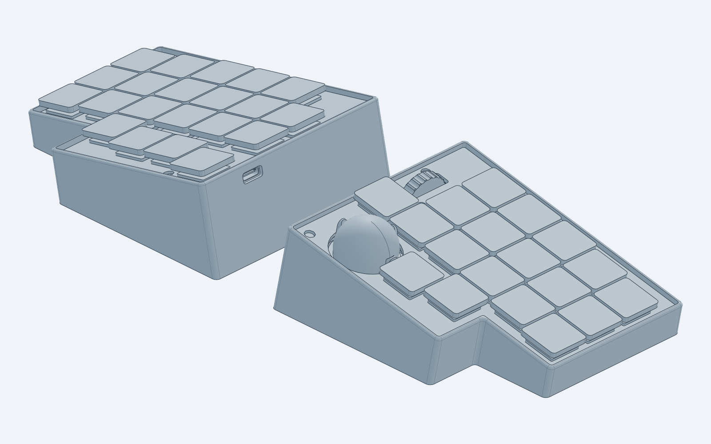
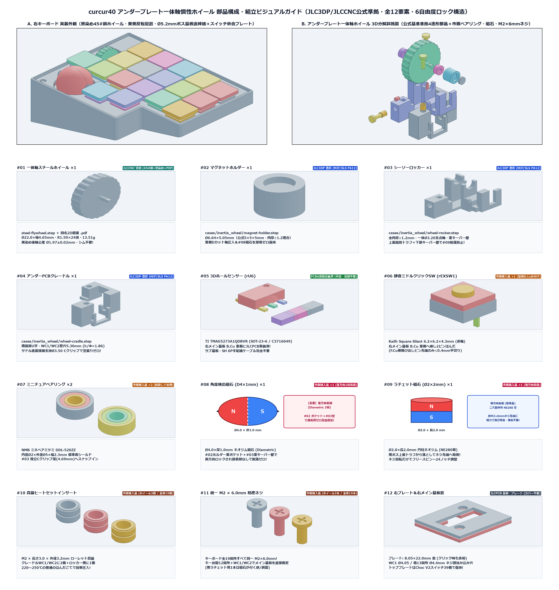
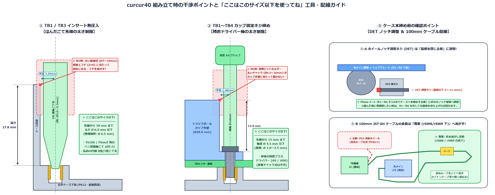
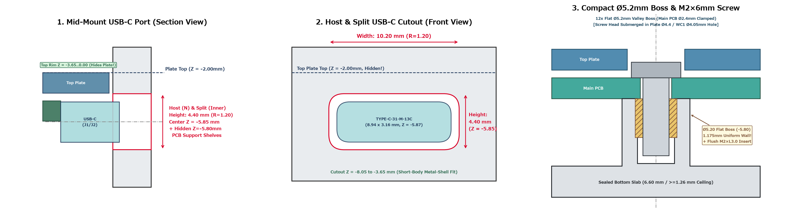
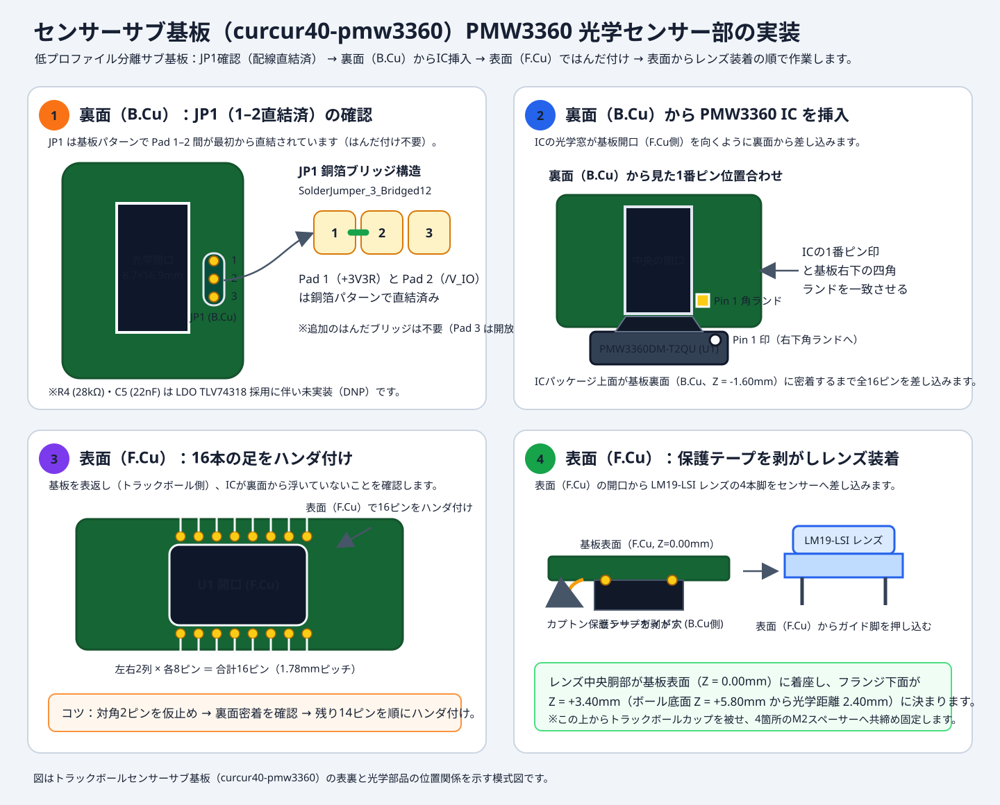
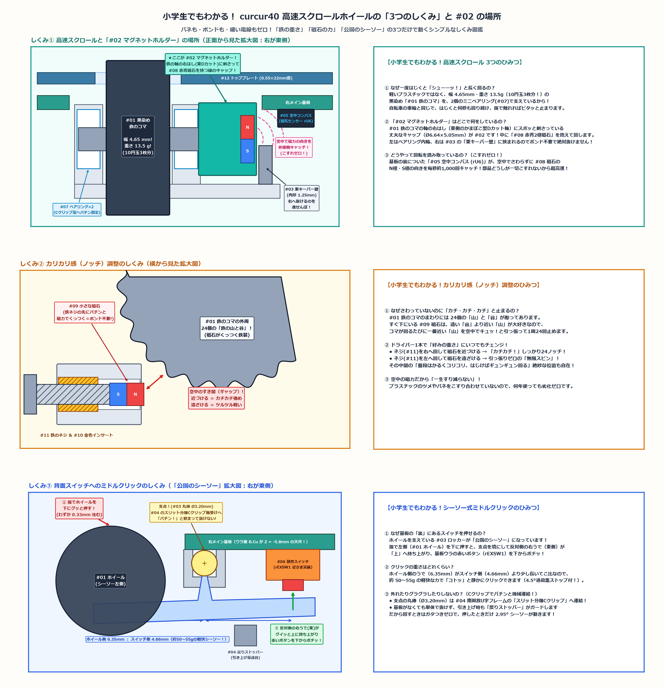
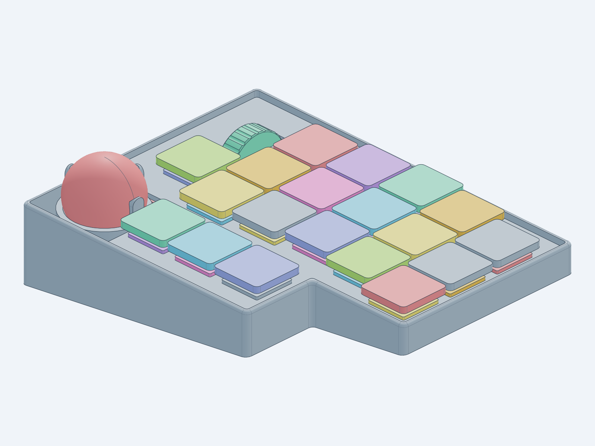
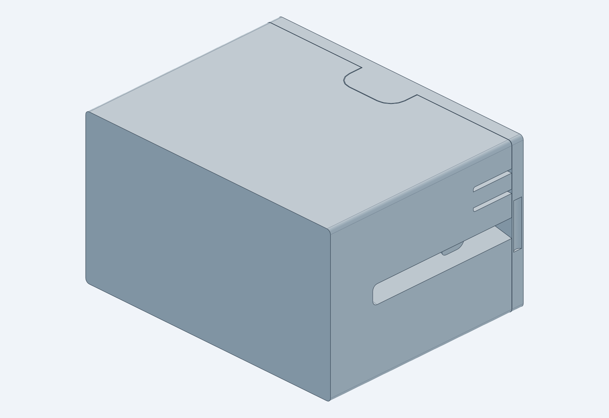
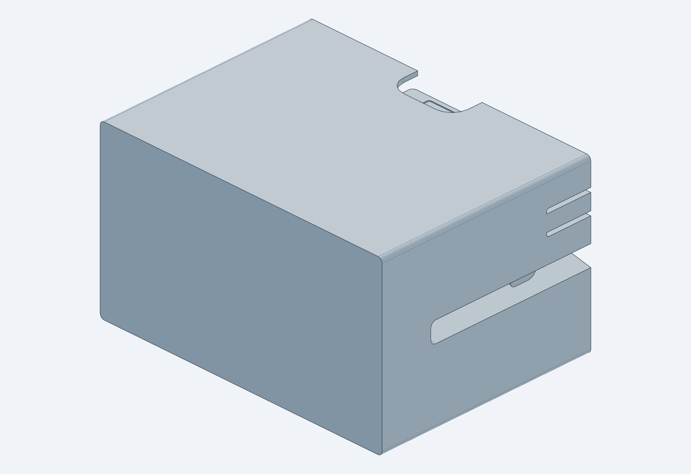

# curcur40 ビルドガイド

**curcur40** は、Corne Chocolate v4 をベースに全キー 1u 化（計39キースイッチ：左21キー＋右18キー、＋ホイール中クリック1入力＝計40入力）、右手人差し指内側に **アンダープレート一体軸パッシブ磁気慣性ホイール（`45# Steel` 1ピース削り出しホイール ＋ 基板直実装 `TMAG5273` 3Dホールセンサ ＋ 接着剤＆シム＆配線ゼロ構造）**、右手親指部に **低プロファイル沈み込み 25mm トラックボール（`PMW3360DM-T2QU` 分離センサーサブ基板・閉円形プレート開口）** を搭載し、筐体全体を **真鍮ヒートセットインサート × 統一 `M2 × 6.0mm` ネジ（100% 密閉・底面穴なしケース）** でまとめた左右分割型ロープロファイルキーボードです。



### 🎬 3D 組み立てアニメーション（全体フロー）

[](./assets/assembly_animation.mp4)

> トラックボール・慣性ホイールのサブ組立からケース・PCB・トッププレート・スイッチ・キーキャップの積み上げまでを通しで確認できます（クリックでフル画質 1080p 60fps 動画 [`docs/assets/assembly_animation.mp4`](./assets/assembly_animation.mp4) を開きます）。

| 上面ビュー（トッププレート・キー配列・カバー不要ホイール） | 底面ビュー（100% 密閉・ネジ穴＆ザグリ穴ゼロのフラット底面） |
| :---: | :---: |
|  |  |

---

## 目次

- **[Step 1: 資材一覧と入手経路・発注ガイド](#step-1-資材一覧と入手経路発注ガイド)**
  - [1-1. 全体構成の概要](#1-1-全体構成の概要)
  - [1-2. JLCPCB に発注するもの（PCB / PCBA / トッププレート：全5アイテム・すべて1.6mm）](#1-2-jlcpcb-に発注するものpcb--pcba--トッププレート全5アイテムすべて16mm)
  - [1-3. JLC3DP / JLCCNC に発注するもの（PA12 3Dプリント6種 ＆ 45#鋼ホイール切削1個）](#1-3-jlc3dp--jlccnc-に発注するものpa12-3dプリント6種--45鋼ホイール切削1個)
  - [1-4. 別で入手・購入するパーツ一覧](#1-4-別で入手購入するパーツ一覧)
  - [1-5. 発注前チェックリスト](#1-5-発注前チェックリスト)
- **[Step 2: 組み立て・ハンダ付け・ファームウェア書き込み手順](#step-2-組み立てハンダ付けファームウェア書き込み手順)**
  - [2-1. 必要な工具](#2-1-必要な工具)
  - [2-2. Phase 1: ファームウェアのビルドと書き込み（事前動作確認）](#2-2-phase-1-ファームウェアのビルドと書き込み事前動作確認)
  - [2-3. Phase 2: 真鍮ヒートセットインサートの熱圧入（計19箇所）](#2-3-phase-2-真鍮ヒートセットインサートの熱圧入計19箇所)
  - [2-4. Phase 3: 手ハンダ作業（わずか2箇所！）＆ トラックボールカップ準備](#2-4-phase-3-手ハンダ作業わずか2箇所-トラックボールカップ準備)
  - [2-5. Phase 4: アンダープレート慣性ホイールの組み立て（接着剤・シム・配線ゼロ）](#2-5-phase-4-アンダープレート慣性ホイールの組み立て接着剤シム配線ゼロ)
  - [2-6. Phase 5: ケースへの統合締結（全箇所共通 M2×6.0mm ネジ）](#2-6-phase-5-ケースへの統合締結全箇所共通-m260mm-ネジ)
  - [2-7. Phase 6: 動作確認・キーマップ設定（VIA / Vial）](#2-7-phase-6-動作確認キーマップ設定via--vial)
  - [2-8. トラブルシューティング・注意事項](#2-8-トラブルシューティング注意事項)
  - [2-9. 【オプション】持ち運び用スライドキャリングボックス（フタ付き）の使い方](#2-9-オプション持ち運び用スライドキャリングボックスフタ付きの使い方)

---

# Step 1: 資材一覧と入手経路・発注ガイド

## 1-1. 全体構成の概要

curcur40 を1台組み立てるために必要な資材は、以下の **4つのルート** でシンプルに揃います（選定型番・購入先リンクの完全なリファレンスは **[`docs/parts_spec.md`](./parts_spec.md)** もあわせて参照してください）。

1. **JLCPCB への発注（★推奨：3-in-1 統合 PCBA パネル × 1種 ＋ FR-4 トッププレート × 2種 ＝ 計3アイテム、すべて標準 `1.6 mm` 厚）**
   - 左右メイン基板（`curcur40-left`, `curcur40-right`）およびトラックボールセンサーサブ基板（`curcur40-pmw3360`）の3枚を **1枚の Economic PCBA 捨て基板パネル（`curcur40-panel-3in1`: `131.05 × 207.25 mm`）** に統合済みのため、**PCBA セットアップ費・ステンシル費 1回分だけ** で RP2040、Flash、Kailh Choc ソケット、RGB LED、デュアル USB-C、JST SH コネクタ（`rJ3`, `J1`）、**慣性ホイール用 3Dホール磁気センサ `rU6`（`TMAG5273A1QDBVR`）**、および PMW3360 周辺 SMD 部品まで **すべて裏面（`Bottom Side`）に一括 PCBA 自動実装** されて届きます（単体3分割データも同梱。ホイール用の別基板や `0.8 mm` 薄板発注は不要です）。
2. **JLC3DP への発注（MJF / SLS `PA12` ナイロン 3Dプリント部品 × 6種・各1個 — 公式造形基準100%適合）**
   - 左右の 100% 密閉底面ボトムケース（`left-desk`, `right-desk`）、25mm トラックボールカップ（`trackball-cup`）、および慣性ホイールの樹脂3部品（`magnet-holder`: $6.64\times 6.64\times 5.05\,\text{mm}$、 `wheel-rocker`、 `wheel-cradle`）をすべて JLC3DP 公式最小サイズ（$\ge 5\times 5\times 5\,\text{mm}$）・肉厚・穴深さ比（$h/\Phi \le 3.0$）準拠の `PA12` ナイロン単一モデルとして一括造形できます。
3. **JLCCNC への発注（1ピース一体軸 `45# Steel` フライホイール × 1個 ＋ 同名2D公差図面 PDF 添付）**
   - 外径 $\varnothing 22.00 \times \text{幅 } 4.65\,\text{mm}$ リム（$R=1.50\,\text{mm}$ 24溝）・内輪段付き肩（$\varnothing 3.00\,\text{mm}$ + $R0.50$ 逃げ溝）・Dカット回転軸を1ピース一体削り出しにした強磁性鋼ホイール（[`steel-flywheel.step`](../cases/inertia_wheel/steel-flywheel.step)、質量 $13.50\,\text{g}$、慣性モーメント $J = 774\,\text{g}\cdot\text{mm}^2$、**`Blackening`［黒染め］仕上げ**）を、同梱の同名2D公差図面 **[`steel-flywheel.pdf`](../cases/inertia_wheel/steel-flywheel.pdf)**（軸部 `⌀1.97 ±0.02 mm` 指定）とセットで発注します。
4. **別途購入するパーツ（スイッチ、キーキャップ、PMW3360＋レンズ、25mm球、JST SH ケーブル1本、ホイール用ベアリング2個・磁石2個・静音SW1個、真鍮インサート19個、統一 `M2×6.0mm` ネジ19本）**
   - スペーサー、シムリング、平行ピン、ラチェット鋼球、瞬間接着剤、ホイール手配線ハーネスは **すべて廃止（不要）** となりました。手ハンダも「右メイン基板の静音スイッチ `rEXSW1`（2ピン）」と「TBセンサー基板の `PMW3360`（16ピン）」の2部品のみです。

---

## 1-2. JLCPCB に発注するもの（PCB / PCBA / トッププレート：3-in-1パネル採用で計3アイテム・すべて1.6mm）

JLCPCB（[https://jlcpcb.com/](https://jlcpcb.com/)）には、コストとDFM手戻りを最小化できる **3-in-1 統合 PCBA パネル 1種** と **PCB のみ（FR-4 トッププレート）2種** の **計3アイテム** を発注するのが最もお得で確実です（すべて標準板厚 **`1.6 mm`**。個別に発注したい場合の単体ファイルも下表④〜⑥に収録しています）。

### 発注ファイル一覧

| 対象 | 発注種別 | 最小発注数 | ガーバーファイル (ZIP) | BOM (部品表 CSV) | CPL (座標データ CSV) |
| :--- | :---: | :---: | :--- | :--- | :--- |
| **★① 3-in-1 統合 PCBA パネル（推奨）**<br>(`curcur40-panel-3in1`: Left + Right + PMW3360) | **PCB + PCBA**<br>（裏面 `Bottom Side` / **1.6mm**） | 5枚<br>（PCBAは2枚〜可） | [GERBER-curcur40-panel-3in1.zip](../pcbs/panel/jlcpcb/production_files/GERBER-curcur40-panel-3in1.zip) | [BOM-curcur40-panel-3in1.csv](../pcbs/panel/jlcpcb/production_files/BOM-curcur40-panel-3in1.csv) | [CPL-curcur40-panel-3in1.csv](../pcbs/panel/jlcpcb/production_files/CPL-curcur40-panel-3in1.csv) |
| **★② 左トッププレート**<br>(`plate-top-left`) | **PCB のみ**<br>（FR-4 **1.6mm**） | 5枚 | [GERBER-plate-top-left.zip](../plates/pcb/jlcpcb/production_files/GERBER-plate-top-left.zip) | 不要（PCBAなし） | 不要（PCBAなし） |
| **★③ 右トッププレート**<br>(`plate-top-right`) | **PCB のみ**<br>（FR-4 **1.6mm**） | 5枚 | [GERBER-plate-top-right.zip](../plates/pcb/jlcpcb/production_files/GERBER-plate-top-right.zip) | 不要（PCBAなし） | 不要（PCBAなし） |
| *(個別参考)* 左メイン基板 (`curcur40-left`) | PCB + PCBA (`1.6mm`) | 5枚 | [GERBER-curcur40-left.zip](../pcbs/left/jlcpcb/production_files/GERBER-curcur40-left.zip) | [BOM-curcur40-left.csv](../pcbs/left/jlcpcb/production_files/BOM-curcur40-left.csv) | [CPL-curcur40-left.csv](../pcbs/left/jlcpcb/production_files/CPL-curcur40-left.csv) |
| *(個別参考)* 右メイン基板 (`curcur40-right`) | PCB + PCBA (`1.6mm`) | 5枚 | [GERBER-curcur40-right.zip](../pcbs/right/jlcpcb/production_files/GERBER-curcur40-right.zip) | [BOM-curcur40-right.csv](../pcbs/right/jlcpcb/production_files/BOM-curcur40-right.csv) | [CPL-curcur40-right.csv](../pcbs/right/jlcpcb/production_files/CPL-curcur40-right.csv) |
| *(個別参考)* TBセンサー基板 (`curcur40-pmw3360`) | PCB + PCBA (`1.6mm`) | 5枚 | [GERBER-curcur40-pmw3360.zip](../pcbs/pmw3360/jlcpcb/production_files/GERBER-curcur40-pmw3360.zip) | [BOM-curcur40-pmw3360.csv](../pcbs/pmw3360/jlcpcb/production_files/BOM-curcur40-pmw3360.csv) | [CPL-curcur40-pmw3360.csv](../pcbs/pmw3360/jlcpcb/production_files/CPL-curcur40-pmw3360.csv) |

> **補足（スイッチ嵌合保持トッププレート・ネジ頭沈み込み設計およびレーザーカット用 SVG について）**:
> - 板厚 $1.60\text{ mm}$ の FR-4 基板として製造します。キー谷間12箇所（`L1`〜`L6`, `R1`〜`R6`）およびホイールクレードル2箇所（`WC1`, `WC2`）の **全14箇所すべてでトッププレートをネジ頭逃げ穴（`WC1` のみ外縁ブリッジ幅確保のため $\varnothing 4.05\text{ mm}$、他13箇所 $\varnothing 4.40\text{ mm}$）** としており、統一 `M2 × 6.0mm` ネジ頭がメイン基板 `F.Cu`（$Z = -4.20\text{ mm}$）に着座してプレート表面（$Z = -2.00\text{ mm}$）より下に完全沈み込みます。そのためキーを押下してもキーキャップ裾と干渉せず、外周余白の目立つネジ穴を全廃してすべてのネジをキーキャップ間の死角へ収めています。
> - トッププレート自体は全39個の Kailh Choc V2 キースイッチ（左21個・右18個）のラッチ嵌合によってメイン基板と一体に保持されます（案1A）。また右トッププレートのホイール窓はカバー不要のシンプルな $8.05 \times 22.00\text{ mm}$ 角丸長穴、トラックボール部は沈み込みカップを囲む閉じた $\varnothing 28.625\text{ mm}$ 円形穴です。
> - アクリル等のレーザーカット用データとして [plate-curcur40.svg](../plates/svg/plate-curcur40.svg) および [foam-curcur40.svg](../plates/svg/foam-curcur40.svg) も同梱しています。

### JLCPCB 推奨発注オプション

- **Base Material / Layers / PCB Thickness**: `FR-4` / `2 Layers` / 全アイテムとも **`1.6 mm`**（3-in-1 パネルは `Panel by Customer` ではなく単一ガーバー `Single PCB` としてそのままアップロードします）
- **PCB Color**: お好みの色（`Black` / `Matte Black` / `White` など）
- **Remove Order Number**: トッププレートは表面に製造番号が入らないよう **`Yes`**（または `Specify a location`）を推奨します。
- **PCBA Assembly Side（裏面 `Bottom Side`）**:
  - **3-in-1 統合パネル (`curcur40-panel-3in1`)**：**`Bottom Side`**（計171点実装 / 30 BOMグループ：左81点 ＋ 右81点 ＋ TBセンサー `p*` 9点）
  - *(単体発注時)* 左メイン `81点 / 20 BOM`、右メイン `81点 / 24 BOM`（オンボード3Dホール `rU6: TMAG5273A1QDBVR` `C3716049`・`rR13: 0Ω`・JST SH `rJ3: C160405` 含む）、TBセンサー `9点 / 7 BOM`
- **意図的に PCBA から除外されている部品（プレビューで Unplaced となって正常なもの）**:
  - **手ハンダ THT 部品（計2個）**: 右メイン基板の静音中クリックスイッチ **`rEXSW1`（`Kailh Square Silent`）**、および TBセンサー基板の光学センサー **`U1` / パネル上 `pU1`（`PMW3360DM-T2QU`）**
  - **銅箔パターン直結済みジャンパ**: TBセンサー基板の **`JP1` / `pJP1`（Pad 1–2 直結済）**
  - **DNP（未実装）部品**: TBセンサー基板の **`R4` / `C5`（`pR4` / `pC5`）**、左右メイン基板の予備端子 **`J4` / `rJ4`**
- **JLCPCB Component Placement（DFM プレビュー）画面での確認ポイント**:
  1. **ミッドマウント USB-C コネクタ（`J1`/`J2`, `rJ1`/`rJ2`: `TYPE-C-31-M-13C`）**: 基板外周切り欠き（3-in-1パネル上では `3.70mm` ルーター逃げスロット手前）に落とし込む部品のため、プレビュー画面で部品位置・向き（12本のSMDピン＋4箇所のシールド長穴に重なり、差込口が外向きスロット側を向く状態）を必ず確認してください。
  2. **1番ピン・コネクタ差込口向きの重点確認**:
     - **`rU6`（`TMAG5273A1QDBVR`, 右メイン基板 `B.Cu`）**: 6ピン `SOT-23-6` パッケージの1番ピン丸印がシルク印字のドット位置と一致していること。
     - **`rJ3`（JST SH 6P, 右メイン基板 `B.Cu`）**: ケーブル差込口が基板内側のトラックボール切り欠き側を向いていること。
     - **`J1` / `pJ1`（JST SH 6P, TBセンサーサブ基板 `B.Cu`）**: ケーブル差込口が右メイン基板側（単体右端）を向いていること。
     - その他の IC（`RP2040`, `W25Q128JVSIQ`, `LDL1117S33R`, `USBLC6-2SC6`, `TLV74318`）・ダイオード（`ZD1`/`rZD1: 1N5819WS`, `D1`/`rD1: 1N4148WS`）・逆付け RGB LED（`YS-SK6812MINI-E`）も1番ピン丸印・カソードマークがシルク印字と一致していること（特に `USBLC6-2SC6` `U3/U5/rU3/rU5` は `180°` 反転すると VBUS–GND 間が順方向導通するため要確認）を目視チェックし、JLCPCB の **`Confirm Parts Placement`（配置確認オプション）** を有効にして発注することを推奨します。

---

## 1-3. JLC3DP / JLCCNC に発注するもの（PA12 3Dプリント6種 ＆ 45#鋼ホイール切削1個）

### ① JLC3DP（MJF / SLS `PA12` 3Dプリント造形：計6種・各1個）
JLC3DP（[https://jlc3dp.com/](https://jlc3dp.com/)）にて、以下の **6ファイル（各1個・計6個）** を発注します。真鍮ヒートセットインサートを綺麗にはんだごて熱圧入でき、かつ靱性・摺動性に優れる **MJF（PA12 ナイロン）** または **SLS（PA12 ナイロン）** を推奨します。

| 対象パーツ | 数量 | アップロード用ファイル (STEP 推奨) | STL ファイル | 推奨素材・方式 |
| :--- | :---: | :--- | :--- | :--- |
| **① 左手用ボトムケース** | **1個** | [left-desk.step](../cases/left-desk.step) | [left-desk.stl](../cases/left-desk.stl) | **MJF (PA12)** / **SLS (PA12)** |
| **② 右手用ボトムケース** | **1個** | [right-desk.step](../cases/right-desk.step) | [right-desk.stl](../cases/right-desk.stl) | **MJF (PA12)** / **SLS (PA12)** |
| **③ 25mm トラックボールカップ** | **1個** | [trackball-cup.step](../cases/trackball-cup.step) | [trackball-cup.stl](../cases/trackball-cup.stl) | **MJF (PA12)** / **SLS (PA12)** / **SLA** |
| **④ `#02` ホイール用マグネットホルダー** | **1個** | [magnet-holder.step](../cases/inertia_wheel/magnet-holder.step) | [magnet-holder.stl](../cases/inertia_wheel/magnet-holder.stl) | **MJF (PA12)** / **SLS (PA12)** |
| **⑤ `#03` ホイール用シーソーロッカー** | **1個** | [wheel-rocker.step](../cases/inertia_wheel/wheel-rocker.step) | [wheel-rocker.stl](../cases/inertia_wheel/wheel-rocker.stl) | **MJF (PA12)** / **SLS (PA12)** |
| **⑥ `#04` ホイール用アンダーPCBクレードル** | **1個** | [wheel-cradle.step](../cases/inertia_wheel/wheel-cradle.step) | [wheel-cradle.stl](../cases/inertia_wheel/wheel-cradle.stl) | **MJF (PA12)** / **SLS (PA12)** |
| **（任意 ※`v1.0`用）持ち運び用スライドボックス本体** | **1個** | [carrying-box.step](../cases/carrying-box.step) | [carrying-box.stl](../cases/carrying-box.stl) | **MJF (PA12)** / **SLS (PA12)**（※`v1.1` 対応更新予定） |
| **（任意 ※`v1.0`用）持ち運び用スライドボックスフタ** | **1個** | [carrying-box-lid.step](../cases/carrying-box-lid.step) | [carrying-box-lid.stl](../cases/carrying-box-lid.stl) | **MJF (PA12)** / **SLS (PA12)**（※`v1.1` 対応更新予定） |

### ② JLCCNC（1ピース一体軸フライホイール CNC 切削：1個 — 同名2D公差図面 PDF 同時添付）
JLCCNC（[https://jlccnc.com/](https://jlccnc.com/) — JLCPCB / JLC3DP と共通アカウント）で、1ピース一体軸ホイールを金属切削で発注します（JLCCNC 公式発注ガイドライン第3節に従い、3D ファイルと同名の 2D 公差図面 PDF を一緒にアップロードします）。

| 対象パーツ | 数量 | アップロード用ファイル（2点同時添付） | 推奨材質・表面処理・公差指定 |
| :--- | :---: | :--- | :--- |
| **⑦ `#01` 一体軸スチールホイール** | **1個** | 3D: [steel-flywheel.step](../cases/inertia_wheel/steel-flywheel.step)<br>2D: **[steel-flywheel.pdf](../cases/inertia_wheel/steel-flywheel.pdf)** | 材質: **`45# Steel`（S45C 強磁性機械構造用炭素鋼 ※必須）**<br>表面処理: **`Blackening`（黒染め / Black Oxide：膜厚 $\le 2\,\mu\text{m}$ で軸太りゼロ＆防錆マットブラック）**<br>公差: **`±0.02 mm` オプション選択 ＋ 同名2D図面 `steel-flywheel.pdf` を添付**（一般部 `ISO 2768-m`、**左右ベアリング嵌合軸＆東Dカット軸のみ黒染め後 `⌀1.97 ±0.02 mm`［`1.950〜1.990 mm`］指定**：`DDL-520ZZ` 内径 `⌀2.000 -0.004/+0` へ確実に挿入するため）<br>⚠️ **注意**: 24溝で磁気ラチェットを働かせるため、非磁性の `SUS304` やアルミではなく必ず強磁性の **`45# Steel`** を選択してください。 |



---

## 1-4. 別で入手・購入するパーツ一覧

すべての購入部材・型番・URL の詳細は **[`docs/parts_spec.md`](./parts_spec.md)** に収録しています。

### ① キースイッチ・キーキャップ（Kailh Choc V2 専用）
| 品名 | 必要数 | 仕様・備考 | 主な入手先 |
| :--- | :---: | :--- | :--- |
| **Kailh Choc V2 キースイッチ (`CPG1353`)** | **39個** | 左手21個 ＋ 右手18個（予備込みで40個パック購入推奨）。MX 十字ステム採用ロープロファイルスイッチ。 | 遊舎工房 / Talp Keyboard / AliExpress 等 |
| **Choc V2 対応 ロープロファイル 1u キーキャップ** | **39個** | **MX 十字ステム対応・ロープロファイル用 1u キーキャップ（外寸 $18.5 \times 18.5\text{ mm}$ 以下）**。※背の高い通常 Cherry/OEM MX キャップは底打ち時に干渉するため不可。 | 遊舎工房 / Booth / AliExpress 等 |

### ② 右手アンダープレート慣性ホイール関連（わずか4品目！接着剤・シム・配線・鋼球すべて不要）
| 呼称・品名 | 必要数 | 型番・仕様・注意点 | 主な入手先 |
| :--- | :---: | :--- | :--- |
| **`#06` 静音ミドルクリックスイッチ (`rEXSW1`)** | **1個** | **`Kailh Square Silent 6.2×6.2×4.3mm`**（2ピン静音角形マウススイッチ `Red Dot`）。右メイン基板 `B.Cu` へ直接ハンダ付けします。 | Amazon (`B0FF9Y9DB8`) / 遊舎工房 / AliExpress |
| **`#07` ミニチュアベアリング（★要脱脂）** | **2個** | NMB ミネベアミツミ **`DDL-520ZZ`**（標準両シールド形：内径 $\varnothing 2.0 \times$ 外径 $\varnothing 5.0 \times$ **幅 $2.30\text{ mm}$**）。一体段付き軸のため**シムリングは不要**です。組み立て前にパーツクリーナーで脱脂洗浄します。 | モノタロウ (`09538365`) |
| **`#08` 角度検出用ネオジム磁石（★径方向2極着磁）** | **1個** | 直径 **$\varnothing 4.0 \times \text{厚さ } 1.0\text{ mm}$ (`D4x1mm`) 円盤型・径方向2極着磁（Diametric）**。`magnet-holder` ポケットへ入れるだけで接着剤ゼロで固定されます。<br>⚠️ **重要**: 必ず円盤の左右で N/S が分かれた **径方向着磁（Diametric）** 品を選んでください。 | AliExpress (`1005010201889003`: `D4x1mm`) |
| **`#09` ラチェット用ネオジム磁石（軸方向着磁）** | **1個** | **二六製作所 `NE280`** 等、直径 **$\varnothing 2.0 \times \text{長さ } 2.0\text{ mm}$ 円柱型・通常の軸方向着磁**。鉄製 `M2×6.0mm` ネジ先端に磁力で自己吸着するため接着剤不要です。 | 二六製作所 (`NE280`) |

### ③ 右手トラックボール・PMW3360 センサー関連
| 品名 | 必要数 | 仕様・備考 | 主な入手先 |
| :--- | :---: | :--- | :--- |
| **25mm トラックボール球** | **1個** | **エレコム `M-B25SV`**（[製品ページ](https://www.elecom.co.jp/products/M-B25SV.html)：シルバー）または **Perixx `PERIPRO-303` 25mm** 等、直径 25mm 交換球。 | 家電量販店 / Amazon / 遊舎工房 |
| **$\varnothing 2.0\text{ mm}$ セラミック支持球** | **3個** | `trackball-cup` 内部の3箇所にスナップイン圧入する $\varnothing 2.0\text{ mm}$ $\text{ZrO}_2$ / $\text{Si}_3\text{N}_4$ ベアリング球。 | Amazon / モノタロウ / AliExpress |
| **PMW3360DM-T2QU IC ＋ LM19-LSI レンズ** | **1セット** | TBセンサーサブ基板（`curcur40-pmw3360`）の `U1` に実装。 | AliExpress / Tindie / Booth |
| **JST SH 1.0mm 6ピン両端コネクタ付ケーブル** | **1本** | 長さ **`100mm`**、**`SHR-06V-S-B` ハウジング・両端同方向フラット（`1-6, 2-5, 3-4, 4-3, 5-2, 6-1` 結線）**。右メイン `rJ3` ⇔ TBセンサー基板 `J1` 接続用（[スイッチサイエンス `#9142` Pimoroni 100mm](https://www.switch-science.com/products/9142?variant=42749692149958) 等）。<br>⚠️ **注意**: `1-1` リバース（逆向き）ケーブルを使うと `+3V3R`/`GNDR` が逆転するため、必ず **両端でツメが同じ面にある同方向（Same-Side / `1-6`）ケーブル** を使用してください。 | スイッチサイエンス / 秋月電子 / Amazon |

### ④ 真鍮ヒートセットインサート・統一 M2×6.0mm ネジ・ゴム足・USBケーブル類
| 品名 | 必要数 | 仕様・備考 | 主な入手先 |
| :--- | :---: | :--- | :--- |
| **真鍮ヒートセットインサート (`M2 × L3.0 × OD3.2mm`)** | **19個** | **左ケース 6個（キー谷間6） ＋ 右ケース 10個（キー谷間6＋TB4）＋ ホイールクレードル 2個 ＋ ホイールロッカー南 1個 ＝ 計 19個（全箇所完全共通）**。ローレット外径 $\varnothing 3.2\text{ mm}$・長さ $3.0\text{ mm}$。 | Amazon / AliExpress / モノタロウ |
| **統一 `M2 × 6.0mm` 精密小ねじ（★鉄／鋼製推奨）** | **19本** | **キーボード全体の全 19箇所すべて同一サイズの `M2 × 6.0mm` ネジ！**（頭径 $\varnothing 3.5 \sim 4.0\text{ mm}$ のなべ頭または低頭）。<br>💡 **ポイント**: 磁石がくっつく一般的な **鉄／ニッケルめっき鋼（または黒染め鋼）** のネジを選ぶと、ホイール南のラチェット調整ネジ（1本）としても `#09` 磁石がそのまま自己吸着して一石二鳥です！ | モノタロウ / Amazon / 秋月電子 |
| **貼り付け式ゴム足** | **8〜10個** | 直径 6〜8mm、厚み 1.5〜2mm 程度（穴のないフラットなケース底面の四隅等に貼付可能）。 | Amazon / ホームセンター |
| **左右間接続用 USB 2.0 Type-C to C ケーブル** | **1本** | `D+` データ線結線あり・E-Marker 非搭載の柔らかいパッシブケーブル（15〜30cm L字推奨）。 | Amazon / 遊舎工房 |
| **PC 接続用 USB Type-C ケーブル** | **1本** | データ通信対応 USB-C ケーブル。 | Amazon / 家電量販店 |

---

## 1-5. 発注前チェックリスト

- [ ] **JLCPCB（3-in-1パネル採用で計3アイテム・すべて `1.6mm`）**:
  - [ ] ★推奨: `curcur40-panel-3in1`（PCB + PCBA / Bottom実装 / 1.6mm — 左＋右＋TBセンサー3枚一括実装）
  - [ ] `plate-top-left` ＆ `plate-top-right`（PCBのみ / 1.6mm / 注文番号削除推奨）
- [ ] **JLC3DP（PA12 ナイロン 6種・各1個） ＆ JLCCNC（1個）**:
  - [ ] `left-desk.step`, `right-desk.step`, `trackball-cup.step`（各1個）
  - [ ] `magnet-holder.step`, `wheel-rocker.step`, `wheel-cradle.step`（各1個）
  - [ ] JLCCNC: `steel-flywheel.step` ＋ 同名2D図面 **`steel-flywheel.pdf`**（**`45# Steel` ＋ `Blackening`［黒染め］＋ 軸径公差 `⌀1.97 ±0.02 mm` 指定**）× 1個
- [ ] **別調達パーツ**:
  - [ ] Kailh Choc V2 (`CPG1353`) スイッチ × **39個** ＆ Choc V2 対応（MX 十字軸）ロープロファイル 1u キーキャップ × **39個**
  - [ ] 慣性ホイール市販品：`Kailh Square Silent` × 1、NMB `DDL-520ZZ` × 2（＋パーツクリーナー）、`D4×1mm` **径方向着磁**磁石 × 1、`NE280` ($\varnothing 2\times 2\text{ mm}$) 軸方向磁石 × 1
  - [ ] トラックボール市販品：25mm球 × 1、$\varnothing 2.0\text{ mm}$ セラミック球 × 3、`PMW3360DM-T2QU`＋`LM19-LSI` × 1、JST SH 6P **同方向（`1-6`）ケーブル** (`100mm`: スイッチサイエンス `#9142` 等) × 1
  - [ ] 共通ファスナ：`M2 × L=3.0 × OD=3.2mm` 真鍮ヒートセットインサート × **19個**、強磁性鋼 `M2 × 6.0mm` ネジ × **19本**、ゴム足、USB-C ケーブル × 2本

---
---

# Step 2: 組み立て・ハンダ付け・ファームウェア書き込み手順

## 2-1. 必要な工具とサイズ条件（★重要：組み立て干渉の防止）



| 工具名 | 用途・**「ここはこのサイズ以下を使ってね」条件** |
| :--- | :--- |
| **普通のはんだごて（温度調節付き・細軸推奨）** | ① 真鍮ヒートセットインサートの熱圧入（**220〜250℃** に下げて使用）<br>② `rEXSW1`（2ピン）と `PMW3360`（16ピン）のはんだ付け（**320〜350℃** で使用）<br>📏 **サイズ条件（上図①）**: 右手ケース下段の `TB1`〜`TB4` ボス天面は深さ $20.6\text{ mm}$ のため、**「こて先先端から $21\text{ mm}$ までの太さが $\varnothing 6.0\text{ mm}$ 以下（3D実測物理限界 $\varnothing 8.5\text{ mm}$）」** の細軸こて（`TS100` / `Pinecil` 等 $\varnothing 5.5\text{ mm}$、または長めの円錐 B型・I型こて先）を使用してください（太い保護スリーブがすぐ始まるこては壁フチに当たります）。 |
| **単体の精密プラスドライバー（`#0` / `#00`）** | 全19箇所すべて同一の `M2 × 6.0mm` ネジ1種類を回すだけで組み立て・ラチェット調整まで完結します。<br>📏 **サイズ条件（上図②）**: トラックボールカップ横の `TB1`〜`TB4` はカップ外壁（爪上端まで高さ差 約 $20.8\text{ mm}$）まで半径 $2.48\text{ mm}$ のため、**「先端から $22\text{ mm}$ までの軸径が $\varnothing 4.5\text{ mm}$ 以下（3D実測物理限界 $\varnothing 4.9\text{ mm}$、推奨 $\varnothing 3.0 \sim 3.5\text{ mm}$）」の単体精密ドライバー** を使用してください（ビット差し替え式の太いチャック $\varnothing 6.5 \sim 10\text{ mm}$ はカップ壁に当たって届きません）。 |
| **ヤニ入りハンダ・ニッパー・ピンセット・カプトンテープ少々** | はんだ付け、飛び出しピン先端の平切り、2mm支持球・小磁石の保持、および右手 `100mm` JST-SH ケーブル余長ループの仮留めに使用します。 |
| **パーツクリーナー（ブレーキクリーナー）** | `DDL-520ZZ` ベアリング2個の内部グリス脱脂洗浄に使用します（※瞬間接着剤は一切不要です！）。 |

---

## 2-2. Phase 1: ファームウェアのビルドと書き込み（事前動作確認）

ハンダ付けや組み込みの前に、JLCPCB から届いた左右メイン基板（`curcur40-left`, `curcur40-right`）単体で PC に接続し、ファームウェア（`.uf2`）を書き込みます。

### ① ファームウェア（`.uf2`）のビルド

#### A. Vial 対応ファームウェアをビルドする場合（推奨）
```sh
FIRMWARE=./curcur40/kbd_firmware
VIAL_QMK=./vial-qmk

mkdir -p "$VIAL_QMK/keyboards/curcur40/rev1/keymaps/vial"
cp -a "$FIRMWARE/keyboards/curcur40/qmk/qmk_firmware/rev1/." \
  "$VIAL_QMK/keyboards/curcur40/rev1/"
cp -a "$FIRMWARE/keyboards/curcur40/vial-kb/vial-qmk/keymaps/vial/." \
  "$VIAL_QMK/keyboards/curcur40/rev1/keymaps/vial/"

cd "$VIAL_QMK"
util/docker_build.sh curcur40/rev1:vial
```
ビルドが完了すると `$VIAL_QMK/.build/curcur40_rev1_vial.uf2` が出力されます。

#### B. VIA（標準 QMK）対応ファームウェアをビルドする場合
```sh
FIRMWARE=./curcur40/kbd_firmware
QMK_FIRMWARE=./qmk_firmware

mkdir -p "$QMK_FIRMWARE/keyboards/curcur40/rev1/keymaps/via"
cp -a "$FIRMWARE/keyboards/curcur40/qmk/qmk_firmware/rev1/." \
  "$QMK_FIRMWARE/keyboards/curcur40/rev1/"
cp -a "$FIRMWARE/keyboards/curcur40/qmk/qmk_firmware/keymaps/via/." \
  "$QMK_FIRMWARE/keyboards/curcur40/rev1/keymaps/via/"

cd "$QMK_FIRMWARE"
SKIP_FLASHING_SUPPORT=1 util/docker_build.sh curcur40/rev1:via
```

### ② 左右メイン基板への書き込み手順（初回 ＆ 組み立て後の再書き込み）
1. **初回書き込み（基板単体時）**: 基板裏面（`B.Cu`）の **`BOOT`（`SMDSW1` / `rSMDSW1`）を押したまま**、基板北側の PC 接続用 USB-C ポート（`J1` / `rJ1`）を PC に接続します。
2. 認識された **`RPI-RP2`** ドライブへ `.uf2` ファイルをドラッグ＆ドロップします（左右両方の基板に同じ `.uf2` を書き込みます）。

> [!TIP]
> **ケース組み立て後のファームウェア再書き込みは「解体不要」です！（Bootmagic / `QK_BOOT`）**
> 本ケースは底面 100% 密閉構造のため、組み立て後は基板裏面の `BOOT`（`SMDSW1`）ボタンに外から触れませんが、**ファームウェアを更新するたびにケースを解体する必要はありません**。以下のどちらでもワンタッチで DFU（`RPI-RP2` ドライブ）に入れます：
> 1. **Bootmagic（最も確実・推奨）**: USB ケーブルを抜いた状態で、**左手は左上端の小指キー（`SW18`, マトリクス `[0, 1]`）、右手は右上端の小指キー（`rSW18`, マトリクス `[4, 1]`）を押しっぱなしにしたまま USB ケーブルを PC に挿す**だけで `RPI-RP2` ドライブとしてマウントされます。
> 2. **`QK_BOOT` キーコード**: Vial / VIA 上でレイヤーに配置した `Reset`（`QK_BOOT`）キーを押すだけでも即座に DFU に入れます（キーマップ編集時も予備レイヤー等に `QK_BOOT` を残しておくと便利です）。
> ※ネジを外して基板裏の `SMDSW1` を直接押す必要があるのは、ファームウェア自作改造等で起動直後にフリーズしキー入力自体が効かなくなった緊急復旧時のみです。

---

## 2-3. Phase 2: 真鍮ヒートセットインサートの熱圧入（計19箇所）



はんだごての温度を **220〜250℃**（PA12 ナイロンの軟化適温）に設定し、3Dプリント部品の **$\varnothing 2.85\text{ mm}$ 下穴（計19箇所）** へ `M2 × L=3.0 × OD=3.2mm` 真鍮インサートを押し込みます。

1. **圧入する場所（合計 19個 — すべて段差のないフラットなボス天面へそのままツライチ圧入！）**:
   - **左手ケース (`left-desk`)**: キー谷間ボス **6箇所（`L1`〜`L6`）**（全6箇所ともメイン基板裏面を受ける均一な $\varnothing 5.20\text{ mm}$ フラット円筒ボス天面［片側肉厚 $1.175\text{ mm}$］へ、狭い首部を通過することなく上からそのままツライチ圧入できます）
   - **右手ケース (`right-desk`)**: キー谷間ボス **6箇所（`R1`〜`R6`：左と完全左右対称・均一な $\varnothing 5.20\text{ mm}$ フラット円筒ボス天面）** ＋ トラックボール下段ボス **4箇所（`TB1`〜`TB4`, $\varnothing 6.00\text{ mm}$）** ＝ **計10箇所**
   - **ホイールクレードル (`wheel-cradle`)**: 対角ボス上面 **2箇所（`WC1`, `WC2`）**
   - **ホイールロッカー (`wheel-rocker`)**: 南側ボスの水平穴の **南側入口 1箇所**
2. **普通のはんだごてで綺麗に圧入するコツ**:
   - 下穴の入口にインサートを指またはピンセットで真っ直ぐ載せ、温めたコテ先をインサート穴の上から軽く当てて自重＋わずかな力でじわっと垂直に押し込みます。
   - インサート天面がボス上面とほぼツライチになる手前（残り $0.2\text{ mm}$ ほど）でコテ先を抜き、すぐに平らな金属面（精密ドライバーの軸腹や定規の平らな面）で上から2〜3秒軽く押さえると、ボス天面と完全に水平・ツライチに美しく仕上がります。

---

## 2-4. Phase 3: 手ハンダ作業（わずか2箇所！）＆ トラックボールカップ準備

はんだごてを通常のハンダ付け温度（320〜350℃）に戻し、残る2つのスルーホール部品をハンダ付けします。

### ① 右メイン基板（`curcur40-right`）への静音スイッチ `rEXSW1` 実装
1. 右メイン基板の**裏面（`B.Cu`：部品実装面）**にあるホイール窓東側の **`rEXSW1`** ランド（`(25.3000, -4.7500)`）へ、`Kailh Square Silent`（$6.2 \times 6.2 \times 4.3\text{ mm}$）の2本のピンを差し込み、スイッチ底面を基板裏面にぴったり密着させます。
2. **表面（`F.Cu`：スイッチソケット差し込み面）**に出た2本のピンをはんだ付けします。
3. 💡 **飛び出しピン先端の平切り（重要：残り高さ $\le 0.4\text{ mm}$）**: 表面 `F.Cu` とトッププレート裏面の間隔（Switch Gap）は $0.60\text{ mm}$ です（スイッチフォームにも逃げ穴を設けていますが、プレート自体はソリッド面です）。プレート裏面にピン先が当たらないよう、フラッシュニッパーを使ってピン先端を基板面から **$0.4\text{ mm}$ 以下** に平切りしてください。

### ② TBセンサーサブ基板（`curcur40-pmw3360`）への `PMW3360` ＆ `LM19-LSI` 実装



1. `JP1` は基板内銅箔パターンで Pad 1–2 直結済み、`R4`/`C5` は DNP のため触る必要はありません。
2. センサーサブ基板の**裏面（`B.Cu`）**から `PMW3360DM-T2QU`（`U1`）の16ピンを差し込み（1番ピン＝四角ランド）、**表面（`F.Cu`）**で16ピンすべてをはんだ付けした後、レンズフランジと干渉しないようピン先端をニッパーで短く切り揃えます。
3. 光学窓のカプトン保護テープを剥がし、**表面（`F.Cu`）**から専用レンズ `LM19-LSI` の4本の脚を角穴へ通してセンサーICへ奥まで差し込みます。

### ③ トラックボールカップへの $\varnothing 2.0\text{ mm}$ セラミック支持球（×3個）圧入
- `trackball-cup` 内壁の3箇所の球面座ディンプル（入口径 $\varnothing 1.95\text{ mm}$）へ、$\varnothing 2.0\text{ mm}$ セラミック支持球を1個ずつ「パチン」と奥まで押し込みます。

---

## 2-5. Phase 4: アンダープレート慣性ホイールの組み立て（接着剤・シム・配線ゼロ）

> 💡 **ホイールの「高速スクロール・ノッチ調整・背面スイッチ中クリック」の3つのしくみと `#02` マグネットホルダーの役割** については、ブラウザで実際にホイールを弾いたりノッチネジや中クリックを動かして体験できる **[さわって動かせる！インタラクティブ図解 (`docs/wheel_mechanism_guide.html`)](./wheel_mechanism_guide.html)**、および **[`docs/passive_inertia_wheel_spec.md` 第0節](./passive_inertia_wheel_spec.md#0-やさしい図解小学生でもわかる3つのしくみと-02-の場所)** をあわせてご覧ください。





1. **`DDL-520ZZ` ベアリング（×2個）の脱脂洗浄（★フリースピン性能の要）**
   - 小瓶やトレイに `DDL-520ZZ`（両シールド形・幅 $2.30\text{ mm}$）を2個入れ、パーツクリーナーを吹きかけて振り洗いし、内部の防錆グリスを溶かし出します（両シールドの隙間から洗浄液が十分浸透します）。乾燥後、指で弾いてシャーッと軽く空転することを確認します。
2. **ローターの組み立て（工具・接着剤・シム不要、約30秒！）**
   - `#01` 一体軸スチールホイール（`steel-flywheel`：外径 $\varnothing 22.00 \times \text{幅 } 4.65\text{ mm}$・質量 $13.50\text{ g}$）の左右軸に、脱脂した `DDL-520ZZ` ベアリングを1個ずつ奥の一体段付き肩（$\varnothing 3.00\text{ mm}$）に当たるまで差し込みます。
   - **東側（キーマトリクス側）の Dカット軸先端** に `#02` `magnet-holder`（$\varnothing 6.64 \times 5.05\text{ mm}$）の西側 D穴を東ベアリング内輪端に当たるまで押し込み、ホルダー東側の丸ポケットに **`#08` `D4×1mm` 径方向2極着磁磁石** を入れます（中央隔壁と `#03` 東側の一体キーパー壁［ギャップ $0.25\text{ mm}$］で確実に抜け止めされるため、接着剤は一切不要です）。
3. **ロッカーとクレードルの Cクリップスナップイン一体連結 ＆ 磁気デテント調整ネジの装着（★基板固定前にノッチ調整！）**
   - `#03` `wheel-rocker` の左右 **独立片持ち Cクリップ軸受座（開口幅 $4.69\text{ mm}$）** へ、ベアリング付きホイールを上から「パチン」と押し込みます（Cクリップ形状によりベアリングの上抜けが機械的にロックされます）。
   - 続けて、南開放 U字フレーム `#04` `wheel-cradle` の左右 **スリット分離型 Cクリップヒンジ座（内径 $\varnothing 3.50\text{ mm}$・入口幅 $2.80\text{ mm}$・肉厚 $1.55\text{ mm}$）** へ `#03` ロッカー東側の左右 $\varnothing 3.20\text{ mm}$ トラニオン支点軸を真上から真っ直ぐ降ろし、「パチン！」とスナップイン連結させます。これで基板に取り付ける前の単体状態でもロッカーとクレードルが外れず一体になり、滑らかなシーソー揺動（＋過荷重ハードストップ保護）だけを行うようになります。
   - 強磁性（鉄製）の **`M2 × 6.0mm` ネジ 1本** をロッカー南ボスの真鍮インサートへ南からねじ込み、南ボス上面の **上面開放ドロップイントラフ** から **`#09` $\varnothing 2.0 \times 2.0\text{ mm}$ 円柱磁石（`NE280`）** を落としてネジ先端へパチンと自己吸着させます（接着剤不要。$\varnothing 2.30\text{ mm}$ ガイドリングと肉厚 $2.25\text{ mm}$ の北端下部キーパー壁があるため、最奥まで締めても磁石がホイール側へ飛び移って張り付くことはありません）。
   - **【重要】この Phase 4 の単体状態で** ホイールを指で弾きながら南のネジを回し、好みの感触（浅く戻せば数秒間回り続ける軽快フリースピン、深く締めれば深溝24極の明快なラチェットノッチ感）にチューニングしておきます（※次の Phase 5 で右メイン基板へ `WC1`/`WC2` ネジ固定すると南ボスは基板の下へ隠れるため、基板に取り付ける前のここでノッチ強弱を合わせておくとスムーズです）。

---

## 2-6. Phase 5: ケースへの統合締結（全箇所共通 M2×6.0mm ネジ）


1. **右メイン基板裏面へのホイールユニット組み付け（`WC1`, `WC2`）**
   - 右メイン基板を裏返し（`B.Cu` 上向き）、十字形ホイール窓へ一体連結済みのホイールユニット（`#03` ロッカー ＋ `#04` クレードル）を差し込み、クレードルの対角2箇所のボスを `WC1`, `WC2` 穴に合わせます。
   - 基板表側（`F.Cu`）から **`M2 × 6.0mm` ネジ × 2本** で `WC1`, `WC2` を締め込みます。ホイールを指で回して空転すること、上から押して Cクリップ支点を中心にシーソー揺動し `rEXSW1` が「コトッ」と静音クリックすること、およびノッチ強弱が好み通りであることをここで最終確認します。
2. **トッププレートとキースイッチの装着**
   - 左右のトッププレート（`plate-top-left`, `plate-top-right`）とメイン基板を合わせ、全39個の Kailh Choc V2 キースイッチ（左21個・右18個）を差し込みます。右手では南側キー `rEXSW2` の真上に揃った $8.05 \times 22.00\text{ mm}$ 長穴からスチールホイールの頂部（キーキャップ天面 $+3.60\text{ mm}$ とほぼ同じ高さ $+3.62\text{ mm}$）だけがスマートに顔を出します（カバー部品の装着は不要です）。
3. **右手トラックボール部の固定（`TB1`〜`TB4`）**
   - 先に TBセンサーサブ基板裏面の `J1` コネクタへ **`100mm` JST SH 6ピン両端同方向（`1-6`）フラットケーブル** の片端を奥まで挿しておきます。
   - TBセンサーサブ基板と `trackball-cup`（高さ $2.00\text{ mm}$ フラット耳）を右手ケース下段の4箇所のインサートボス（`TB1`〜`TB4`）に載せ、単体の細軸精密ドライバー（`#0`、先端 $22\text{ mm}$ 軸径 $\le \varnothing 4.5\text{ mm}$）を使って上から **`M2 × 6.0mm` ネジ × 4本** で固定します。
4. **左右メイン基板＋トッププレートの着地とキー谷間 12箇所の固定（`L1`〜`L6`, `R1`〜`R6`）**
   - 右手では TBセンサー基板から伸びる `100mm` JST SH ケーブルの反対側を右メイン基板裏面の **`rJ3`** へ真っ直ぐ差し込みます。**ケーブルの余長ループは、北側の回転ホイール（`#01`）に触れないよう南東側（`rSW8` / `rSW9` 直下の広い空間）へ丸めて寄せ、カプトンテープ等で軽く留めておきます**（`2-1` 図③-B 参照）。
   - 左右のプレート＋メイン基板ユニットをケースへ降ろします（北側・内側の2つのミッドマウント USB-C コネクタ先端がケース開口フチの内側へ $0.25\text{ mm}$ 入る設計のため、**北・内側の角［USB-C 2箇所側］をほんの少し斜めに先へ潜り込ませてから全体を水平に降ろす**と、壁を押し広げることなく引っ掛かりゼロでスッと着地します。右手ではプレートの閉じた $\varnothing 28.625\text{ mm}$ 円形開口が沈み込みトラックボールカップを綺麗に囲み、USB-C ポート近傍の裏面もケース内壁の3箇所の基板受け棚にぴったり着地します）。キー谷間12箇所すべて（左 `L1`〜`L6`・右 `R1`〜`R6`）でトッププレートの $\varnothing 4.40\text{ mm}$ ネジ頭逃げ穴から統一 **`M2 × 6.0mm` ネジ × 12本** を差し込み、メイン基板表面をケースの $\varnothing 5.20\text{ mm}$ フラットインサートボスへ直接締め込みます（ネジ頭はすべてトッププレート天面下に綺麗に沈み込み、キーキャップ装着後は谷間の死角へ隠れます）。
5. **仕上げ**
   - 全39キーに Choc V2 対応ロープロファイル 1u キーキャップを取り付け、25mm トラックボール球をカップへ押し込み、フラットなケース底面にゴム足を貼って完成です！

---

## 2-7. Phase 6: 動作確認・キーマップ設定（VIA / Vial）

1. **接続順序**: 先に親指内側の左右間ポート（`J2` ⇔ `rJ2`）をパッシブ USB 2.0 C-to-C ケーブルで繋いでから、北側の PC 接続ポート（`J1` または `rJ1`）を PC に接続します。
2. **全39キー ＋ ホイール静音中クリック確認（計40入力）**: [Vial Web (https://vial.rocks/)](https://vial.rocks/) または VIA の Matrix Tester で全39キーおよびホイール押し込み（`[4, 6]`, デフォルト `BTN3`）を確認します。
3. **アンダープレート一体軸慣性ホイールの高速スクロール確認**:
   - $13.50\text{ g}$ の `45# Steel` フライホイール（$J = 774\,\text{g}\cdot\text{mm}^2$、黒染め仕上げ）とオンボード `TMAG5273` の `XZX` 擬似同時サンプリングにより、普段は 24溝と 1:1 同期した心地よいノッチスクロール（1回転 24ノッチ）、指で弾けば数秒間なめらかに回り続けるフリースピン、指を添えれば瞬時にピタッと物理停止する直感操作が楽しめます。
   - **`WHL_HRZ`** キー（`USER03`、Vial / VIA の `Custom` タブからホイール直下キー `rEXSW2` 等の任意キーへ割り当て可能）を押しながら回すと、ファームウェア側で水平スクロール（`H-Wheel`）出力に切り替わります（なお `Shift` キー押下時はファームウェア側で軸変換を行わず OS・アプリ標準の `Shift + 縦スクロール` 挙動に任せています）。
4. **25mm トラックボール ＆ 2D慣性ドラッグスクロール確認**:
   - 通常時はカーソル移動、`SCRL_MO` / `SCRL_TG` 操作時は親指フリックで惰性スクロール＆親指タッチ即停止する 2D 慣性ドラッグスクロール（`SCRL_SL` で低速精密スクロール）が利用できます。

---

## 2-8. トラブルシューティング・注意事項

| 症状 | 主な原因と確認・対処方法 |
| :--- | :--- |
| **片側のキーボードが反応しない** | 両基板に `.uf2` を書き込んだか、PCケーブルが北側 `J1`/`rJ1` に、左右間ケーブル（データ通信対応パッシブ USB 2.0 C-to-C）が内側 `J2`⇔`rJ2` に刺さっているか確認してください。 |
| **慣性ホイールのスクロールが反応しない** | `#02` `magnet-holder` に入れた `#08` `D4×1mm` 磁石が **径方向2極着磁（Diametric）** 品であるか確認してください（一般的な上下厚み方向着磁の円盤磁石では回転磁界が変化せず角度を検出できません）。 |
| **慣性ホイールのクリックが固い／戻らない** | `rEXSW1` の表面 `F.Cu` 側にはんだ付けした2本のピン先端が長く残ってトッププレート裏面に当たっていないか（$\le 0.4\text{ mm}$ に平切りされているか）、および `WC1`/`WC2` の2本のネジでクレードルが基板裏面に密着固定されているか確認してください。 |
| **ホイールの空転時間が短い／ノッチが強すぎる** | ① `DDL-520ZZ` ベアリングをパーツクリーナーで十分脱脂洗浄したか確認してください。<br>② 右メイン基板をケースから持ち上げ、`wheel-rocker` 南ボスの `M2×6.0mm` ラチェット調整ネジを反時計回りに少し緩めて磁石と24溝の距離を広げてください。 |
| **組み立て後にファームウェアを更新・再書き込みしたい** | **ケースの解体は不要です**。USB ケーブルを抜いた状態で、**左手は左上端キー `SW18`（`[0, 1]`）、右手は右上端キー `rSW18`（`[4, 1]`）を押したまま USB を PC に挿す（Bootmagic）** か、キーマップ上の `QK_BOOT` キーを押すと `RPI-RP2` ドライブが開きます。 |
| **トラックボールのカーソルが動かない** | TBセンサー基板の `PMW3360` 光学窓の保護テープ剥がし忘れ、`LM19-LSI` レンズの差し込み深さ、表面16ピンの足切り、および `rJ3`⇔`J1` 間の **JST SH 6P 同方向ケーブル（`1-6` 結線 ※`1-1` リバース不可）** の差し込みを確認してください。 |

---

## 2-9. 【オプション】持ち運び用スライドキャリングボックス（フタ付き）の使い方

> [!NOTE]
> **【`v1.1` 筐体に関する注記】** 現在の [`carrying-box.step`](../cases/carrying-box.step) ＆ [`carrying-box-lid.step`](../cases/carrying-box-lid.step) は `v1.0` 筐体（テンティング角 $7.47^\circ$）向け寸法です。`v1.1` 筐体（テンティング角 $11.80^\circ$・スリム外形）への適合アップデートは次フェーズで実施予定です。

外出先やオフィスへ持ち運ぶ場合は、ネジ・マグネット・ゴムバンド等の別部品を一切使わない **`PA12` ナイロン製 上下リバーシブル直方体スライドボックス＋スナップフタ（[`carrying-box.step`](../cases/carrying-box.step) ＋ [`carrying-box-lid.step`](../cases/carrying-box-lid.step)）** を使うことで、**全4箇所の USB-C マグネット端子（CIO `CIO-SLMG-T-C` 等）・25mm トラックボール球・底面ゴム足をすべて付けたまま** 6面フルカバーの直方体ブロック（フタ装着外寸 **$142.4 \times 111.9 \times 65.4\text{ mm}$**）として安全にパッキングできます。

| フタ装着フルカバー収納 (`carrying-box-with-lid-assembly.step`) | フタ取り外し・スライド挿入時 (`carrying-box-assembly.step`) |
| :---: | :---: |
|  |  |

1. **準備（マグネット端子・トラックボール・ゴム足はすべて付けたままでOK）**:
   - ボックス奥面およびフタ内面には外へ貫通しない **デュアル内部「堀」**、左右側面にはスライドスロットを備えているため、**全4箇所の CIO `CIO-SLMG-T-C` 等の USB-C マグネット交換端子を挿しっぱなしのまま**収納できます（ケーブル本体のみ外します）。
   - **25mm トラックボールも付けたまま**収納でき、中央隔壁の U字キーパーが落下衝撃時のボール脱落を防止します。またケース底面のゴム足は上下の掘り込みレール内で常時 $0.75\text{ mm}$ 空中に浮くため、引っ掛かりゼロでスムーズにスライドします。
2. **収納手順（箱もフタも上下逆さま区別なし！スッと差し込んでカチッと閉めるだけ）**:
   - 左右のキーボードをキー面同士が内側で向かい合うように互い違いに重ねます（右手の親指側に左手の小指側が重なる向き＝$7.47^\circ$ の傾斜が相殺されて上下平行になる向き）。
   - ボックス本体・フタともに **$Y$ 軸まわり $180^\circ$ 完全回転対称** のため、**右手トラックボール側を下にしても上にしても（箱・フタの上下向きを一切気にせず）** そのまま中央隔壁に沿って奥のストッパー段差に当たるまでスッと差し込み、フタを押し込んで「カチッ」とロックすれば完了です。
3. **取り出し手順**:
   - 長さ $14.0\text{ mm}$ の弾性梁と抜き角 $26^\circ$ の浅角カムにより、フタ左右の指掛け溝をつまんで **手前へ真っ直ぐ引くだけ（引き抜き力 約 $9.7\text{ N} \approx 1.0\text{ kgf}$）** でスムーズにフタが外れ、中央の指掛け切り欠きからキーボードを引き出せます（しくみの体験型図解：[**`docs/carrying_box_lid_guide.html`**](./carrying_box_lid_guide.html)）。
