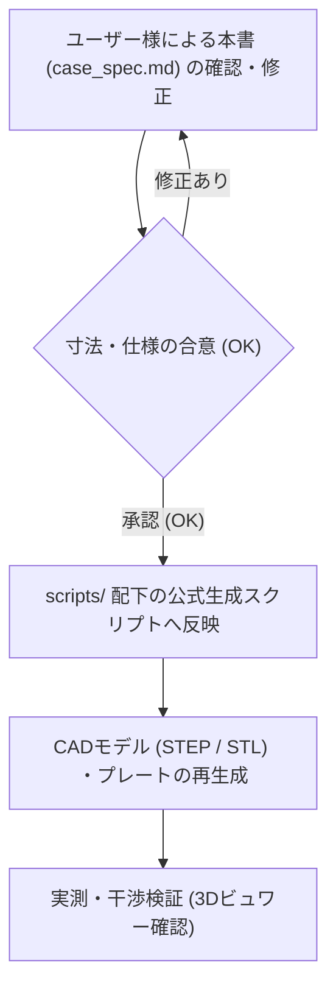

# curcur40 ケース設計仕様書 (Case Specification)

本書は、エルゴノミクス分割キーボード **curcur40**（トラックボール一体型・Choc v2 ロープロファイル）のケースおよびトラックボールカップの設計基準書です。
今後の3Dモデル生成スクリプトは、すべて本書に記載された寸法・ルールに厳密に準拠して作成・更新されます。

> **【運用ルール】**
> 1. **スクリプトの配置場所**: 3Dモデル生成スクリプトや検証スクリプトは、Gitでバージョン管理するためすべてワークスペース内（`cases/` または `scripts/`）に配置します。
> 2. **設計変更の手順**:
>    - 寸法や仕様を変更したい場合、まず本書（`docs/case_spec.md`）の該当数値を編集します。
>    - ドキュメントのレビューが合意（OK）された後、スクリプトへ反映して3Dモデル（STEP/STL）を生成します。

---

## 1. 垂直Z軸積層構造 (Vertical Stackup)

ケース天面リムを基準 ($Z = 0.00 \, \text{mm}$) とした、各層の厚みおよびZ座標の定義です。

### 1.1 積層寸法一覧表

| レイヤー名 | 厚み / ギャップ | 開始 Z座標 | 終了 Z座標 | 備考 / 根拠 |
| :--- | :---: | :---: | :---: | :--- |
| **ケース天面リム〜プレート天面** | **2.00 mm** | $Z = 0.00$ | $Z = -2.00$ | プレート天面はケースリムより $2.00\,\text{mm}$ 奥に着座 |
| **トッププレート (Top Plate)** | **1.60 mm** | $Z = -2.00$ | $Z = -3.60$ | FR4製。外周 10本（左5・右5）の $5.50\,\text{mm}$ スペーサー上端（$Z=-3.60$）に直接着座 |
| **スイッチ空間 (Switch Gap)** | **0.60 mm** | $Z = -3.60$ | $Z = -4.20$ | Kailh Choc v2 ハウジング下部高 $2.20\,\text{mm} - \text{プレート厚 } 1.60\,\text{mm}$ |
| **メイン基板 (Main PCB)** | **1.60 mm** | $Z = -4.20$ | $Z = -5.80$ | FR4製。キースイッチおよびソケット嵌合により保持（右手親指部は別基板へ分離） |
| **基板裏面空間 (Component Cavity)** | **2.20 mm (小指端) 〜** | $Z = -5.80$ | $Z = -8.00 \sim -24.50$ | 傾斜内底面（外底面と平行、肉厚 $2.40\,\text{mm}$ 均一）。小指端は $Z=-8.00$ にスキム（ソケット下端 $Z=-7.65$ に対し $0.35\sim 0.40\,\text{mm}$ 余裕） |
| **外周ネジ座面ボス (`L1`〜`L5`, `R1`〜`R5`)** | **$\varnothing 6.80\,\text{mm}$ 円筒柱** | $Z = -9.10$ | 傾斜内底面まで | 傾斜内底面から $Z=-9.10$ まで立ち上がり、M2 5.50mm スペーサー下端を支持（ザグリ天井 $Z=-11.50$、クランプ厚 $2.40\,\text{mm}$） |
| **沈み込みトラックボールカップ開口リム** | **14.00 mm (カップ本体)** | $Z = -2.00$ | $Z = -16.00$ | カップ円形リム（$Z_{\text{rel}}=+14.00$）をトッププレート表面（$Z=-2.00$）と同一面に揃えて $-11.80\,\text{mm}$ 低プロファイル化 |
| **トラックボールセンサー基板 (`curcur40-pmw3360`)** | **1.60 mm** | $Z = -16.00$ | $Z = -17.60$ | FR4製。メイン基板から $-11.80\,\text{mm}$ 下段に配置、カップ底面（$Z=-16.00$）とボス上面（$Z=-17.60$）でサンドイッチ固定 |
| **トラックボールネジ座面ボス (`TB1`〜`TB4`)** | **$\varnothing 6.80\,\text{mm}$ 円筒柱** | $Z = -17.60$ | 傾斜内底面まで | 傾斜内底面から $Z=-17.60$ まで立ち上がり、センサー基板裏面と **M2 5.50mm スペーサー**下端を同時支持（ザグリ天井 $Z=-20.00$、クランプ厚 $2.40\,\text{mm}$） |
| **ビルトインテンティング外底面 (Built-in Tenting)** | **底板厚 2.40 mm 均一** | 傾斜内底面 | $Z = -10.00 \sim -26.90$ | 小指側外端（$|X_{\text{step}}|=135.858\,\text{mm}$）は全高 **$10.00\,\text{mm}$**（$Z=-10.00$）、親指側内端（$|X_{\text{step}}|=7.025\,\text{mm}$）は全高 **$26.90\,\text{mm}$**（$Z=-26.90$、傾斜角 $\theta_{\text{tent}} = 7.47^\circ$） |

### 1.2 基板裏面（B.Cu）部品の突出長と安全マージン

メイン基板裏面（`B.Cu`: $Z = -5.80 \, \text{mm}$）およびセンサーサブ基板裏面（`B.Cu`: $Z = -17.60 \, \text{mm}$）から下方のケース内底面（傾斜内底面 $Z = -8.00 \sim -24.50 \, \text{mm}$）に向けて突出する部品の実測寸法と安全クリアランスです：

| 実装基板・部品 | 基準 `B.Cu` 面 | 下端到達 Z座標 | 直下のケース内底面 Z座標 | 最小クリアランス |
| :--- | :---: | :---: | :---: | :---: |
| **Kailh Choc ソケット**（メイン基板 小指端 `SW17`/`rSW17`） | $Z = -5.80$ | $Z = -7.65$ | $Z = -8.00$（小指端スキム面） | **$\ge 0.35\,\text{mm}$**（完全非接触） |
| **USB-C レセプタクル (`TYPE-C-31-M-13C`)**（ミッドマウント） | $Z = -5.80$ | $Z = -7.45$ | $Z = -21.93$ | **$14.48\,\text{mm}$**（完全非接触） |
| **TRRS ジャック (`PJ-398A-5A`)**（ミッドマウント） | $Z = -5.80$ | $Z = -7.89$ | $Z = -24.50$ | **$16.61\,\text{mm}$**（完全非接触） |
| **JST SH 6ピンコネクタ (`rJ3`, `SM06B-SRSS-TB`)**（右メイン） | $Z = -5.80$ | $Z = -8.75$ | $Z = -18.67$ | **$9.92\,\text{mm}$**（完全非接触） |
| **JST SH 6ピンコネクタ (`J1`, `SM06B-SRSS-TB`)**（センサー基板） | $Z = -17.60$ | $Z = -20.55$ | $Z = -20.69 \sim -21.25$ | **$\ge 0.14\,\text{mm}$**（中心部 $0.48\,\text{mm}$、完全非接触） |
| **PMW3360 センサー本体 (`U1`)**（センサー基板） | $Z = -17.60$ | $Z = -20.01$ | $Z = -22.29 \sim -24.16$ | **$\ge 2.28\,\text{mm}$**（完全非接触） |

> **【設計結論および AI 監査時の誤認防止ルール】**
> 1. **傾斜内底面による全方位クリアランスとフラット外底面**: ケース外底面は小指側外端（$Z = -10.00\,\text{mm}$）から親指側内端（$Z = -26.90\,\text{mm}$）へ $7.47^\circ$ 傾斜するビルトインテンティング構造であり、内底面も外底面と平行な肉厚 $2.40\,\text{mm}$ の傾斜面（小指端のみ $Z = -8.00\,\text{mm}$ 水平スキム）と円筒ボス（$\varnothing 6.80\,\text{mm}$）で構成されています。すべての実装部品に対して十分なクリアランス（KiCad 全実装部品 STEP との 3D 干渉体積 **`0.00000000 mm³`**）が確保されており、ケース底面にセンサー逃げ穴や `BOOT`/`RESET` アクセス穴を開ける必要はありません（ファームウェア書き込み後は Vial GUI や `QK_BOOT` キーコードでブートローダー移行可能なため、防塵性と剛性を優先します）。
> 2. **ケース上縁リム深さ（$2.00 \, \text{mm}$）の維持**: トッププレート天面（$Z = -2.00 \, \text{mm}$）およびトラックボールカップ円形リム天面（$Z = -2.00 \, \text{mm}$）に対して、ケース外壁リム天面（$Z = 0.00 \, \text{mm}$）が $2.00 \, \text{mm}$ 高いハイプロファイルリム形状は意図的な確定デザインであり、変更しません。
> 3. **Kailh Choc V2 スイッチと $1.60 \, \text{mm}$ 厚トッププレートの適合性**: Kailh Choc V2（`CPG1353`）のハウジング嵌合部は $13.80 \times 13.80 \, \text{mm}$、ラッチ溝高さは $1.65 \, \text{mm}$、フランジ下高さは $2.20 \, \text{mm}$ であり、板厚 $1.60 \, \text{mm}$ の FR-4 トッププレート（開口 $14.0 \times 14.0 \, \text{mm}$、Corne V4 準拠）および Switch Gap $0.60 \, \text{mm}$（$2.20 - 1.60 = 0.60 \, \text{mm}$）に正確に適合します。

---

## 2. ねじ止め・ファスナ仕様 (Fastening Specifications)

外周 10箇所（左手 5箇所 `L1`〜`L5` ＋ 右手 5箇所 `R1`〜`R5`、左右完全対称）とトラックボールカップ固定耳 4箇所（`TB1`〜`TB4`）の計 14箇所に M2 メスメススペーサー（外径 $\varnothing 3.0 \, \text{mm}$）を配置します。

### 2.1 締結部品の選定仕様（全14箇所 M2 5.50mm スペーサー完全統一）
* **全 14箇所共通スペーサー（左手外周 `L1`〜`L5`、右手外周 `R1`〜`R5`、トラックボールカップ `TB1`〜`TB4`）**: M2 メスメススペーサー **長さ 5.50 mm**（外径 $\varnothing 3.0 \, \text{mm}$）× **14個**
  * **① 外周 10箇所（左手 `L1`〜`L5`、右手 `R1`〜`R5`）**:
    * ケースの傾斜内底面から立ち上がる円筒ボス上面（$Z = -9.10 \, \text{mm}$）からトッププレート下面（$Z = -3.60 \, \text{mm}$）までの距離は、**基板裏面空間 $3.30 \, \text{mm}$ ＋ メインPCB厚 $1.60 \, \text{mm}$ ＋ スイッチ空間 $0.60 \, \text{mm}$ ＝ ちょうど $5.50 \, \text{mm}$** です。
    * メインPCBの貫通穴（$\varnothing 3.30 \, \text{mm}$）を突き抜けた M2 5.50mm スペーサーの上端面（$Z = -3.60 \, \text{mm}$）に **トッププレート下面が直接着座** し、上面からの M2 $\times$ 4.0mm ネジが **$2.40 \, \text{mm}$** 螺合します。
  * **② トラックボールカップ 4箇所（右手 `TB1`〜`TB4`）**:
    * 傾斜内底面から立ち上がる円筒ボス上面（**$Z = -17.60 \, \text{mm}$**、穴径 $\varnothing 2.40 \, \text{mm}$）に、M2 5.50mm スペーサー（外径 $\varnothing 3.00 \, \text{mm}$）とセンサーサブ基板（`B.Cu`, $Z = -17.60 \, \text{mm}$、穴径 $\varnothing 3.30 \, \text{mm}$）が同時に着座し、上からトラックボールカップ底面（$Z = -16.00 \, \text{mm}$）でセンサーサブ基板をサンドイッチ固定します。
    * 5.50mm スペーサーは下部 $1.60 \, \text{mm}$ がセンサーサブ基板を貫通し、残り **$3.90 \, \text{mm}$**（$Z = -16.00 \sim -12.10 \, \text{mm}$）がカップ固定耳（総高さ **$5.50 \, \text{mm}$**、$Z = -16.00 \sim -10.50 \, \text{mm}$）の下部スペーサー受け穴（$\varnothing 3.30 \, \text{mm}$、深さ $3.90 \, \text{mm}$）へ進入します。
    * カップ固定耳の上部 **$1.60 \, \text{mm}$**（$Z = -12.10 \sim -10.50 \, \text{mm}$）は **$\varnothing 2.40 \, \text{mm}$ のネジ貫通肉厚**となっており、上から M2 $\times$ 4.0mm ネジを締め込むと $1.60 \, \text{mm}$ の肉厚を通過してスペーサー上部へ **$2.40 \, \text{mm}$** 螺合し、下からの M2 $\times$ 4.0mm ネジ（ザグリ天井 $Z = -20.00 \, \text{mm}$、クランプ肉厚 $2.40 \, \text{mm}$）はスペーサー下部へ **$1.60 \, \text{mm}$** 螺合します（スペーサー内のネジ間隙間 **$1.50 \, \text{mm}$** を確保）。
* **固定ネジ**: M2 小ねじ（計 **28本**：底面側 14本 ＋ 上面側 14本）
  * ネジ呼び径: M2（外径 $2.0 \, \text{mm}$）
  * ネジ頭径: **$\varnothing 4.00 \, \text{mm}$**
  * ネジ頭厚み: **$0.80 \, \text{mm}$**
  * ネジ足長さ: **$4.00 \, \text{mm}$**

### 2.2 各レイヤーの貫通穴・ザグリ寸法
すべての外周ネジ穴をキーキャップ（$18 \times 18 \, \text{mm}$）投影領域の外側に配置したため、**トッププレート（FR-4）の座ぐり加工は一切不要**（ストレート貫通穴のみ）です。ケース底面外側のみ、ネジ頭が机に干渉・傷をつけないようザグリ（沈頭穴）を設けます。
また、トッププレート外周輪郭はケース内壁に対して全周 **$0.30 \, \text{mm}$** のクリアランスを確保し、右手トラックボール切り欠き境界（トッププレート $x_{\text{pcb}} = 24.2000\,\text{mm}, y_{\text{pcb}} = 37.4000\,\text{mm}$、右メイン基板 $x_{\text{pcb}} = 23.8000\,\text{mm}, y_{\text{pcb}} = 37.4000\,\text{mm}$）はカップ円筒外周（$R=14.00\,\text{mm}$、東端 $x_{\text{pcb}} = 23.5250\,\text{mm}$・北端 $y_{\text{pcb}} = 38.3875\,\text{mm}$）に対して全周クリアランスを確保しているため、先にトラックボールカップを固定した後でも右メイン基板＋トッププレートを真上から垂直に下ろして着地できます。

| 対象レイヤー | 箇所 | 加工形状 | 設計寸法 | 備考 |
| :--- | :--- | :--- | :---: | :--- |
| **トッププレート (FR-4)** | 外周ネジ穴（左5 / 右5） | ストレート円筒貫通穴 | **$\varnothing 2.40 \, \text{mm}$** | 上からM2ネジ頭（$\varnothing 4.0$）が着座（座ぐり不要） |
| **トラックボールカップ** | 固定耳穴（右 `TB1`〜`TB4`、高さ $5.50\,\text{mm}$） | 段付き円筒穴（下部 $3.90\,\text{mm}$ / 上部 $1.60\,\text{mm}$） | **下部 $\varnothing 3.30 \, \text{mm}$ / 上部 $\varnothing 2.40 \, \text{mm}$** | 下部 $3.90\,\text{mm}$ にスペーサーが進入、上部 $1.60\,\text{mm}$ をM2ネジが貫通 |
| **PCB (FR-4)** | 全スペーサー穴（左5 / 右メイン5 / 右センサー4） | ストレート円筒貫通穴 | **$\varnothing 3.30 \, \text{mm}$** | M2 5.50mm スペーサー（外径 $\varnothing 3.0\,\text{mm}$）が貫通 |
| **ケース底面・ボス (3D Print)** | ネジ座面円筒ボス（左5 / 右9） | 傾斜内底面からの円筒柱 | **外径 $\varnothing 6.80 \, \text{mm}$** | 外周穴は上面 $Z=-9.10$、TB穴は上面 $Z=-17.60$ |
| **ケース底面・ボス (3D Print)** | ネジ貫通穴（左5 / 右9） | ストレート円筒貫通穴 | **$\varnothing 2.40 \, \text{mm}$** | M2ネジ足（$\varnothing 2.0$）が貫通し、ボス上面に $\varnothing 3.0$ スペーサーが着座 |
| **ケース底面・ボス (3D Print)** | ネジ頭ザグリ穴（左5 / 右9） | 底面外側深座繰り | **$\varnothing 4.60 \, \text{mm}$** | ネジ頭（$\varnothing 4.0$）＋周囲逃げ 0.3mm、全14箇所とも底面から座面まで埋め込み |
| **ケース底面・ボス (3D Print)** | クランプ肉厚（全14箇所統一） | ボス上面〜ザグリ天井 | **$2.40 \, \text{mm}$ 統一** | 外周穴は $Z=-9.10 \sim -11.50$、TB穴は $Z=-17.60 \sim -20.00$（M2×4mmネジが全箇所 $1.60\,\text{mm}$ 螺合） |
| **ケース内壁 (3D Print)** | メインPCB受け爪（東西南北 4箇所） | 壁面からの45°斜めリブ棚 | **上面 $Z = -5.80 \, \text{mm}$ / 幅 $10.0 \, \text{mm}$ / 掛かり代 $1.00 \, \text{mm}$** | スイッチ押下・挿抜時のメイン基板のたわみを防止（北・南・小指外・親指内の部品空き領域 4箇所） |

### 2.3 全ネジ穴の配置座標一覧（PCB座標系 & ケースSTEP座標系）
PCB座標系 $(x_{\text{pcb}}, y_{\text{pcb}})$ からケース・アセンブリSTEP座標系 $(X_{\text{step}}, Y_{\text{step}})$ への変換式は以下の通りです：
* **左手**: $X_{\text{step}} = x_{\text{pcb}} - 14.2875$、 $Y_{\text{step}} = -(y_{\text{pcb}} + 57.1500)$
* **右手**: $X_{\text{step}} = x_{\text{pcb}} + 14.2875$、 $Y_{\text{step}} = -(y_{\text{pcb}} + 57.1500)$

#### ① 左手（計5箇所：すべて外周ネジ穴）
| 番号 | 配置箇所 | PCB座標 $(x_{\text{pcb}}, y_{\text{pcb}})$ | STEP座標 $(X_{\text{step}}, Y_{\text{step}})$ | トッププレート穴 | メインPCB穴 | ケース底面穴 / ザグリ |
| :---: | :--- | :---: | :---: | :---: | :---: | :---: |
| **L1** | 内側上（USB-C横） | $(0.0000, -15.0000)$ | $(-14.2875, -42.1500)$ | $\varnothing 2.40$ | $\varnothing 3.30$ | $\varnothing 2.40$ / $\varnothing 4.60$ ($Z_{\text{cb}}=-11.50$) |
| **L2** | 内側下（TRRS上） | $(0.0000, 20.0000)$ | $(-14.2875, -77.1500)$ | $\varnothing 2.40$ | $\varnothing 3.30$ | $\varnothing 2.40$ / $\varnothing 4.60$ ($Z_{\text{cb}}=-11.50$) |
| **L3** | 小指側上 | $(-101.0000, -20.0000)$ | $(-115.2875, -37.1500)$ | $\varnothing 2.40$ | $\varnothing 3.30$ | $\varnothing 2.40$ / $\varnothing 4.60$ ($Z_{\text{cb}}=-11.50$) |
| **L4** | 小指側下 | $(-98.0000, 38.0000)$ | $(-112.2875, -95.1500)$ | $\varnothing 2.40$ | $\varnothing 3.30$ | $\varnothing 2.40$ / $\varnothing 4.60$ ($Z_{\text{cb}}=-11.50$) |
| **L5** | 親指側下（右 `R5` と左右対称） | $(-62.0000, 64.6000)$ | $(-76.2875, -121.7500)$ | $\varnothing 2.40$ | $\varnothing 3.30$ | $\varnothing 2.40$ / $\varnothing 4.60$ ($Z_{\text{cb}}=-11.50$) |

#### ② 右手（計9箇所：外周5箇所 ＋ トラックボールカップ周囲4箇所）
| 番号 | 配置箇所 | PCB座標 $(x_{\text{pcb}}, y_{\text{pcb}})$ | STEP座標 $(X_{\text{step}}, Y_{\text{step}})$ | トッププレート / カップ穴 | PCB貫通穴 | ケース底面穴 / ザグリ |
| :---: | :--- | :---: | :---: | :---: | :---: | :---: |
| **R1** | 外周・内側上（USB-C横） | $(0.0000, -15.0000)$ | $(14.2875, -42.1500)$ | プレート $\varnothing 2.40$ | 右メイン $\varnothing 3.30$ | $\varnothing 2.40$ / $\varnothing 4.60$ ($Z_{\text{cb}}=-11.50$) |
| **R2** | 外周・内側下（TRRS上） | $(0.0000, 20.0000)$ | $(14.2875, -77.1500)$ | プレート $\varnothing 2.40$ | 右メイン $\varnothing 3.30$ | $\varnothing 2.40$ / $\varnothing 4.60$ ($Z_{\text{cb}}=-11.50$) |
| **R3** | 外周・小指側上 | $(101.0000, -20.0000)$ | $(115.2875, -37.1500)$ | プレート $\varnothing 2.40$ | 右メイン $\varnothing 3.30$ | $\varnothing 2.40$ / $\varnothing 4.60$ ($Z_{\text{cb}}=-11.50$) |
| **R4** | 外周・小指側下 | $(98.0000, 38.0000)$ | $(112.2875, -95.1500)$ | プレート $\varnothing 2.40$ | 右メイン $\varnothing 3.30$ | $\varnothing 2.40$ / $\varnothing 4.60$ ($Z_{\text{cb}}=-11.50$) |
| **R5** | 外周・親指側下（左 `L5` と左右対称） | $(62.0000, 64.6000)$ | $(76.2875, -121.7500)$ | プレート $\varnothing 2.40$ | 右メイン $\varnothing 3.30$ | $\varnothing 2.40$ / $\varnothing 4.60$ ($Z_{\text{cb}}=-11.50$) |
| **TB1** | トラックボール北西 (NW) | $(-2.4750, 41.0875)$ | $(11.8125, -98.2375)$ | カップ耳 $\varnothing 3.30 / \varnothing 2.40$ | センサー $\varnothing 3.30$ | $\varnothing 2.40$ / $\varnothing 4.60$ ($Z_{\text{cb}}=-20.00$) |
| **TB2** | トラックボール北東 (NE) | $(21.5250, 41.0875)$ | $(35.8125, -98.2375)$ | カップ耳 $\varnothing 3.30 / \varnothing 2.40$ | センサー $\varnothing 3.30$ | $\varnothing 2.40$ / $\varnothing 4.60$ ($Z_{\text{cb}}=-20.00$) |
| **TB3** | トラックボール南西 (SW) | $(-2.4750, 63.6875)$ | $(11.8125, -120.8375)$ | カップ耳 $\varnothing 3.30 / \varnothing 2.40$ | センサー $\varnothing 3.30$ | $\varnothing 2.40$ / $\varnothing 4.60$ ($Z_{\text{cb}}=-20.00$) |
| **TB4** | トラックボール南東 (SE) | $(21.5250, 63.6875)$ | $(35.8125, -120.8375)$ | カップ耳 $\varnothing 3.30 / \varnothing 2.40$ | センサー $\varnothing 3.30$ | $\varnothing 2.40$ / $\varnothing 4.60$ ($Z_{\text{cb}}=-20.00$) |

---

## 3. 外周ポート・開口部仕様 (Cutouts & Ports)

メイン基板の切り欠き（`Edge.Cuts`）に落とし込んで実装されるミッドマウント型コネクタ（USB-C `TYPE-C-31-M-13C` および TRRS `PJ-398A-5A`）の実中心高さ（`B.Cu` 面高さである **$Z = -5.85\,\text{mm}$**）に合わせて開口部を同心配置し、**基板着地時のクリアランスおよびプラグ樹脂グリップの余裕を確保しつつ、外からのトッププレート（$Z = -3.60 \sim -2.00\,\text{mm}$）の露出を最小限に抑える**よう設計しています。

### 3.1 TRRS ジャック抜け穴（内側親指側面）
* **加工形状**: ストレート円筒貫通穴（**外側ザグリは不要**：$\varnothing 6.80 \, \text{mm}$ でジャック先端およびプラグ外装を直接受容）
* **穴寸法**: **直径 $\varnothing 6.80 \, \text{mm}$**（半径 **$3.40 \, \text{mm}$**）
* **垂直配置と各基準面からの距離**:
  * **TRRSジャック（`PJ-398A-5A`）実中心高さ**: `B.Cu` ($Z = -5.80\,\text{mm}$) ミッドマウント（`Offset.z = -2.10 mm`）により、プラグ穴および先端円筒（$\varnothing 5.00\,\text{mm}$、$Z = -8.34 \sim -3.34\,\text{mm}$）の中心は **$Z = -5.84 \, \text{mm}$**
  * **開口中心 Z座標**: **$Z = -5.85 \, \text{mm}$**（ジャック穴とほぼ完全同心、先端円筒 $\varnothing 5.00\,\text{mm}$ に対し全周 $+0.90\,\text{mm}$ の余裕）
  * **穴上端 Z座標**: $-5.85 + 3.40 = \mathbf{-2.45 \, mm}$
    * 旧設計（上端 $Z = -1.60\,\text{mm}$）から **$0.85\,\text{mm}$ 低く**なり、トッププレート天面（$Z = -2.00\,\text{mm}$）より下に収まることでトッププレートの露出を大幅に抑えています。
  * **穴下端 Z座標**: $-5.85 - 3.40 = \mathbf{-9.25 \, mm}$
    * 親指内側壁の傾斜内底面（$Z = -24.50 \, \text{mm}$）に対して **$15.25 \, \text{mm}$** の十分な余裕があります。

### 3.2 USB-C ポート開口部（上側北面）
* **開口寸法**: 幅 **$12.00 \, \text{mm}$** $\times$ 高さ **$6.20 \, \text{mm}$**
* **コーナーR**: 四隅 **$R = 1.50 \, \text{mm}$**
* **垂直配置と各基準面からの距離**:
  * **USB-C レセプタクル（`TYPE-C-31-M-13C`, シェル $8.94 \times 3.16\,\text{mm}$）実中心高さ**: `B.Cu` ($Z = -5.80\,\text{mm}$) ミッドマウント（`Offset.z = -1.60 mm`）により、実シェル（$Z = -7.45 \sim -4.29\,\text{mm}$）の中心は **$Z = -5.87 \, \text{mm}$**
  * **開口中心 Z座標**: **$Z = -5.85 \, \text{mm}$**（レセプタクル中心とほぼ完全同心、実シェルに対して左右各 $+1.53\,\text{mm}$・上下各 $+1.52\,\text{mm}$ の対称余裕を確保）
  * **開口上端 Z座標**: $-5.85 + 3.10 = \mathbf{-2.75 \, mm}$
    * 旧設計（上端 $Z = -1.70\,\text{mm}$）から **$1.05\,\text{mm}$ 低く**なり、トッププレート（$Z = -3.60 \sim -2.00\,\text{mm}$）の上半分以上（$0.85\,\text{mm}$）がケース上縁リム（壁厚 $2.75\,\text{mm}$）の裏に隠れます。
  * **開口下端 Z座標**: $-5.85 - 3.10 = \mathbf{-8.95 \, mm}$
    * この位置（$|X_{\text{step}}| = 26.575\,\text{mm}$）の傾斜内底面（$Z = -21.93 \, \text{mm}$）に対して **$12.98 \, \text{mm}$** の十分な余裕があります。

### 3.3 ポート開口とケース積層の整合性評価
* **ミッドマウント実装コネクタとの完全同心 & トッププレート露出の大幅軽減**:
  * 両ポートとも中心を実コネクタ中心（$Z = -5.85 \, \text{mm}$）に合わせ、開口サイズを実用十分な余裕（USB-C: $12.00 \times 6.20\,\text{mm}$、TRRS: $\varnothing 6.80\,\text{mm}$）に引き締めたことで、プラグ樹脂部の干渉を防ぎつつ、外からのトッププレート露出を最小限に抑えています。

---

## 4. トラックボールカップ & 光学系詳細仕様 (Trackball & Optics)

本節は、PixArt社データシート（PMW3360DM-T2QU / LM19-LSI）および基準アセンブリ [`cases/pmw3360-lens-pcb-assembly.step`](../cases/pmw3360-lens-pcb-assembly.step) に基づき、トラックボールカップの幾何寸法・光学アライメントを完全定義したものです。

### 4.1 光学系アライメント・寸法規定の出典と計算

#### ① データシート規定値（Figure 4 SECTION B-B & DETAIL C より）
* **使用ボール**: 直径 **$\varnothing 25.0 \, \text{mm}$**（半径 $12.50 \, \text{mm}$）
* **Navigation Surface（ボール最下面）**: 光学トラッキングの基準面。
* **レンズフランジ基準面 〜 ボール最下面**: **`2.40 mm`** (Bottom of Lens Flange to Navigation Surface)
* **PCB表面 (F.Cu) 〜 ボール最下面**: **`5.80 mm`**
* **PCB厚み**: **`1.60 mm`** (FR-4)
* **センサーIC背面 〜 ボール最下面**: **`9.81 mm`** (Top of Sensor to Navigation Surface)

#### ② データシートから導き出されるカップおよびレンズの高さ寸法
1. **レンズポケットの高さ（PCB表面〜フランジ座面）**:
   $$\Delta Z_{\text{pocket}} = 5.80 \, \text{mm} - 2.40 \, \text{mm} = \mathbf{3.40 \, mm}$$
   （※Figure 6 のレンズ単体図でも、フランジ座から基板当たり面までが $3.51 \pm 0.05 \, \text{mm}$ と規定されています）
2. **レンズフランジ面〜PCB裏面（センサー上面）までの距離**:
   $$3.40 \, \text{mm} + 1.60 \, \text{mm} = \mathbf{5.00 \, mm}$$
3. **センサーIC本体の厚み**:
   $$9.81 \, \text{mm} - 7.40 \, \text{mm} = \mathbf{2.41 \, mm}$$
   （※Figure 2 の公称本体厚は $1.91 \, \text{mm}$、リードフレーム・公差を含めた最大厚が $2.41 \, \text{mm}$）
4. **レンズフランジ面〜センサー背面までの総高さ**:
   $$5.00 \, \text{mm} + 2.41 \, \text{mm} = \mathbf{7.41 \, mm}$$

#### ③ 構成部品の並び・組み立て詳細仕様（AI誤認防止ルール）
1. **光学レンズ (LM19-LSI)**:
   * センサーサブ基板（`curcur40-pmw3360`）の**表面（F.Cu側 / トラックボール側、グローバル $Z = -16.00 \, \text{mm}$）**に配置。
   * 下面から生えた**4本の脚**（$\varnothing 0.90 \, \text{mm}$ の丸ピン2本＋角リブ2本）が、センサーサブ基板の角穴（$16.90 \times 8.70 \, \text{mm}$）を通って下方のセンサーICへ差し込まれる。
   * **★ 丸ガイドポスト座標に関する誤認防止**: 実部品（`PMW3360DM-T2QU` / `LM19-LSI`）および実フットプリント [`PMW3360DM-T2QU_16Pin.kicad_mod`](../pcbs/common/kbd/kicad-footprints/kbd.pretty/PMW3360DM-T2QU_16Pin.kicad_mod)（[`monkeypad/pmw3360-breakout`](https://github.com/monkeypad/pmw3360-breakout) 準拠）における丸ガイドポスト穴（$\varnothing 1.70 \, \text{mm}$）の中心座標は、センサー中心基準で **$(-7.10, +3.30) \, \text{mm}$ および $(+6.70, -3.40) \, \text{mm}$** の非対称配置であり、基板角穴（$\pm 8.45 \times \pm 4.35 \, \text{mm}$）の内側に余裕をもって収まります。
2. **トラックボールセンサーサブ基板 (`curcur40-pmw3360`)**:
   * 厚み **1.60 mm**（グローバル $Z = -17.60 \sim -16.00 \, \text{mm}$）。中央に光路とレンズ脚を通すための角穴（$16.90 \times 8.70 \, \text{mm}$）が開いており、四隅の `TB1`〜`TB4`（$\varnothing 3.30 \, \text{mm}$ 穴）でケース下段ボス上面（$Z = -17.60 \, \text{mm}$）とカップ底面（$Z = -16.00 \, \text{mm}$）にサンドイッチ固定される。
3. **光学センサーIC (PMW3360DM-T2QU)**:
   * センサーサブ基板の**裏面（B.Cu側 / ケース底面側、グローバル $Z = -17.60 \, \text{mm}$）**から上向きに配置。
   * **センサーIC本体には貫通穴や欠けは一切なく、厚み 2.41 mm の完全なソリッド樹脂パッケージ**である（下端到達 $Z = -20.01 \, \text{mm}$）。
   * 16本の金属ピン（$Y = \pm 7.62 \, \text{mm}$、$1.78 \, \text{mm}$ ピッチ千鳥配列）は裏面のIC本体両側面から生え、**裏面から表面へとセンサー基板を突き抜けて表面（F.Cu側）ではんだ付け**される（広口レンズ室 $19.60 \times 22.20 \, \text{mm}$ の内側に収まり、ピン先端をニッパーで短く切り揃えることでフランジやカップとの干渉は一切生じない）。
4. **ケース傾斜内底面**:
   * センサー突出下端（$Z = -20.01 \, \text{mm}$）および JST SH コネクタ `J1` 下端（$Z = -20.55 \, \text{mm}$）に対して、直下のケース傾斜内底面（$Z = -22.29 \sim -24.16 \, \text{mm}$）に十分なクリアランス（$1.74 \sim 2.28 \, \text{mm}$ 以上）があるため、**ケース底面にセンサー逃げ穴やポケットは一切不要**。
5. **カップ固定耳（`TB1`〜`TB4`）の高さ $5.50 \, \text{mm}$ 段付き穴に関する誤認防止**:
   * カップ固定耳（全高 $5.50 \, \text{mm}$、$Z_{\text{rel}} = 0.00 \sim +5.50 \, \text{mm}$ / グローバル $Z = -16.00 \sim -10.50 \, \text{mm}$）は、**下部 $3.90 \, \text{mm}$ が $\varnothing 3.30 \, \text{mm}$ スペーサー受け穴**、**上部 $1.60 \, \text{mm}$ が $\varnothing 2.40 \, \text{mm}$ ネジ貫通穴**の2段階段付き構造である（ケース下段ボス上面 $Z = -17.60 \, \text{mm}$ に立つ M2 5.50mm スペーサーがセンサー基板厚 $1.60 \, \text{mm}$ を貫通してカップ耳内部へ $3.90 \, \text{mm}$ 進入し、上からの M2 × 4.0mm ネジが上部肉厚 $1.60 \, \text{mm}$ を通過してスペーサーへ $2.40 \, \text{mm}$ 螺合する）。

---

### 4.2 トラックボールカップ内部の幾何構造と測定値

トラックボールカップは、センサーサブ基板表面（`F.Cu`: $Z_{\text{rel}} = 0.00 \, \text{mm}$ / グローバル $Z = -16.00 \, \text{mm}$）を着座基準面としてモデリングされます。

| 構造部位 | センサーPCB基準 相対Z座標 ($Z_{\text{rel}}$) | グローバルZ座標 (ケース全体) | 設計寸法・計算根拠 |
| :--- | :---: | :---: | :--- |
| **カップ着座底面 (Sensor PCB F.Cu)** | $0.00 \, \text{mm}$ | $Z = -16.00 \, \text{mm}$ | センサーサブ基板 (`curcur40-pmw3360`) 表面に着座 |
| **レンズフランジ受け座面** | $+3.40 \, \text{mm}$ | $Z = -12.60 \, \text{mm}$ | LM19レンズフランジ底面（規定光学距離 2.40mm の基準面） |
| **レンズ室天井面（2段階設計）** | $+4.85 \, \text{mm}$ | $Z = -11.15 \, \text{mm}$ | 広口レンズ室（$19.6 \times 22.2 \, \text{mm}$）天井。LM19フランジ（$18.85 \times 21.15 \, \text{mm}$）を完全収容 |
| **ボール最下面 (Tracking)** | $+5.80 \, \text{mm}$ | $Z = -10.20 \, \text{mm}$ | レンズフランジ座面から光学規定距離 2.40mm 上空に保持 |
| **のぞき穴（開口部）上端エッジ** | $+6.69 \, \text{mm}$ | $Z = -9.31 \, \text{mm}$ | 球面すり鉢と開口穴（$Y=\pm 5.5$）の交線 |
| **のぞき穴の縦壁高さ** | **1.84 mm** | ― | $6.69 - 4.85 = \mathbf{1.84 \, mm}$（実測値と完全一致） |
| **カップ円形リム天面** | $+14.00 \, \text{mm}$ | $Z = -2.00 \, \text{mm}$ | **トッププレート表面 ($Z = -2.00\,\text{mm}$) と完全同一高さ** |
| **25mmボール中心位置** | $+18.30 \, \text{mm}$ | $Z = +2.30 \, \text{mm}$ | ボール底面 $-10.20 + 12.50 = +2.30 \, \text{mm}$ |
| **ボール赤道面 (Equator)** | $+18.30 \, \text{mm}$ | $Z = +2.30 \, \text{mm}$ | 爪が抱え込む基準高さ |
| **爪の頂点 (Claw Tip)** | $+22.80 \, \text{mm}$ | $Z = +6.80 \, \text{mm}$ | 赤道より上側を包み込んで保持 |
| **25mmボール頂点** | $+30.80 \, \text{mm}$ | $Z = +14.80 \, \text{mm}$ | キーキャップ頂点 ($Z = +3.60\,\text{mm}$) との高さ差 **$+11.20\,\text{mm}$** |

#### 底面開口の2段階設計（LM19レンズ干渉排除・光学距離保証）
* **第1段（広口レンズ室）**: 幅 $19.60 \times 22.20 \, \text{mm}$（高さ $Z_{\text{rel}} = 0.00 \sim 4.85 \, \text{mm}$）
  * LM19レンズの最大外形フランジ（実測 $18.85 \times 21.15 \, \text{mm}$、高さ $Z_{\text{rel}} = 3.40 \sim 4.80 \, \text{mm}$）および `PMW3360` の16ピン配列幅を干渉体積 $0.00000000 \, \text{mm}^3$ で完全に飲み込みます。
  * フランジ底面（$Z_{\text{rel}} = 3.40 \, \text{mm}$）が正しく着座し、ボール最下面（$Z_{\text{rel}} = 5.80 \, \text{mm}$）との **規定光学距離 2.40 mm を狂いなく100%保証** します。
  * ※以前存在した中間段差（$14.0 \times 16.0 \, \text{mm}$）はフランジと激突する設計バグであったため撤廃し、クリーンな2段階開口に是正しました。
* **第2段（中央光学のぞき穴）**: 幅 $8.00 \times 11.00 \, \text{mm}$（高さ $Z_{\text{rel}} = 4.85 \sim 6.69 \, \text{mm}$）
  * 光学ドーム凸部（$4.0 \times 6.0 \, \text{mm}$、頂部 $Z_{\text{rel}} = 5.30 \, \text{mm}$）およびLED照射・受光光路のみをボール下面へ通過させます。

#### のぞき穴縦壁寸法（1.84 mm）の幾何学的証明
* 内側球面：中心 $Z_{\text{center}} = 18.30 \, \text{mm}$、半径 $R_{\text{cup\_inner}} = 12.85 \, \text{mm}$（25mm球に対して 0.35mm の滑走隙間）。
* のぞき穴開口部（$Y = \pm 5.50 \, \text{mm}$）における球面高さ：
  $$Z_{\text{edge}} = 18.30 - \sqrt{12.85^2 - 5.50^2} = 18.30 - 11.613 = \mathbf{6.687 \, mm}$$
* レンズポケット天井面：$Z_{\text{pocket\_ceil}} = \mathbf{4.850 \, mm}$
* したがって、穴の縁の縦壁肉厚は：
  $$\Delta Z_{\text{wall}} = 6.687 - 4.850 = \mathbf{1.837 \, mm} \approx \mathbf{1.84 \, mm}$$
  ツール実測値 1.84 mm と小数点第2位まで完全に一致します。

---

### 4.3 支玉（ベアリングボール）の配置仕様

直径 **$\varnothing 2.00 \, \text{mm}$** のセラミック製支玉3点によって、25mm球を空中の規定位置（最下面 $Z_{\text{rel}} = +5.80 \, \text{mm}$）に精密保持します。

* **旋回軌道半径 ($R_{\text{orbit}}$)**:
  $$R_{\text{orbit}} = R_{\text{ball}} + r_{\text{bearing}} = 12.50 \, \text{mm} + 1.00 \, \text{mm} = \mathbf{13.50 \, mm}$$
* **支玉の仰角（傾斜角 $\theta$）**: **$52.0^\circ$**（水平から下向き）
* **支玉中心の高さ ($Z_{\text{bearing}}$)**:
  $$Z_{\text{bearing}} = 18.30 - 13.50 \cdot \sin(52^\circ) = 18.30 - 10.638 = \mathbf{7.66 \, mm}$$
* **支玉の水平配置角（3点等配）**:
  * 支玉 #1: **$30.0^\circ$**
  * 支玉 #2: **$150.0^\circ$**
  * 支玉 #3: **$270.0^\circ$**（南側開口部の直下中央）
* **支玉ポケット（スナップイン保持付きブラインド球面座）**:
  * 直径 $\varnothing 2.00 \, \text{mm}$ の支玉球面にフィットする球面座（半径 $R = 1.03 \, \text{mm}$、深さ $1.35 \, \text{mm}$）に加え、入口部に **$\varnothing 1.95 \, \text{mm}$（半径 $r = 0.975 \, \text{mm}$）の円筒スロート** を設けることで、硬質な 3D プリント樹脂でも割れを防ぎつつ $0.05 \, \text{mm}$ の軽微なアンダーカットで支玉をパチンと保持します。
  * 支玉が約 $0.65 \, \text{mm}$ 球面から突出し、ボールとカップ内壁の 0.35mm 隙間を維持。
  * **底面貫通穴なし（非貫通）**: 底面レンズポケット側へ貫通させず、完全密閉したブラインド球面座とすることで底面剛性を維持し、意図しない二重穴形状や光漏れを防止。

---

### 4.4 トラックボール保持爪（T字直交配置）仕様

保持爪および球受座の全体形状・配置は、本節冒頭の [トラックボールカップ詳細設計図面](assets/trackball_cup_detail_drawing.png) に準拠します。

#### ① 爪の配置角度（確定仕様）
* **北側 (North)**: **$90.0^\circ$**（上側 / USB-Cポート側）
* **東側 (East)**: **$0.0^\circ / 360.0^\circ$**（右側 / キーボード外側）
* **西側 (West)**: **$180.0^\circ$**（左側 / キーボード内側）
* **南側 (South)**: **爪なし（全周均一リム・低リム加工不要）**

#### ② 爪のプロファイルと保持メカニズム（北半球球面包み込み保持・シームレス円筒外壁）
* **爪背面の完全円筒面化（フラッシュサーフェス）**:
  * 爪の背面（外壁面）は、カップ本体外壁と同一の円筒面（$R = 14.00 \, \text{mm}$、外径 $\varnothing 28.00 \, \text{mm}$）でトリミング成形されます。
  * これにより、直方体押し出しによる外側への角のはみ出し（$0.18 \, \text{mm}$）やリム境目（$Z = 13 \sim 14 \, \text{mm}$）の段差・継ぎ目を完全排除し、カップ下端から爪頂部まで一体のシームレスな円筒美観を実現します。
* **局所突起（ツメ突起）が不要な理由**:
  * 一般的なトラックボールカップに見られる小さな「点突起（球形ポッチ）」は、ボール挿入時にボール表面を擦って傷をつけたり、3Dプリント時の印刷バリや積層段差が原因で引っかかりを生じやすいデメリットがあります。
  * 本設計では、北・東・西の3本のスリム爪（幅 $4.50 \, \text{mm}$）の内面自体が、ボールと同心の球面すり鉢（$R = 12.85 \, \text{mm}$）を描きながら赤道面（$Z_{\text{rel}} = +18.30 \, \text{mm}$）を越えて **$Z_{\text{rel}} = +22.80 \, \text{mm}$（赤道より $+4.50 \, \text{mm}$ 上方）** まで延びています。
  * このため、**爪の内面全体が自然にボール北半球を包み込む「球面ラップ保持（Spherical Wrap Retention）」** が成立しており、局所的な突起を付加する必要がありません。

* **高さに応じた開口径の変化と確実な脱落防止**:
  * **赤道面（$Z_{\text{rel}} = +18.30 \, \text{mm}$）**: 
    * 3爪内面の対向開口径: **$\varnothing 25.30 \, \text{mm}$**
    * ボール赤道径（$\varnothing 25.00 \, \text{mm}$）に対して $+0.15 \, \text{mm}$（全周クリアランス $+0.35 \, \text{mm}$）のゆとりがあり、スムーズに通過・回転します。
  * **保持開始高（$Z_{\text{rel}} = +20.50 \, \text{mm}$）**:
    * 3爪内面の対向開口径: **$\varnothing 24.92 \, \text{mm}$**
    * 球面の絞り込みによりボール赤道径（$\varnothing 25.00 \, \text{mm}$）を下回り、ここから上方へ向かって保持力が働きます。
  * **最狭スロート部（$Z_{\text{rel}} = +21.40 \, \text{mm}$）**:
    * 3爪内面の対向開口径: **$\varnothing 24.59 \, \text{mm}$**
    * ボール赤道に対して **$0.41 \, \text{mm}$ の確実な開口絞り込み（干渉ラッチ）** を形成し、つまみ上げ時や逆さ持ち運び時の自重（約 $15 \, \text{g}$）による脱落を完全に阻止します。
  * **挿入誘導テーパー（$Z_{\text{rel}} = 21.40 \sim 22.80 \, \text{mm}$）**:
    * 最上部には開口角を持つスムーズなリードイン面が施されており、ボールを上から押し込む際に中心へ吸い込まれるようにガイドされます。

* **通常着座時（3点支玉支持）のクリアランス**:
  * ボールが底部のセラミック支玉3点（$Z = 7.66 \, \text{mm}$）に着座している通常使用時、ボール表面とカップ・爪内面との間には、**全域にわたって均一に $+0.35 \, \text{mm}$（$350 \, \mu\text{m}$）のエアギャップ** が保たれます。
  * ボールとカップ内壁・爪との接触は **完全ゼロ（干渉体積 $0.00000000 \, \text{mm}^3$）** であり、操作時は支玉3点との極低摩擦接触のみとなるため、擦れ感のない極上のシルキータッチを実現します。

* **スナップイン／アウトの弾性変形機構**:
  * 爪の幅は $4.50 \, \text{mm}$、厚み $2.40 \, \text{mm}$、自由長約 $8.80 \, \text{mm}$ のスリムなカンチレバー（片持ち梁）構造です。
  * ボール着脱時は、3本の爪がそれぞれ約 $0.07 \, \text{mm}$ ずつ外側へ均等・弾性的にしなることで、ボールを傷つけることなく「パチン」と適度な手応えで着脱・清掃が可能です。

* **南側親指エリアの開放（自然なアクセス性）**:
  * 南側（$270^\circ$ 付近）には爪を設けず、カップ本体自体が赤道より低い位置にあるため、ボールの上半分（赤道より上）が自然に広く露出し、親指の腹が無理なくフィットします。

---

### 4.5 トラックボールカップ 4箇所ねじ止め・スペーサー締結仕様

ケース下段円筒ボス、センサーサブ基板（`curcur40-pmw3360`）、およびトラックボールカップは、外周 10箇所と完全共通の **M2 5.50mm メス-メス スペーサー（外径 $\varnothing 3.0 \, \text{mm}$）** および上下の **M2 $\times$ 4.0mm ネジ** を用い、**センサーサブ基板をケースボス上面とカップ底面でサンドイッチしつつ、スペーサーがセンサーサブ基板の $\varnothing 3.30 \, \text{mm}$ 穴を貫通してカップ固定耳（高さ $5.50 \, \text{mm}$）の下段 $\varnothing 3.30 \, \text{mm}$ ソケット穴へ進入する構造** で一体締結されます。

#### ① 垂直締結スタック構造 (Sensor PCB Sandwich & Stepped Ear Fastening Architecture)
上から下に向かって、以下の順序で構成・挟み込み締結されます：

1. **上部ネジ**: M2 $\times$ 4.0mm 小ねじ（頭径 $\varnothing 4.0 \, \text{mm}$、頭厚 $0.8 \, \text{mm}$）
   * カップ耳上面（$Z_{\text{rel}} = +5.50 \, \text{mm}$ / グローバル $Z = -10.50 \, \text{mm}$）に着座し、カップ耳上段の $\varnothing 2.40 \, \text{mm}$ ネジ貫通穴（肉厚 $1.60 \, \text{mm}$）を通過してスペーサー上部メスネジへ **$2.40 \, \text{mm}$**（6.0山）確実に螺入されます。
2. **カップ固定足（マウントイヤー、段付きソケット構造）**:
   * 全高: **$5.50 \, \text{mm}$**（$Z_{\text{rel}} = 0.00 \sim +5.50 \, \text{mm}$ / グローバル $Z = -16.00 \sim -10.50 \, \text{mm}$、外径ボス $\varnothing 6.00 \, \text{mm}$）
   * **上段ネジ貫通穴（$Z_{\text{rel}} = +3.90 \sim +5.50 \, \text{mm}$、厚み $1.60 \, \text{mm}$）**: 穴径 **$\varnothing 2.40 \, \text{mm}$**
     * 上から入る M2 ネジ頭（$\varnothing 4.0 \, \text{mm}$）を耳上面で受け止め、下から進入するスペーサー上端面（$Z_{\text{rel}} = +3.90 \, \text{mm}$ / グローバル $Z = -12.10 \, \text{mm}$）のストッパーとなります。
   * **下段スペーサーソケット穴（$Z_{\text{rel}} = 0.00 \sim +3.90 \, \text{mm}$、深さ $3.90 \, \text{mm}$）**: 穴径 **$\varnothing 3.30 \, \text{mm}$**
     * スペーサー外径（$\varnothing 3.0 \, \text{mm}$）に対し周囲 $+0.15 \, \text{mm}$ のクリアランスを持ち、センサー基板を貫通してきた 5.50mm スペーサーの上部 $3.90 \, \text{mm}$ を受け入れます。
     * カップ底面および耳底面（$Z_{\text{rel}} = 0.00 \, \text{mm}$ / グローバル $Z = -16.00 \, \text{mm}$）はセンサーサブ基板上面（`F.Cu`）に密着着座します。
3. **トラックボールセンサーサブ基板 (`curcur40-pmw3360`)**:
   * 板厚: **$1.60 \, \text{mm}$**（$Z = -17.60 \sim -16.00 \, \text{mm}$）
   * スペーサー貫通穴径: **$\varnothing 3.30 \, \text{mm}$**
   * ケース下段ボス上面（$Z = -17.60 \, \text{mm}$）とカップ底面（$Z = -16.00 \, \text{mm}$）の間でガタつきなくサンドイッチ保持されます。
4. **メスメススペーサー (Unified M2 5.50mm Standoff)**:
   * 規格: M2 メス-メス スペーサー **長さ 5.50 mm**（外径 **$\varnothing 3.0 \, \text{mm}$**、外周 10箇所と完全共通）
   * 配置構造: ケース下段円筒ボス上面（$Z = -17.60 \, \text{mm}$）に着座し、センサーサブ基板貫通部（$1.60 \, \text{mm}$）＋ カップ固定耳下段ソケット穴（$3.90 \, \text{mm}$）＝ 計 $5.50 \, \text{mm}$（上端 $Z = -12.10 \, \text{mm}$）を貫通します。
5. **ケース下段円筒ボスおよび下部ネジ**:
   * ボス外径: **$\varnothing 6.80 \, \text{mm}$**（傾斜内底面から上面 **$Z = -17.60 \, \text{mm}$** まで立ち上がり、$\varnothing 3.0 \, \text{mm}$ スペーサーとセンサーサブ基板裏面を同時支持）
   * 底面外側ディープザグリ穴: **$\varnothing 4.60 \, \text{mm}$**（ケース外底面からザグリ天井 **$Z = -20.00 \, \text{mm}$** まで）
   * クランプ肉厚（ザグリ天井〜ボス上面）: $-17.60 - (-20.00) = \mathbf{2.40 \, mm}$（外周 10箇所と完全統一）
   * ネジ貫通穴径: **$\varnothing 2.40 \, \text{mm}$**
   * 下部ネジ: M2 $\times$ 4.0mm 小ねじを底面ザグリから上向きに挿入。クランプ肉厚 $2.40 \, \text{mm}$ を通過し、スペーサー下部メスネジへ **$1.60 \, \text{mm}$**（4.0山）強固に螺入されます。

#### ② ネジ噛み合い深さと内部安全ギャップの計算（全14箇所共通 5.50mm スペーサー）
* **スペーサー全長**: $5.50 \, \text{mm}$（`TB1`〜`TB4` では $Z = -17.60 \sim -12.10 \, \text{mm}$、外周 10箇所では $Z = -9.10 \sim -3.60 \, \text{mm}$）
* **上部ネジ螺入深さ**: 上部肉厚 $1.60 \, \text{mm}$（カップ耳上段またはトッププレート）を通過し、$4.00 - 1.60 = \mathbf{2.40 \, mm}$（6.0山）螺合
* **下部ネジ螺入深さ**: ケースボスのクランプ肉厚 $2.40 \, \text{mm}$ を通過し、$4.00 - 2.40 = \mathbf{1.60 \, mm}$（4.0山）螺合
* **スペーサー内部のネジ間隙間（安全ギャップ）**:
  $$5.50 \, \text{mm} - (2.40 \, \text{mm} + 1.60 \, \text{mm}) = \mathbf{1.50 \, mm}$$
* 全 14箇所すべてで上下のネジ先端間に **$1.50 \, \text{mm}$** の余裕が確保されており、ネジ同士がスペーサー内部で衝突・底突きすることは物理的にあり得ません。

#### ③ 4箇所のねじ穴配置座標（カップ中心基準）
LM19レンズ（$21.15 \times 18.85 \, \text{mm}$）およびPMW3360センサーIC（$14.20 \times 19.60 \, \text{mm}$）の外周を四方から均等に挟み込む、干渉ゼロの座標です：

| ねじ穴番号 | 配置方角 | X 相対座標 | Y 相対座標 | カップ耳段付き穴径 | センサーPCB穴径 | ケースボス貫通/ザグリ径 | 備考 |
| :---: | :---: | :---: | :---: | :---: | :---: | :---: | :--- |
| **#1 (`TB2`)** | 北東 (NE) | **$+12.00 \, \text{mm}$** | **$+11.30 \, \text{mm}$** | 下部 $\varnothing 3.30$ / 上部 $\varnothing 2.40$ | $\varnothing 3.30 \, \text{mm}$ | $\varnothing 2.40$ / ザグリ $\varnothing 4.60$ ($Z_{\text{cb}}=-20.00$) | ピッチ X: 24.00 mm |
| **#2 (`TB1`)** | 北西 (NW) | **$-12.00 \, \text{mm}$** | **$+11.30 \, \text{mm}$** | 下部 $\varnothing 3.30$ / 上部 $\varnothing 2.40$ | $\varnothing 3.30 \, \text{mm}$ | $\varnothing 2.40$ / ザグリ $\varnothing 4.60$ ($Z_{\text{cb}}=-20.00$) | ピッチ Y: 22.60 mm |
| **#3 (`TB3`)** | 南西 (SW) | **$-12.00 \, \text{mm}$** | **$-11.30 \, \text{mm}$** | 下部 $\varnothing 3.30$ / 上部 $\varnothing 2.40$ | $\varnothing 3.30 \, \text{mm}$ | $\varnothing 2.40$ / ザグリ $\varnothing 4.60$ ($Z_{\text{cb}}=-20.00$) | レンズ外周逃げ確認済み |
| **#4 (`TB4`)** | 南東 (SE) | **$+12.00 \, \text{mm}$** | **$-11.30 \, \text{mm}$** | 下部 $\varnothing 3.30$ / 上部 $\varnothing 2.40$ | $\varnothing 3.30 \, \text{mm}$ | $\varnothing 2.40$ / ザグリ $\varnothing 4.60$ ($Z_{\text{cb}}=-20.00$) | センサーピン外周逃げ確認済み |

### 4.6 3Dモデルにおけるレンズ側光学距離基準点（`Lens_Optical_Ref_Point`）のプロット仕様

GUI（CAD Viewer 等）の計測ツール（`📏 Measure`）で、25mm トラックボール球（`Trackball_25mm`, 最下面 $Z_{\text{rel}} = +5.80 \, \text{mm}$ / フルアセンブリ $Z = -10.2000 \, \text{mm}$）とレンズ側光学距離基準点（フランジ下面 $Z_{\text{rel}} = +3.40 \, \text{mm}$ / フルアセンブリ $Z = -12.6000 \, \text{mm}$）の間の光学距離（設計値 **$2.40 \, \text{mm}$**）を直接クリック選択して検証できるよう、以下の5つの STEP モデルに独立した名前付きオブジェクト **`Lens_Optical_Ref_Point`**（光軸中心に配置した厚みゼロ・直径 $\varnothing 0.70 \, \text{mm}$ の円形基準面）をプロットしています。

| STEP モデルファイル | 生成スクリプト | `Lens_Optical_Ref_Point` 座標 $(X, Y, Z)$ | `Trackball_25mm` との計測距離 |
| :--- | :--- | :---: | :---: |
| **[`pmw3360-lens-pcb-assembly.step`](../cases/pmw3360-lens-pcb-assembly.step)** | [`scripts/generate_sensor_assemblies.py`](../scripts/generate_sensor_assemblies.py) | $(0.0000, 0.0000, +3.4000) \, \text{mm}$ | ―（単体光学モジュール） |
| **[`trackball-sensor-assembly.step`](../cases/trackball-sensor-assembly.step)** | [`scripts/generate_sensor_assemblies.py`](../scripts/generate_sensor_assemblies.py) | $(0.0000, 0.0000, +3.4000) \, \text{mm}$ | **$2.4000 \, \text{mm}$** |
| **[`trackball-cup-with-ball.step`](../cases/trackball-cup-with-ball.step)** | [`scripts/generate_trackball_cup.py`](../scripts/generate_trackball_cup.py) | $(0.0000, 0.0000, +3.4000) \, \text{mm}$ | **$2.4000 \, \text{mm}$** |
| **[`assembly-full.step`](../cases/assembly-full.step)** | [`scripts/generate_full_assembly.py`](../scripts/generate_full_assembly.py) | $(23.8125, -109.5375, -12.6000) \, \text{mm}$ | **$2.4000 \, \text{mm}$** |
| **[`assembly-full-desk.step`](../cases/assembly-full-desk.step)** | [`scripts/generate_full_assembly.py`](../scripts/generate_full_assembly.py) | デスク水平変換後の光軸座面 | **$2.4000 \, \text{mm}$** |

---

## 5. 設計レビュー・変更反映のフローとスクリプト管理ルール

ユーザー様が数値を変更したい場合は、以下の手順で行います（ディレクトリ構成および [`scripts/`](../scripts) 配下の公式生成スクリプト一覧については [pcb_spec.md 第9節](./pcb_spec.md#9-リポジトリのフォルダ構成生成スクリプト格納ルール-directory--script-rules) もあわせて参照してください）：

