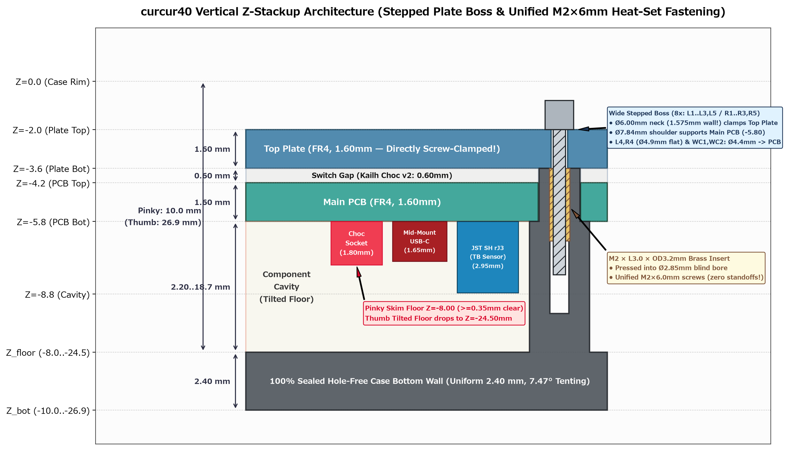
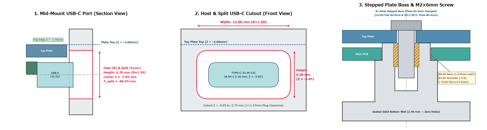
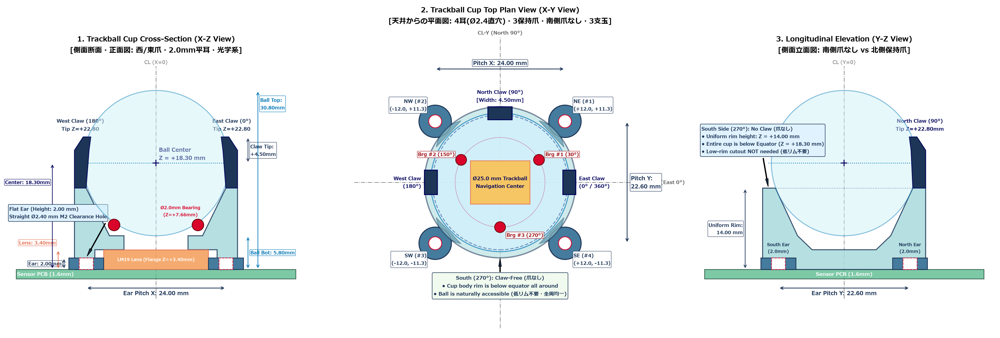
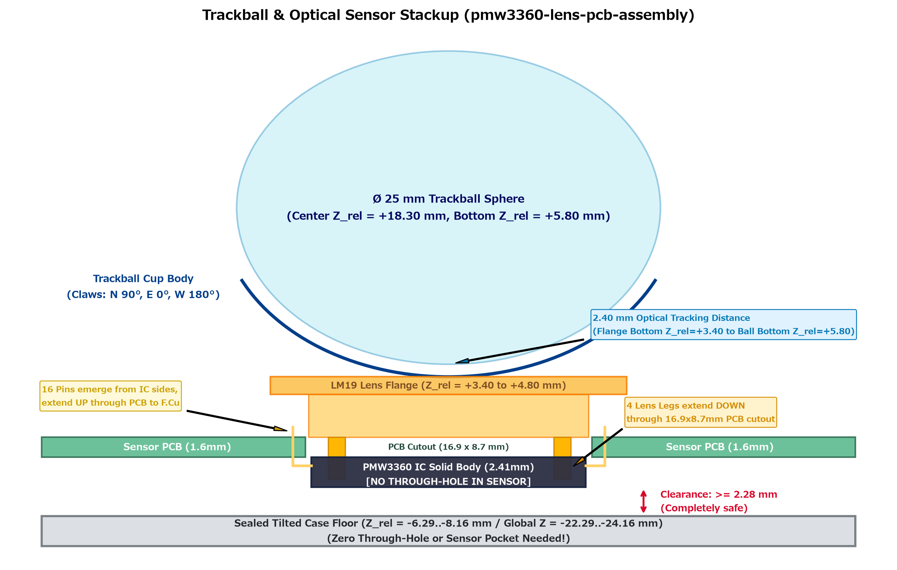
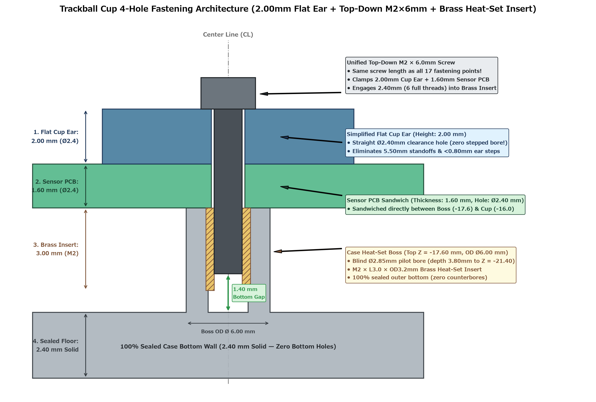

# curcur40 ケース設計仕様書 (Case Specification)

本書は、エルゴノミクス分割キーボード **curcur40**（25mmトラックボール・アンダープレート一体軸パッシブ磁気慣性ホイール統合型、Choc v2 ロープロファイル）のケース、トッププレート機械インターフェース、およびトラックボールカップの設計基準書です（パッシブ磁気慣性ホイールの単体機構・部品設計については [passive_inertia_wheel_spec.md](./passive_inertia_wheel_spec.md) を参照）。
今後の3Dモデル生成スクリプトは、すべて本書に記載された寸法・ルールに厳密に準拠して作成・更新されます。

> **【運用ルール】**
> 1. **スクリプトの配置場所**: 3Dモデル生成スクリプトや検証スクリプトは、Gitでバージョン管理するためすべてワークスペース内（`scripts/`）に配置します。
> 2. **設計変更の手順**:
>    - 寸法や仕様を変更したい場合、まず本書（`docs/case_spec.md`）の該当数値を編集します。
>    - ドキュメントのレビューが合意（OK）された後、スクリプトへ反映して3Dモデル（STEP/STL）を生成します。

---

## 1. 垂直Z軸積層構造 (Vertical Stackup)

ケース天面リムを基準 ($Z = 0.00 \, \text{mm}$) とした、各層の厚みおよびZ座標の定義です。

### 1.1 積層寸法一覧表

| レイヤー名 | 厚み / ギャップ | 開始 Z座標 | 終了 Z座標 | 備考 / 根拠 |
| :--- | :---: | :---: | :---: | :--- |
| **ケース天面リム〜プレート天面** | **2.00 mm** | $Z = 0.00$ | $Z = -2.00$ | プレート天面はケースリムより $2.00\,\text{mm}$ 奥に着座 |
| **トッププレート (Top Plate)** | **1.60 mm** | $Z = -2.00$ | $Z = -3.60$ | FR-4製。Kailh Choc V2 スイッチ（左21個・右19個）のラッチ嵌合により保持（案1A）。ネジ位置 全14箇所（左 `L1..L6`・右 `R1..R6, WC1, WC2`）はすべて **$\varnothing 4.40\,\text{mm}$ 頭逃げ穴** とし、ネジ頭（$Z=-4.20 \sim -3.00$）がプレート天面下に完全沈み込むためキー押下時も干渉ゼロ |
| **スイッチ空間 (Switch Gap)** | **0.60 mm** | $Z = -3.60$ | $Z = -4.20$ | Kailh Choc v2 ハウジング下部高 $2.20\,\text{mm} - \text{プレート厚 } 1.60\,\text{mm}$ |
| **メイン基板 (Main PCB)** | **1.60 mm** | $Z = -4.20$ | $Z = -5.80$ | FR-4製。左右完全対称のキー谷間12箇所（`L1..L6`, `R1..R6`: **$\varnothing 5.20\,\text{mm}$**, 天面 $Z=-5.80$）＋右クレードル2箇所（`WC1, WC2`, $Z=-5.80$）＋USB-Cポート近傍のケース内壁基板受け棚（片側3箇所・天面 $Z=-5.80$）で支持され、全14箇所の $\varnothing 2.40\,\text{mm}$ 円穴から `M2×6.0mm` ネジで直接クランプ（外周余白のむき出しネジ穴ゼロ） |
| **基板裏面空間 (Component Cavity)** | **2.20 mm (小指端) 〜** | $Z = -5.80$ | $Z = -8.00 \sim -25.50$ | 傾斜内底面（外底面と平行、標準肉厚 $2.40\,\text{mm}$）。小指端は $Z=-8.00$ にスキム（ソケット下端 $Z=-7.65$ に対し $\ge 0.35\,\text{mm}$ 余裕）、右ケース `J1` ハウジング＆配線引き出し部（$15.50 \times 11.60\,\text{mm}$）は残肉厚 $1.40\,\text{mm}$ の局所逃がしポケット |
| **キー谷間フラット円筒ボス (`L1`〜`L6`, `R1`〜`R6`)** | **均一外径 $\varnothing 5.20\,\text{mm}$** | $Z = -5.80$ | 傾斜内底面まで | 全12箇所とも左右完全対称・段差ゼロのフラット円筒ボス（外径 **$\varnothing 5.20\,\text{mm}$**、下穴 $\varnothing 2.85\,\text{mm}$、片側均一肉厚 **$1.175\,\text{mm}$**）。すべてキーキャップ裾の谷間・死角に配置され、打鍵剛性の均一化と真上からの不可視性を両立 |
| **ケース内壁 USB-C 基板受け棚（片側3箇所）** | **内壁せり出し $2.00\,\text{mm}$** | $Z = -5.80$ | 傾斜内底面まで | 北内壁のPC側 USB-C 両脇（`NW_HostUSB_Shelf`, `NE_HostUSB_Shelf`）および内西壁の左右間 USB-C 北側（`W_SplitUSB_Shelf`）の計3箇所/片側で傾斜床から $Z=-5.80$ まで一体立ち上げ（基板裏面との重なり幅 $1.50\,\text{mm}$、内角 $R=0.85\,\text{mm}$）。外からも真上からも一切見えない死角で USB-C 挿抜時の下向き基板たわみを防止 |
| **アンダープレート一体軸慣性ホイール** | **全高 23.80 mm (ロッカー底込)** | $Z = +4.10$ | $Z = -19.70$ | 回転軸中心を **$Z=-6.90\,\text{mm}$** に配置した $\varnothing 22.00 \times 6.50\,\text{mm}$（$19.31\,\text{g}$）1ピース一体軸 `45# Steel` ホイール（頂点 **$Z=+4.10$**：キー天面 $+3.60$ 比わずか **$+0.50\,\text{mm}$**、ホイール下端 $Z=-17.90$、ロッカー底面 $Z=-19.70$、クレードル底面 $Z=-13.40$、スナップカバー不要） |
| **沈み込みトラックボールカップ開口リム** | **14.00 mm (カップ本体)** | $Z = -2.00$ | $Z = -16.00$ | カップ円形リム（$Z_{\text{rel}}=+14.00$）をトッププレート表面（$Z=-2.00$）と同一面に揃えて $-11.80\,\text{mm}$ 低プロファイル化（固定耳は高さ $2.00\,\text{mm}$ フラット耳） |
| **トラックボールセンサー基板 (`curcur40-pmw3360`)** | **1.60 mm** | $Z = -16.00$ | $Z = -17.60$ | FR-4製。メイン基板から $-11.80\,\text{mm}$ 下段に配置、カップ固定耳（$2.00\,\text{mm}$）ごとボス上面（$Z=-17.60$）の真鍮インサートへ統一 `M2×6.0mm` ネジで締結 |
| **トラックボールインサートボス (`TB1`〜`TB4`)** | **$\varnothing 6.00\,\text{mm}$ 円筒柱** | $Z = -17.60$ | 傾斜内底面まで | 傾斜内底面から $Z=-17.60$ まで立ち上がり、盲穴（$\varnothing 2.85\,\text{mm}$, 深さ $3.80\,\text{mm}$, 底 $Z=-21.40$）に真鍮ヒートセットインサートを圧入 |
| **100% 密閉ビルトインテンティング外底面** | **底板厚 2.40 mm 標準**（右 `J1` ポケットのみ 1.40 mm） | 傾斜内底面 | $Z = -10.00 \sim -26.90$ | **底面ネジ穴・ザグリ穴完全ゼロ（100% 密閉フラット底面）**。小指側外端（$|X_{\text{step}}|=135.858\,\text{mm}$）は全高 **$10.00\,\text{mm}$**（$Z=-10.00$）、親指側内端（$|X_{\text{step}}|=7.025\,\text{mm}$）は全高 **$26.90\,\text{mm}$**（$Z=-26.90$、傾斜角 $\theta_{\text{tent}} = 7.47^\circ$） |

### 1.2 基板裏面（B.Cu）部品・アンダープレートホイール機構の突出長と安全マージン

メイン基板裏面（`B.Cu`: $Z = -5.80 \, \text{mm}$）およびセンサーサブ基板裏面（`B.Cu`: $Z = -17.60 \, \text{mm}$）から下方のケース内底面（傾斜内底面 $Z = -8.00 \sim -24.50 \, \text{mm}$）に向けて突出する部品の実測寸法と安全クリアランスです：

| 実装基板・部品 | 基準面 | 下端到達 Z座標 | 直下のケース内底面 Z座標 | 最小クリアランス |
| :--- | :---: | :---: | :---: | :---: |
| **Kailh Choc V2 ソケット**（メイン基板 小指端 `SW17`/`rSW17`） | $Z = -5.80$ | $Z = -7.65$ | $Z = -8.00$（小指端スキム面） | **$\ge 0.35\,\text{mm}$**（完全非接触） |
| **PC側 USB-C レセプタクル (`J1`/`rJ1`, `TYPE-C-31-M-13C`)**（ミッドマウント、北面） | $Z = -5.80$ | $Z = -7.45$ | $Z = -21.93$ | **$14.48\,\text{mm}$**（完全非接触） |
| **左右間 USB-C レセプタクル (`J2`/`rJ2`, `TYPE-C-31-M-13C`)**（ミッドマウント、内側壁） | $Z = -5.80$ | $Z = -7.45$ | $Z = -23.48 \sim -24.30$ | **$\ge 16.03\,\text{mm}$**（完全非接触） |
| **3Dホールセンサー (`rU6`, `TMAG5273A1QDBVR`)**（右メイン：慣性ホイール角度検出） | $Z = -5.80$ | $Z = -6.95$ | $Z = -22.85$ | **$15.90\,\text{mm}$**（完全非接触） |
| **静音中クリックスイッチ (`rEXSW1`, `Kailh Square Silent`)**（右メイン：ホイール押下用） | $Z = -5.80$ | $Z = -10.10$（プランジャ先） | $Z = -23.55$（クレードル受け座まで揺動余裕確保） | **完全非接触**（ロッカー西アームが対向） |
| **アンダープレート慣性ホイール機構 (`wheel-rocker` / `wheel-cradle`)** | $Z = -5.80$ | $Z = -19.70$（ロッカー底） | $Z = -20.64 \sim -22.10$ | **静止時 $0.94\,\text{mm}$ / 押下時 $\ge 0.46\,\text{mm}$**（完全非接触） |
| **JST SH 6ピンコネクタ (`rJ3`, `SM06B-SRSS-TB` ＋ 嵌合 `SHR-06V-S-B`)**（右メイン：トラックボール用） | $Z = -5.80$ | $Z = -8.85$（嵌合プラグ $-8.80$） | $Z = -18.67$（南内壁まで $0.50\,\text{mm}$） | **床面 $9.82\,\text{mm}$ / 南内壁 $0.50\,\text{mm}$**（完全非接触） |
| **JST SH 6ピンコネクタ (`J1`, `SM06B-SRSS-TB` ＋ 嵌合 `SHR-06V-S-B`)**（センサー基板） | $Z = -17.60$ | $Z = -20.65$（嵌合プラグ $-20.60$） | $Z = -21.43 \sim -22.25$（残肉厚 $1.40\,\text{mm}$ 局所逃がしポケット） | **ヘッダ $1.04\,\text{mm}$ / 嵌合プラグ $0.83\,\text{mm}$**（完全非接触） |
| **PMW3360 センサー本体 (`U1`)**（センサー基板） | $Z = -17.60$ | $Z = -20.01$ | $Z = -22.29 \sim -24.16$ | **$\ge 2.28\,\text{mm}$**（完全非接触） |

> **【設計結論および AI 監査時の誤認防止ルール】**
> 1. **100% 密閉フラット外底面・左右完全対称キー谷間 $\varnothing 5.20\,\text{mm}$ フラットボス・内壁 USB-C 基板受け棚・右 `J1` 局所逃がしポケット・KiCad 3D STEP 完全同期検証**: 真鍮ヒートセットインサートによる上方向片側締結（`M2 × 6.0mm` ネジ統一）を採用したことで、ケース外底面にはネジ貫通穴もザグリ穴も一切存在しません。外底面は小指側外端（$Z = -10.00\,\text{mm}$）から親指側内端（$Z = -26.90\,\text{mm}$）へ $7.47^\circ$ 傾斜するビルトインテンティング構造であり、内底面も外底面と平行な標準肉厚 $2.40\,\text{mm}$ の傾斜面（小指端のみ $Z = -8.00\,\text{mm}$ 水平スキム、および右ケースのセンサー基板 `J1` 嵌合 `SHR-06V-S-B` ハウジング＆配線引き出し部 $X_{\text{step}} \in [30.50, 46.00], Y_{\text{step}} \in [-115.3375, -103.7375]\,\text{mm}$ のみ外底面と平行な残肉厚 $1.40\,\text{mm}$ の局所逃がしポケット）、単段フラット円筒ボス（キー谷間12箇所 `L1..L6, R1..R6`: $\varnothing 5.20\,\text{mm}$, 天面 $Z=-5.80\,\text{mm}$、`TB1..TB4`: $\varnothing 6.00\,\text{mm}$, 天面 $Z=-17.60\,\text{mm}$）、および USB-C ポート近傍の内壁一体基板受け棚（片側3箇所、天面 $Z=-5.80\,\text{mm}$）で構成されています。フルアセンブリ生成時は KiCad 10.0 から3枚の実装基板＋全535個の3D実装部品モデルを直接 STEP 出力したうえで嵌合 JST `SHR-06V-S-B` ハウジング2個も統合し、全674ソリッド間の 3D 干渉体積 **`0.00000000 mm³`** を自動検証しています。
> 2. **ケース上縁リム深さ（$2.00 \, \text{mm}$）の維持**: トッププレート天面（$Z = -2.00 \, \text{mm}$）およびトラックボールカップ円形リム天面（$Z = -2.00 \, \text{mm}$）に対して、ケース外壁リム天面（$Z = 0.00 \, \text{mm}$）が $2.00 \, \text{mm}$ 高いハイプロファイルリム形状は意図的な確定デザインであり、変更しません。
> 3. **Kailh Choc V2 スイッチと $1.60 \, \text{mm}$ 厚トッププレートの適合性**: Kailh Choc V2（`CPG1353`）のハウジング嵌合部は $13.80 \times 13.80 \, \text{mm}$、ラッチ溝高さは $1.65 \, \text{mm}$、フランジ下高さは $2.20 \, \text{mm}$ であり、板厚 $1.60 \, \text{mm}$ の FR-4 トッププレート（開口 $14.0 \times 14.0 \, \text{mm}$、Corne V4 準拠）および Switch Gap $0.60 \, \text{mm}$（$2.20 - 1.60 = 0.60 \, \text{mm}$）に正確に適合します。

---

## 2. ねじ止め・ファスナ仕様 (Fastening Specifications)

旧設計の `5.50mm` メスメススペーサーおよび上下両面 `M2 × 4.0mm` ネジ・ケース底面ザグリ穴を全面廃止し、キーボード全体の **全 19箇所すべて** を **真鍮ヒートセットインサート（`M2 × L=3.0 × OD=3.2 mm`、計 19個）** と **統一長さ `M2 × 6.0 mm` ネジ（計 19本）** に完全統一しています。

### 2.1 締結部品の選定仕様（全19箇所 真鍮ヒートセットインサート ＆ 統一 M2×6.0mm ネジ）
* **全 19箇所共通 真鍮ヒートセットインサート**: ローレット付き熱圧入真鍮インサート **`M2 × 長さ L = 3.0 mm × 外径 OD = 3.2 mm`** × **19個**
  * 3Dプリント樹脂パーツ（MJF/SLS PA12）側の下穴径をすべて **$\varnothing 2.85 \, \text{mm}$ ストレート盲穴（一部貫通）** に統一しており、$220 \sim 250\,^\circ\text{C}$ に設定した**普通のはんだごて**で上から真っ直ぐ押し込むだけで強固な金属雌ネジを形成します（専用ヒートセットチップ不要）。
* **全 19箇所共通 固定・調整ネジ**: **`M2 × 長さ 6.0 mm` 精密小ねじ**（なべ頭または低頭、頭径 $\varnothing 3.5 \sim 4.0\,\text{mm}$、**強磁性鉄／ニッケルめっき鋼製推奨**）× **19本**
  * **① 左右ケース キー谷間 12箇所（左右完全対称 `L1`〜`L6` / `R1`〜`R6`・外周むき出し穴ゼロ・コンパクト $\varnothing 5.20\,\text{mm}$ 単段フラット円筒ボス・内壁 USB-C 受け棚併用）**:
    * **全 12箇所共通（左 `L1`〜`L6` 6箇所 ＆ 右 `R1`〜`R6` 6箇所）＝ 天面 $Z = -5.80\,\text{mm}$ 均一フラット円筒ボス（外径 $\varnothing 5.20\,\text{mm}$）**:
      * ネジ頭がトッププレート下に完全沈み込みキーキャップ裾と干渉しない構造（案1A）を活かし、かつてトッププレート外周余白で目立っていたネジ穴を**完全廃止（外周むき出しネジ穴ゼロ）**し、左右完全対称の **キー間谷間・キャップ裏死角 6点ずつ（計12箇所）** へ再配置しました。
      * これにより ①真上（$90^\circ$）から見ても斜め手前から見てもネジ穴がキーキャップの陰に隠れて目立たず、②人差し指北（`#1`）・小指北南（`#2, #3`）・内側南（`#4`）・親指内外（`#5, #6`）がキーマトリクス内部を均等スパンで支えるため打鍵位置による硬さ・たわみ差が最小化され、③さらに北内壁・内西壁の死角に一体成形した **3箇所の基板受け棚（$Z = -5.80\,\text{mm}$）** が PC側・左右間 USB-C ケーブル挿抜時の下向き荷重を直接受け止めます。
      * 下穴（$\varnothing 2.85\,\text{mm}$）周囲に **片側均一肉厚 $1.175\,\text{mm}$（`OD 3.20mm` ローレット溶融外周でも $1.00\,\text{mm}$ ソリッド肉厚）** を確保し、段差ゼロのフラット天面（$Z = -5.80\,\text{mm}$）へそのまま真っ直ぐインサートを熱圧入できるため、熱圧入時の狭い首部通過や膨れ・割れが一切発生しません。
      * メイン基板は全12箇所ともシンプルな **$\varnothing 2.40\,\text{mm}$ 円穴** で上から `M2 × 6.0mm` ネジにより直接ガッチリ固定（インサート全長 **$3.00\,\text{mm}$（7.5山）フル螺合**）され、ネジ頭（$Z = -4.20 \sim -3.00\,\text{mm}$）はトッププレートの **$\varnothing 4.40\,\text{mm}$ ネジ頭逃げ穴** 内に完全沈み込みます。左右トッププレートは Kailh Choc V2 キースイッチ（左21個・右19個）のラッチ嵌合により全6自由度（`±X, ±Y, ±Z`）で確実に保持されます。
  * **② トラックボールカップ固定耳 4箇所（右手 `TB1`〜`TB4`）**:
    * カップ固定耳を高さ **$2.00\,\text{mm}$ のシンプルなフラット耳**（$Z_{\text{rel}} = 0.00 \sim +2.00\,\text{mm}$ / グローバル $Z = -16.00 \sim -14.00\,\text{mm}$、外径 $\varnothing 6.00\,\text{mm}$、ストレート貫通穴 **$\varnothing 2.40\,\text{mm}$**、段付き穴なし）とし、その下のセンサーサブ基板（板厚 $1.60\,\text{mm}$、ストレート貫通穴 **$\varnothing 2.40\,\text{mm}$**）と一緒にケース下段ボス天面（**$Z = -17.60\,\text{mm}$**、盲穴深さ $3.80\,\text{mm}$・底 $Z = -21.40\,\text{mm}$）の真鍮インサートへ上から `M2 × 6.0mm` ネジで一括締結します。
    * クランプ総厚 $2.00 + 1.60 = 3.60\,\text{mm}$ に対し、インサートへの有効螺合 **$2.40\,\text{mm}$（6.0山）**・穴底隙間 **$1.40\,\text{mm}$** となり、ケース外底面（$Z \approx -23.8 \sim -26.2\,\text{mm}$）まで十分な肉厚を残したまま底面穴ゼロで固定されます。
  * **③ アンダープレート慣性ホイール クレードル固定 2箇所（右手 `WC1`, `WC2`）＆ Cクリップスナップインヒンジ**:
    * [`wheel-cradle.step`](../cases/inertia_wheel/wheel-cradle.step) の左右ヒンジ座を **Cクリップスナップイン軸受（内径 $\varnothing 3.06\,\text{mm}$・入口スロート幅 $2.66\,\text{mm}$・抱き角 $239^\circ$、顎肉厚 $\ge 1.25\,\text{mm}$）** としたことで、基板に取り付ける前の単体状態でも `#03` シーソーロッカーの $\varnothing 3.00\,\text{mm}$ トラニオン支点軸（$Z = -8.15\,\text{mm}$）が「パチン」と機械的に連結・抜け止め（$\pm u, \pm v, +w, -w$ ロック、シーソー揺動 $0^\circ \sim +2.20^\circ$ のみ許容）されます。
    * 右トッププレートの $\varnothing 4.40\,\text{mm}$ ネジ頭逃げ穴を通し、右メイン基板 `F.Cu`（$Z = -4.20\,\text{mm}$、穴径 $\varnothing 2.40\,\text{mm}$）から裏面 `B.Cu`（$Z = -5.80\,\text{mm}$）に密着するクレードルの2箇所の真鍮インサートボス（`WC1`, `WC2`、下穴深さ $5.00\,\text{mm}$）へ上から `M2 × 6.0mm` ネジ 2本で直締結します。
  * **④ 慣性ホイール 接着剤ゼロ磁気デテント調整 1箇所（`wheel-rocker.step` 南ボス）**:
    * [`wheel-rocker.step`](../cases/inertia_wheel/wheel-rocker.step) 南側ボスの水平穴（$\varnothing 2.85\,\text{mm}$, $Z = -11.30\,\text{mm}$）南口に圧入した真鍮インサートへ、**強磁性（鉄／ニッケルめっき鋼）の `M2 × 6.0mm` ネジ 1本** を南からねじ込み、ネジ先端に **$\varnothing 2.0 \times 2.0\,\text{mm}$ 軸方向着磁ネオジム磁石（二六製作所 `NE280` 等）を磁力だけで自己吸着**（接着剤ゼロ！）させて `45# Steel` ホイールの24溝とのエアギャップを無段階調整します。

### 2.2 各レイヤーの貫通穴・開口・ボス寸法
トッププレート外周輪郭はケース内壁に対して全周 **$0.30 \, \text{mm}$** のクリアランスを確保し、右手トラックボール切り欠き境界（トッププレート $x_{\text{pcb}} = 24.2000\,\text{mm}, y_{\text{pcb}} = 37.4000\,\text{mm}$、右メイン基板 $x_{\text{pcb}} = 23.8000\,\text{mm}, y_{\text{pcb}} = 37.4000\,\text{mm}$）はカップ円筒外周（$R=14.00\,\text{mm}$、東端 $x_{\text{pcb}} = 23.5250\,\text{mm}$・北端 $y_{\text{pcb}} = 38.3875\,\text{mm}$）に対して全周クリアランスを確保しているため、先にトラックボールカップを固定した後でも右メイン基板＋トッププレート（慣性ホイール組込済）を真上から垂直に下ろして着地できます。

| 対象レイヤー | 箇所 | 加工形状 | 設計寸法 | 備考 |
| :--- | :--- | :--- | :---: | :--- |
| **トッププレート (FR-4)** | 基板締結ネジ頭逃げ穴（左 `L1..L6` 6箇所 / 右 `R1..R6, WC1, WC2` 8箇所、計14箇所） | ストレート円筒貫通穴 | **$\varnothing 4.40 \, \text{mm}$** | ネジ頭（$\varnothing 3.8\,\text{mm}$）が通過してメイン基板 `F.Cu` ($Z=-4.20$) に沈み込み着座（キー押下干渉ゼロ・外周余白穴ゼロ） |
| **トッププレート (FR-4)** | アンダープレート慣性ホイール開口（右内側上部） | シンプル角丸長穴（カバー不要） | **$7.70 \times 22.00\,\text{mm}$ ($R=1.00\,\text{mm}$)** | 中心 **$(14.2875, -2.0000)\,\text{mm}$**（南側キー `rEXSW2` と左右中心軸完全一致）。幅 $6.50\,\text{mm}$ のスチールホイールに対して片側 $0.60\,\text{mm}$ の余裕を確保 |
| **トラックボールカップ** | 固定耳穴（右 `TB1`〜`TB4`、フラット耳高さ $2.00\,\text{mm}$） | ストレート円筒貫通穴（段付きなし） | **$\varnothing 2.40 \, \text{mm}$** | センサー基板（$1.60\,\text{mm}$）ごと上から `M2×6.0mm` ネジでケースインサートへ直締結 |
| **PCB (FR-4)** | M2ネジ貫通穴（左 `L1..L6` / 右メイン `R1..R6, WC1, WC2` / 右センサー `TB1`〜`TB4`、計18箇所） | ストレート円筒貫通穴 (`Edge.Cuts`) | **$\varnothing 2.40 \, \text{mm}$** | 全箇所ともシンプルな円穴（太穴・南U溝ゼロ）。統一 `M2×6.0mm` ネジで基板表面を直接締結 |
| **PCB (FR-4)** | アンダープレート慣性ホイール窓（右メイン内側上部） | 十字形角丸切り欠き | **縦スロット $7.70 \times 23.00\,\text{mm}$ ＋ 横翼 $[4.8375..21.3375] \times [-5.75..+1.75]\,\text{mm}$** | 幅 $6.50\,\text{mm}$ スチールホイール・`DDL-520ZZ` 軸受2個・`#02` マグネットホルダーが非接触通過（可動最小隙間 $\ge 0.30\,\text{mm}$） |
| **ケース内底面・ボス・受け棚 (PA12)** | 単段フラットインサートボス（左6 / 右10）＋ USB-C 内壁基板受け棚（左右各3） | 傾斜内底面からの円筒柱・内壁一体ピラスター（TB近接ボスは内壁へブリッジ結合） | **キー谷間12箇所 $\varnothing 5.20\,\text{mm}$ ($Z=-5.80$)・TB 4箇所 $\varnothing 6.00\,\text{mm}$ ($Z=-17.60$) / 下穴 $\varnothing 2.85\,\text{mm}$・受け棚天面 $Z=-5.80$** | 全ボスとも段差ゼロのフラット天面へツライチ熱圧入（片側均一肉厚 $1.175 \sim 1.575\,\text{mm}$）、内壁受け棚3箇所が USB-C 挿抜荷重を支持 |
| **ケース外底面 (PA12)** | 底面全域（左 / 右） | 完全密閉フラット傾斜底面 | **貫通穴・ザグリ穴 0箇所** | 均一肉厚 $2.40\,\text{mm}$ の完全フラット底面（防塵性・剛性・外観を最大化） |

### 2.3 全19箇所ヒートセットインサート・ネジ配置座標一覧（PCB座標系 & ケースSTEP座標系）
PCB座標系 $(x_{\text{pcb}}, y_{\text{pcb}})$ からケース・アセンブリSTEP座標系 $(X_{\text{step}}, Y_{\text{step}})$ への変換式は以下の通りです：
* **左手**: $X_{\text{step}} = x_{\text{pcb}} - 14.2875$、 $Y_{\text{step}} = -(y_{\text{pcb}} + 57.1500)$
* **右手**: $X_{\text{step}} = x_{\text{pcb}} + 14.2875$、 $Y_{\text{step}} = -(y_{\text{pcb}} + 57.1500)$

#### ① 左手（計6箇所：すべて右手 `R1`〜`R6` と完全左右対称・キー谷間フラット円筒ボス $\varnothing 5.20\,\text{mm}$ at $Z = -5.80\,\text{mm}$）
| 番号 | 配置箇所 | PCB座標 $(x_{\text{pcb}}, y_{\text{pcb}})$ | STEP座標 $(X_{\text{step}}, Y_{\text{step}})$ | トッププレート穴 | メインPCB穴 | ケースボス天面 / インサート下穴 ($\varnothing 2.85$) |
| :---: | :--- | :---: | :---: | :---: | :---: | :---: |
| **L1** | 人差し指・北4キー谷間（`SW3/4/5/6` 間） | $(-42.2500, 0.0000)$ | $(-56.5375, -57.1500)$ | $\varnothing 4.40$ | $\varnothing 2.40$ | フラット円筒 $\varnothing 5.20$ $Z = -5.80$（盲穴底 $-11.80$） |
| **L2** | 小指・北4キー谷間（`SW13/14/17/18` 間） | $(-100.5000, 2.5000)$ | $(-114.7875, -59.6500)$ | $\varnothing 4.40$ | $\varnothing 2.40$ | フラット円筒 $\varnothing 5.20$ $Z = -5.80$（盲穴底 $-11.00$） |
| **L3** | 小指・南4キー谷間（`SW14/15/16/17` 間） | $(-100.5000, 21.5000)$ | $(-114.7875, -78.6500)$ | $\varnothing 4.40$ | $\varnothing 2.40$ | フラット円筒 $\varnothing 5.20$ $Z = -5.80$（盲穴底 $-11.00$） |
| **L4** | 内側南・`EXSW2` 南東／`SW2` 西端谷間 | $(-21.5000, 29.2500)$ | $(-35.7875, -86.4000)$ | $\varnothing 4.40$ | $\varnothing 2.40$ | フラット円筒 $\varnothing 5.20$ $Z = -5.80$（盲穴底 $-11.80$） |
| **L5** | 親指内側・`SW1` 北裏死角 | $(-34.5000, 42.0000)$ | $(-48.7875, -99.1500)$ | $\varnothing 4.40$ | $\varnothing 2.40$ | フラット円筒 $\varnothing 5.20$ $Z = -5.80$（盲穴底 $-11.80$） |
| **L6** | 親指外側・`SW8/SW9` 北裏谷間 | $(-60.5000, 42.5000)$ | $(-74.7875, -99.6500)$ | $\varnothing 4.40$ | $\varnothing 2.40$ | フラット円筒 $\varnothing 5.20$ $Z = -5.80$（盲穴底 $-11.80$） |

#### ② 右手（計13箇所：ケースボス10箇所［キー谷間6＋TB4］＋ ホイールクレードル2箇所［`WC1`/`WC2`］＋ ホイールロッカー磁力調整1箇所）
| 番号 | 配置箇所 | PCB座標 $(x_{\text{pcb}}, y_{\text{pcb}})$ | STEP座標 $(X_{\text{step}}, Y_{\text{step}})$ | プレート / カップ穴 | PCB貫通穴 | インサート圧入先 ($\varnothing 2.85$ 下穴) |
| :---: | :--- | :---: | :---: | :---: | :---: | :---: |
| **R1** | 人差し指・北4キー谷間（`rSW3/4/5/6` 間） | $(42.2500, 0.0000)$ | $(56.5375, -57.1500)$ | プレート $\varnothing 4.40$ | 右メイン $\varnothing 2.40$ | フラット円筒 $\varnothing 5.20$ $Z = -5.80$（盲穴底 $-11.80$） |
| **R2** | 小指・北4キー谷間（`rSW13/14/17/18` 間） | $(100.5000, 2.5000)$ | $(114.7875, -59.6500)$ | プレート $\varnothing 4.40$ | 右メイン $\varnothing 2.40$ | フラット円筒 $\varnothing 5.20$ $Z = -5.80$（盲穴底 $-11.00$） |
| **R3** | 小指・南4キー谷間（`rSW14/15/16/17` 間） | $(100.5000, 21.5000)$ | $(114.7875, -78.6500)$ | プレート $\varnothing 4.40$ | 右メイン $\varnothing 2.40$ | フラット円筒 $\varnothing 5.20$ $Z = -5.80$（盲穴底 $-11.00$） |
| **R4** | 内側南・`rEXSW2` 南東／`rSW2` 西端谷間 | $(21.5000, 29.2500)$ | $(35.7875, -86.4000)$ | プレート $\varnothing 4.40$ | 右メイン $\varnothing 2.40$ | フラット円筒 $\varnothing 5.20$ $Z = -5.80$（盲穴底 $-11.80$） |
| **R5** | 親指内側・`rSW1` 北裏死角 | $(34.5000, 42.0000)$ | $(48.7875, -99.1500)$ | プレート $\varnothing 4.40$ | 右メイン $\varnothing 2.40$ | フラット円筒 $\varnothing 5.20$ $Z = -5.80$（盲穴底 $-11.80$） |
| **R6** | 親指外側・`rSW8/rSW9` 北裏谷間 | $(60.5000, 42.5000)$ | $(74.7875, -99.6500)$ | プレート $\varnothing 4.40$ | 右メイン $\varnothing 2.40$ | フラット円筒 $\varnothing 5.20$ $Z = -5.80$（盲穴底 $-11.80$） |
| **TB1** | トラックボール北西 (NW) | $(-2.4750, 41.0875)$ | $(11.8125, -98.2375)$ | カップ耳 ($2.0\,\text{mm}$) $\varnothing 2.40$ | センサー $\varnothing 2.40$ | ケース下段ボス $Z = -17.60$ (盲穴深さ $3.80$, 底 $-21.40$) |
| **TB2** | トラックボール北東 (NE) | $(21.5250, 41.0875)$ | $(35.8125, -98.2375)$ | カップ耳 ($2.0\,\text{mm}$) $\varnothing 2.40$ | センサー $\varnothing 2.40$ | ケース下段ボス $Z = -17.60$ (盲穴深さ $3.80$, 底 $-21.40$) |
| **TB3** | トラックボール南西 (SW) | $(-2.4750, 63.6875)$ | $(11.8125, -120.8375)$ | カップ耳 ($2.0\,\text{mm}$) $\varnothing 2.40$ | センサー $\varnothing 2.40$ | ケース下段ボス $Z = -17.60$ (盲穴深さ $3.80$, 底 $-21.40$) |
| **TB4** | トラックボール南東 (SE) | $(21.5250, 63.6875)$ | $(35.8125, -120.8375)$ | カップ耳 ($2.0\,\text{mm}$) $\varnothing 2.40$ | センサー $\varnothing 2.40$ | ケース下段ボス $Z = -17.60$ (盲穴深さ $3.80$, 底 $-21.40$) |
| **WC1** | ホイールクレードル北西固定 | $(6.6375, -9.8000)$ | $(20.9250, -47.3500)$ | プレート $\varnothing 4.40$ | 右メイン $\varnothing 2.40$ | `wheel-cradle` 北西ボス $Z = -5.80$ (深さ $5.00\,\text{mm}$) |
| **WC2** | ホイールクレードル南東固定 | $(21.2375, 6.0000)$ | $(35.5250, -63.1500)$ | プレート $\varnothing 4.40$ | 右メイン $\varnothing 2.40$ | `wheel-cradle` 南東ボス $Z = -5.80$ (深さ $5.00\,\text{mm}$) |
| **DET** | ホイール磁気デテント無段階調整 | $(14.2875, 14.4000)$ 南口 | $(28.5750, -71.5500, -11.30)$ | ―（基板下水平配置） | ― | `wheel-rocker` 南ボス水平穴 ($v \in [-16.40, -11.40]$) |

---

## 3. 外周ポート・開口部仕様 (Cutouts & Ports)

メイン基板の切り欠き（`Edge.Cuts`）に落とし込んで実装される4箇所すべてのミッドマウント型 USB-C コネクタ（PC接続用 `J1`/`rJ1` および左右分割接続用 `J2`/`rJ2`、ともに `TYPE-C-31-M-13C`）の実中心高さ（`B.Cu` 面高さに近い **$Z = -5.85\,\text{mm}$**）に合わせて開口部を完全共通の角丸長穴（幅 $12.00 \times$ 高さ $6.20\,\text{mm}$、$R = 1.50\,\text{mm}$）で同心配置し、**基板着地時のクリアランスおよびプラグ樹脂グリップ（ストレート／L字とも）の余裕を確保しつつ、外からのトッププレート（$Z = -3.60 \sim -2.00\,\text{mm}$）の露出を最小限に抑える**よう設計しています。

### 3.1 左右間 USB-C ポート開口部（内側親指側面：`J2` / `rJ2`）
* **開口寸法**: 幅 **$12.00 \, \text{mm}$**（Y方向、中心 $y_{\text{pcb}} = 29.5000\,\text{mm}$ / $Y_{\text{step}} = -86.6500\,\text{mm}$、範囲 $Y_{\text{step}} = -92.65 \sim -80.65\,\text{mm}$） $\times$ 高さ **$6.20 \, \text{mm}$**（Z方向）
* **コーナーR**: 四隅 **$R = 1.50 \, \text{mm}$**
* **垂直・水平配置と各基準面からの距離**:
  * **USB-C レセプタクル（`TYPE-C-31-M-13C`, シェル $8.94 \times 3.16\,\text{mm}$）実中心高さ**: `B.Cu` ($Z = -5.80\,\text{mm}$) ミッドマウント（`Offset.z = -1.60 mm`）により、実シェル（$Z = -7.45 \sim -4.29\,\text{mm}$）の中心は **$Z = -5.87 \, \text{mm}$**
  * **開口中心 Z座標**: **$Z = -5.85 \, \text{mm}$**（レセプタクル中心とほぼ完全同心、実シェルに対して前後各 $+1.53\,\text{mm}$・上下各 $+1.52\,\text{mm}$ の対称余裕を確保）
  * **開口上端 Z座標**: $-5.85 + 3.10 = \mathbf{-2.75 \, mm}$（トッププレートの上半分以上 $0.85\,\text{mm}$ がケース上縁リムの裏に隠れます）
  * **開口下端 Z座標**: $-5.85 - 3.10 = \mathbf{-8.95 \, mm}$（ビルトインテンティング外底面 $Z_{\text{bottom}} = -26.90\,\text{mm}$ から約 **$21.0\,\text{mm}$** 高い位置にあり、L字型 USB-C ケーブルを挿してもデスク面に一切干渉しません）

### 3.2 PC接続用 USB-C ポート開口部（上側北面：`J1` / `rJ1`）
* **開口寸法**: 幅 **$12.00 \, \text{mm}$**（X方向、中心 $|X_{\text{step}}| = 26.5750\,\text{mm}$） $\times$ 高さ **$6.20 \, \text{mm}$**（Z方向）、四隅 **$R = 1.50 \, \text{mm}$**
* **開口中心 Z座標**: **$Z = -5.85 \, \text{mm}$**（上端 $-2.75\,\text{mm}$、下端 $-8.95\,\text{mm}$、傾斜内底面 $Z = -21.93\,\text{mm}$ に対し **$12.98\,\text{mm}$** の余裕）

### 3.3 USB-C ポート近傍 ケース内壁基板受け棚（Hidden Inner-Wall PCB Support Shelves）
外周ネジ穴をキー間谷間（`L1`〜`L6`, `R1`〜`R6`）へ内移設したうえで、PC接続用 USB-C（北面 `J1`/`rJ1`）および左右間 USB-C（内西面 `J2`/`rJ2`）のケーブル挿抜時に基板端へ加わる下向き荷重・こじり力を確実に支持するため、**トッププレート（$Z = -3.60 \sim -2.00\,\text{mm}$）の下に完全に隠れて外からも真上からも一切見えない死角**（天面 **$Z = -5.8000 \, \text{mm}$** ＝ メイン基板 `B.Cu` 着座面）に、傾斜内底面から垂直に立ち上がる左右完全対称の **内壁一体ピラスター（基板受け棚）× 片側3箇所（計6箇所）** を設けています（いずれも内壁から **$2.00\,\text{mm}$** 内側へ突出し、メイン基板外周クリアランス $0.50\,\text{mm}$ を差し引いた **$1.50\,\text{mm}$ 幅** で基板裏面をソリッド支持、垂直内角 $R = 0.85\,\text{mm}$、オーバーハング・アンダーカット完全ゼロ）：
* **`NW_HostUSB_Shelf`（北西コーナー〜PC側 USB-C 西脇）**: $|X_{\text{step}}| \in [7.8000, 18.5000]\,\text{mm}$、$Y_{\text{step}} \in [-34.3375, -31.6000]\,\text{mm}$（北西内角の狭小隙間も同時にソリッド充填）
* **`NE_HostUSB_Shelf`（PC側 USB-C 東脇）**: $|X_{\text{step}}| \in [34.6500, 44.6500]\,\text{mm}$、$Y_{\text{step}} \in [-34.3375, -31.6000]\,\text{mm}$
* **`W_SplitUSB_Shelf`（内西壁・左右間 USB-C 北脇）**: $|X_{\text{step}}| \in [7.8000, 10.5250]\,\text{mm}$、$Y_{\text{step}} \in [-78.5000, -64.5000]\,\text{mm}$

### 3.4 右ケース内底 `J1` ハウジング＆配線引き出し用 局所逃がしポケット（J1 Connector & Wire Exit Relief Pocket）
センサーサブ基板 `curcur40-pmw3360` 裏面（`B.Cu`: $Z = -17.60\,\text{mm}$）の東向き JST SH 6ピンヘッダ `J1`（`SM06B-SRSS-TB`）に嵌合するケーブル側プラグハウジング **`SHR-06V-S-B`**（突起爪付：幅 $9.00\,\text{mm} \times$ 厚み $2.80\,\text{mm} \times$ 奥行 $5.00\,\text{mm}$、嵌合時の後方せり出し $2.00\,\text{mm}$ → 東端 $X_{\text{step}} = 37.9625\,\text{mm}$・下面 $Z = -20.595\,\text{mm}$）および東側へ引き出される `AWG#26` 6芯ケーブルの曲げ半径に十分な余裕を与えるため、右ケースの `TB2` ボスと `TB4` ボスの間の傾斜内底面にのみ **100% 外底面非貫通の局所逃がしポケット** を設けています：
* **ポケット平面範囲（STEP座標系）**: 中心 **$(38.2500, -109.5375)\,\text{mm}$**、サイズ **$15.50 \times 11.60\,\text{mm}$**（$X_{\text{step}} \in [30.5000, 46.0000]\,\text{mm}$, $Y_{\text{step}} \in [-115.3375, -103.7375]\,\text{mm}$、四隅コーナー $R = 1.50\,\text{mm}$＝凹円筒径 $\varnothing 3.00\,\text{mm} \ge \varnothing 1.50\,\text{mm}$、`TB2`/`TB4` $\varnothing 6.00\,\text{mm}$ ボス外周から南北各 $2.50\,\text{mm}$ 離隔）
* **底面残肉厚・クリアランス**: 外底面テンティング平面（$\theta_{\text{tent}} = 7.47^\circ$）と完全平行に法線方向 **残肉厚 $1.4000\,\text{mm}$**（標準床厚 $2.40\,\text{mm}$ からの彫り込み段差 $0.98\,\text{mm} > 0.80\,\text{mm}$ のため薄肉違反ゼロ）を確保し、外底面の 100% フラット密閉性を維持したまま `J1` ヘッダに対し **$1.04\,\text{mm}$**・嵌合 `SHR-06V-S-B` ハウジングに対し **$0.83\,\text{mm}$** のクリアランスと東側 $+8.0\,\text{mm}$ のケーブル引き出し余裕を実現しています。

---

## 4. トラックボールカップ & 光学系詳細仕様 (Trackball & Optics)

本節は、PixArt社データシート（PMW3360DM-T2QU / LM19-LSI）および基準アセンブリ [`cases/assemblies/pmw3360-lens-pcb-assembly.step`](../cases/assemblies/pmw3360-lens-pcb-assembly.step) に基づき、トラックボールカップの幾何寸法・光学アライメントを完全定義したものです。

### 4.1 光学系アライメント・寸法規定の出典と計算

#### ① データシート規定値（Figure 4 SECTION B-B & DETAIL C より）
* **使用ボール**: 直径 **$\varnothing 25.0 \, \text{mm}$**（半径 $12.50 \, \text{mm}$）
* **Navigation Surface（ボール最下面）**: 光学トラッキングの基準面。
* **レンズフランジ基準面 〜 ボール最下面**: **`2.40 mm`** (Bottom of Lens Flange to Navigation Surface)
* **PCB表面 (F.Cu) 〜 ボール最下面**: **`5.80 mm`**
* **PCB厚み**: **`1.60 mm`** (FR-4)
* **センサーIC背面 〜 ボール最下面**: **`9.81 mm`** (Top of Sensor to Navigation Surface)

#### ② データシートから導き出されるカップおよびレンズの高さ寸法
1. **レンズポケットの高さ（PCB表面〜フランジ座面）**:
   $$\Delta Z_{\text{pocket}} = 5.80 \, \text{mm} - 2.40 \, \text{mm} = \mathbf{3.40 \, mm}$$
2. **レンズフランジ面〜PCB裏面（センサー上面）までの距離**:
   $$3.40 \, \text{mm} + 1.60 \, \text{mm} = \mathbf{5.00 \, mm}$$
3. **センサーIC本体の厚み**:
   $$9.81 \, \text{mm} - 7.40 \, \text{mm} = \mathbf{2.41 \, mm}$$
4. **レンズフランジ面〜センサー背面までの総高さ**:
   $$5.00 \, \text{mm} + 2.41 \, \text{mm} = \mathbf{7.41 \, mm}$$

#### ③ 構成部品の並び・組み立て詳細仕様（AI誤認防止ルール）
1. **光学レンズ (LM19-LSI)**:
   * センサーサブ基板（`curcur40-pmw3360`）の**表面（F.Cu側 / トラックボール側、グローバル $Z = -16.00 \, \text{mm}$）**に配置。
   * 下面から生えた**4本の脚**（$\varnothing 0.90 \, \text{mm}$ の丸ピン2本＋角リブ2本）が、センサーサブ基板の角穴（$16.90 \times 8.70 \, \text{mm}$）を通って下方のセンサーICへ差し込まれる。
   * **★ 丸ガイドポスト座標に関する誤認防止**: 実部品（`PMW3360DM-T2QU` / `LM19-LSI`）および実フットプリント [`PMW3360DM-T2QU_16Pin.kicad_mod`](../pcbs/common/kbd/kicad-footprints/kbd.pretty/PMW3360DM-T2QU_16Pin.kicad_mod)（[`monkeypad/pmw3360-breakout`](https://github.com/monkeypad/pmw3360-breakout) 準拠）における丸ガイドポスト穴（$\varnothing 1.70 \, \text{mm}$）の中心座標は、センサー中心基準で **$(-7.10, +3.30) \, \text{mm}$ および $(+6.70, -3.40) \, \text{mm}$** の非対称配置であり、基板角穴（$\pm 8.45 \times \pm 4.35 \, \text{mm}$）の内側に余裕をもって収まります。
2. **トラックボールセンサーサブ基板 (`curcur40-pmw3360`)**:
   * 厚み **1.60 mm**（グローバル $Z = -17.60 \sim -16.00 \, \text{mm}$）。中央に光路とレンズ脚を通すための角穴（$16.90 \times 8.70 \, \text{mm}$）が開いており、四隅の `TB1`〜`TB4`（ストレート **$\varnothing 2.40 \, \text{mm}$** 穴）でケース下段ボス上面（$Z = -17.60 \, \text{mm}$）とカップ底面（$Z = -16.00 \, \text{mm}$）に挟み込み締結される。
3. **光学センサーIC (PMW3360DM-T2QU)**:
   * センサーサブ基板の**裏面（B.Cu側 / ケース底面側、グローバル $Z = -17.60 \, \text{mm}$）**から上向きに配置。厚み $2.41\,\text{mm}$ の完全なソリッド樹脂パッケージ（下端到達 $Z = -20.01 \, \text{mm}$）であり、16本の金属ピンは表面（`F.Cu` 側）ではんだ付け後、広口レンズ室（$19.60 \times 22.20 \, \text{mm}$）内で干渉しないよう先端を短く切り揃える。
4. **カップ固定耳（`TB1`〜`TB4`）の高さ $2.00 \, \text{mm}$ フラット直穴設計**:
   * 真鍮ヒートセットインサート化に伴い、旧設計の $5.50\,\text{mm}$ 段付きスペーサーソケット耳を廃止し、**高さ $2.00 \, \text{mm}$・外径 $\varnothing 6.00 \, \text{mm}$・ストレート貫通穴 $\varnothing 2.40 \, \text{mm}$ の肉厚フラット耳**へ簡素化しました。これにより旧設計の段付き座面薄肉部（旧グループB・C）も原理的に解消されています。

---

### 4.2 トラックボールカップ内部の幾何構造と測定値

トラックボールカップは、センサーサブ基板表面（`F.Cu`: $Z_{\text{rel}} = 0.00 \, \text{mm}$ / グローバル $Z = -16.00 \, \text{mm}$）を着座基準面としてモデリングされます。

| 構造部位 | センサーPCB基準 相対Z座標 ($Z_{\text{rel}}$) | グローバルZ座標 (ケース全体) | 設計寸法・計算根拠 |
| :--- | :---: | :---: | :--- |
| **カップ着座底面 (Sensor PCB F.Cu)** | $0.00 \, \text{mm}$ | $Z = -16.00 \, \text{mm}$ | センサーサブ基板 (`curcur40-pmw3360`) 表面に着座 |
| **カップ4箇所フラット固定耳 天面** | $+2.00 \, \text{mm}$ | $Z = -14.00 \, \text{mm}$ | ストレート $\varnothing 2.40\,\text{mm}$ 穴。上から `M2×6.0mm` ネジ頭が着座 |
| **レンズフランジ受け座面** | $+3.40 \, \text{mm}$ | $Z = -12.60 \, \text{mm}$ | LM19レンズフランジ底面（規定光学距離 2.40mm の基準面） |
| **レンズ室天井面（2段階設計）** | $+4.85 \, \text{mm}$ | $Z = -11.15 \, \text{mm}$ | 広口レンズ室（$19.6 \times 22.2 \, \text{mm}$）天井。LM19フランジ（$18.85 \times 21.15 \, \text{mm}$）を完全収容 |
| **ボール最下面 (Tracking)** | $+5.80 \, \text{mm}$ | $Z = -10.20 \, \text{mm}$ | レンズフランジ座面から光学規定距離 2.40mm 上空に保持 |
| **のぞき穴（開口部）上端エッジ** | $+6.69 \, \text{mm}$ | $Z = -9.31 \, \text{mm}$ | 球面すり鉢と開口穴（$Y=\pm 5.5$）の交線（縦壁高さ $1.84\,\text{mm}$） |
| **カップ円形リム天面** | $+14.00 \, \text{mm}$ | $Z = -2.00 \, \text{mm}$ | **トッププレート表面 ($Z = -2.00\,\text{mm}$) と完全同一高さ** |
| **25mmボール中心 / 赤道面** | $+18.30 \, \text{mm}$ | $Z = +2.30 \, \text{mm}$ | ボール底面 $-10.20 + 12.50 = +2.30 \, \text{mm}$ |
| **爪の頂点 (Claw Tip)** | $+22.80 \, \text{mm}$ | $Z = +6.80 \, \text{mm}$ | 赤道より上側を包み込んで保持（最狭スロート径 $\varnothing 24.59\,\text{mm}$） |
| **25mmボール頂点** | $+30.80 \, \text{mm}$ | $Z = +14.80 \, \text{mm}$ | キーキャップ頂点 ($Z = +3.60\,\text{mm}$) との高さ差 **$+11.20\,\text{mm}$** |

---

### 4.3 支玉（ベアリングボール）および保持爪の配置仕様

* **支玉（$\varnothing 2.00 \, \text{mm}$ セラミック球 × 3個）**: 旋回軌道半径 $R_{\text{orbit}} = 13.50 \, \text{mm}$、仰角 $52.0^\circ$（中心高さ $Z_{\text{rel}} = 7.66 \, \text{mm}$）、水平角 $30^\circ, 150^\circ, 270^\circ$ の3点等配。入口径 $\varnothing 1.95 \, \text{mm}$ のブラインド球面座（底面非貫通）へスナップイン保持され、25mm球とカップ内壁の間に全域 $+0.35 \, \text{mm}$ の均一エアギャップを保ちます。
* **保持爪（T字3爪：北 $90^\circ$・東 $0^\circ$・西 $180^\circ$、南側爪なし開放）**: カップ外壁と同一円筒面（$\varnothing 28.00 \, \text{mm}$）のフラッシュサーフェス3爪（幅 $4.50 \, \text{mm}$）が球面ラップ保持（最狭スロート径 $\varnothing 24.59 \, \text{mm}$ at $Z_{\text{rel}} = +21.40 \, \text{mm}$）により点突起なしで滑らかなスナップイン着脱と逆さ落下防止を両立します（※東側保持爪は隣接する親指キー `rSW1` キーキャップと水平方向に $0.58 \sim 1.13\,\text{mm}$ のクリアランスで物理干渉ゼロですが、爪頂点 $Z = +6.80\,\text{mm}$ が `rSW1` 天面 $Z = +3.60\,\text{mm}$ より $+3.20\,\text{mm}$ 高いため、`rSW1` 上から横滑りでボールへ親指を移す運指では丸められた爪上端に触れる場合があります）。

---

### 4.4 トラックボールカップ 4箇所ヒートセット締結仕様 (`TB1`〜`TB4`)

上から下に向かって、以下のシンプルな片側上方向スタックで一体締結されます：
1. **統一固定ネジ**: `M2 × 6.0mm` 小ねじ（頭径 $\varnothing \le 4.0 \, \text{mm}$）がカップ固定耳天面（$Z_{\text{rel}} = +2.00 \, \text{mm}$ / $Z = -14.00 \, \text{mm}$）に着座。
2. **カップ固定耳**: 高さ **$2.00 \, \text{mm}$**（$Z = -16.00 \sim -14.00 \, \text{mm}$、外径 $\varnothing 6.00 \, \text{mm}$、ストレート穴 $\varnothing 2.40 \, \text{mm}$）。
3. **トラックボールセンサーサブ基板 (`curcur40-pmw3360`)**: 板厚 **$1.60 \, \text{mm}$**（$Z = -17.60 \sim -16.00 \, \text{mm}$、ストレート穴 $\varnothing 2.40 \, \text{mm}$）。
4. **ケース下段インサートボス**: ボス天面 **$Z = -17.60 \, \text{mm}$**（外径 $\varnothing 6.00 \, \text{mm}$）、下穴 $\varnothing 2.85 \, \text{mm} \times$ 深さ **$3.80 \, \text{mm}$**（盲穴底 $Z = -21.40 \, \text{mm}$）に **`M2 × L=3.0 × OD=3.2mm` 真鍮ヒートセットインサート**（$Z = -17.60 \sim -20.60 \, \text{mm}$）を圧入。
5. **螺合深さと安全ギャップ**: ネジ足 $6.00\,\text{mm} - (2.00 + 1.60)\,\text{mm} = \mathbf{2.40 \, mm}$（**6.0山**）確実に螺合し、ネジ先端（$Z = -20.00 \, \text{mm}$）と盲穴底（$Z = -21.40 \, \text{mm}$）の間に **$1.40 \, \text{mm}$** の余裕を確保、さらにその下に傾斜外底面までの完全密閉ソリッド肉厚を維持します。

| ねじ穴番号 | 配置方角 | カップ中心相対 $(X, Y)$ | カップ耳穴径 ($2.0\,\text{mm}$ 厚) | センサーPCB穴径 | ケースボス下穴 ($\varnothing 2.85$ 盲穴) |
| :---: | :---: | :---: | :---: | :---: | :---: |
| **#1 (`TB2`)** | 北東 (NE) | $(+12.00, +11.30) \, \text{mm}$ | ストレート $\varnothing 2.40 \, \text{mm}$ | $\varnothing 2.40 \, \text{mm}$ | $Z = -17.60 \sim -21.40 \, \text{mm}$ (深さ $3.80$) |
| **#2 (`TB1`)** | 北西 (NW) | $(-12.00, +11.30) \, \text{mm}$ | ストレート $\varnothing 2.40 \, \text{mm}$ | $\varnothing 2.40 \, \text{mm}$ | $Z = -17.60 \sim -21.40 \, \text{mm}$ (深さ $3.80$) |
| **#3 (`TB3`)** | 南西 (SW) | $(-12.00, -11.30) \, \text{mm}$ | ストレート $\varnothing 2.40 \, \text{mm}$ | $\varnothing 2.40 \, \text{mm}$ | $Z = -17.60 \sim -21.40 \, \text{mm}$ (深さ $3.80$) |
| **#4 (`TB4`)** | 南東 (SE) | $(+12.00, -11.30) \, \text{mm}$ | ストレート $\varnothing 2.40 \, \text{mm}$ | $\varnothing 2.40 \, \text{mm}$ | $Z = -17.60 \sim -21.40 \, \text{mm}$ (深さ $3.80$) |

### 4.5 3Dモデルにおけるレンズ側光学距離基準点（`Lens_Optical_Ref_Point`）のプロット仕様

以下の5つの検証アセンブリ STEP モデルには、GUI（CAD Viewer 等）の計測ツールで 25mm トラックボール球（`Trackball_25mm`）との規定光学距離（**$2.4000 \, \text{mm}$**）を直接クリック計測できるよう、独立した名前付きオブジェクト **`Lens_Optical_Ref_Point`**（直径 $\varnothing 0.70 \, \text{mm}$ の円形基準面）を収録しています：
* [`pmw3360-lens-pcb-assembly.step`](../cases/assemblies/pmw3360-lens-pcb-assembly.step) — $(0.0000, 0.0000, +3.4000) \, \text{mm}$
* [`trackball-sensor-assembly.step`](../cases/assemblies/trackball-sensor-assembly.step) — $(0.0000, 0.0000, +3.4000) \, \text{mm}$（計測距離 $2.4000 \, \text{mm}$）
* [`trackball-cup-with-ball.step`](../cases/assemblies/trackball-cup-with-ball.step) — $(0.0000, 0.0000, +3.4000) \, \text{mm}$（計測距離 $2.4000 \, \text{mm}$）
* [`assembly-full.step`](../cases/assemblies/assembly-full.step) — $(23.8125, -109.5375, -12.6000) \, \text{mm}$（計測距離 $2.4000 \, \text{mm}$）
* [`assembly-full-desk.step`](../cases/assemblies/assembly-full-desk.step) — デスク水平変換後の光軸座面（計測距離 $2.4000 \, \text{mm}$）

---

## 5. モデル生成時の自動検証ルール（干渉・極小隙間・0.8mm未満肉厚・JLC3DP 発注前チェック）

[`scripts/generate_cases.py`](../scripts/generate_cases.py)、[`scripts/generate_trackball_cup.py`](../scripts/generate_trackball_cup.py)、[`scripts/generate_inertia_wheel.py`](../scripts/generate_inertia_wheel.py)、および [`scripts/generate_full_assembly.py`](../scripts/generate_full_assembly.py) の実行時には、以下の自動検証（JLC3DP 公式 MJF / SLS デザインルール準拠）が必ず実行され、違反が **0件** であることがアサートされます：

1. **JLC3DP 基本造形ルール検証（全6種の PA12 3Dプリント部品すべて PASS）**:
   * **水密・多様体・単一ソリッド**: `solid.is_valid == True`, `is_sound(solid) == True`, `len(solid.solids()) == 1`, `solid.volume > 0`。
   * **造形サイズ範囲**: JLC3DP MJF/SLS 最小サイズ（$5.0 \times 5.0 \times 2.0\,\text{mm}$）以上、最大造形サイズ（$380 \times 284 \times 380\,\text{mm}$）以内（最小パーツである `magnet-holder` も $\varnothing 5.72 \times 2.05\,\text{mm}$ で適合）。
   * **最小凹円筒穴径 $\ge \varnothing 1.50\,\text{mm}$**: すべての凹円筒面の直径が $\varnothing 1.50\,\text{mm}$ 以上（ヒートセットインサート下穴 $\varnothing 2.85\,\text{mm}$、M2貫通穴 $\varnothing 2.40\,\text{mm}$、`magnet-holder` D穴 $\varnothing 2.00\,\text{mm}$、カップ支持球入口 $\varnothing 1.95\,\text{mm}$）。
   * **底面水平接地**: 3Dプリント用6モデル（`left-desk`, `right-desk`, `trackball-cup`, `magnet-holder`, `wheel-rocker`, `wheel-cradle`）すべての最下面が $Z = 0.0000\,\text{mm}$ に水平接地。
2. **KiCad 3D STEP 完全同期による全パーツ間の3D干渉体積検証（全674ソリッド、`overlap_volume == 0.00000000 mm³`）**:
   * `kicad-cli pcb export step --subst-models --no-dnp` により3枚の実装基板（`curcur40-left`, `curcur40-right`, `curcur40-pmw3360`）および **全535個の実3D部品モデル**（ダイオード・ソケット・IC・コンデンサ・抵抗・タクトSW・`rEXSW1`・USB-C 4個・JST-SH `rJ3`/`J1` 等）を直接 STEP 同期したうえで、嵌合する **JST `SHR-06V-S-B` ハウジング2個**（`Sensor_PCB_J1_SHR06V_Plug`, `Right_PCB_rJ3_SHR06V_Plug`）・左右ケース（キー谷間ボス12箇所＋USB-C内壁受け棚6箇所＋TBボス4箇所＋右 `J1` 局所逃がしポケット）・トッププレート・40個の Kailh Choc V2 スイッチ・40個のキーキャップ・トラックボールカップ・25mmボール・PMW3360センサー・LM19レンズ・慣性ホイール一式（静止姿勢 $0^\circ$ ＆ 中クリック押下姿勢 $2.20^\circ$）・19個の真鍮ヒートセットインサート・19本の統一 `M2×6.0mm` ネジの全組み合わせで干渉体積が完全ゼロ（押下時のみ `rEXSW1` プランジャを正常押下）であること。
3. **極小隙間・可動部クリアランスおよび全パーツ 6自由度（6-DOF）拘束の自動検証**:
   * 非接触パーツ間（全KiCad実装部品 vs ケース内底面・ボス・基板受け棚・クレードル $\ge 0.30\,\text{mm}$、ホイール可動部 vs ケース床 $\ge 0.40\,\text{mm}$・プレート/基板回転部 $\ge 0.30\,\text{mm}$、25mm球 vs カップ $= 0.35\,\text{mm}$）を自動検証し、壁近接トラックボールボス（右 `TB1, TB3, TB4`；キー谷間ボス `L1`〜`L6`, `R1`〜`R6` はすべて内壁から離隔）は隣接内壁とブリッジ融合させて狭小隙間を残さないこと。
   * さらに `verify_6dof_constraints()` およびフルアセンブリ 6-DOF 検証により、**左右メイン基板・センサー基板・トラックボールカップ・クレードルがフラットボス・内壁基板受け棚＆`M2×6.0mm` ネジで、左右トッププレートが Kailh Choc V2 スイッチ（左21個・右19個）のラッチ嵌合で `±X, ±Y, ±Z` すべてにおいて機械的にロック** され、ホイール機構では **`#03` シーソーロッカーと `#04` クレードルが Cクリップスナップインヒンジ（$\varnothing 3.06\,\text{mm}$ / 入口 $2.66\,\text{mm}$ / 抱き角 $239^\circ$）により基板未装着の単体でも $\pm u, \pm v, +w, -w$ で機械連結** されつつ、**回転 `Rx`（$360^\circ$）とシーソークリック（$0^\circ \sim 2.20^\circ$）のみが稼働し、ベアリング上抜け（Cクリップ $\le 0.06\,\text{mm}$）・`#02`/`#08` 抜け（西キーパータブ＋Dカット段差）が機械的に完全阻止** されることを自動アサートすること。
4. **全6種の3Dプリント部品の肉厚 $0.80\,\text{mm}$ 未満検証（確定除外箇所を除く違反 0件）**:
   * **`magnet-holder`, `wheel-rocker`, `wheel-cradle`（慣性ホイール PA12 部品 3種）**: **除外箇所なし（`< 0.80 mm` 面ペア完全 0件）**。
   * **左右ケース（`left-desk` / `right-desk`）の確定除外箇所**:
     * ① ケース上端フチ（$Z = 0.00\,\text{mm}$）：壁厚 $1.50\,\text{mm}$ に対する外周 $R = 0.95\,\text{mm}$ フィレット残りの水平天面幅（$0.550\,\text{mm}$、コーナー斜め距離 $0.629 \sim 0.743\,\text{mm}$）。
     * ② 小指側内底面の水平スキム境界（$Z = -8.00\,\text{mm}$, $|X_{\text{step}}| \ge 132.0\,\text{mm}$）と傾斜床／内角フィレットとの境界段差（$0.459 \sim 0.549\,\text{mm}$）。
   * **トラックボールカップ（`trackball-cup`）の確定除外箇所**:
     * ① グループA（約 $0.355\,\text{mm}$、$Z_{\text{rel}} \in [7.0, 8.8]\,\text{mm}$）：$\varnothing 2.00\,\text{mm}$ セラミック支持球3箇所のスナップイン抜け止めリップ（入口 $\varnothing 1.95\,\text{mm}$）。
     * ② グループD（$0.700\,\text{mm}$、$Z_{\text{rel}} \in [21.0, 22.8]\,\text{mm}$）：ボール保持爪3箇所の上端導入面取りエッジ（※固定耳を $2.00\,\text{mm}$ フラット直穴化したことで旧グループB・Cは完全解消済み）。
   * **キャリングフレーム（`carrying-frame`、オプション品）**: **除外箇所なし（`< 0.80 mm` 面ペア完全 0件）**。

---

## 6. 持ち運び用スナップイン・キャリングフレーム仕様 (`carrying-frame` — Optional)

左右分割キーボードを **全4箇所の USB-C マグネット端子（CIO `CIO-SLMG-T-C` 等）、25mm トラックボール、および底面ゴム足をすべて装着したまま、真上から押し込むだけで最小厚みの平行直方体として一体化して持ち運ぶ** ためのオプション 1ピース PA12 フレーム（[`cases/carrying-frame.step`](../cases/carrying-frame.step) / [`carrying-assembly.step`](../cases/assemblies/carrying-assembly.step)）の設計基準です。既存のキーボード筐体・基板への変更は一切不要です。

### 6.1 互い違いウェッジ相殺配置（`Rot_X(180°)`）と全体寸法
* **空間配置変換**: 右キーボード（`right.step`、リム天面 $Z = 0.00\,\text{mm}$）を基準とし、左キーボード（`left.step`）をキー面が内側（$-Z$ 向き）になるよう X軸まわりに $180^\circ$ 回転して重ねます：
  $$(X', Y', Z') = (x_L + 142.8830,\; -y_L - 157.4875,\; -z_L + H_{\text{sep}}), \qquad H_{\text{sep}} = \mathbf{19.5000\,\text{mm}}$$
* **テンティング角の完全相殺とデスク水平造形姿勢**: 右ケースの親指側（高さ $26.90\,\text{mm}$）に左ケースの小指側（高さ $10.00\,\text{mm}$）が、右ケースの小指側（$10.00\,\text{mm}$）に左ケースの親指側（$26.90\,\text{mm}$）が重なるため、左右のビルトインテンティング角 $\theta_{\text{tent}} = 7.47^\circ$ 同士が完全に打ち消し合い、**上下の外底面が数学的に完全平行な直方体ブリック** となります：
  * **フレーム単体造形サイズ（デスク水平姿勢・底面4箇所同時接地）**: **$144.76 \times 100.31 \times 59.22\,\text{mm}$**、体積 **$44.79\,\text{cm}^3$**（フレーム胴体平面 $133.33 \times 100.31\,\text{mm}$ ＋ 東西リリースパドル）
  * **収納時の平行直方体総厚み（傾斜底面法線方向）**:
    $$T_{\perp} = (26.90 + 19.50 + 10.00) \times \cos(7.473^\circ) = \mathbf{55.92\,\text{mm}}$$
    （上下のケース外底面に厚み $2.00\,\text{mm}$ のゴム足を貼付し、4箇所に `CIO-SLMG-T-C` マグネット端子を装着した状態での全体包絡外寸は **$144.76 \times 103.51 \times 59.92\,\text{mm}$**；全ラッチ下端はゴム足接地面より $0.35\,\text{mm}$ 内側に収まりデスク面と非接触）

### 6.2 内部保護構造（全40キー・慣性ホイール・25mmボール完全非接触）
1. **リム全周着座インロー構造（スイッチ・プレート無負荷）**:
   * 外周スカート（肉厚 $2.00\,\text{mm}$、上下ケース外壁への重なり深さ各 $2.40\,\text{mm}$）と内周着座レッジ（全幅 $3.75\,\text{mm}$、`get_inner_pts` 揃え）により、荷重をすべて左右ケースの上縁リム（$Z = 0.00\,\text{mm}$ / $Z = +19.50\,\text{mm}$）のみで受け止めます（全40個のキーキャップまで水平 $\ge 1.52\,\text{mm}$・最小表面距離 $0.80\,\text{mm}$、トラックボールカップまで $\ge 1.28\,\text{mm}$ のクリアランス）。
2. **ドーナツ型トラックボール・キーパーリング（非接触抜け止めハローリング）**:
   * 右手 25mm トラックボール中心 $(23.8125, -109.5375)$ 上空の **$Z \in [+12.80, +15.10]\,\text{mm}$**（肉厚 $2.30\,\text{mm}$）に、内径 **$\varnothing 15.60\,\text{mm}$**・外径 **$\varnothing 22.00\,\text{mm}$** の円環リングを南壁・西壁へコーナーブリッジで一体結合します。
   * 静止時はボール球面（頂点 $+14.80\,\text{mm}$）に対して **$0.58\,\text{mm}$ の非接触エアギャップ** を保ち（セラミック支持球への押し付け傷ゼロ）、輸送時の落下衝撃でもボールの上昇を最大 **$0.73\,\text{mm}$** で機械的に阻止します（カップ保持爪からの脱出に必要な $+3.10\,\text{mm}$ の $1/4$ 以下で確実に保持し、かつ最大上昇時でも対向する左手 `SW18` キーキャップ下面 $+15.90\,\text{mm}$ まで **$0.37\,\text{mm}$** の余裕が残るためキー押下も発生しません）。
3. **対角L字切り欠き部のプロテクトシールド（点対称2箇所）**:
   * 北西L字コーナー（$X \in [7.025, 44.133], Y \in [-57.356, -30.838]$）には **$Z \in [+7.75, +9.75]\,\text{mm}$（肉厚 $2.00\,\text{mm}$）** の天板シールドを設け、左ケース切り欠き下に位置する右手 `rSW3`（$+3.60\,\text{mm}$）および慣性ホイール北端（$+4.10\,\text{mm}$、表面クリアランス $3.67\,\text{mm}$）を保護します。
   * 南東L字コーナー（$X \in [98.750, 135.858], Y \in [-126.650, -100.132]$）には点対称の **$Z \in [+9.75, +11.75]\,\text{mm}$（肉厚 $2.00\,\text{mm}$）** の底板シールドを設け、左手 `SW3`/`EXSW1`（$+15.90\,\text{mm}$、クリアランス $4.15\,\text{mm}$）を保護します。

### 6.3 全4箇所 USB-C マグネット端子完全開放 ＆ 両側ワンタッチ・パドルラッチ機構（ゴム足100%非干渉）
1. **全4箇所 USB-C ポート幅広オープン U字切り欠き（`CIO-SLMG-T-C` 常時装着対応）**:
   * 右キーボードの北 `rJ1`（中心 $X = 26.575$）・西 `rJ2`（中心 $Y = -86.650$）、および反転配置した左キーボードの南 `J1`（中心 $X = 116.308$）・東 `J2`（中心 $Y = -70.838$）の全4箇所すべてにおいて、外周スカートを着座面（$Z = +0.05\,\text{mm}$ / $+19.45\,\text{mm}$）まで **幅 $18.00\,\text{mm}$（角 $R = 1.00\,\text{mm}$）** で開放します。
   * これにより、CIO マグネットシリコンケーブル専用取換端子 **`CIO-SLMG-T-C`**（頭部外形 約 $12.3 \times 7.0\,\text{mm}$、ポート外突出 約 $3.5\,\text{mm}$）を全4箇所に挿しっぱなしにした状態で、全方向 **$\ge 2.40\,\text{mm}$ の表面クリアランス** を保ち、真上／真下からのストレート押し込み・引き抜き時にもフレームと一切接触しません。
2. **親指側・小指側 両側ワンタッチ・カンチレバーパドルラッチ（計4箇所・真上から押し込むだけで自動ロック）**:
   * **小指側パドルラッチ**（右：東面 $X = 135.858, Y \in [-82.00, -62.00]$ ／ 左：西面 $X = 7.025, Y \in [-95.49, -75.49]$）：幅 **$20.00\,\text{mm}$**・梁厚 **$2.00\,\text{mm}$**（両脇スリット幅 $2.00\,\text{mm}$、根元 $\varnothing 2.00\,\text{mm}$）の弾性アームが、高さ $10.00\,\text{mm}$ の小指外壁下端へ **$1.00\,\text{mm}$** スナップ係合します。
   * **親指側パドルラッチ＋サポートエプロン**（右：西面 $X = 7.025, Y \in [-65.00, -45.00]$ ／ 左：東面 $X = 135.858, Y \in [-112.49, -92.49]$）：Split USB-C オープン切り欠きから北へ $12.65\,\text{mm}$ 離したソリッド外壁部に幅 $36.00\,\text{mm}$ のサイドエプロン（$Z = -10.50\,\text{mm}$ まで延長）を一体成形し、自由梁長を $19.75\,\text{mm}$ に揃えることで小指側ラッチとほぼ同一のバネ剛性（約 $10 \sim 11\,\text{N/mm}$）で高さ $26.90\,\text{mm}$ の親指外壁下端へ **$1.00\,\text{mm}$** スナップ係合します。
   * 全4箇所のラッチ先端には押し込み自動導入スロープと外向き $1.40\,\text{mm}$ の水平指掛けリリースパドルを備え、**真上から押し込むだけでロック、両側パドルを軽く引くだけでリリース** できます。ラッチ爪は親指・小指とも最外周エッジから内側 $1.00\,\text{mm}$ のみに掛かるため、**親指・小指の外端から $2.0\,\text{mm}$ 以上内側に貼付されたすべての底面ゴム足と100%非干渉** です（標準配置ゴム足までの最小クリアランス $5.26\,\text{mm}$）。
