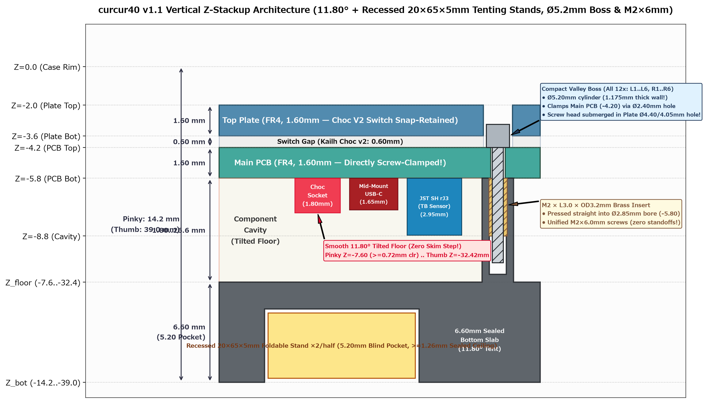
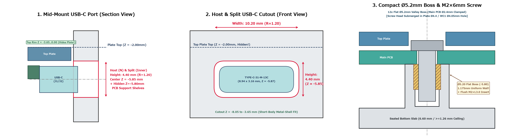
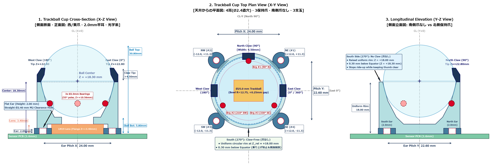
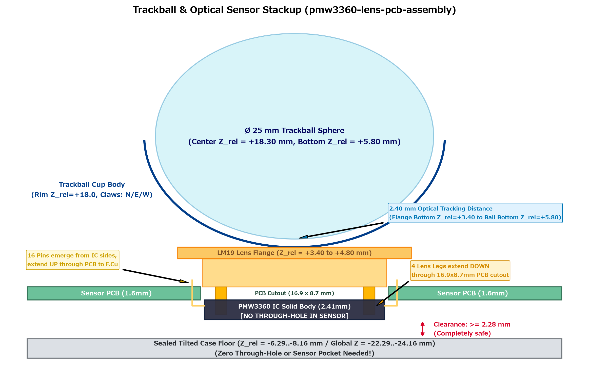
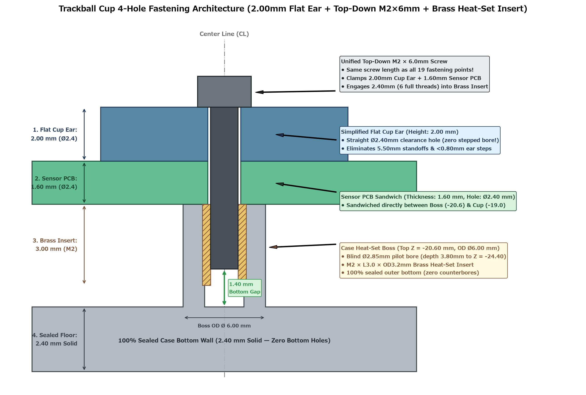

# curcur40 ケース設計仕様書 (Case Specification)

本書は、エルゴノミクス分割キーボード **curcur40**（25mmトラックボール・アンダープレート一体軸パッシブ磁気慣性ホイール統合型、Choc v2 ロープロファイル）のケース、トッププレート機械インターフェース、およびトラックボールカップの設計基準書です（パッシブ磁気慣性ホイールの単体機構・部品設計については [passive_inertia_wheel_spec.md](./passive_inertia_wheel_spec.md) を参照）。
今後の3Dモデル生成スクリプトは、すべて本書に記載された寸法・ルールに厳密に準拠して作成・更新されます。

> **【運用ルール】**
> 1. **スクリプトの配置場所**: 3Dモデル生成スクリプトや検証スクリプトは、Gitでバージョン管理するためすべてワークスペース内（`scripts/`）に配置します。
> 2. **設計変更の手順**:
>    - 寸法や仕様を変更したい場合、まず本書（`docs/case_spec.md`）の該当数値を編集します。
>    - ドキュメントのレビューが合意（OK）された後、スクリプトへ反映して3Dモデル（STEP/STL）を生成します。

---

## 1. 垂直Z軸積層構造 (Vertical Stackup)

ケース天面リムを基準 ($Z = 0.00 \, \text{mm}$) とした、各層の厚みおよびZ座標の定義です。

### 1.1 積層寸法一覧表

| レイヤー名 | 厚み / ギャップ | 開始 Z座標 | 終了 Z座標 | 備考 / 根拠 |
| :--- | :---: | :---: | :---: | :--- |
| **ケース天面リム〜プレート天面** | **2.00 mm** | $Z = 0.00$ | $Z = -2.00$ | プレート天面はケースリムより $2.00\,\text{mm}$ 奥に着座 |
| **トッププレート (Top Plate)** | **1.60 mm** | $Z = -2.00$ | $Z = -3.60$ | FR-4製。Kailh Choc V2 スイッチ（左21個・右18個＝計39個）のラッチ嵌合により保持（案1A）。ネジ位置 全14箇所（左 `L1..L6`・右 `R1..R6, WC1, WC2`）はすべて頭逃げ穴（`WC1` のみ外縁ブリッジ幅 $0.75\,\text{mm}$ 確保のため **$\varnothing 4.05\,\text{mm}$**、他13箇所 **$\varnothing 4.40\,\text{mm}$**）とし、ネジ頭（$Z=-4.20 \sim -3.00$）がプレート天面下に完全沈み込むためキー押下時も干渉ゼロ。右手トラックボール部は閉じた円形開口（**$\varnothing 28.625\,\text{mm}$**）でカップ外周を囲む |
| **スイッチ空間 (Switch Gap)** | **0.60 mm** | $Z = -3.60$ | $Z = -4.20$ | Kailh Choc v2 ハウジング下部高 $2.20\,\text{mm} - \text{プレート厚 } 1.60\,\text{mm}$ |
| **メイン基板 (Main PCB)** | **1.60 mm** | $Z = -4.20$ | $Z = -5.80$ | FR-4製。キー谷間12箇所（`L1..L6`, `R1..R6`: **$\varnothing 5.20\,\text{mm}$**, 天面 $Z=-5.80$）＋右クレードル2箇所（`WC1, WC2`, $Z=-5.80$）＋USB-Cポート近傍のケース内壁基板受け棚（片側3箇所・天面 $Z=-5.80$）で支持され、全14箇所の $\varnothing 2.40\,\text{mm}$ 円穴から `M2×6.0mm` ネジで直接クランプ（外周余白のむき出しネジ穴ゼロ） |
| **基板裏面空間 (Component Cavity)** | **1.80 mm (小指外端) 〜** | $Z = -5.80$ | $Z = -7.60 \sim -32.42$ | 外底面と完全平行な **段差・薄肉ポケットなしの連続 $11.80^\circ$ 傾斜内底面**（`v1.1` 内底面高さを完全維持）。小指端ソケット下で $\ge 0.72\,\text{mm}$、未カット `LM19` ガイドピン下で $\ge 0.71\,\text{mm}$、センサー基板 `J1` 嵌合 `SHR-06V-S-B` プラグ下でも $\ge 0.47\,\text{mm}$ の余裕を確保 |
| **キー谷間フラット円筒ボス (`L1`〜`L6`, `R1`〜`R6`)** | **均一外径 $\varnothing 5.20\,\text{mm}$** | $Z = -5.80$ | 傾斜内底面まで | 全12箇所とも段差ゼロのフラット円筒ボス（外径 **$\varnothing 5.20\,\text{mm}$**、下穴 $\varnothing 2.85\,\text{mm}$、片側均一肉厚 **$1.175\,\text{mm}$**）。すべてキーキャップ裾の谷間・死角に配置され、打鍵剛性の均一化と真上からの不可視性を両立 |
| **ケース内壁 USB-C 基板受け棚（片側3箇所）** | **内壁せり出し $2.00\,\text{mm}$** | $Z = -5.80$ | 傾斜内底面まで | 北内壁のPC側 USB-C 両脇（`NW_HostUSB_Shelf`, `NE_HostUSB_Shelf`）および内西壁の左右間 USB-C 北側（`W_SplitUSB_Shelf`）の計3箇所/片側で傾斜床から $Z=-5.80$ まで一体立ち上げ（基板裏面との重なり幅 $1.50\,\text{mm}$、内角 $R=0.85\,\text{mm}$）。外からも真上からも一切見えない死角で USB-C 挿抜時の下向き基板たわみを防止 |
| **アンダープレート一体軸慣性ホイール** | **全高 25.42 mm (クレードル底込)** | $Z = +3.62$ | $Z = -21.80$ | 回転軸中心を **$Z=-7.38\,\text{mm}$**（PCB $(14.2875, 2.7625)$）に配置した $\varnothing 22.00 \times 4.65\,\text{mm}$（$13.51\,\text{g}$, $J = 774\,\text{g}\cdot\text{mm}^2$）1ピース一体軸 `45# Steel` ホイール（頂点 **$Z=+3.62$**：キー天面 $+3.60$ 比わずか **$+0.02\,\text{mm}$**、ホイール下端 $Z=-18.38$、ロッカー底面 $Z=-21.20$、クレードル底面 $Z=-21.80$、東側反転配置で西側張り出しゼロ） |
| **沈み込みトラックボールカップ開口リム** | **14.00 mm (カップ本体)** | $Z = -5.00$ | $Z = -19.00$ | `v1.1` でさらに $-3.00\,\text{mm}$ 沈み込ませ、カップ円形リム（$Z_{\text{rel}}=+14.00$）をトッププレート下面より $1.40\,\text{mm}$ 奥（**$Z=-5.00\,\text{mm}$**）に配置（固定耳は高さ $2.00\,\text{mm}$ フラット耳） |
| **トラックボールセンサー基板 (`curcur40-pmw3360`)** | **1.60 mm** | $Z = -19.00$ | $Z = -20.60$ | FR-4製。メイン基板から $-14.80\,\text{mm}$ 下段に配置、カップ固定耳（$2.00\,\text{mm}$）ごとボス上面（$Z=-20.60$）の真鍮インサートへ統一 `M2×6.0mm` ネジで締結 |
| **トラックボールインサートボス (`TB1`〜`TB4`)** | **$\varnothing 6.00\,\text{mm}$ 円筒柱** | $Z = -20.60$ | 傾斜内底面まで | 傾斜内底面から $Z=-20.60$ まで立ち上がり、盲穴（$\varnothing 2.85\,\text{mm}$, 深さ $3.80\,\text{mm}$, 底 $Z=-24.40$）に真鍮ヒートセットインサートを圧入 |
| **埋め込みテンティングスタンド対応・100% 密閉外底面** | **鉛直床厚 6.60 mm / 法線 6.46 mm**（スタンド盲穴深さ $5.20\,\text{mm}$・隔壁 $\ge 1.09 \sim 1.26\,\text{mm}$） | 傾斜内底面 | $Z = -14.20 \sim -39.02$ | **内部空間への貫通穴完全ゼロ（100% 密閉底面）**。市販の **`20 × 65 × 5 mm` 折りたたみスタンド** を片側2本（北 $Y=-52.30$・南 $Y=-97.20\,\text{mm}$、X軸平行 $0^\circ$・左右鏡像対称、ポケット $65.80 \times 20.60 \times 5.20\,\text{mm}$ ＋ 親指側爪掛け凹み $4.50 \times 12.00 \times 5.20\,\text{mm}$）ツライチ収納できるよう外底面を鉛直 $-4.20\,\text{mm}$（法線 $+4.11\,\text{mm}$）オフセット。小指側外端（$|X_{\text{step}}|=135.858\,\text{mm}$）全高 **$14.20\,\text{mm}$**（$Z=-14.20$）、親指側内端（$|X_{\text{step}}|=17.050\,\text{mm}$）全高 **$39.02\,\text{mm}$**（$Z=-39.0203$、収納時 $\theta_{\text{tent}} = 11.80^\circ$ ／ スタンド展開時 約 $24^\circ \cdot 34^\circ$） |

### 1.2 基板裏面（B.Cu）部品・アンダープレートホイール機構の突出長と安全マージン

メイン基板裏面（`B.Cu`: $Z = -5.80 \, \text{mm}$）およびセンサーサブ基板裏面（`B.Cu`: $Z = -20.60 \, \text{mm}$）から下方のケース内底面（連続傾斜内底面 $Z = -7.60 \sim -32.42 \, \text{mm}$）に向けて突出する部品の実測寸法と安全クリアランスです：

| 実装基板・部品 | 基準面 | 下端到達 Z座標 | 直下のケース内底面 Z座標 | 最小クリアランス |
| :--- | :---: | :---: | :---: | :---: |
| **Kailh Choc V2 ソケット**（メイン基板 小指端 `SW17`/`rSW17`） | $Z = -5.80$ | $Z = -7.65$ | $Z \le -8.37$（$11.80^\circ$ 傾斜床） | **$\ge 0.72\,\text{mm}$**（完全非接触） |
| **PC側 USB-C レセプタクル (`J1`/`rJ1`, `TYPE-C-31-M-13C`)**（ミッドマウント、北面） | $Z = -5.80$ | $Z = -7.45$ | $Z \approx -23.4 \sim -24.0$ | **$\ge 15.9\,\text{mm}$**（完全非接触） |
| **左右間 USB-C レセプタクル (`J2`/`rJ2`, `TYPE-C-31-M-13C`)**（ミッドマウント、内側壁） | $Z = -5.80$ | $Z = -7.45$ | $Z \approx -31.8$ | **$\ge 24.3\,\text{mm}$**（完全非接触） |
| **3Dホールセンサー (`rU6`, `TMAG5273A1QDBVR`)**（右メイン：`(25.32, 2.7625)` 東側同軸配置） | $Z = -5.80$ | $Z = -6.95$ | $Z \approx -27.8$ | **$\ge 20.8\,\text{mm}$**（完全非接触） |
| **静音中クリックスイッチ (`rEXSW1`, `Kailh Square Silent`)**（右メイン：`(25.30, -4.75)` 東側配置） | $Z = -5.80$ | $Z = -10.10$（プランジャ先） | $Z \approx -27.8$ | **完全非接触**（ロッカー北東ストライカーが対向） |
| **アンダープレート慣性ホイール機構 (`wheel-rocker` / `wheel-cradle`)** | $Z = -5.80$ | $Z = -21.80$（クレードル底） | $Z \approx -29.3 \sim -30.5$ | **静止・$2.95^\circ$ フルクリック押下とも底面 $> 7.5\,\text{mm}$ / 内壁 $\ge 0.625\,\text{mm}$**（完全非接触） |
| **JST SH 6ピンコネクタ (`rJ3`, `SM06B-SRSS-TB` ＋ 嵌合 `SHR-06V-S-B`)**（右メイン：`46.80, 36.35` 西向き） | $Z = -5.80$ | $Z = -8.85$（嵌合プラグ $-8.80$） | $Z \approx -23.3$ | **床面 $> 14\,\text{mm}$ / ケース壁 $\ge 0.50\,\text{mm}$**（完全非接触） |
| **JST SH 6ピンコネクタ (`J1`, `SM06B-SRSS-TB` ＋ 嵌合 `SHR-06V-S-B`)**（センサー基板：`38.25, 47.625` 東向き） | $Z = -20.60$ | $Z = -23.65$（嵌合プラグ $-23.60$） | $Z \approx -24.07 \sim -25.60$（標準床厚 $2.40\,\text{mm}$ 連続傾斜床） | **ヘッダ $\ge 0.50\,\text{mm}$ / 嵌合プラグ $\ge 0.47\,\text{mm}$**（完全非接触） |
| **PMW3360 センサー本体 (`U1`)**（センサー基板） | $Z = -20.60$ | $Z = -23.01$ | $Z \approx -26.5 \sim -28.0$ | **$\ge 3.5\,\text{mm}$**（完全非接触） |

> **【設計結論および AI 監査時の誤認防止ルール】**
> 1. **100% 密閉外底面（`20×65×5mm` 折りたたみテンティングスタンド平行2本埋め込みブラインドポケット付）・$11.80^\circ$ 段差ゼロ連続傾斜内底面・キー谷間 $\varnothing 5.20\,\text{mm}$ フラットボス・内壁 USB-C 基板受け棚・KiCad 3D STEP 完全同期検証**: 真鍮ヒートセットインサートによる上方向片側締結（`M2 × 6.0mm` ネジ統一）を採用したことで、ケース外底面には内部への貫通穴もネジザグリ穴も一切存在しません。外底面は小指側外端（$|X_{\text{step}}| = 135.858\,\text{mm}, Z = -14.20\,\text{mm}$）から親指側内端（$|X_{\text{step}}| = 17.050\,\text{mm}, Z = -39.0203\,\text{mm}$）へ $\theta_{\text{tent}} = 11.80^\circ$ 傾斜し、その外底面（鉛直床スラブ厚 $6.60\,\text{mm}$／法線厚 $6.46\,\text{mm}$）に **`20 × 65 × 5 mm` 折りたたみスタンドを片側2本・X軸平行（$0^\circ$）・左右完全鏡像対称でツライチ収納できるブラインドポケット**（本穴 $65.80 \times 20.60 \times 5.20\,\text{mm}$ $R=1.20$、北 $Y=-52.30$・南 $Y=-97.20\,\text{mm}$、$u_{\text{thumb}} \in [8.00, 73.80]\,\text{mm}$ ＋ 親指側爪掛け凹み $4.50 \times 12.00 \times 5.20\,\text{mm}$ $u_{\text{thumb}} \in [3.50, 8.00]\,\text{mm}$、内底面までの密閉隔壁厚 $1.26\,\text{mm}$・`TB2`/`TB4` 盲穴底直下でもソリッド肉厚 $1.09\,\text{mm} > 0.80\,\text{mm}$、親指外壁も無開口で外から金属非露出）を備えています。内底面は `v1.1` と同一高さの連続傾斜平面（$Z = -7.60 \sim -32.42\,\text{mm}$、薄肉ポケットやスキム段差ゼロ）、単段フラット円筒ボス（キー谷間12箇所 `L1..L6, R1..R6`: $\varnothing 5.20\,\text{mm}$, 天面 $Z=-5.80\,\text{mm}$、`TB1..TB4`: $\varnothing 6.00\,\text{mm}$, 天面 $Z=-20.60\,\text{mm}$）、および USB-C ポート近傍の内壁一体基板受け棚（片側3箇所、天面 $Z=-5.80\,\text{mm}$）で構成されています。フルアセンブリ生成時は KiCad 10.0 から3枚の実装基板＋全実装部品3Dモデルを直接 STEP 出力したうえで嵌合 JST `SHR-06V-S-B` ハウジング2個と収納状態の折りたたみスタンド4本も統合し、全ソリッド間の 3D 干渉体積 **`0.00000000 mm³`** を自動検証しています。
> 2. **ケース上縁リム深さ（$2.00 \, \text{mm}$）と沈み込みトラックボールリム（$Z = -5.00\,\text{mm}$）の維持**: トッププレート天面（$Z = -2.00 \, \text{mm}$）に対してケース外壁リム天面（$Z = 0.00 \, \text{mm}$）が $2.00 \, \text{mm}$ 高いハイプロファイルリム形状、およびトラックボールカップ円形リム天面をプレート下面よりさらに奥の $Z = -5.00 \, \text{mm}$ へ沈み込ませて閉円形プレート開口（$\varnothing 28.625\,\text{mm}$）で囲む `v1.1` 低プロファイル外観は確定デザインです。
> 3. **Kailh Choc V2 スイッチと $1.60 \, \text{mm}$ 厚トッププレートの適合性**: Kailh Choc V2（`CPG1353`）のハウジング嵌合部は $13.80 \times 13.80 \, \text{mm}$、ラッチ溝高さは $1.65 \, \text{mm}$、フランジ下高さは $2.20 \, \text{mm}$ であり、板厚 $1.60 \, \text{mm}$ の FR-4 トッププレート（開口 $14.0 \times 14.0 \, \text{mm}$、Corne V4 準拠）および Switch Gap $0.60 \, \text{mm}$（$2.20 - 1.60 = 0.60 \, \text{mm}$）に正確に適合します。

---

## 2. ねじ止め・ファスナ仕様 (Fastening Specifications)

旧設計の `5.50mm` メスメススペーサーおよび上下両面 `M2 × 4.0mm` ネジ・ケース底面ザグリ穴を全面廃止し、キーボード全体の **全 19箇所すべて** を **真鍮ヒートセットインサート（`M2 × L=3.0 × OD=3.2 mm`、計 19個）** と **統一長さ `M2 × 6.0 mm` ネジ（計 19本）** に完全統一しています。

### 2.1 締結部品の選定仕様（全19箇所 真鍮ヒートセットインサート ＆ 統一 M2×6.0mm ネジ）
* **全 19箇所共通 真鍮ヒートセットインサート**: ローレット付き熱圧入真鍮インサート **`M2 × 長さ L = 3.0 mm × 外径 OD = 3.2 mm`** × **19個**
  * 3Dプリント樹脂パーツ（MJF/SLS PA12）側の下穴径をすべて **$\varnothing 2.85 \, \text{mm}$ ストレート盲穴（一部貫通）** に統一しており、$220 \sim 250\,^\circ\text{C}$ に設定した**普通のはんだごて**で上から真っ直ぐ押し込むだけで強固な金属雌ネジを形成します（専用ヒートセットチップ不要）。
* **全 19箇所共通 固定・調整ネジ**: **`M2 × 長さ 6.0 mm` JIS 精密なべ小ねじ推奨**（標準頭径 $\varnothing 3.5\,\text{mm}$、最大でも $\le \varnothing 3.8\,\text{mm}$ ※`WC1` 穴 $\varnothing 4.05\,\text{mm}$ に対して $\varnothing 4.0\,\text{mm}$ 幅広超低頭は非推奨、**強磁性鉄／ニッケルめっき鋼製推奨**）× **19本**
  * **① 左右ケース キー谷間 12箇所（左右完全対称 `L1`〜`L6` / `R1`〜`R6`・外周むき出し穴ゼロ・コンパクト $\varnothing 5.20\,\text{mm}$ 単段フラット円筒ボス・内壁 USB-C 受け棚併用）**:
    * **全 12箇所共通（左 `L1`〜`L6` 6箇所 ＆ 右 `R1`〜`R6` 6箇所）＝ 天面 $Z = -5.80\,\text{mm}$ 均一フラット円筒ボス（外径 $\varnothing 5.20\,\text{mm}$）**:
      * ネジ頭がトッププレート下に完全沈み込みキーキャップ裾と干渉しない構造（案1A）を活かし、かつてトッププレート外周余白で目立っていたネジ穴を**完全廃止（外周むき出しネジ穴ゼロ）**し、左右完全対称の **キー間谷間・キャップ裏死角 6点ずつ（計12箇所）** へ再配置しました。
      * これにより ①真上（$90^\circ$）から見ても斜め手前から見てもネジ穴がキーキャップの陰に隠れて目立たず、②人差し指北（`#1`）・小指北南（`#2, #3`）・内側南（`#4`）・親指内外（`#5, #6`）がキーマトリクス内部を均等スパンで支えるため打鍵位置による硬さ・たわみ差が最小化され、③さらに北内壁・内西壁の死角に一体成形した **3箇所の基板受け棚（$Z = -5.80\,\text{mm}$）** が PC側・左右間 USB-C ケーブル挿抜時の下向き荷重を直接受け止めます。
      * 下穴（$\varnothing 2.85\,\text{mm}$）周囲に **片側均一肉厚 $1.175\,\text{mm}$（`OD 3.20mm` ローレット溶融外周でも $1.00\,\text{mm}$ ソリッド肉厚）** を確保し、段差ゼロのフラット天面（$Z = -5.80\,\text{mm}$）へそのまま真っ直ぐインサートを熱圧入できるため、熱圧入時の狭い首部通過や膨れ・割れが一切発生しません。
      * メイン基板は全12箇所ともシンプルな **$\varnothing 2.40\,\text{mm}$ 円穴** で上から `M2 × 6.0mm` ネジにより直接ガッチリ固定（インサート全長 **$3.00\,\text{mm}$（7.5山）フル螺合**）され、ネジ頭（$Z = -4.20 \sim -3.00\,\text{mm}$）はトッププレートの **$\varnothing 4.40\,\text{mm}$ ネジ頭逃げ穴** 内に完全沈み込みます。左右トッププレートは Kailh Choc V2 キースイッチ（左21個・右18個＝計39個）のラッチ嵌合により全6自由度（`±X, ±Y, ±Z`）で確実に保持されます。
  * **② トラックボールカップ固定耳 4箇所（右手 `TB1`〜`TB4`）**:
    * カップ固定耳を高さ **$2.00\,\text{mm}$ のシンプルなフラット耳**（$Z_{\text{rel}} = 0.00 \sim +2.00\,\text{mm}$ / グローバル $Z = -19.00 \sim -17.00\,\text{mm}$、外径 $\varnothing 6.00\,\text{mm}$、ストレート貫通穴 **$\varnothing 2.40\,\text{mm}$**、段付き穴なし）とし、その下のセンサーサブ基板（板厚 $1.60\,\text{mm}$、ストレート貫通穴 **$\varnothing 2.40\,\text{mm}$**）と一緒にケース下段ボス天面（**$Z = -20.60\,\text{mm}$**、盲穴深さ $3.80\,\text{mm}$・底 $Z = -24.40\,\text{mm}$）の真鍮インサートへ上から `M2 × 6.0mm` ネジで一括締結します。
    * クランプ総厚 $2.00 + 1.60 = 3.60\,\text{mm}$ に対し、インサートへの有効螺合 **$2.40\,\text{mm}$（6.0山）**・穴底隙間 **$1.40\,\text{mm}$** となり、ケース外底面（$Z \approx -26.5 \sim -31.7\,\text{mm}$）まで十分な肉厚を残したまま底面穴ゼロで固定されます。
  * **③ アンダープレート慣性ホイール クレードル固定 2箇所（右手 `WC1`, `WC2`）＆ サドル底面接線支持 Cクリップスナップインヒンジ**:
    * 南開放 U字フレーム構造の [`wheel-cradle.step`](../cases/inertia_wheel/wheel-cradle.step) の左右ヒンジ座を **サドル底面接線支持・スリット分離型 Cクリップスナップイン軸受（内径 $\varnothing 3.50\,\text{mm}$・入口スロート幅 $2.80\,\text{mm}$・肉厚 $1.55\,\text{mm}$）** としたことで、ホイール組込済みの `#03` シーソーロッカーを真上から真っ直ぐ無干渉で降ろして $\varnothing 3.20\,\text{mm}$ トラニオン支点軸（$Z = -14.35\,\text{mm}$）を「パチン」と機械的に連結・抜け止めしつつ、公差遊びを上側へ集約して重力沈み込み（空振り）ゼロで `rEXSW1` を確実にクリック（$2.95^\circ$ で $0.28\,\text{mm}$ 押下、$+3.88^\circ$ 西側過荷重ハードストップ保護）できます。
    * 右トッププレートの頭逃げ穴（`WC1` $\varnothing 4.05\,\text{mm}$ / `WC2` $\varnothing 4.40\,\text{mm}$）を通し、右メイン基板 `F.Cu`（$Z = -4.20\,\text{mm}$、穴径 $\varnothing 2.40\,\text{mm}$）から裏面 `B.Cu`（$Z = -5.80\,\text{mm}$）に密着するクレードルの2箇所の真鍮インサート止まり穴ボス（`WC1`, `WC2`: $\varnothing 2.85 \times \text{深さ } 5.30\,\text{mm}$, $h/\Phi = 1.86 \le 3.0$、ネジ先端底余裕 $0.90\,\text{mm}$）へ上から `M2 × 6.0mm` ネジ 2本で直締結します。
  * **④ 慣性ホイール 下部キーパー壁付き・接着剤ゼロ磁気デテント調整 1箇所（`wheel-rocker.step` 南ボス）**:
    * [`wheel-rocker.step`](../cases/inertia_wheel/wheel-rocker.step) 南側ボスの水平穴（$\varnothing 2.85 \times 3.20\,\text{mm}$, $Z = -14.08\,\text{mm}$）南口に圧入した真鍮インサートへ、**強磁性（鉄／ニッケルめっき鋼）の `M2 × 6.0mm` ネジ 1本** を南からねじ込み、上面開放ドロップイントラフから入れた **$\varnothing 2.0 \times 2.0\,\text{mm}$ 軸方向着磁ネオジム磁石（二六製作所 `NE280` 等）をネジ先端に磁力だけで自己吸着**（接着剤ゼロ・$\varnothing 2.30\,\text{mm}$ ガイドリング＋肉厚 $2.25\,\text{mm}$ 北端下部キーパー壁によりホイール吸着を完全防止）させて `45# Steel` ホイールの $R=1.50\,\text{mm}$ 外周24溝とのエアギャップを無段階調整します。

### 2.2 各レイヤーの貫通穴・開口・ボス寸法
トッププレート外周輪郭はケース内壁に対して全周 **$0.30 \, \text{mm}$** のクリアランスを確保し、右手トラックボール部はトッププレートの閉円形開口（**$\varnothing 28.625\,\text{mm}$**、中心 $(28.5750, 47.6250)$）および右メイン基板のU字切り欠き（$x_{\text{pcb}} \in [14.1500, 42.8375], y_{\text{pcb}} \ge 32.9000\,\text{mm}$）によってカップ円筒外周（$\varnothing 28.00\,\text{mm}$、リム天面 $Z = -5.00\,\text{mm}$）と全周クリアランスを確保しているため、先にトラックボールカップを固定した後でも右メイン基板＋トッププレート（慣性ホイール組込済）を真上から垂直に下ろして着地できます。

| 対象レイヤー | 箇所 | 加工形状 | 設計寸法 | 備考 |
| :--- | :--- | :--- | :---: | :--- |
| **トッププレート (FR-4)** | 基板締結ネジ頭逃げ穴（左 `L1..L6` 6箇所 / 右 `R1..R6, WC1, WC2` 8箇所、計14箇所） | ストレート円筒貫通穴 | **$\varnothing 4.40 \, \text{mm}$** (`WC1` のみ **$\varnothing 4.05\,\text{mm}$**) | ネジ頭（標準 JIS なべ頭 $\varnothing 3.5\,\text{mm}$、最大 $\le \varnothing 3.8\,\text{mm}$）が通過してメイン基板 `F.Cu` ($Z=-4.20$) に沈み込み着座（`WC1` 西外縁ブリッジ幅 $0.75\,\text{mm}$ 確保） |
| **トッププレート (FR-4)** | トラックボール開口（右親指上部） | 閉じた円筒貫通穴 | **$\varnothing 28.625\,\text{mm}$ ($R=14.3125\,\text{mm}$)** | 中心 **$(28.5750, 47.6250)\,\text{mm}$**。$-3.00\,\text{mm}$ 沈み込みカップ（外径 $\varnothing 28.00\,\text{mm}$）を全周均一ギャップ $0.3125\,\text{mm}$ で囲む |
| **トッププレート (FR-4)** | アンダープレート慣性ホイール開口（右内側上部） | シンプル角丸長穴（カバー不要） | **$8.05 \times 22.00\,\text{mm}$ ($R=1.00\,\text{mm}$)** | 中心 **$(14.1125, 2.7625)\,\text{mm}$**（ホイール軸 $x=14.2875$ に対し西端 $-0.35\,\text{mm}$ 拡幅）。$2.95^\circ$ フルクリック時も全可動部 $\ge 0.33\,\text{mm}$ 余裕 |
| **トラックボールカップ** | 固定耳穴（右 `TB1`〜`TB4`、フラット耳高さ $2.00\,\text{mm}$） | ストレート円筒貫通穴（段付きなし） | **$\varnothing 2.40 \, \text{mm}$** | センサー基板（$1.60\,\text{mm}$）ごと上から `M2×6.0mm` ネジでケースインサートへ直締結 |
| **PCB (FR-4)** | M2ネジ貫通穴（左 `L1..L6` / 右メイン `R1..R6, WC1, WC2` / 右センサー `TB1`〜`TB4`、計18箇所） | ストレート円筒貫通穴 (`Edge.Cuts`) | **$\varnothing 2.40 \, \text{mm}$** | 全箇所ともシンプルな円穴（太穴・南U溝ゼロ）。統一 `M2×6.0mm` ネジで基板表面を直接締結 |
| **PCB (FR-4)** | アンダープレート慣性ホイール窓（右メイン内側上部） | 十字形角丸切り欠き | **縦スロット $7.95 \times 23.00\,\text{mm}$ ＋ 横翼 $[6.9375..23.6475] \times [-0.9875..+6.5125]\,\text{mm}$** | スチールホイール・`DDL-520ZZ` 軸受2個・東側 `#02` マグネットホルダー（$\varnothing 6.64 \times 5.05\,\text{mm}$）が静止時・$2.95^\circ$ クリック時とも非接触通過（最小隙間 $\ge 0.31\,\text{mm}$） |
| **ケース内底面・ボス・受け棚 (PA12)** | 単段フラットインサートボス（左6 / 右10）＋ USB-C 内壁基板受け棚（左右各3） | 傾斜内底面からの円筒柱・内壁一体ピラスター（TB近接ボスは内壁へブリッジ結合） | **キー谷間12箇所 $\varnothing 5.20\,\text{mm}$ ($Z=-5.80$)・TB 4箇所 $\varnothing 6.00\,\text{mm}$ ($Z=-20.60$) / 下穴 $\varnothing 2.85\,\text{mm}$・受け棚天面 $Z=-5.80$** | 全ボスとも段差ゼロのフラット天面へツライチ熱圧入（片側均一肉厚 $1.175 \sim 1.575\,\text{mm}$）、内壁受け棚3箇所が USB-C 挿抜荷重を支持 |
| **ケース外底面 (PA12)** | 底面全域（左 / 右） | 100% 密閉傾斜底面 ＋ 折りたたみスタンド平行2本ブラインドポケット | **内部貫通穴 0箇所 / ポケット $65.80 \times 20.60 \times 5.20\,\text{mm}$ ($R=1.20$) × 片側2箇所 ＋ 爪掛け凹み** | 鉛直スラブ厚 $6.60\,\text{mm}$（法線 $6.46\,\text{mm}$、密閉隔壁 $\ge 1.09 \sim 1.26\,\text{mm}$）の $11.80^\circ$ 底面に `20×65×5mm` スタンドをツライチ収納 |

### 2.3 全19箇所ヒートセットインサート・ネジ配置座標一覧（PCB座標系 & ケースSTEP座標系）
PCB座標系 $(x_{\text{pcb}}, y_{\text{pcb}})$ からケース・アセンブリSTEP座標系 $(X_{\text{step}}, Y_{\text{step}})$ への変換式は以下の通りです：
* **左手**: $X_{\text{step}} = x_{\text{pcb}} - 14.2875$、 $Y_{\text{step}} = -(y_{\text{pcb}} + 57.1500)$
* **右手**: $X_{\text{step}} = x_{\text{pcb}} + 14.2875$、 $Y_{\text{step}} = -(y_{\text{pcb}} + 57.1500)$

#### ① 左手（計6箇所：キー谷間フラット円筒ボス $\varnothing 5.20\,\text{mm}$ at $Z = -5.80\,\text{mm}$）
| 番号 | 配置箇所 | PCB座標 $(x_{\text{pcb}}, y_{\text{pcb}})$ | STEP座標 $(X_{\text{step}}, Y_{\text{step}})$ | トッププレート穴 | メインPCB穴 | ケースボス天面 / インサート下穴 ($\varnothing 2.85$) |
| :---: | :--- | :---: | :---: | :---: | :---: | :---: |
| **L1** | 人差し指・北4キー谷間（`SW3/4/5/6` 間） | $(-42.2500, -4.5000)$ | $(-56.5375, -52.6500)$ | $\varnothing 4.40$ | $\varnothing 2.40$ | フラット円筒 $\varnothing 5.20$ $Z = -5.80$（盲穴底 $-11.80$） |
| **L2** | 小指・北4キー谷間（`SW13/14/17/18` 間） | $(-100.5000, 0.5000)$ | $(-114.7875, -57.6500)$ | $\varnothing 4.40$ | $\varnothing 2.40$ | フラット円筒 $\varnothing 5.20$ $Z = -5.80$（盲穴底 $-11.80$） |
| **L3** | 小指・南4キー谷間（`SW14/15/16/17` 間） | $(-100.5000, 19.5000)$ | $(-114.7875, -76.6500)$ | $\varnothing 4.40$ | $\varnothing 2.40$ | フラット円筒 $\varnothing 5.20$ $Z = -5.80$（盲穴底 $-11.80$） |
| **L4** | 人差し指・南4キー谷間（`SW2/3/6/7` 間） | $(-42.2500, 14.5000)$ | $(-56.5375, -71.6500)$ | $\varnothing 4.40$ | $\varnothing 2.40$ | フラット円筒 $\varnothing 5.20$ $Z = -5.80$（盲穴底 $-11.80$） |
| **L5** | 親指内側・`SW1/EXSW3` 南裏死角 | $(-27.0000, 58.8000)$ | $(-41.2875, -115.9500)$ | $\varnothing 4.40$ | $\varnothing 2.40$ | フラット円筒 $\varnothing 5.20$ $Z = -5.80$（盲穴底 $-11.80$） |
| **L6** | 親指外側・`SW7/8/9/10` 間谷間 | $(-60.5000, 35.0000)$ | $(-74.7875, -92.1500)$ | $\varnothing 4.40$ | $\varnothing 2.40$ | フラット円筒 $\varnothing 5.20$ $Z = -5.80$（盲穴底 $-11.80$） |

#### ② 右手（計13箇所：ケースボス10箇所［キー谷間6＋TB4］＋ ホイールクレードル2箇所［`WC1`/`WC2`］＋ ホイールロッカー磁力調整1箇所）
| 番号 | 配置箇所 | PCB座標 $(x_{\text{pcb}}, y_{\text{pcb}})$ | STEP座標 $(X_{\text{step}}, Y_{\text{step}})$ | プレート / カップ穴 | PCB貫通穴 | インサート圧入先 ($\varnothing 2.85$ 下穴) |
| :---: | :--- | :---: | :---: | :---: | :---: | :---: |
| **R1** | 人差し指・北4キー谷間（`rSW3/4/5/6` 間） | $(42.2500, -4.5000)$ | $(56.5375, -52.6500)$ | プレート $\varnothing 4.40$ | 右メイン $\varnothing 2.40$ | フラット円筒 $\varnothing 5.20$ $Z = -5.80$（盲穴底 $-11.80$） |
| **R2** | 小指・北4キー谷間（`rSW13/14/17/18` 間） | $(100.5000, 0.5000)$ | $(114.7875, -57.6500)$ | プレート $\varnothing 4.40$ | 右メイン $\varnothing 2.40$ | フラット円筒 $\varnothing 5.20$ $Z = -5.80$（盲穴底 $-11.80$） |
| **R3** | 小指・南4キー谷間（`rSW14/15/16/17` 間） | $(100.5000, 19.5000)$ | $(114.7875, -76.6500)$ | プレート $\varnothing 4.40$ | 右メイン $\varnothing 2.40$ | フラット円筒 $\varnothing 5.20$ $Z = -5.80$（盲穴底 $-11.80$） |
| **R4** | 人差し指・南4キー谷間（`rSW2/3/6/7` 間） | $(42.2500, 14.5000)$ | $(56.5375, -71.6500)$ | プレート $\varnothing 4.40$ | 右メイン $\varnothing 2.40$ | フラット円筒 $\varnothing 5.20$ $Z = -5.80$（盲穴底 $-11.80$） |
| **R5** | 南西半島下端・`rU2` 南死角 | $(9.4500, 58.5000)$ | $(23.7375, -115.6500)$ | プレート $\varnothing 4.40$ | 右メイン $\varnothing 2.40$ | フラット円筒 $\varnothing 5.20$ $Z = -5.80$（盲穴底 $-11.80$） |
| **R6** | 親指外側・`rSW7/8/9/10` 間谷間 | $(60.5000, 35.0000)$ | $(74.7875, -92.1500)$ | プレート $\varnothing 4.40$ | 右メイン $\varnothing 2.40$ | フラット円筒 $\varnothing 5.20$ $Z = -5.80$（盲穴底 $-11.80$） |
| **TB1** | トラックボール北西 (NW) | $(16.5750, 36.3250)$ | $(30.8625, -93.4750)$ | カップ耳 ($2.0\,\text{mm}$) $\varnothing 2.40$ | センサー $\varnothing 2.40$ | ケース下段ボス $Z = -20.60$ (盲穴深さ $3.80$, 底 $-24.40$) |
| **TB2** | トラックボール北東 (NE) | $(40.5750, 36.3250)$ | $(54.8625, -93.4750)$ | カップ耳 ($2.0\,\text{mm}$) $\varnothing 2.40$ | センサー $\varnothing 2.40$ | ケース下段ボス $Z = -20.60$ (盲穴深さ $3.80$, 底 $-24.40$) |
| **TB3** | トラックボール南西 (SW) | $(16.5750, 58.9250)$ | $(30.8625, -116.0750)$ | カップ耳 ($2.0\,\text{mm}$) $\varnothing 2.40$ | センサー $\varnothing 2.40$ | ケース下段ボス $Z = -20.60$ (盲穴深さ $3.80$, 底 $-24.40$) |
| **TB4** | トラックボール南東 (SE) | $(40.5750, 58.9250)$ | $(54.8625, -116.0750)$ | カップ耳 ($2.0\,\text{mm}$) $\varnothing 2.40$ | センサー $\varnothing 2.40$ | ケース下段ボス $Z = -20.60$ (盲穴深さ $3.80$, 底 $-24.40$) |
| **WC1** | ホイールクレードル北西固定 | $(7.3375, -5.0375)$ | $(21.6250, -52.1125)$ | プレート $\varnothing 4.05$ | 右メイン $\varnothing 2.40$ | `wheel-cradle` 北西ボス $Z = -5.80$ (止まり穴深さ $4.50\,\text{mm}$) |
| **WC2** | ホイールクレードル南東固定 | $(21.2375, 10.7625)$ | $(35.5250, -67.9125)$ | プレート $\varnothing 4.40$ | 右メイン $\varnothing 2.40$ | `wheel-cradle` 南東ボス $Z = -5.80$ (止まり穴深さ $4.50\,\text{mm}$) |
| **DET** | ホイール磁気デテント無段階調整 | $(13.3375, 21.8825)$ 南口 | $(27.6250, -79.0325, -14.08)$ | ―（基板下水平配置） | ― | `wheel-rocker` 南ボス水平穴＋開放トラフ ($v \in [-19.12, -8.55]$) |

---

## 3. 外周ポート・開口部仕様 (Cutouts & Ports)

メイン基板の切り欠き（`Edge.Cuts`）に落とし込んで実装される4箇所すべてのミッドマウント型 USB-C コネクタ（PC接続用 `J1`/`rJ1` および左右分割接続用 `J2`/`rJ2`、ともに `TYPE-C-31-M-13C`）の実中心高さ（`B.Cu` 面高さに近い **$Z = -5.85\,\text{mm}$**）に合わせて開口部を完全共通の角丸長穴（幅 **$10.20\,\text{mm}$** $\times$ 高さ **$4.40\,\text{mm}$**、$R = 1.20\,\text{mm}$）で同心配置し、**基板着地時のクリアランス（全周約 $0.62\,\text{mm}$）を確保しつつ、外観上も必要最小限の開口サイズ（上端 $Z = -3.65\,\text{mm}$ によりトッププレート $Z = -3.60 \sim -2.00\,\text{mm}$ の断面露出を 100% 遮蔽する設計）**としています。

> [!IMPORTANT]
> **【意図的設計ルール・AI誤認防止】短胴 USB-C レセプタクル `TYPE-C-31-M-13C` におけるプラグ挿入深さと最小開口方針**
> 採用部品 **`TYPE-C-31-M-13C`（HRO / LCSC `C2848620`）** は外殻全長 **$6.50\,\text{mm}$**・奥側インシュレータ壁厚 $2.00\,\text{mm}$ のショートボディ品であり、**プラグ金属シェルの有効挿入深さ（物理突き当たり＆正規ロック位置）は $4.50\,\text{mm}$** です。一般的な USB-C オスプラグの金属シェル長（USB-IF 規格基準 **$6.65 \pm 0.10\,\text{mm}$**、市販品 $6.65 \sim 7.00\,\text{mm}$）を 100% 奥まで挿し切っても、レセプタクル先端から **$2.15 \sim 2.50\,\text{mm}$**、ケース外表面（口金奥まり量 $1.255\,\text{mm}$）から外側に **$+0.9 \sim +1.2\,\text{mm}$** 金属シェルが露出し、**樹脂オーバーモールドはケース外壁の手前で止まって開口内へ一切入りません**（`v1.0` 実機にて複数ケーブルで確認済み）。このため、オーバーモールド通過用の穴拡大やザグリは設けず、**意図的に必要最小限の開口サイズを維持**しています。

### 3.1 左右間 USB-C ポート開口部（内側親指側面：`J2` / `rJ2`）
* **開口寸法**: 幅 **$10.20 \, \text{mm}$**（Y方向、中心 $y_{\text{pcb}} = 38.7500\,\text{mm}$ / $Y_{\text{step}} = -95.9000\,\text{mm}$、範囲 $Y_{\text{step}} = -101.00 \sim -90.80\,\text{mm}$） $\times$ 高さ **$4.40 \, \text{mm}$**（Z方向）
* **コーナーR**: 四隅 **$R = 1.20 \, \text{mm}$**
* **垂直・水平配置と各基準面からの距離**:
  * **USB-C レセプタクル（`TYPE-C-31-M-13C`, シェル $8.94 \times 3.16\,\text{mm}$）実中心高さ**: `B.Cu` ($Z = -5.80\,\text{mm}$) ミッドマウント（`Offset.z = -1.60 mm`）により、実シェル（$Z = -7.45 \sim -4.29\,\text{mm}$）の中心は **$Z = -5.87 \, \text{mm}$**
  * **開口中心 Z座標**: **$Z = -5.85 \, \text{mm}$**（レセプタクル中心とほぼ完全同心、実シェルに対して前後各 $+0.63\,\text{mm}$・上下各 $+0.62\,\text{mm}$ の対称クリアランスを確保）
  * **開口上端 Z座標**: $-5.85 + 2.20 = \mathbf{-3.65 \, mm}$（トッププレート $Z = -3.60 \sim -2.00\,\text{mm}$ の端面がケース上枠 $3.65\,\text{mm}$ の裏に 100% 隠れます）
  * **開口下端 Z座標**: $-5.85 - 2.20 = \mathbf{-8.05 \, mm}$（ビルトインテンティング外底面 $Z_{\text{bottom}} = -39.02\,\text{mm}$ から約 **$31.0\,\text{mm}$** 高い位置にあり、L字型 USB-C ケーブルを挿してもデスク面に一切干渉しません）

### 3.2 PC接続用 USB-C ポート開口部（上側北面：`J1` / `rJ1`）
* **開口寸法**: 幅 **$10.20 \, \text{mm}$**（X方向、中心 左手 `J1`: $X_{\text{step}} = -60.2375\,\text{mm}$ / 右手 `rJ1`: $X_{\text{step}} = +57.1500\,\text{mm}$） $\times$ 高さ **$4.40 \, \text{mm}$**（Z方向）、四隅 **$R = 1.20 \, \text{mm}$**
* **開口中心 Z座標**: **$Z = -5.85 \, \text{mm}$**（上端 $-3.65\,\text{mm}$、下端 $-8.05\,\text{mm}$、傾斜内底面 $Z \approx -23.4 \sim -24.0\,\text{mm}$ に対し **$15.3\,\text{mm}$ 以上**の余裕）

### 3.3 USB-C ポート近傍 ケース内壁基板受け棚（Hidden Inner-Wall PCB Support Shelves）
外周ネジ穴をキー間谷間（`L1`〜`L6`, `R1`〜`R6`）へ内移設したうえで、PC接続用 USB-C（北面 `J1`/`rJ1`）および左右間 USB-C（内西面 `J2`/`rJ2`）のケーブル挿抜時に基板端へ加わる下向き荷重・こじり力を確実に支持するため、**トッププレート（$Z = -3.60 \sim -2.00\,\text{mm}$）の下に完全に隠れて外からも真上からも一切見えない死角**（天面 **$Z = -5.8000 \, \text{mm}$** ＝ メイン基板 `B.Cu` 着座面）に、傾斜内底面から垂直に立ち上がる **内壁一体ピラスター（基板受け棚）× 片側3箇所（計6箇所）** を設けています（いずれも内壁から **$2.00\,\text{mm}$** 内側へ突出し、メイン基板外周クリアランス $0.50\,\text{mm}$ を差し引いた **$1.50\,\text{mm}$ 幅** で基板裏面をソリッド支持、垂直内角 $R = 0.85\,\text{mm}$、オーバーハング・アンダーカット完全ゼロ）：
* **`NW_HostUSB_Shelf`（PC側 USB-C 西脇）**: 左 $X_{\text{step}} \in [-77.2000, -67.2000]$ ／ 右 $X_{\text{step}} \in [40.1500, 50.1500]\,\text{mm}$、$Y_{\text{step}} \in [-30.9875, -28.2000]\,\text{mm}$
* **`NE_HostUSB_Shelf`（PC側 USB-C 東脇）**: 左 $X_{\text{step}} \in [-53.2000, -43.2000]$ ／ 右 $X_{\text{step}} \in [64.1500, 74.1500]\,\text{mm}$、$Y_{\text{step}} \in [-30.9875, -28.2000]\,\text{mm}$
* **`W_SplitUSB_Shelf`（内側壁・左右間 USB-C 北脇）**: $|X_{\text{step}}| \in [17.8000, 20.5500]\,\text{mm}$、$Y_{\text{step}} \in [-81.8000, -74.6000]\,\text{mm}$

### 3.4 右ケース $11.80^\circ$ 連続傾斜内底面・センサー基板 `J1` クリアランス・底面埋め込みスタンドポケット
`v1.1` ではトラックボールカップの $-3.00\,\text{mm}$ 沈み込み化（センサーサブ基板 `curcur40-pmw3360` 裏面 `B.Cu`: $Z = -20.60\,\text{mm}$）に合わせて最小包絡テンティング角を $\theta_{\text{tent}} = 11.80^\circ$（内底面 $Z = -7.60 \sim -32.4203\,\text{mm}$）へ設定し、さらに外底面を鉛直 $-4.20\,\text{mm}$（法線 $+4.11\,\text{mm}$：小指外端 $Z = -14.20\,\text{mm}$・親指内端 $Z = -39.0203\,\text{mm}$、鉛直床スラブ厚 $6.60\,\text{mm}$）オフセットしています。これにより、**内部側は局所的な薄肉逃がしポケットを一切設けない段差ゼロ連続傾斜平面のまま**、東向き `J1`（`SM06B-SRSS-TB`）ヘッダに対し **$\ge 0.83\,\text{mm}$**、嵌合 `SHR-06V-S-B` ハウジング（下面 $Z = -23.60\,\text{mm}$）に対しても **$\ge 0.47\,\text{mm}$** のクリアランスを確保しつつ、**外底面側には `20 × 65 × 5 mm` 折りたたみスタンドを片側2本・X軸平行でツライチ収納できる深さ $5.20\,\text{mm}$ のブラインドポケット（内底面までの密閉隔壁 $1.26\,\text{mm}$・`TB2`/`TB4` 盲穴底直下でもソリッド肉厚 $1.09\,\text{mm} > 0.80\,\text{mm}$）** を成立させています。

---

## 4. トラックボールカップ & 光学系詳細仕様 (Trackball & Optics)

本節は、PixArt社データシート（PMW3360DM-T2QU / LM19-LSI）および基準アセンブリ [`cases/assemblies/pmw3360-lens-pcb-assembly.step`](../cases/assemblies/pmw3360-lens-pcb-assembly.step) に基づき、トラックボールカップの幾何寸法・光学アライメントを完全定義したものです。

### 4.1 光学系アライメント・寸法規定の出典と計算

#### ① データシート規定値（Figure 4 SECTION B-B & DETAIL C より）
* **使用ボール**: 直径 **$\varnothing 25.0 \, \text{mm}$**（半径 $12.50 \, \text{mm}$）
* **Navigation Surface（ボール最下面）**: 光学トラッキングの基準面。
* **レンズフランジ基準面 〜 ボール最下面**: **`2.40 mm`** (Bottom of Lens Flange to Navigation Surface)
* **PCB表面 (F.Cu) 〜 ボール最下面**: **`5.80 mm`**
* **PCB厚み**: **`1.60 mm`** (FR-4)
* **センサーIC背面 〜 ボール最下面**: **`9.81 mm`** (Top of Sensor to Navigation Surface)

#### ② データシートから導き出されるカップおよびレンズの高さ寸法
1. **レンズポケットの高さ（PCB表面〜フランジ座面）**:
   $$\Delta Z_{\text{pocket}} = 5.80 \, \text{mm} - 2.40 \, \text{mm} = \mathbf{3.40 \, mm}$$
2. **レンズフランジ面〜PCB裏面（センサー上面）までの距離**:
   $$3.40 \, \text{mm} + 1.60 \, \text{mm} = \mathbf{5.00 \, mm}$$
3. **センサーIC本体の厚み**:
   $$9.81 \, \text{mm} - 7.40 \, \text{mm} = \mathbf{2.41 \, mm}$$
4. **レンズフランジ面〜センサー背面までの総高さ**:
   $$5.00 \, \text{mm} + 2.41 \, \text{mm} = \mathbf{7.41 \, mm}$$

#### ③ 構成部品の並び・組み立て詳細仕様（AI誤認防止ルール）
1. **光学レンズ (LM19-LSI)**:
   * センサーサブ基板（`curcur40-pmw3360`）の**表面（F.Cu側 / トラックボール側、グローバル $Z = -19.00 \, \text{mm}$）**に配置。
   * 下面から生えた**4本の脚**（$\varnothing 0.90 \, \text{mm}$ の丸ピン2本＋角リブ2本）が、センサーサブ基板の角穴（$16.90 \times 8.70 \, \text{mm}$）を通って下方のセンサーICへ差し込まれる。
   * **★ 丸ガイドポスト座標に関する誤認防止**: 実部品（`PMW3360DM-T2QU` / `LM19-LSI`）および実フットプリント [`PMW3360DM-T2QU_16Pin.kicad_mod`](../pcbs/common/kbd/kicad-footprints/kbd.pretty/PMW3360DM-T2QU_16Pin.kicad_mod)（[`monkeypad/pmw3360-breakout`](https://github.com/monkeypad/pmw3360-breakout) 準拠）における丸ガイドポスト穴（$\varnothing 1.70 \, \text{mm}$）の中心座標は、センサー中心基準で **$(-7.10, +3.30) \, \text{mm}$ および $(+6.70, -3.40) \, \text{mm}$** の非対称配置であり、基板角穴（$\pm 8.45 \times \pm 4.35 \, \text{mm}$）の内側に余裕をもって収まります。
2. **トラックボールセンサーサブ基板 (`curcur40-pmw3360`)**:
   * 厚み **1.60 mm**（グローバル $Z = -20.60 \sim -19.00 \, \text{mm}$）。中央に光路とレンズ脚を通すための角穴（$16.90 \times 8.70 \, \text{mm}$）が開いており、四隅の `TB1`〜`TB4`（ストレート **$\varnothing 2.40 \, \text{mm}$** 穴）でケース下段ボス上面（$Z = -20.60 \, \text{mm}$）とカップ底面（$Z = -19.00 \, \text{mm}$）に挟み込み締結される。
3. **光学センサーIC (PMW3360DM-T2QU)**:
   * センサーサブ基板の**裏面（B.Cu側 / ケース底面側、グローバル $Z = -20.60 \, \text{mm}$）**から上向きに配置。厚み $2.41\,\text{mm}$ の完全なソリッド樹脂パッケージ（下端到達 $Z = -23.01 \, \text{mm}$）であり、16本の金属ピンは表面（`F.Cu` 側）ではんだ付け後、広口レンズ室（$19.60 \times 22.20 \, \text{mm}$）内で干渉しないよう先端を短く切り揃える。
4. **カップ固定耳（`TB1`〜`TB4`）の高さ $2.00 \, \text{mm}$ フラット直穴設計**:
   * 真鍮ヒートセットインサート化に伴い、旧設計の $5.50\,\text{mm}$ 段付きスペーサーソケット耳を廃止し、**高さ $2.00 \, \text{mm}$・外径 $\varnothing 6.00 \, \text{mm}$・ストレート貫通穴 $\varnothing 2.40 \, \text{mm}$ の肉厚フラット耳**へ簡素化しました。これにより旧設計の段付き座面薄肉部（旧グループB・C）も原理的に解消されています。

---

### 4.2 トラックボールカップ内部の幾何構造と測定値

トラックボールカップは、センサーサブ基板表面（`F.Cu`: $Z_{\text{rel}} = 0.00 \, \text{mm}$ / グローバル $Z = -19.00 \, \text{mm}$）を着座基準面としてモデリングされます。

| 構造部位 | センサーPCB基準 相対Z座標 ($Z_{\text{rel}}$) | グローバルZ座標 (ケース全体) | 設計寸法・計算根拠 |
| :--- | :---: | :---: | :--- |
| **カップ着座底面 (Sensor PCB F.Cu)** | $0.00 \, \text{mm}$ | $Z = -19.00 \, \text{mm}$ | センサーサブ基板 (`curcur40-pmw3360`) 表面に着座 |
| **カップ4箇所フラット固定耳 天面** | $+2.00 \, \text{mm}$ | $Z = -17.00 \, \text{mm}$ | ストレート $\varnothing 2.40\,\text{mm}$ 穴。上から `M2×6.0mm` ネジ頭が着座 |
| **レンズフランジ受け座面** | $+3.40 \, \text{mm}$ | $Z = -15.60 \, \text{mm}$ | LM19レンズフランジ底面（規定光学距離 2.40mm の基準面） |
| **レンズ室天井面（2段階設計）** | $+4.85 \, \text{mm}$ | $Z = -14.15 \, \text{mm}$ | 広口レンズ室（$19.6 \times 22.2 \, \text{mm}$）天井。LM19フランジ（$18.85 \times 21.15 \, \text{mm}$）を完全収容 |
| **ボール最下面 (Tracking)** | $+5.80 \, \text{mm}$ | $Z = -13.20 \, \text{mm}$ | レンズフランジ座面から光学規定距離 2.40mm 上空に保持 |
| **のぞき穴（開口部）上端エッジ** | $+6.58 \, \text{mm}$ | $Z = -12.42 \, \text{mm}$ | 球面すり鉢（$R = 12.75\,\text{mm}$）と開口穴（$Y=\pm 5.5$）の交線 |
| **3点セラミック支持球 中心** | $+10.56 \, \text{mm}$ | $Z = -8.44 \, \text{mm}$ | 底面極から $55.0^\circ$（俯角 $35.0^\circ$, 水平半径 $R_{xy} = 11.06\,\text{mm}$）、方位角 $90^\circ, 210^\circ, 330^\circ$ |
| **カップ円形リム天面** | $+14.00 \, \text{mm}$ | $Z = -5.00 \, \text{mm}$ | **トッププレート下面 ($Z = -3.60\,\text{mm}$) より $1.40\,\text{mm}$ 奥へ沈み込み**（閉円形 $\varnothing 28.625\,\text{mm}$ プレート開口で外周を囲みつつ爪バネ長 $7.67\,\text{mm}$ を維持） |
| **25mmボール中心 / 赤道面** | $+18.30 \, \text{mm}$ | $Z = -0.70 \, \text{mm}$ | ボール底面 $-13.20 + 12.50 = -0.70 \, \text{mm}$ |
| **爪の頂点 (Claw Tip)** | $+22.80 \, \text{mm}$ | $Z = +3.80 \, \text{mm}$ | 赤道より上側を包み込んで保持（キーキャップ頂点 $+3.60\,\text{mm}$ とほぼ同じ高さに低背化！） |
| **25mmボール頂点** | $+30.80 \, \text{mm}$ | $Z = +11.80 \, \text{mm}$ | キーキャップ頂点 ($Z = +3.60\,\text{mm}$) との高さ差 **$+8.20\,\text{mm}$**（`v1.0` 比 $-3.00\,\text{mm}$ 低背化） |

---

### 4.3 支玉（ベアリングボール）・内球面クリアランスおよび保持爪の配置仕様

* **支玉（$\varnothing 2.00 \, \text{mm}$ セラミック球 × 3個 — 高速フリック乗り上げ防止設計）**: 旋回軌道半径 $R_{\text{orbit}} = 13.50 \, \text{mm}$、**底面極からの開き角 $55.0^\circ$（水平からの俯角 $35.0^\circ$、中心高さ $Z_{\text{rel}} = +10.56 \, \text{mm}$、水平軌道半径 $R_{xy} = 11.06 \, \text{mm}$）**、方位角 **`90°`（北・上フリック正面受け）, `210°`（南西）, `330°`（南東）** の3点等配（`#1: (0.00, +11.06, +10.56)`, `#2: (-9.58, -5.53, +10.56)`, `#3: (+9.58, -5.53, +10.56)`）。入口径 $\varnothing 1.95 \, \text{mm}$ のブラインド球面座（$R = 1.03 \, \text{mm}$、ポケット穴上端 $Z_{\text{rel}} = +11.81 \, \text{mm}$ で円形リム $14.00 \, \text{mm}$ 下に $2.19 \, \text{mm}$ の上壁余裕、外壁面 $R = 14.00 \, \text{mm}$ まで半径肉厚 $1.91 \, \text{mm} \ge 0.80 \, \text{mm}$）へスナップイン保持されます。上方向フリックに対して限界横力比 $F_h / F_v = 1.43$、最弱谷間（南 $270^\circ$ 等）でも $F_h / F_v = 0.71$ を確保しており、軽量な樹脂コーティング球（ELECOM `M-B25SV` 約 $10\,\text{g}$ 等）を勢いよく回しても支持球への乗り上げ・カタつきが発生しません。
* **内球面クリアランス（$R_{\text{inner}} = 12.75 \, \text{mm}$）および沈み込み円形リム（$Z_{\text{rel}} = +14.00 \, \text{mm}$ / グローバル $Z = -5.00 \, \text{mm}$）**: カップ内球面半径を **$R = 12.75 \, \text{mm}$（内径 $\varnothing 25.50 \, \text{mm}$、25mm球との均一エアギャップ $+0.25 \, \text{mm}$）** に設定し、塗装厚公差や `PA12` 収縮公差が重なっても非接触の滑らかな回転を維持しつつ遊びを最小化しています。また円形リム天面を $Z = -5.00 \, \text{mm}$（赤道より $4.30 \, \text{mm}$ 下）に保つことで、裏面に押出穴を持たない密閉ケース構造でも **3本爪の十分な弾性バネ長（$L = 7.67 \, \text{mm}$）を確保し、上から素手で容易に着脱** できます。
* **保持爪（T字3爪：北 $90^\circ$・東 $0^\circ$・西 $180^\circ$、南側爪なし開放）**: カップ外壁と同一円筒面（$\varnothing 28.00 \, \text{mm}$）のフラッシュサーフェス3爪（幅 $4.50 \, \text{mm}$）が球面ラップ保持（最狭スロート径 $\varnothing 24.59 \, \text{mm}$ at $Z_{\text{rel}} = +21.67 \, \text{mm}$）により点突起なしで滑らかなスナップイン着脱と逆さ落下防止を両立します（`v1.1` で爪頂点が $Z = +3.80\,\text{mm}$ まで下がり、キーキャップ天面 $Z = +3.60\,\text{mm}$ とほぼツライチに揃いました）。

---

### 4.4 トラックボールカップ 4箇所ヒートセット締結仕様 (`TB1`〜`TB4`)

上から下に向かって、以下のシンプルな片側上方向スタックで一体締結されます：
1. **統一固定ネジ**: `M2 × 6.0mm` 小ねじ（頭径 $\varnothing \le 4.0 \, \text{mm}$）がカップ固定耳天面（$Z_{\text{rel}} = +2.00 \, \text{mm}$ / $Z = -17.00 \, \text{mm}$）に着座。
2. **カップ固定耳**: 高さ **$2.00 \, \text{mm}$**（$Z = -19.00 \sim -17.00 \, \text{mm}$、外径 $\varnothing 6.00 \, \text{mm}$、ストレート穴 $\varnothing 2.40 \, \text{mm}$）。
3. **トラックボールセンサーサブ基板 (`curcur40-pmw3360`)**: 板厚 **$1.60 \, \text{mm}$**（$Z = -20.60 \sim -19.00 \, \text{mm}$、ストレート穴 $\varnothing 2.40 \, \text{mm}$）。
4. **ケース下段インサートボス**: ボス天面 **$Z = -20.60 \, \text{mm}$**（外径 $\varnothing 6.00 \, \text{mm}$）、下穴 $\varnothing 2.85 \, \text{mm} \times$ 深さ **$3.80 \, \text{mm}$**（盲穴底 $Z = -24.40 \, \text{mm}$）に **`M2 × L=3.0 × OD=3.2mm` 真鍮ヒートセットインサート**（$Z = -20.60 \sim -23.60 \, \text{mm}$）を圧入。
5. **螺合深さと安全ギャップ**: ネジ足 $6.00\,\text{mm} - (2.00 + 1.60)\,\text{mm} = \mathbf{2.40 \, mm}$（**6.0山**）確実に螺合し、ネジ先端（$Z = -23.00 \, \text{mm}$）と盲穴底（$Z = -24.40 \, \text{mm}$）の間に **$1.40 \, \text{mm}$** の余裕を確保、さらにその下に傾斜外底面までの完全密閉ソリッド肉厚を維持します。

| ねじ穴番号 | 配置方角 | カップ中心相対 $(X, Y)$ | カップ耳穴径 ($2.0\,\text{mm}$ 厚) | センサーPCB穴径 | ケースボス下穴 ($\varnothing 2.85$ 盲穴) |
| :---: | :---: | :---: | :---: | :---: | :---: |
| **#1 (`TB2`)** | 北東 (NE) | $(+12.00, +11.30) \, \text{mm}$ | ストレート $\varnothing 2.40 \, \text{mm}$ | $\varnothing 2.40 \, \text{mm}$ | $Z = -20.60 \sim -24.40 \, \text{mm}$ (深さ $3.80$) |
| **#2 (`TB1`)** | 北西 (NW) | $(-12.00, +11.30) \, \text{mm}$ | ストレート $\varnothing 2.40 \, \text{mm}$ | $\varnothing 2.40 \, \text{mm}$ | $Z = -20.60 \sim -24.40 \, \text{mm}$ (深さ $3.80$) |
| **#3 (`TB3`)** | 南西 (SW) | $(-12.00, -11.30) \, \text{mm}$ | ストレート $\varnothing 2.40 \, \text{mm}$ | $\varnothing 2.40 \, \text{mm}$ | $Z = -20.60 \sim -24.40 \, \text{mm}$ (深さ $3.80$) |
| **#4 (`TB4`)** | 南東 (SE) | $(+12.00, -11.30) \, \text{mm}$ | ストレート $\varnothing 2.40 \, \text{mm}$ | $\varnothing 2.40 \, \text{mm}$ | $Z = -20.60 \sim -24.40 \, \text{mm}$ (深さ $3.80$) |

### 4.5 3Dモデルにおけるレンズ側光学距離基準点（`Lens_Optical_Ref_Point`）のプロット仕様

以下の5つの検証アセンブリ STEP モデルには、GUI（CAD Viewer 等）の計測ツールで 25mm トラックボール球（`Trackball_25mm`）との規定光学距離（**$2.4000 \, \text{mm}$**）を直接クリック計測できるよう、独立した名前付きオブジェクト **`Lens_Optical_Ref_Point`**（直径 $\varnothing 0.70 \, \text{mm}$ の円形基準面）を収録しています：
* [`pmw3360-lens-pcb-assembly.step`](../cases/assemblies/pmw3360-lens-pcb-assembly.step) — $(0.0000, 0.0000, +3.4000) \, \text{mm}$
* [`trackball-sensor-assembly.step`](../cases/assemblies/trackball-sensor-assembly.step) — $(0.0000, 0.0000, +3.4000) \, \text{mm}$（計測距離 $2.4000 \, \text{mm}$）
* [`trackball-cup-with-ball.step`](../cases/assemblies/trackball-cup-with-ball.step) — $(0.0000, 0.0000, +3.4000) \, \text{mm}$（計測距離 $2.4000 \, \text{mm}$）
* [`assembly-full.step`](../cases/assemblies/assembly-full.step) — $(42.8625, -104.7750, -15.6000) \, \text{mm}$（計測距離 $2.4000 \, \text{mm}$）
* [`assembly-full-desk.step`](../cases/assemblies/assembly-full-desk.step) — デスク水平変換後の光軸座面（計測距離 $2.4000 \, \text{mm}$）

---

## 5. モデル生成時の自動検証ルール（干渉・極小隙間・0.8mm未満肉厚・JLC3DP 発注前チェック）

[`scripts/generate_cases.py`](../scripts/generate_cases.py)、[`scripts/generate_trackball_cup.py`](../scripts/generate_trackball_cup.py)、[`scripts/generate_inertia_wheel.py`](../scripts/generate_inertia_wheel.py)、および [`scripts/generate_full_assembly.py`](../scripts/generate_full_assembly.py) の実行時には、以下の自動検証（JLC3DP 公式 MJF / SLS デザインルール準拠）が必ず実行され、違反が **0件** であることがアサートされます：

1. **JLC3DP 公式造形ガイドライン検証（全6種の PA12 3Dプリント部品すべて PASS）**:
   * **1ファイル1モデル・水密多様体・単一ソリッド**: `solid.is_valid == True`, `is_sound(solid) == True`, `len(solid.solids()) == 1`, `solid.volume > 0`。
   * **公式造形サイズ範囲**: JLC3DP 公式最小サイズ（**$5.0 \times 5.0 \times 5.0\,\text{mm}$ または $10.0 \times 2.0 \times 2.0\,\text{mm}$**）以上、最大造形サイズ（**$350 \times 276 \times 360\,\text{mm}$**：MJF `PA12` $370\times 276\times 360$ と SLS `3201PA-F` $350\times 350\times 400$ の厳密共通範囲）以内（最小パーツである `magnet-holder` も **$6.64 \times 6.64 \times 5.05\,\text{mm}$** で単一モデルのまま完全適合）。
   * **最小凹円筒穴径 $\ge \varnothing 1.50\,\text{mm}$ ＆ 穴深さ比 $h / \Phi \le 3.0$**: すべての凹円筒面の直径が $\varnothing 1.50\,\text{mm}$ 以上かつ深さ対直径比 $h/\Phi \le 3.0$ 以内（ヒートセットインサート下穴 $\varnothing 2.85\,\text{mm}$［$h/\Phi \le 2.11$］、M2貫通穴 $\varnothing 2.40\,\text{mm}$、`magnet-holder` D穴 $\varnothing 2.10\,\text{mm}$［$h/\Phi = 1.26$］、`wheel-rocker` ガイド穴 $\varnothing 2.30\,\text{mm}$［$h/\Phi \le 1.66$］、カップ支持球入口 $\varnothing 1.95\,\text{mm}$）。
   * **底面水平接地**: 3Dプリント用6モデル（`left-desk`, `right-desk`, `trackball-cup`, `magnet-holder`, `wheel-rocker`, `wheel-cradle`）すべての最下面が $Z = 0.0000\,\text{mm}$ に水平接地。
2. **KiCad 3D STEP 完全同期による全パーツ間の3D干渉体積検証（全ソリッド `overlap_volume == 0.00000000 mm³`）**:
   * `kicad-cli pcb export step --subst-models --no-dnp` により3枚の実装基板（`curcur40-left`, `curcur40-right`, `curcur40-pmw3360`）および全実装部品の実3Dモデル（ダイオード・ソケット・IC・コンデンサ・抵抗・タクトSW・`rEXSW1`・USB-C 4個・JST-SH `rJ3`/`J1` 等）を直接 STEP 同期したうえで、嵌合する **JST `SHR-06V-S-B` ハウジング2個**（`Sensor_PCB_J1_SHR06V_Plug`, `Right_PCB_rJ3_SHR06V_Plug`）・左右ケース（キー谷間ボス12箇所＋USB-C内壁受け棚6箇所＋TBボス4箇所）・トッププレート・39個の Kailh Choc V2 スイッチ・39個のキーキャップ・トラックボールカップ・25mmボール・PMW3360センサー・LM19レンズ・慣性ホイール一式（静止姿勢 $0^\circ$ ＆ フルクリック押下姿勢 $2.95^\circ$）・19個の真鍮ヒートセットインサート・19本の統一 `M2×6.0mm` ネジの全組み合わせで干渉体積が完全ゼロ（押下時のみ `rEXSW1` プランジャを正常押下）であること。
3. **極小隙間・可動部クリアランスおよび全パーツ 6自由度（6-DOF）拘束の自動検証**:
   * 非接触パーツ間（全KiCad実装部品 vs ケース内底面・ボス・基板受け棚・クレードル $\ge 0.30\,\text{mm}$、ホイール可動部 vs ケース床 $\ge 0.40\,\text{mm}$・プレート/基板 $\ge 0.30\,\text{mm}$、25mm球 vs カップ $= 0.25\,\text{mm}$）を自動検証し、壁近接トラックボールボス（右 `TB3` 等）は隣接内壁とブリッジ融合させて狭小隙間を残さないこと。
   * さらに `verify_6dof_constraints()` およびフルアセンブリ 6-DOF 検証により、**左右メイン基板・センサー基板・トラックボールカップ・クレードルがフラットボス・内壁基板受け棚＆`M2×6.0mm` ネジで、左右トッププレートが Kailh Choc V2 スイッチ（左21個・右18個＝計39個）のラッチ嵌合で `±X, ±Y, ±Z` すべてにおいて機械的にロック** され、ホイール機構では **`#03` シーソーロッカーと `#04` クレードルがスリット分離型 Cクリップスナップインヒンジ（$\varnothing 3.50\,\text{mm}$ ボア / 入口 $2.80\,\text{mm}$ / 爪肉厚 $1.55\,\text{mm}$）により基板未装着の単体でも $\pm u, \pm v, +w, -w$ で機械連結** されつつ、**回転 `Rx`（$360^\circ$）とシーソークリック（$0^\circ \sim 2.95^\circ$＋過荷重ハードストップ）のみが稼働し、ベアリング上抜け・`#02`/`#08`/`#09` 抜け（東キーパー壁＋ガイドリング＆肉厚 $2.25\,\text{mm}$ 下部キーパー壁）が機械的に完全阻止** されることを自動アサートすること。
4. **全6種の3Dプリント部品の公式肉厚検証（確定除外箇所を除く違反 0件）**:
   * **`magnet-holder`, `wheel-rocker`（慣性ホイール PA12 部品）**: **除外箇所なし（`< 1.20 mm` 面ペア完全 0件、全爪・突起 $\ge 1.50\,\text{mm}$）**。
   * **`wheel-cradle`（慣性ホイール PA12 クレードル）**: **除外箇所なし（`< 1.00 mm` 面ペア完全 0件、全爪・脚 $\ge 1.55\,\text{mm}$）**。
   * **左右ケース（`left-desk` / `right-desk`）の確定除外箇所**:
     * ① ケース上端フチ（$Z = 0.00\,\text{mm}$）：壁厚 $1.50\,\text{mm}$ に対する外周 $R = 0.95\,\text{mm}$ フィレット残りの水平天面幅（$0.550\,\text{mm}$、コーナー斜め距離 $0.629 \sim 0.743\,\text{mm}$）。（※$11.80^\circ$ 連続傾斜床化により旧小指スキム段差は完全解消済み）。
   * **トラックボールカップ（`trackball-cup`）の確定除外箇所**:
     * ① グループA（約 $0.455\,\text{mm}$、$Z_{\text{rel}} \in [9.8, 12.0]\,\text{mm}$）：$\varnothing 2.00\,\text{mm}$ セラミック支持球3箇所のスナップイン抜け止めリップ（入口 $\varnothing 1.95\,\text{mm}$）。
     * ② グループD（$0.700\,\text{mm}$、$Z_{\text{rel}} \in [21.0, 22.8]\,\text{mm}$）：ボール保持爪3箇所の上端導入面取りエッジ（※固定耳を $2.00\,\text{mm}$ フラット直穴化したことで旧グループB・Cは完全解消済み）。
   * **持ち運び用オプション部品（`carrying-box` / `carrying-box-lid`）**: **両モデルとも除外箇所なし（`< 0.80 mm` 面ペア完全 0件）**。

---

## 6. 持ち運び用キャリングボックス仕様（上下リバーシブル直方体スライドボックス＋スナップフタ — Optional）

左右分割キーボード（`v1.1` 筐体：テンティング角 $11.80^\circ$・外寸 $118.81 \times 94.40 \times 39.02\,\text{mm}$）を **全4箇所の USB-C マグネット端子（CIO `CIO-SLMG-T-C` 等）、底面埋め込み折りたたみスタンド 4本、25mm トラックボール、および底面ゴム足 10個をすべて装着したまま、既存のキーボード筐体・基板に一切変更を加えずに平行直方体として6面フルカバー収納して持ち運ぶ** ためのオプション PA12 ケース仕様です（[`cases/carrying-box.step`](../cases/carrying-box.step) ＋ [`cases/carrying-box-lid.step`](../cases/carrying-box-lid.step)）。

### 6.1 左右共通：互い違いウェッジ相殺配置（`Rot_X(180°)`）
* **空間配置変換**: 右キーボード（`right.step`、リム天面 $Z = 0.00\,\text{mm}$）を基準とし、左キーボード（`left.step`）をキー面が内側（$-Z$ 向き）になるよう X軸まわりに $180^\circ$ 回転して重ねます：
  $$(X', Y', Z') = (x_L + 152.9080,\; -y_L - 149.3750,\; -z_L + H_{\text{sep}}), \qquad H_{\text{sep}} = \mathbf{16.5000\,\text{mm}}$$
* **テンティング角の完全相殺**: 右ケースの親指側（高さ $39.02\,\text{mm}$）に左ケースの小指側（高さ $14.20\,\text{mm}$）が、右ケースの小指側（$14.20\,\text{mm}$）に左ケースの親指側（$39.02\,\text{mm}$）が重なるため、左右のビルトインテンティング角 $\theta_{\text{tent}} = 11.800^\circ$ 同士が完全に打ち消し合い、上下の外底面が数学的に完全平行な直方体（素ケース法線総厚 $T_{\perp} = 68.25\,\text{mm}$）となります。

### 6.2 上下リバーシブル完全90°直方体・スナップフタ付き6面フルカバー構造 (`carrying-box.step` ＋ `carrying-box-lid.step`)
天面・底面を水平（$0.000^\circ$）、左右側面および前後面を完全垂直（$90.000^\circ$）に揃えた**真の直方体外殻**と、引き抜き力学計算済みの隠しスナップ爪でワンタッチ固定する**穴なしキャップフタ（`carrying-box-lid.step`）**により、6面フルカバーするホルスターボックス方式です。ボックス本体・フタともに **$Y$ 軸まわり $180^\circ$ 完全回転対称（自己対称体積誤差 `0.000000 mm³`）** に設計されているため、**右手トラックボール側を下にしても上にしても（箱・フタの上下向きを一切気にせず）そのままスッと差し込んでカチッと閉められます**（生成スクリプト：[`scripts/generate_carrying_box.py`](../scripts/generate_carrying_box.py)）。

1. **外形寸法・体積（高さ増加ゼロで上下完全リバーシブル化）**:
   * **ボックス本体造形サイズ（`carrying-box.step`、奥面貫通穴ゼロ・上下点対称）**: **$140.20 \times 103.79 \times 77.75\,\text{mm}$**、体積 **$264.36\,\text{cm}^3$**（最小凹穴径 $\varnothing 2.00\,\text{mm}$、`< 0.80 mm` 違反 0件）
   * **スナップロック式キャップフタ造形サイズ（`carrying-box-lid.step`、外正面フルフラット穴なし・上下点対称）**: **$140.20 \times 77.75 \times 24.15\,\text{mm}$**、体積 **$70.84\,\text{cm}^3$**（キャップ厚 $6.50\,\text{mm}$ ＋ 中央穴埋めタング＆長スパン $14.0\,\text{mm}$ 隠しスナップ爪、最小凹穴径 $\varnothing 5.00\,\text{mm}$、`< 0.80 mm` 違反 0件）
   * **収納フルアセンブリ包絡外寸（埋め込みスタンド4本＋ゴム足10個＋`CIO-SLMG-T-C` 4個込み）**:
     * **フタ装着時（標準収納姿勢 `carrying-box-with-lid-assembly.step`、全683ソリッド）**: **$140.20 \times 110.44 \times 77.75\,\text{mm}$**（前後面とも貫通穴ゼロ・側面端子先端も垂直外壁より内側に保護、幅・高さへのフタ出っ張り **$0.00\,\text{mm}$**）
     * **フタ取り外し時（内部確認・スライド挿入時 `carrying-box-assembly.step`、全682ソリッド）**: **$140.20 \times 105.30 \times 77.75\,\text{mm}$**
2. **ゴム足空中フローティング Cレール ＆ クランク段差・両側トラックボールキーパー隔壁**:
   * **外殻 $90^\circ$ 直方体 × 内殻 $11.800^\circ$ 点対称ガイドレール**: 天板・底板の内側を $2.75\,\text{mm}$ 掘り下げることで、正位置・上下反転位置のどちらでも **全10個のゴム足を常時 $0.75\,\text{mm}$ 空中に浮かせた状態（摩擦・引っ掛かり完全ゼロ）** で出し入れできます。
   * **点対称クランク段差ディバイダ ＆ 左右デュアル U字キーパースロット**: 中央隔壁を西側 $Z_{\text{asm}} \in [+9.80, +12.05]\,\text{mm}$・中央 $20\,\text{mm}$ スムーズ傾斜・東側 $Z_{\text{asm}} \in [+4.45, +6.70]\,\text{mm}$（肉厚 $2.25\,\text{mm}$、軽量化窓 $10 \times 34\,\text{mm} \times 2$ 付き）の点対称クランク形状とし、西・東の両側に **幅 $15.60\,\text{mm}$ の U字キーパースロット** を配置。箱の高さ $77.75\,\text{mm}$ を一切増やさずに、右手トラックボール（$-3.00\,\text{mm}$ 沈み込み、ボール天頂 $Z = +11.80\,\text{mm}$）が下段でも上段でも $0.58\,\text{mm}$ の非接触クリアランスと $\le 0.73\,\text{mm}$ の浮き上がり阻止を両立します（全39キーキャップまで $\ge 0.85\,\text{mm}$、慣性ホイールまで $6.23\,\text{mm}$）。
3. **貫通穴を廃した前後端の対称デュアル内部「堀」＋ 奥突き当たりストッパー段差 ＆ 側面スロット**:
   * **奥面（左南 `J1` 用 デュアル内部堀＋手前突き当たりストッパー）**: ボックス南奥外壁（$Y = -128.94\,\text{mm}$、肉厚 $2.20\,\text{mm}$）は貫通穴ゼロの密閉壁とし、手前 $Y = -122.19\,\text{mm}$ の**突き当たりストッパー段差**でキーボード本体を受け止めます。上下どちら向きで入れても左 `J1`（$X_{\text{asm}} = +92.67\,\text{mm}$）の `CIO-SLMG-T-C` 端子が対角2箇所の**深さ $4.55\,\text{mm}$ の内部堀（$17.60 \times 11.60\,\text{mm}$）**へ非接触で収まります（最小表面距離 $1.00\,\text{mm}$）。
   * **フタ内面（右北 `rJ1` 用 デュアル内部堀）**: フタ外正面も貫通穴ゼロとし、内面側の対角2箇所に設けた**深さ $4.30\,\text{mm}$ の内部堀（$18.60 \times 12.80\,\text{mm}$）**により、キーボード・フタのどちらを逆さにしても右 `rJ1`（$X_{\text{asm}} = +57.15\,\text{mm}$）端子に対して **$2.29\,\text{mm}$** 以上のクリアランスを確保します。
   * **東西側面（等長水平スライドスロット）**: 西壁下部・東壁上部に等長（$Y \ge -104.75\,\text{mm}$、高さ $9.50\,\text{mm}$）の水平オープンスロットを備え、どちら向きでも側面 `CIO-SLMG-T-C` 端子が外壁より $3.73\,\text{mm}$ 内側に保護されたままスライドできます。
4. **力学計算済み 長スパン・浅角カム式スナップフタ機構（セルフロック防止・真っ直ぐ引いて開閉可能）**:
   * **偏心モーメント・摩擦円錐を考慮した弾性梁設計（`verify_lid_snap_mechanics`、体験型図解：[`docs/carrying_box_lid_guide.html`](./carrying_box_lid_guide.html)）**: フタを真っ直ぐ $+Y$ 方向に引いた際にもセルフロックせずスムーズに爪が内側へたわんで外れるよう、自由梁長 $L = 14.0\,\text{mm}$・梁厚 $t = 1.85\,\text{mm}$・梁幅 $b = 9.5\,\text{mm}$・内側たわみ逃げ隙間 $0.85\,\text{mm}$・掛かり量 $\delta = 0.50\,\text{mm}$・浅角カム斜面（抜き角 $\alpha_{\text{out}} = 26.0^\circ$／押し込み角 $\alpha_{\text{in}} = 20.0^\circ$）に設定。カム開放モーメントが偏心食い込みモーメントの **$8.61\text{倍}$**（限界セルフロック摩擦係数 $\mu_{\text{crit}} = 1.53 \gg 0.30$）を確保しており、フタ左右の深さ $1.20\,\text{mm}$ 指掛け溝を持って真っ直ぐ引くだけで **引き抜き力 $9.73\,\text{N}$（約 $0.99\,\text{kgf}$）・押し込み力 $6.35\,\text{N}$（約 $0.65\,\text{kgf}$）・根元最大曲げひずみ $0.71\%$（PA12 弾性限界に対する安全率 $4.94\text{倍}$）** で軽快に着脱できます。
   * **中央指掛け切り欠き（幅 $32.0\,\text{mm} \times \text{深さ } 15.0\,\text{mm}$）＆ 入口仮保持ストッパー**: 横幅中央に揃えた上下の指掛け切り欠きをフタの角丸タングがツライチに塞ぎ、フタを開けた状態でも入口のクリックストッパーがキーボードの滑り出しを防ぎます。
