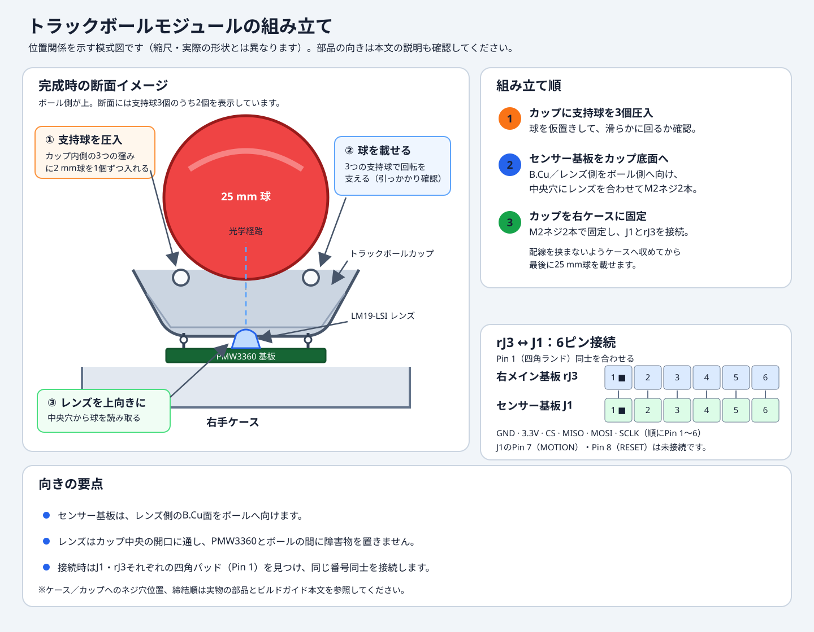

# curcur40 ビルドガイド

**curcur40** は、Corne Chocolate v4 をベースに全キー 1u 化（計40キー：左21キー＋右19キー）、右手人差し指内側に水平スクロールエンコーダ（**CKW12**）、右手親指上部に **25mm トラックボール（PMW3360 光学センサー）** を統合した左右分割型ロープロファイルキーボードです。


---

## 目次

- **[Step 1: 資材一覧と入手経路・発注ガイド](#step-1-資材一覧と入手経路発注ガイド)**
  - [1-1. 全体構成の概要](#1-1-全体構成の概要)
  - [1-2. JLCPCB に発注するもの（PCB / PCBA / プレート）](#1-2-jlcpcb-に発注するものpcb--pcba--プレート)
  - [1-3. JLC3DP に発注するもの（3Dプリント造形）](#1-3-jlc3dp-に発注するもの3dプリント造形)
  - [1-4. 別で入手・購入するパーツ一覧](#1-4-別で入手購入するパーツ一覧)
  - [1-5. 発注前チェックリスト](#1-5-発注前チェックリスト)
- **[Step 2: 組み立て・ハンダ付け・ファームウェア書き込み手順](#step-2-組み立てハンダ付けファームウェア書き込み手順)**
  - [2-1. 必要な工具](#2-1-必要な工具)
  - [2-2. Phase 1: ファームウェアのビルドと書き込み（事前動作確認）](#2-2-phase-1-ファームウェアのビルドと書き込み事前動作確認)
  - [2-3. Phase 2: 手ハンダ作業（センサー基板 ＆ 右メイン基板）](#2-3-phase-2-手ハンダ作業センサー基板--右メイン基板)
  - [2-4. Phase 3: トラックボールカップとセンサー基板の組み込み](#2-4-phase-3-トラックボールカップとセンサー基板の組み込み)
  - [2-5. Phase 4: スイッチプレート・ケースの組み立て](#2-5-phase-4-スイッチプレートケースの組み立て)
  - [2-6. Phase 5: 動作確認・キーマップ設定（VIA / Vial）](#2-6-phase-5-動作確認キーマップ設定via--vial)
  - [2-7. トラブルシューティング・注意事項](#2-7-トラブルシューティング注意事項)

---

# Step 1: 資材一覧と入手経路・発注ガイド

## 1-1. 全体構成の概要

curcur40 を1台組み立てるために必要な資材は、大きく分けて以下の **3つのルート** で揃えます。

1. **JLCPCB への発注（基板製造 ＋ 表面実装 PCBA ＋ FR-4 スイッチプレート）**
   - 左右メイン基板および PMW3360 センサー基板は、マイコン（RP2040）やダイオード、Kailh Choc ソケット、LED、USB-C、TRRS ジャック等の細かい表面実装部品（SMD）がすべて **PCBA（部品実装サービス）用の BOM / CPL ファイル付き** で用意されています。
2. **JLC3DP への発注（3Dプリントケース ＋ トラックボールカップ）**
   - 左右の専用ケースと、25mm トラックボールを保持するカップ（ホルダー）を 3D プリントで造形します。
3. **別途購入するパーツ（スイッチ、キーキャップ、センサーIC、トラックボール球、CKW12、ネジ類など）**
   - PCBA で実装されない手ハンダ部品（`CKW12`、`PMW3360DM-T2QU`、6ピンヘッダ）と、組み立て用の機構部品・外装パーツを国内ショップや通販で揃えます。

---

## 1-2. JLCPCB に発注するもの（PCB / PCBA / プレート）

JLCPCB（[https://jlcpcb.com/](https://jlcpcb.com/)）には、**PCBA 付き基板 3種** と **PCB のみ（FR-4 プレート）2種** の計5アイテムを発注します。

### 発注ファイル一覧

| 対象 | 発注種別 | 最小発注数 | ガーバーファイル (ZIP) | BOM (部品表 CSV) | CPL (座標データ CSV) |
| :--- | :---: | :---: | :--- | :--- | :--- |
| **① 左メイン基板**<br>(`curcur40-left`) | **PCB + PCBA**<br>（裏面 `B.Cu` 実装） | 5枚<br>（PCBAは2枚〜可） | [GERBER-curcur40-left.zip](../../pcbs/curcur40/left/jlcpcb/production_files/GERBER-curcur40-left.zip) | [BOM-curcur40-left.csv](../../pcbs/curcur40/left/jlcpcb/production_files/BOM-curcur40-left.csv) | [CPL-curcur40-left.csv](../../pcbs/curcur40/left/jlcpcb/production_files/CPL-curcur40-left.csv) |
| **② 右メイン基板**<br>(`curcur40-right`) | **PCB + PCBA**<br>（裏面 `B.Cu` 実装） | 5枚<br>（PCBAは2枚〜可） | [GERBER-curcur40-right.zip](../../pcbs/curcur40/right/jlcpcb/production_files/GERBER-curcur40-right.zip) | [BOM-curcur40-right.csv](../../pcbs/curcur40/right/jlcpcb/production_files/BOM-curcur40-right.csv) | [CPL-curcur40-right.csv](../../pcbs/curcur40/right/jlcpcb/production_files/CPL-curcur40-right.csv) |
| **③ PMW3360 センサー基板**<br>(`curcur40-pmw3360`) | **PCB + PCBA**<br>（表面 `F.Cu` 実装） | 5枚<br>（PCBAは2枚〜可） | [GERBER-curcur40-pmw3360.zip](../../pcbs/curcur40/pmw3360/jlcpcb/production_files/GERBER-curcur40-pmw3360.zip) | [BOM-curcur40-pmw3360.csv](../../pcbs/curcur40/pmw3360/jlcpcb/production_files/BOM-curcur40-pmw3360.csv) | [CPL-curcur40-pmw3360.csv](../../pcbs/curcur40/pmw3360/jlcpcb/production_files/CPL-curcur40-pmw3360.csv) |
| **④ 左トッププレート**<br>(`plate-top-left`) | **PCB のみ**<br>（FR-4 1.6mm） | 5枚 | [GERBER-plate-top-left.zip](../../plates/curcur40/pcb/jlcpcb/production_files/GERBER-plate-top-left.zip) | 不要（PCBAなし） | 不要（PCBAなし） |
| **⑤ 右トッププレート**<br>(`plate-top-right`) | **PCB のみ**<br>（FR-4 1.6mm） | 5枚 | [GERBER-plate-top-right.zip](../../plates/curcur40/pcb/jlcpcb/production_files/GERBER-plate-top-right.zip) | 不要（PCBAなし） | 不要（PCBAなし） |

> **補足（ボトムプレートについて）**:
> 3Dプリントケース（`cases/curcur40/left.step`, `right.step`）を使用する場合、ボトムプレートは不要です。万が一 3Dプリントケースを使わずサンドイッチ構造にしたい場合のみ、[GERBER-plate-bottom-left.zip](../../plates/curcur40/pcb/jlcpcb/production_files/GERBER-plate-bottom-left.zip) および [GERBER-plate-bottom-right.zip](../../plates/curcur40/pcb/jlcpcb/production_files/GERBER-plate-bottom-right.zip) を追加で発注してください。
> また、アクリル等のレーザーカットでプレートを作る場合は [plate-curcur40.svg](../../plates/curcur40/svg/plate-curcur40.svg)（およびポロンフォーム用 [foam-curcur40.svg](../../plates/curcur40/svg/foam-curcur40.svg)）を使用できます。

### JLCPCB 推奨発注オプション

- **Base Material**: `FR-4`
- **Layers**: `2 Layers`
- **PCB Thickness**: **`1.6 mm`**（メイン基板・センサー基板・トッププレートすべて `1.6 mm`）
- **PCB Color**: お好みの色（`Black` / `Matte Black` / `White` など）
- **Surface Finish**: `HASL(with lead)` または `LeadFree HASL` / `ENIG`
- **Remove Order Number**: **`Specify a location`** または **`Yes`（有料オプション）** ※特にトッププレートは表面に製造番号が入らないよう `Remove Order Number: Yes` を推奨します。
- **PCBA Assembly Side**:
  - 左メイン基板 (`curcur40-left`)：**`Bottom Side`**
  - 右メイン基板 (`curcur40-right`)：**`Bottom Side`**
  - PMW3360 センサー基板 (`curcur40-pmw3360`)：**`Top Side`**
- **PCBA 実装内容の確認**:
  - 左右メイン基板には RP2040 マイコン、Flash メモリ、水晶振動子、LDO、Kailh Choc ホットスワップソケット（左21個・右19個）、ダイオード、RGB LED、USB Type-C コネクタ、TRRS ジャック、リセット/ブートスイッチ、抵抗・コンデンサ類がすべて実装されます。
  - 右メイン基板の **`rEXSW1`（CKW12）** と **`rJ3`（6ピンヘッダ）**、およびセンサー基板の **`U1`（PMW3360）** と **`J1`（ピンヘッダ）** は手ハンダ対象のため PCBA からは除外されています（確認画面で Unplaced となっても正常です）。

---

## 1-3. JLC3DP に発注するもの（3Dプリント造形）

JLC3DP（[https://jlc3dp.com/](https://jlc3dp.com/)）または手持ちの 3D プリンタで、以下の **3つのパーツ** を造形します（JLC3DP へは形状精度の高い `.step` ファイルのアップロードを推奨します）。

| 対象パーツ | 数量 | アップロード用ファイル (STEP 推奨) | STL ファイル（予備・スライサー用） | 推奨素材・方式 |
| :--- | :---: | :--- | :--- | :--- |
| **① 左手用ケース** | **1個** | [left.step](../../cases/curcur40/left.step) | [left.stl](../../cases/curcur40/left.stl) | **MJF (PA12 ナイロン)** / **SLS (PA12)**<br>または **SLA (タフレジン / Black Resin)** |
| **② 右手用ケース** | **1個** | [right.step](../../cases/curcur40/right.step) | [right.stl](../../cases/curcur40/right.stl) | **MJF (PA12 ナイロン)** / **SLS (PA12)**<br>または **SLA (タフレジン / Black Resin)** |
| **③ 25mm トラックボールカップ** | **1個** | [trackball-cup.step](../../cases/curcur40/trackball-cup.step) | [trackball-cup.stl](../../cases/curcur40/trackball-cup.stl) | **SLA (高精細レジン)** または **MJF (PA12)**<br>※直径2mm支持球を圧入するため寸法精度の高い方式を推奨 |

> **オプション（CKW12 の 3D プリントパーツを自前で造形する場合）**:
> 後述する「CKW12 キット」を Booth で購入する場合は、キット内に 3D プリントパーツ（ハウジング・ホイール・ステム）が含まれているため発注不要です。
> 電子部品のみを個別購入して CKW12 を自作する場合は、[3dmodels/curcur40.3dshapes/](../../3dmodels/curcur40.3dshapes/) 内の以下の3ファイル（または本家 [kumamuk-git/CKW12](https://github.com/kumamuk-git/CKW12) の STL）も一緒に JLC3DP（SLA レジン推奨）で造形してください。
> - ハウジング: [CKW12_housing.step](../../3dmodels/curcur40.3dshapes/CKW12_housing.step) × 1個
> - ホイール: [CKW12_wheel_d18_t5.step](../../3dmodels/curcur40.3dshapes/CKW12_wheel_d18_t5.step) × 1個
> - ステム: [CKW12_stem.step](../../3dmodels/curcur40.3dshapes/CKW12_stem.step) × 1個

---

## 1-4. 別で入手・購入するパーツ一覧

JLCPCB / JLC3DP 以外で、キーボードショップ・電子部品通販・Amazon 等から入手するパーツの一覧です。

### キースイッチ・キーキャップ

| 品名 | 必要数 | 仕様・備考 | 主な入手先 |
| :--- | :---: | :--- | :--- |
| **Kailh Choc V1 / V2 キースイッチ** | **40個** | 左手21個 ＋ 右手19個。<br>Kailh Choc V1（Red / White / Sunset Tactile 等）または Choc V2 ロープロファイルスイッチに対応。 | 遊舎工房 / Talp Keyboard / Daily Craft Keyboard / AliExpress 等 |
| **Choc 用 1u キーキャップ** | **40個** | **全キー 1u サイズ（40個）** です。<br>※選ぶスイッチ（Choc V1 ステム / Choc V2 十字ステム）に適合するロープロファイルキーキャップを用意してください。 | 遊舎工房 / Booth / Talp Keyboard / AliExpress 等 |

### 右手スクロールエンコーダ（CKW12）関連

右手人差し指内側（`rEXSW1`）に搭載する水平ロータリーエンコーダです。**方法A（キット購入）** が最も簡単で確実です。

#### 方法A：キットを購入する場合（推奨）
| 品名 | 必要数 | 仕様・備考 | 主な入手先 |
| :--- | :---: | :--- | :--- |
| **CKW12 水平ロータリーエンコーダキット** | **1セット** | エンコーダ、タクトスイッチ、コンスルーピン（5本）、M2皿ネジ、3Dプリントパーツ一式がすべて揃ったキット。 | Booth（[kumamuk 氏のショップ](https://kumamuk.booth.pm/items/5487792)） |

#### 方法B：部品を個別に揃える場合（キット在庫切れ時など）
| 品名 | 必要数 | 型番・仕様 | 主な入手先 |
| :--- | :---: | :--- | :--- |
| **中空軸ロータリーエンコーダ** | **1個** | Alps Alpine **`EC05E1220202`** | 秋月電子 / Mouser / DigiKey |
| **横押しタクトスイッチ** | **1個** | Alps Alpine **`SKQYACE010`**（または `SKQGAFE010`） | Mouser / DigiKey / AliExpress |
| **コンスルー（スプリングピンヘッダ）** | **5ピン分** | 2.54mmピッチ、高さ 2.0mm または 2.5mm（12ピン等をニッパーで1ピンずつ5個に切り分けて使用） | 遊舎工房 / 千石電商 / 秋月電子 |
| **M2 皿ネジ（CKW12固定用）** | **2本** | M2 × 長さ 3mm〜4mm（基板裏側からCKW12ハウジングへネジ止め） | ホームセンター / Amazon / モノタロウ |

### 右手トラックボール・PMW3360 センサー関連

| 品名 | 必要数 | 仕様・備考 | 主な入手先 |
| :--- | :---: | :--- | :--- |
| **25mm トラックボール球** | **1個** | 直径 **25mm** のトラックボール交換球。<br>定番は **Perixx（ペリックス）PERIPRO-303 25mm**、または Keyball / killerwhale 用 25mm 球。 | Amazon（Perixx公式）/ 遊舎工房 / Booth |
| **直径 2.0mm（$\varnothing 2.0\text{ mm}$）支持球** | **3個** | `trackball-cup` 内部の3つのくぼみに圧入してトラックボールを滑らかに支えるベアリング球。<br>**$\varnothing 2.0\text{ mm}$ セラミック球（$\text{ZrO}_2$ ジルコニア または $\text{Si}_3\text{N}_4$ 窒化ケイ素）** または高精密ステンレス球（G10〜G20）。 | Amazon / モノタロウ / AliExpress / Booth |
| **PMW3360DM-T2QU センサーIC ＋ レンズ（LM19-LSI）** | **1セット** | 光学センサー IC 本体（16-pin DIP形状）と専用レンズのセット。`curcur40-pmw3360` 基板の `U1` に手ハンダします。<br>※組立時の注意：`curcur40-pmw3360` 基板表面のジャンパ **`JP1` の 1-2 パッド（3.3V動作）をハンダブリッジ** して使用します。 | AliExpress / Tindie / Booth |
| **2.54mmピッチ 6ピン ピンヘッダ / ソケット（または配線材）** | **1組（6ピン）** | 右メイン基板の `rJ3`（6ピン：`GND, +3V3, CS, MISO, MOSI, SCLK`）とセンサー基板の `J1`（1〜6番ピン）を接続します。<br>ピンヘッダ＋ソケット、またはリボンケーブルの直付けで接続可能です。 | 秋月電子 / 千石電商 / Amazon |

### ネジ・スペーサー・ゴム足・ケーブル類

Corne Chocolate v4 準拠の筐体固定用ネジ・スペーサーと、トラックボールモジュール固定用のネジ、および接続ケーブルです。

| 品名 | 必要数 | 仕様・備考 | 主な入手先 |
| :--- | :---: | :--- | :--- |
| **M2 スペーサー（長さ 5.5mm）** | **8個** | 左手4個 ＋ 右手4個（両メス、丸型または六角）。<br>トッププレート（1.6mm）と 3D ケース底面の間隔を保持し、PCB（1.6mm）の穴を貫通します。 | 遊舎工房 / Hirosugi-Net（廣杉計器）/ Amazon / AliExpress |
| **M2 ネジ（長さ 4.5mm または 4.0mm）** | **16本** | トッププレート側 8本 ＋ ケース底面側 8本。<br>精密低頭ネジまたは平頭ネジ推奨。 | 遊舎工房 / Amazon / モノタロウ / 秋月電子 |
| **M2 ネジ（長さ 5.0mm〜6.0mm）** | **4本** | 右手ケースへの `trackball-cup` 固定用（2本）および `curcur40-pmw3360` センサー基板固定用（2本）。※必要に応じて M2 ナット 2〜4個を併用。 | ホームセンター / Amazon / モノタロウ |
| **ゴム足（クッションゴム）** | **8〜10個** | 直径 6mm〜8mm、厚み 1.5mm〜2mm 程度の貼り付け式ゴム足（左右ケース底面の四隅＋トラックボール下部に貼付）。 | Amazon / 100円ショップ / ホームセンター |
| **TRRS ケーブル（4極・3.5mm）** | **1本** | 左右分割キーボード間を接続するケーブル。<br>⚠️ **必ず「4極（TRRS）」を使用してください（3極 TRS ケーブルは VCC と GND がショートするため使用不可）。** | 遊舎工房 / Amazon |
| **USB Type-C ケーブル** | **1本** | PC との接続用（データ通信対応のもの）。 | Amazon / 家電量販店 |

---

## 1-5. 発注前チェックリスト

- [ ] **JLCPCB**:
  - [ ] `curcur40-left`（PCB + PCBA / Bottom実装 / 1.6mm）
  - [ ] `curcur40-right`（PCB + PCBA / Bottom実装 / 1.6mm）
  - [ ] `curcur40-pmw3360`（PCB + PCBA / Top実装 / 1.6mm）
  - [ ] `plate-top-left`（PCBのみ / 1.6mm / 注文番号削除推奨）
  - [ ] `plate-top-right`（PCBのみ / 1.6mm / 注文番号削除推奨）
- [ ] **JLC3DP**:
  - [ ] `left.step` × 1
  - [ ] `right.step` × 1
  - [ ] `trackball-cup.step` × 1
- [ ] **別調達パーツ**:
  - [ ] Kailh Choc スイッチ × 40個 ＆ 1u キーキャップ × 40個
  - [ ] CKW12 キット × 1セット
  - [ ] 25mm トラックボール球 × 1個 ＆ $\varnothing 2.0\text{ mm}$ 支持球 × 3個
  - [ ] PMW3360DM-T2QU センサー ＋ LM19-LSI レンズ × 1セット ＆ 6ピンヘッダ/配線材
  - [ ] M2 スペーサー（5.5mm × 8個）、M2 ネジ（4.5mm × 16本、5〜6mm × 4本）、ゴム足
  - [ ] 4極 TRRS ケーブル × 1本 ＆ USB-C ケーブル × 1本

---
---

# Step 2: 組み立て・ハンダ付け・ファームウェア書き込み手順

ここからは、届いた基板とパーツを使って **curcur40** を完成させるまでの手順をステップバイステップで解説します。

## 2-1. 必要な工具

| 工具名 | 用途・推奨スペック |
| :--- | :--- |
| **ハンダごて** | 温度調節機能付き推奨（設定目安：鉛入りハンダ 320℃ / 鉛フリーハンダ 350℃）。先は細めの円錐型または刀型（BC型/K型）が作業しやすいです。 |
| **ハンダ** | ヤニ入りハンダ（太さ $\varnothing 0.6\text{ mm} \sim 0.8\text{ mm}$ 推奨）。 |
| **ピンセット** | ジャンパ作業や小ネジ、2mmセラミック支持球の配置に使います。 |
| **ニッパー** | コンスルーピンの切り分けや、ピンヘッダの余分な足のカットに使います。 |
| **精密ドライバー** | M2 ネジ用のプラスドライバー（`#0` または `#00`）。 |
| **テスター（任意）** | ジャンパ `JP1` や 6ピンヘッダ接続の導通・ショート確認にあると安心です。 |

---

## 2-2. Phase 1: ファームウェアのビルドと書き込み（事前動作確認）

ハンダ付けやケースへの組み込みを始める前に、JLCPCB から届いた左右のメイン基板（`curcur40-left`, `curcur40-right`）単体で PC に接続し、ファームウェアの書き込みと初期動作確認を行います。

### ① ファームウェア（`.uf2`）のビルド

本リポジトリの [`kbd_firmware/`](../../kbd_firmware/) ディレクトリには、**VIA（QMK）版** と **Vial 版** の両方のファームウェア定義が含まれています。トラックボール用のマウスボタンやエンコーダ設定を専用アプリから即座に変更できる **Vial 版** が特におすすめです。

以下は WSL での手順です。`FIRMWARE` は本リポジトリ内の `kbd_firmware`、`VIAL_QMK` は Vial-QMK のチェックアウト先を指定してください。例のパスは環境に合わせて変更します。QMK/Vial-QMK の Docker ビルド環境がセットアップ済みであることを前提とします。

#### A. Vial 対応ファームウェアをビルドする場合（推奨）
```sh
FIRMWARE=./curcur40/kbd_firmware
VIAL_QMK=./vial-qmk

# 基板定義とVialキーマップをVial-QMKのkeyboardツリーへコピー
mkdir -p "$VIAL_QMK/keyboards/curcur40/rev1/keymaps/vial"
cp -a "$FIRMWARE/keyboards/curcur40/qmk/qmk_firmware/rev1/." \
  "$VIAL_QMK/keyboards/curcur40/rev1/"
cp -a "$FIRMWARE/keyboards/curcur40/vial-kb/vial-qmk/keymaps/vial/." \
  "$VIAL_QMK/keyboards/curcur40/rev1/keymaps/vial/"

# Vial-QMKのDockerビルドを実行
cd "$VIAL_QMK"
util/docker_build.sh curcur40/rev1:vial
```
ビルドが完了すると、`$VIAL_QMK/.build/curcur40_rev1_vial.uf2` に `.uf2` ファイルが出力されます。左右のメイン基板には同じファイルを書き込みます。

#### B. VIA（標準 QMK）対応ファームウェアをビルドする場合
```sh
FIRMWARE=./curcur40/kbd_firmware
QMK_FIRMWARE=./qmk_firmware

# 基板定義とVIAキーマップをQMKのkeyboardツリーへコピー
mkdir -p "$QMK_FIRMWARE/keyboards/curcur40/rev1/keymaps/via"
cp -a "$FIRMWARE/keyboards/curcur40/qmk/qmk_firmware/rev1/." \
  "$QMK_FIRMWARE/keyboards/curcur40/rev1/"
cp -a "$FIRMWARE/keyboards/curcur40/qmk/qmk_firmware/keymaps/via/." \
  "$QMK_FIRMWARE/keyboards/curcur40/rev1/keymaps/via/"

# QMKのDockerビルドを実行（キーボードへのUSB書き込み機能は不要）
cd "$QMK_FIRMWARE"
SKIP_FLASHING_SUPPORT=1 util/docker_build.sh curcur40/rev1:via
```
ビルドが完了すると、`$QMK_FIRMWARE/.build/curcur40_rev1_via.uf2` に `.uf2` ファイルが出力されます。左右のメイン基板には同じファイルを書き込みます。

---

### ② 左右メイン基板への書き込み手順

左手基板（`curcur40-left`）と右手基板（`curcur40-right`）の **両方** に、同じ `.uf2` ファイルを以下の手順で書き込みます。

1. **ブートローダーモードで接続する**
   - まだ TRRS ケーブルは繋がず、片方の基板だけを手元に置きます。
   - 基板裏面（部品実装面）にあるタクトスイッチ **`BOOT`（左手は `lSW1`、右手は `rSW1`）を押したまま**、USB Type-C ケーブルを PC に接続します。
   - （※すでに USB 接続している場合は、`BOOT` を押しながら隣の `RESET`（`lSW2` / `rSW2`）を1回押して離すか、`RESET` ボタンを素早く2回ダブルタップするとブートローダーに入ります。）
2. **`RPI-RP2` ドライブへのコピー**
   - PC 上に **`RPI-RP2`** という名前の USB ストレージが認識されます。
   - 先ほどビルドした `.uf2` ファイル（`curcur40_rev1_vial.uf2` または `curcur40_rev1_via.uf2`）を `RPI-RP2` ドライブへドラッグ＆ドロップします。
3. **自動再起動と認識確認**
   - コピーが完了すると自動的にドライブがアンマウントされ、キーボード（`curcur40`）として認識され、RGB LED が点灯します。
   - USB ケーブルを抜き、**もう片方の基板にもまったく同じ手順で `.uf2` を書き込みます**。

---

## 2-3. Phase 2: 手ハンダ作業（センサー基板 ＆ 右メイン基板）

> 💡 **左手メイン基板（`curcur40-left`）について**:
> 左手基板はすべての部品が JLCPCB の PCBA で実装されているため、**左手基板へのハンダ付け作業は一切ありません**。

手ハンダが必要なのは **① PMW3360 センサー基板** と **② 右メイン基板（`rEXSW1` エンコーダ ＆ `rJ3` 6ピン接続）** の2枚のみです。

---

### Step 2-3-1: PMW3360 センサー基板（`curcur40-pmw3360`）の組み立て


1. **電圧選択ジャンパ `JP1` のハンダブリッジ（重要！）**
   - センサー基板の表側（`F.Cu`：コンデンサ `C1〜C4` や LDO `U2` が載っている面）にある 3パッドのジャンパ **`JP1`** を確認します。
   - シルク印刷の **`1` パッド（`V_IN`）と中央の `2` パッド（`V_IO`）の間をハンダでブリッジ（ショート）** します。
   - ⚠️ **注意**：`3` パッド側にはハンダが触れないようにしてください（`1-2` を繋ぐことで、RP2040 と同じ 3.3V ロジック電圧で動作します）。

2. **PMW3360DM-T2QU センサー IC（`U1`）のハンダ付け**
   - センサー IC 本体の **1番ピン（角が斜めに面取りされている側／丸印側）** を確認します。
   - 基板の **表側（`F.Cu`：SMD部品があり、`U1` の白いシルク枠と `●` マークがある面）** からセンサー IC の足を差し込みます。
     - **1番ピンが基板の四角ランド（`●` マークがあるパッド）** に一致する向きで挿入してください。
     - センサー底面の黒い光学突起部分が、基板中央の長方形くり抜き穴にすっぽり収まります。
   - IC が基板から浮かないよう指やマスキングテープで押さえ、**基板の裏側（`B.Cu`）に出た 16本のピンをすべてハンダ付け** します。

3. **専用レンズ（`LM19-LSI`）の装着**
   - センサー底面の光学窓に貼られている黄色（またはオレンジ色）の保護カプトンテープをピンセットで剥がします（※ホコリが入らないよう、作業直前に剥がしてください）。
   - **基板の裏側（`B.Cu` 側）** から、透明な専用レンズ（`LM19-LSI`）の2つの穴をセンサーの2本のガイドピンに合わせてパチンと奥まで差し込みます。
   - レンズがぐらつかないよう、ガイドピンの先端をハンダごての腹で軽く熱カシメするか、レンズのフランジ端を少量のカプトンテープ等で仮止めしておくと組み立て時に外れず快適です。

---

### Step 2-3-2: 右メイン基板への水平エンコーダ（`CKW12`）の組み付け


右手人差し指内側（`rEXSW1`）に水平スクロールエンコーダ **CKW12** を組み立てて取り付けます。

1. **CKW12 本体の組み立て**（詳細は [CKW12 公式ビルドガイド](https://github.com/kumamuk-git/CKW12) も参照）
   - **コンスルーピンの準備**：コンスルーをニッパーで **1ピンずつ × 5個** に切り分けます（※切り口で隣のピンを傷つけないよう、不要な枠ごと丁寧にカットしてください）。
   - **ホイールとエンコーダの合体**：六角形のシャフト（`CKW12_stem`）を、ホイール（`CKW12_wheel`）の中心穴と中空軸エンコーダ（`EC05E1220202`）の中心穴に貫通させます。
   - **ハウジングへの収納**：3Dプリントされたハウジング（`CKW12_housing`）の所定の位置に横押しタクトスイッチ（`SKQYACE010`）をはめ込み、続けてホイール＋エンコーダ＋ステムを収納します。
     - ホイールを上から押したときに、ステムの先端がタクトスイッチを「カチッ」と押せる向きになっていることを確認してください。
   - **コンスルー5ピンの挿入**：ハウジング底面にある5つのスリットに、切り分けたコンスルーピン5個を差し込み、エンコーダ（3端子）とタクトスイッチ（2端子）の側面電極にコンスルーのバネ側がしっかり接触するように収めます。

2. **右メイン基板（`rEXSW1`）への固定とハンダ付け**
   - 右メイン基板の **表側（`F.Cu`：キースイッチを挿す面）** の `rEXSW1` 位置に CKW12 を載せ、5本のコンスルーピンを基板の5つのスルーホールに通します。
   - **基板の裏側（`B.Cu`）から M2 皿ネジ（長さ 3〜4mm）× 2本** を通し、CKW12 ハウジングをしっかりネジ止めします。
   - **基板の裏側（`B.Cu`）に出たコンスルーの5本の足（パッド）をハンダ付け** します。
     - ⚠️ **注意**：コンスルーは内部にバネ構造があるため、ハンダを流し込みすぎるとバネが固着します。少量のハンダで素早く（1〜2秒で）ランドと足だけをハンダ付けしてください。

---

### Step 2-3-3: 右メイン基板（`rJ3`）と PMW3360 センサー基板（`J1`）の接続（6ピン）

右メイン基板の **`rJ3`（6ピン）** と、PMW3360 センサー基板の **`J1`（1〜6番ピン）** は、**1番ピンから6番ピンまでピン配列が完全一致（1対1対応）** しています。

| ピン番号 | パッド形状 | 右メイン基板 (`rJ3`) | PMW3360 センサー基板 (`J1`) | 信号内容 (RP2040 GPIO) |
| :---: | :---: | :--- | :--- | :--- |
| **Pin 1** | **四角ランド (`■`)** | `GNDR` | `GND` | グラウンド (`GND`) |
| **Pin 2** | 丸ランド (`●`) | `+3V3R` | `V_IN` | 電源 (`+3.3V`) |
| **Pin 3** | 丸ランド (`●`) | `/NCS` | `/CS` | SPI チップセレクト (`GP6`) |
| **Pin 4** | 丸ランド (`●`) | `/MISO` | `/MISO` | SPI MISO (`GP8`) |
| **Pin 5** | 丸ランド (`●`) | `/MOSI` | `/MOSI` | SPI MOSI (`GP11`) |
| **Pin 6** | 丸ランド (`●`) | `/SCLK` | `/SCLK` | SPI クロック (`GP14`) |
| *(Pin 7)* | 丸ランド (`●`) | *(なし)* | `/MOTION` | **未接続（オープンのまま）** |
| *(Pin 8)* | 丸ランド (`●`) | *(なし)* | `/RESET` | **未接続（オープンのまま）** |

- **接続方法**：
  - 6ピンのピンヘッダ＋ピンソケット（または柔軟なリボンケーブル／被覆線 6本）を使って、右メイン基板の `rJ3`（1〜6番ピン）とセンサー基板の `J1`（1〜6番ピン）を **1番（四角パッド）同士、2番同士……6番同士** が繋がるようにハンダ付けします。
  - センサー基板 `J1` の 7番（`MOTION`）・8番（`RESET`）は何も繋がなくてOKです。

---

## 2-4. Phase 3: トラックボールカップとセンサー基板の組み込み


トラックボール部は、**25mm球 → 直径2mmの支持球3個 → カップ → PMW3360センサー基板** の順で重なります。センサー基板はレンズ側（`B.Cu`面）をボール側へ向け、レンズをカップ中央の開口に合わせます。接続は右メイン基板 `rJ3` とセンサー基板 `J1` のPin 1〜6を同じ番号同士でつなぎます。



> 図は向きと重なりを示す模式図です。寸法・形状は実物と異なります。ネジ位置や部品の最終的な向きは、以下の手順と各部品のシルク印刷で確認してください。

1. **$\varnothing 2.0\text{ mm}$ 支持球（×3個）の圧入**
   - 3Dプリントしたトラックボールカップ（`trackball-cup`）の内側にある **3箇所の半球状のくぼみ** に、直径 2.0mm のセラミック球（またはステンレス球）を1個ずつ載せ、ピンセットの柄や硬い平らなもので「パチン」と奥まで押し込んで固定します。
   - 25mm トラックボール球を仮置きして、3つの支持球の上で引っかかりなくスルスルと回転するか確認します（確認したら一度ボールを外します）。

2. **センサー基板とトラックボールカップの固定**
   - トラックボールカップ底面のレンズ開口部に、先ほど組み立てた `curcur40-pmw3360` センサー基板の **レンズ側（`B.Cu` 面）がボール側（上向き）を向くように** 合わせます。レンズがカップ中央の開口を通り、ボールの中心を向いていることを確認してから、M2 ネジ（5〜6mm）2本で固定します。
   - 右手用 3D プリントケース（`right.step`）のトラックボールマウント部に、トラックボールカップを M2 ネジ 2本で固定します。
   - 組み込み前に、センサー基板 `J1` と右メイン基板 `rJ3` のPin 1（四角ランド）の向きを確認し、Pin 1〜6を番号どおりに接続します。ケーブルをケースに挟み込まないように取り回します。
   - 25mm球は組み立て・配線が終わってからカップに載せます。

---

## 2-5. Phase 4: スイッチプレート・ケースの組み立て

左右とも、Corne Chocolate v4 と同じ構造でスイッチプレート・基板・ケースを組み立てます。


1. **トッププレートとメイン基板にキースイッチを取り付ける**
   - 左右のトッププレート（`plate-top-left`, `plate-top-right`）の表側から、四隅の数箇所に Kailh Choc キースイッチをはめ込みます。
   - メイン基板の **表側（`F.Cu`）** をプレートの裏面に合わせ、キースイッチの2本の金属ピンが Kailh ホットスワップソケットにまっすぐ刺さるように押し込みます。
   - ⚠️ **ピン折れ注意**：スイッチの足が曲がったまま無理に押し込むとソケットを破損します。真上から垂直に差し込み、残りすべてのキースイッチ（左21個・右19個）を取り付けます。

2. **3Dプリントケースに M2 スペーサーを取り付ける**
   - 左右の 3D プリントケース（`left`, `right`）の内側にある 4箇所のボス穴に、**M2 スペーサー（長さ 5.5mm）× 各4個（計8個）** を置き、ケース底面（裏側）から **M2 ネジ（長さ 4.5mm）× 各4本（計8本）** で固定します。

3. **プレート＋基板ユニットをケースに固定する**
   - 手順1で組んだ「トッププレート＋メイン基板」をケースに収めます（基板の4箇所の穴を M2 スペーサーが貫通します）。
   - トッププレートの表側から、**M2 ネジ（長さ 4.5mm）× 各4本（計8本）** をスペーサーに締めて固定します。

4. **キーキャップ・トラックボール球・ゴム足の取り付け**
   - 全40個のキースイッチに **1u キーキャップ（40個）** を取り付けます。
   - 右手のトラックボールカップに **25mm トラックボール球** を上からパチンとはめ込みます。
   - 左右ケースの裏面四隅（および右手トラックボール下部）に **ゴム足（クッションゴム）** を貼り付けます。

---

## 2-6. Phase 5: 動作確認・キーマップ設定（VIA / Vial）


### 1. ケーブル接続の鉄則（最重要！）

> ⚠️ **【絶対厳守】TRRS ケーブルの活線挿抜（ホットプラグ）禁止**
> PC に USB ケーブルが刺さって通電している状態で TRRS ケーブルを抜き差しすると、TRRS 端子の構造上 `VCC (+3.3V)` と `GND` が一瞬ショートし、マイコン（RP2040）や LDO が破損する恐れがあります。
> **必ず「先に左右を 4極 TRRS ケーブルでしっかり繋いでから、最後に USB Type-C ケーブルを PC に挿す」** ようにしてください。外すときも **「先に USB を抜いてから TRRS を抜く」** を徹底してください。

### 2. 動作テスト項目

1. **全40キーの入力確認**
   - [Vial Web (https://vial.rocks/)](https://vial.rocks/) または [VIA (https://usevia.app/)](https://usevia.app/) の「Key Tester（Matrix Tester）」を開き、左手21キー・右手19キー（および CKW12 ホイールの押し込みクリック）がすべて反応するか確認します。
2. **CKW12 水平スクロールエンコーダの回転確認**
   - 右手人差し指内側のホイールを上下に転がし、デフォルトでは音量上下（レイヤー1では `PageUp` / `PageDown`）が入力されるか確認します。
   - Vial 上でエンコーダにマウスホイール上下（`KC_WH_U` / `KC_WH_D`）を割り当てれば、そのまま縦スクロールホイールとして使用できます。
3. **25mm トラックボールのカーソル移動確認**
   - トラックボールを転がして、マウスカーソルが上下左右にスムーズに動くか確認します。
   - デフォルトキーマップでは、以下の位置にマウスクリック（左クリック `BTN1`・右クリック `BTN2`・中クリック `BTN3`）が配置されています：
     - **Layer 0（デフォルト）**: 右手人差し指内側の中段キーに `BTN3`（中クリック）
     - **Layer 1（左親指 `MO(1)` 長押し中）**:
       - 左手ホームポジション：F キー位置に `BTN1`（左クリック）、D キー位置に `BTN2`（右クリック）
       - 右手下段：N キー位置に `BTN1`（左クリック）、M キー位置に `BTN2`（右クリック）

### 3. Vial / VIA でのキーマップ変更方法

- **Vial を使う場合（推奨）**:
  - `curcur40_rev1_vial.uf2` を書き込んでいれば、ブラウザで [https://vial.rocks/](https://vial.rocks/) にアクセス（または Vial デスクトップアプリを起動）するだけで、JSON ファイルの読み込み不要で即座に `curcur40` が自動認識され、全40キー・エンコーダ・コンボ・タップダンス・RGB を GUI でリアルタイムに書き換えられます。
- **VIA を使う場合**:
  - `curcur40_rev1_via.uf2` を書き込んだ場合は、[https://usevia.app/](https://usevia.app/) を開き、Settings タブで **`Show Design tab`** を ON にします。
  - Design タブ（ブラシのアイコン）から、本リポジトリの [`kbd_firmware/keyboards/curcur40/the-via/curcur40.json`](../../kbd_firmware/keyboards/curcur40/the-via/curcur40.json) を Load するとキーマップ編集画面が開きます。

---

## 2-7. トラブルシューティング・注意事項

| 症状 | 主な原因と確認・対処方法 |
| :--- | :--- |
| **片側のキーボードが反応しない** | ① 両方の基板に `.uf2` ファームウェアを書き込んだか確認してください。<br>② 3極（TRS）ケーブルではなく **4極（TRRS）ケーブル** が奥までしっかり刺さっているか確認してください。 |
| **特定のキーだけ反応しない** | キースイッチの足が曲がってソケットに入っていない可能性があります。一度スイッチを引き抜き、ピンをまっすぐに伸ばしてから垂直に挿し直してください。 |
| **エンコーダ（CKW12）の回転またはクリックが効かない** | ① コンスルーピンが CKW12 ハウジング内のエンコーダ側面端子・タクトスイッチ端子にしっかり接触しているか確認してください。<br>② 基板裏面の5箇所のコンスルー足が確実にハンダ付けされているか確認してください。 |
| **トラックボールを転がしてもカーソルが動かない** | ① センサー基板表面のジャンパ **`JP1` の `1-2` がハンダブリッジされているか** 確認してください（未ブリッジだと `V_IO` に電源が供給されず通信できません）。<br>② 右メイン基板 `rJ3` とセンサー基板 `J1` の 1〜6番ピンが正しい順序（1番四角パッド＝GND 同士）で導通しているか確認してください。<br>③ センサーの光学窓の保護テープ（黄色いカプトンテープ）を剥がし忘れていないか、レンズ（`LM19-LSI`）が奥までしっかり装着されているか確認してください。 |
