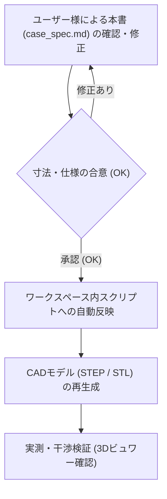

# curcur40 ケース設計仕様書 (Case Specification)

本書は、エルゴノミクス分割キーボード **curcur40**（トラックボール一体型・Choc v2 ロープロファイル）のケースおよびトラックボールカップの設計基準書です。
今後の3Dモデル生成スクリプトは、すべて本書に記載された寸法・ルールに厳密に準拠して作成・更新されます。

> **【運用ルール】**
> 1. **スクリプトの配置場所**: 3Dモデル生成スクリプトや検証スクリプトは、Gitでバージョン管理するためすべてワークスペース内（`cases/curcur40/` または `scripts/`）に配置します。
> 2. **設計変更の手順**:
>    - 寸法や仕様を変更したい場合、まず本書（`docs/curcur40/case_spec.md`）の該当数値を編集します。
>    - ドキュメントのレビューが合意（OK）された後、スクリプトへ反映して3Dモデル（STEP/STL）を生成します。

---

## 1. 垂直Z軸積層構造 (Vertical Stackup)

トッププレート天面を基準 ($Z = 0.00 \, \text{mm}$) とした、各層の厚みおよびZ座標の定義です。

### 1.1 積層寸法一覧表

| レイヤー名 | 厚み / ギャップ | 開始 Z座標 | 終了 Z座標 | 備考 / 根拠 |
| :--- | :---: | :---: | :---: | :--- |
| **トッププレート (Top Plate)** | **1.60 mm** | $Z = 0.00$ | $Z = -1.60$ | FR4製。スイッチのツバが乗る |
| **スイッチ空間 (Switch Gap)** | **2.00 mm** | $Z = -1.60$ | $Z = -3.60$ | Kailh Choc v2 スイッチ着座空間 |
| **メイン基板 (Main PCB)** | **1.60 mm** | $Z = -3.60$ | $Z = -5.20$ | FR4製。中央にセンサー用角穴あり |
| **基板裏面空間 (Component Cavity)** | **3.20 mm** | $Z = -5.20$ | $Z = -8.40$ | 部品最大突出 2.5mm + クリアランス 0.7mm |
| **ケース底面肉厚 (Case Floor)** | **3.20 mm** | $Z = -8.40$ | $Z = -11.60$ | 底面剛性確保、M2ザグリ深さ 1.3mm を内包 |
| **ケース全体厚 (Total Height)** | **11.60 mm** | $Z = 0.00$ | $Z = -11.60$ | トッププレート天面〜ケース外底面 |

### 1.2 基板裏面（B.Cu）部品の突出長と安全マージン

PCB裏面（$Z = -5.20 \, \text{mm}$）からケース内底面（$Z = -8.40 \, \text{mm}$）に向けて突出する部品の実測寸法です：

| 実装部品 | PCB裏面からの突出長 | 下端到達 Z座標 | ケース内底面 ($Z=-8.40$) とのクリアランス |
| :--- | :---: | :---: | :---: |
| **Kailh Choc ソケット** | 2.00 mm | $Z = -7.20$ | **1.20 mm** (完全非接触) |
| **TRRS ジャック (PJ-398A)** | 2.30 mm | $Z = -7.50$ | **0.90 mm** (完全非接触) |
| **PMW3360 センサー本体** | 2.20 mm | $Z = -7.40$ | **1.00 mm** (完全非接触) |

> **【設計結論】**
> すべての基板裏面部品は $Z = -7.50 \, \text{mm}$ より上で収まるため、ケース内底面（$Z = -8.40 \, \text{mm}$）に対して **最低でも 0.90 mm の完全な安全隙間** が確保されます。ケース底面にセンサー用の余計な掘り込み穴や貫通穴を開ける必要は一切ありません。

---

## 2. ねじ止め・ファスナ仕様 (Fastening Specifications)

購入済み部品に基づき、固定部品の規格をすべて統一します（パターンA：メスメススペーサー方式）。

### 2.1 締結部品の選定仕様
* **スペーサー**: M2 メスメススペーサー **長さ 5.50 mm**（外径 $\varnothing 3.0 \sim 3.5 \, \text{mm}$）
* **固定ネジ**: M2 小ねじ
  * ネジ呼び径: M2（外径 $2.0 \, \text{mm}$）
  * ネジ頭径: **$\varnothing 4.00 \, \text{mm}$**
  * ネジ頭厚み: **$0.80 \, \text{mm}$**
  * ネジ足長さ: **$4.00 \, \text{mm}$**

### 2.2 ケース底面の貫通穴とザグリ寸法
ケースを机に置いた際にネジ頭が机に干渉・傷をつけないよう、底面外側にザグリ（沈頭穴）を設けます。

| 箇所 | 加工形状 | 設計寸法 | 備考 |
| :--- | :--- | :---: | :--- |
| **ネジ貫通穴** | ストレート円筒 | **$\varnothing 2.40 \, \text{mm}$** | M2ネジ足（$\varnothing 2.0$）のスムーズな挿入公差 |
| **ネジ頭ザグリ穴** | 外側座繰り | **$\varnothing 4.60 \, \text{mm}$** | ネジ頭（$\varnothing 4.0$）＋周囲逃げ 0.3mm |
| **ザグリ深さ** | 底面からの深さ | **$1.30 \sim 1.50 \, \text{mm}$** | ネジ頭厚（$0.8$）に対し約0.5mm奥に沈む |
| **ザグリ残り肉厚** | 貫通部の実肉厚 | **$1.70 \sim 1.90 \, \text{mm}$** | ケース底面肉厚 3.2mm から十分な強度を維持 |

※トラックボールカップを固定する足面には、ネジ頭ザグリは不要（フラット面）です。

---

## 3. 外周ポート・開口部仕様 (Cutouts & Ports)

### 3.1 TRRS ジャック抜け穴（内側親指側面）
* **貫通穴径**: **$\varnothing 5.50 \, \text{mm}$**（半径 $2.75 \, \text{mm}$）
* **プラグ根元ザグリ径**: **$\varnothing 7.50 \, \text{mm}$**（半径 $3.75 \, \text{mm}$、深さ $2.0 \sim 2.5 \, \text{mm}$）
  * 市販の太めのTRRSケーブルプラグ外装がケース外壁に衝突せず、奥までしっかり挿さるように設計します。
* **中心高さ位置**:
  * ケース外底面（$Z = -11.60 \, \text{mm}$）から中心までの高さ: **`4.95 mm`**（$Z = -6.65 \, \text{mm}$）
  * ケース内底面（$Z = -8.40 \, \text{mm}$）から穴下端までの隙間: **`0.60 mm`**（ケース内底面を一切削らない安全配置）

### 3.2 USB-C ポート開口部（上側北面）
* **開口寸法**: 幅 **$12.50 \, \text{mm}$** $\times$ 高さ **$4.80 \, \text{mm}$**
* **コーナーR**: 四隅 $R = 1.20 \, \text{mm}$
* **中心高さ**: $Z = -6.65 \, \text{mm}$（PCB上のType-Cコネクタ中心に一致）

---

## 4. トラックボールカップ & 光学系仕様 (Trackball & Optics)

本節は、基準アセンブリ [`cases/curcur40/pmw3360-lens-pcb-assembly.step`](../../cases/curcur40/pmw3360-lens-pcb-assembly.step) の物理寸法および合意事項を定義したものです。**AIエージェントおよびモデリングスクリプトは、以下の構造関係を絶対に変更してはなりません。**

### 4.1 光学系アライメント・部品配置の絶対ルール
使用するトラックボール球のサイズは **直径 $\varnothing 25.0 \, \text{mm}$** です（34mm球ではありません）。

#### ① 光学レンズ (LM19-LSI)
* **配置面**: メインPCBの**表面（F.Cu側 / キーキャップ側）**に配置されます。
* **フランジ部**: トラックボールカップ底面とPCB表面の間に挟まれます。
* **位置決め脚（4本）**:
  * レンズ下面から下向きに生えた **4本の脚**（$\varnothing 0.90 \, \text{mm}$ の丸ピン2本＋角型リブ2本）が、PCBの角穴を突き抜けて裏面のセンサーICへと伸びます。

#### ② メインPCB (Main PCB)
* **板厚**: **1.60 mm**
* **貫通開口部 (Cutout)**: 中央に **$16.90 \times 8.70 \, \text{mm}$**（または $17.26 \times 8.60 \, \text{mm}$）の長方形角穴が開いています。
  * この穴は「レンズの4本の脚」と「光学光路」が通り抜けるためのものであり、センサー本体が穴に埋まるわけではありません。

#### ③ 光学センサーIC (PMW3360DM-T2QU)
* **配置面**: メインPCBの**裏面（B.Cu側 / ケース底面側）**から上向きに配置されます。
* **パッケージ構造（重要・誤認厳禁）**:
  * **センサーIC本体には貫通穴やスリット・欠けは一切存在しません**。厚み $2.41 \, \text{mm}$（公称 $1.91 \, \text{mm}$）の**完全なソリッド樹脂モールドパッケージ**です。
  * パッケージ上面（受光面側）にあるガイド穴（凹み）に、表面からPCB穴を突き抜けてきたレンズの4本の脚がスポッとはまり込み、光学中心が100%同軸に固定されます。
* **端子ピン（16本 DIP）**:
  * 16本の金属リード端子は、裏面にあるセンサーIC本体の両側面（列間 $10.70 \, \text{mm}$）から生えています。
  * この16本のピンが、**裏面から表面へとPCBのスルーホール穴を突き抜け**、表面（F.Cu側）でハンダ付けされます。

#### ④ ケース底面との干渉クリアランス
* センサー本体底面は $Z = -7.40 \sim -7.50 \, \text{mm}$ に位置します。
* ケース内底面は $Z = -8.40 \, \text{mm}$ であるため、**約 0.90 〜 1.00 mm の十分な非接触空間**があります。
* したがって、**ケース底面にセンサーを逃げるための掘り込みポケットや貫通穴は一切不要**であり、ケース内底面は**完全なフラット面**として成形します。

---

### 4.2 トラックボールカップ・保持爪仕様

球の脱落防止爪（リテンションクロー）は、親指の操作性を最大化しつつ球を安定保持するため、以下の**直交3方向（T字）配置**とします。

#### ① 爪の配置角度（絶対仕様）
* **北側 (North)**: **90.0°**（上側 / USB-Cポート側）
* **東側 (East)**: **0.0° / 360.0°**（右側 / キーボード外側）
* **西側 (West)**: **180.0°**（左側 / キーボード内側）
* **南側 (South)**: **開口（爪なし）**
  * 親指が球に触れる南側エリアを大きく開放することで、親指の可動域を広げ、スムーズな操作性を実現します。
  * 北(90°)、東(0°)、西(180°)の3点が球の上半球（赤道上）を包み込むため、南側が開いていても球が持ち上がったり脱落することはありません。

#### ② 爪およびカップの形状仕様
* **球受座**: 直径 $\varnothing 25.0 \, \text{mm}$ 球に対し、3点支持（$\varnothing 2.0 \, \text{mm}$ セラミックベアリングボール3個を等間隔または最適角で配置）。
* **爪のプロファイル**:
  * 爪の支え（アーム部）は、十分な強度・弾性を維持しつつ**可能な限りスリムなリブ構造**とし、キートップや指との干渉を最小限に抑えます。
  * 爪先端は球の曲率に沿ったスムーズなアーチ形状とし、引っ掛かりのない滑らかな意匠とします。
* **固定足**:
  * ケース側スペーサーに締結するための固定足（M2ネジ貫通穴）。足表面にネジ頭ザグリは不要（フラット面）。

---

## 5. 設計レビューと変更反映のフロー

ユーザー様が数値を変更したい場合は、以下の手順で行います：

