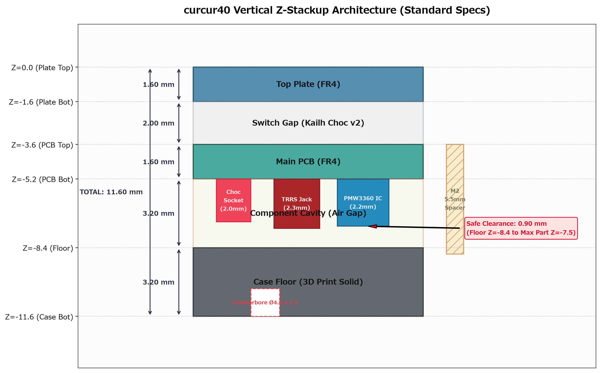
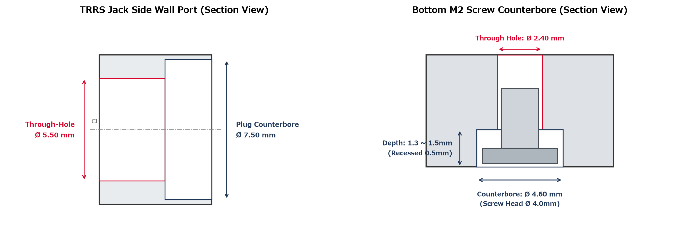
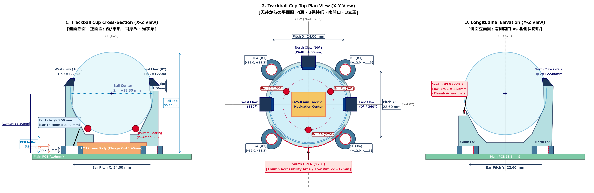
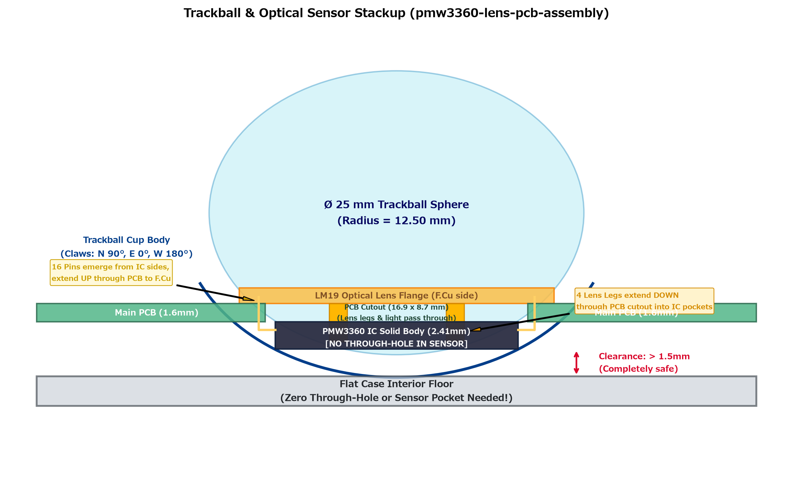
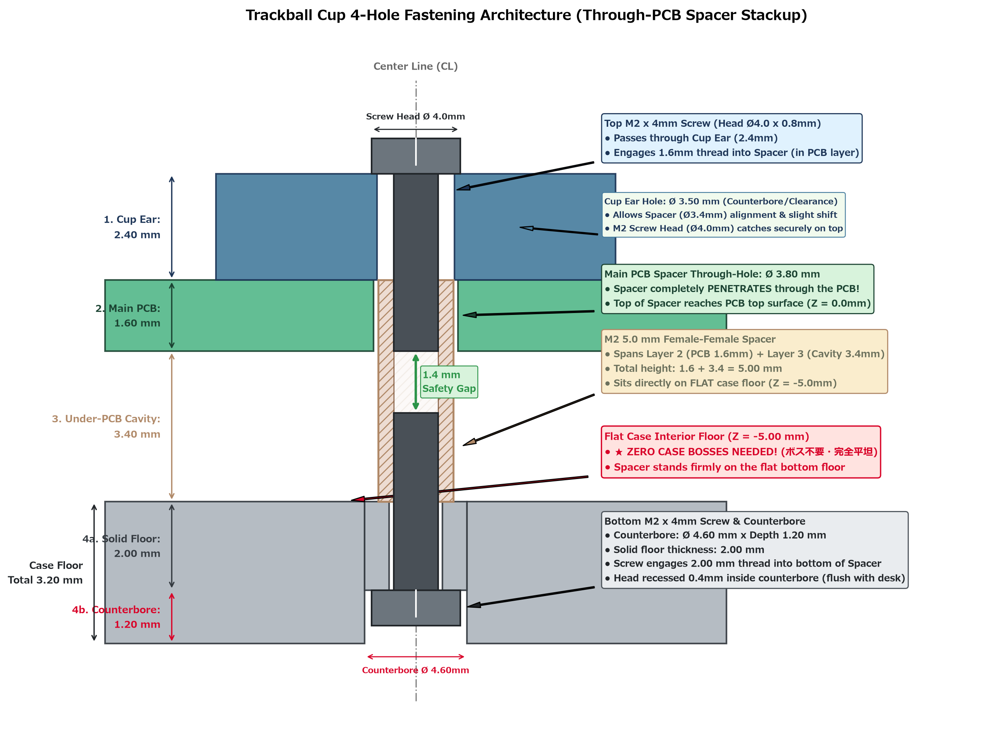
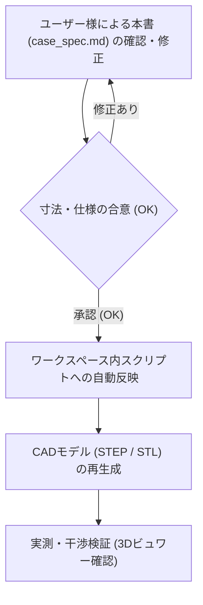

# curcur40 ケース設計仕様書 (Case Specification)

本書は、エルゴノミクス分割キーボード **curcur40**（トラックボール一体型・Choc v2 ロープロファイル）のケースおよびトラックボールカップの設計基準書です。
今後の3Dモデル生成スクリプトは、すべて本書に記載された寸法・ルールに厳密に準拠して作成・更新されます。

> **【運用ルール】**
> 1. **スクリプトの配置場所**: 3Dモデル生成スクリプトや検証スクリプトは、Gitでバージョン管理するためすべてワークスペース内（`cases/curcur40/` または `scripts/`）に配置します。
> 2. **設計変更の手順**:
>    - 寸法や仕様を変更したい場合、まず本書（`docs/curcur40/case_spec.md`）の該当数値を編集します。
>    - ドキュメントのレビューが合意（OK）された後、スクリプトへ反映して3Dモデル（STEP/STL）を生成します。

---

## 1. 垂直Z軸積層構造 (Vertical Stackup)

トッププレート天面を基準 ($Z = 0.00 \, \text{mm}$) とした、各層の厚みおよびZ座標の定義です。

### 1.1 積層寸法一覧表

| レイヤー名 | 厚み / ギャップ | 開始 Z座標 | 終了 Z座標 | 備考 / 根拠 |
| :--- | :---: | :---: | :---: | :--- |
| **トッププレート (Top Plate)** | **1.60 mm** | $Z = 0.00$ | $Z = -1.60$ | FR4製。スイッチのツバが乗る |
| **スイッチ空間 (Switch Gap)** | **2.00 mm** | $Z = -1.60$ | $Z = -3.60$ | Kailh Choc v2 スイッチ着座空間 |
| **メイン基板 (Main PCB)** | **1.60 mm** | $Z = -3.60$ | $Z = -5.20$ | FR4製。中央にセンサー用角穴あり |
| **基板裏面空間 (Component Cavity)** | **3.20 mm** | $Z = -5.20$ | $Z = -8.40$ | 部品最大突出 2.5mm + クリアランス 0.7mm |
| **ケース底面肉厚 (Case Floor)** | **3.20 mm** | $Z = -8.40$ | $Z = -11.60$ | 底面剛性確保、M2ザグリ深さ 1.3mm を内包 |
| **ケース全体厚 (Total Height)** | **11.60 mm** | $Z = 0.00$ | $Z = -11.60$ | トッププレート天面〜ケース外底面 |

### 1.2 基板裏面（B.Cu）部品の突出長と安全マージン

PCB裏面（$Z = -5.20 \, \text{mm}$）からケース内底面（$Z = -8.40 \, \text{mm}$）に向けて突出する部品の実測寸法です：

| 実装部品 | PCB裏面からの突出長 | 下端到達 Z座標 | ケース内底面 ($Z=-8.40$) とのクリアランス |
| :--- | :---: | :---: | :---: |
| **Kailh Choc ソケット** | 2.00 mm | $Z = -7.20$ | **1.20 mm** (完全非接触) |
| **TRRS ジャック (PJ-398A)** | 2.30 mm | $Z = -7.50$ | **0.90 mm** (完全非接触) |
| **PMW3360 センサー本体** | 2.20 mm | $Z = -7.40$ | **1.00 mm** (完全非接触) |

> **【設計結論】**
> すべての基板裏面部品は $Z = -7.50 \, \text{mm}$ より上で収まるため、ケース内底面（$Z = -8.40 \, \text{mm}$）に対して **最低でも 0.90 mm の完全な安全隙間** が確保されます。ケース底面にセンサー用の余計な掘り込み穴や貫通穴を開ける必要は一切ありません。

---

## 2. ねじ止め・ファスナ仕様 (Fastening Specifications)

購入済み部品に基づき、固定部品の規格をすべて統一します（パターンA：メスメススペーサー方式）。

### 2.1 締結部品の選定仕様
* **スペーサー**: M2 メスメススペーサー **長さ 5.50 mm**（外径 $\varnothing 3.0 \sim 3.5 \, \text{mm}$）
* **固定ネジ**: M2 小ねじ
  * ネジ呼び径: M2（外径 $2.0 \, \text{mm}$）
  * ネジ頭径: **$\varnothing 4.00 \, \text{mm}$**
  * ネジ頭厚み: **$0.80 \, \text{mm}$**
  * ネジ足長さ: **$4.00 \, \text{mm}$**

### 2.2 ケース底面の貫通穴とザグリ寸法
ケースを机に置いた際にネジ頭が机に干渉・傷をつけないよう、底面外側にザグリ（沈頭穴）を設けます。

| 箇所 | 加工形状 | 設計寸法 | 備考 |
| :--- | :--- | :---: | :--- |
| **ネジ貫通穴** | ストレート円筒 | **$\varnothing 2.40 \, \text{mm}$** | M2ネジ足（$\varnothing 2.0$）のスムーズな挿入公差 |
| **ネジ頭ザグリ穴** | 外側座繰り | **$\varnothing 4.60 \, \text{mm}$** | ネジ頭（$\varnothing 4.0$）＋周囲逃げ 0.3mm |
| **ザグリ深さ** | 底面からの深さ | **$1.30 \sim 1.50 \, \text{mm}$** | ネジ頭厚（$0.8$）に対し約0.5mm奥に沈む |
| **ザグリ残り肉厚** | 貫通部の実肉厚 | **$1.70 \sim 1.90 \, \text{mm}$** | ケース底面肉厚 3.2mm から十分な強度を維持 |

※トラックボールカップを固定する足面には、ネジ頭ザグリは不要（フラット面）です。

---

## 3. 外周ポート・開口部仕様 (Cutouts & Ports)

### 3.1 TRRS ジャック抜け穴（内側親指側面）
* **貫通穴径**: **$\varnothing 5.50 \, \text{mm}$**（半径 $2.75 \, \text{mm}$）
* **プラグ根元ザグリ径**: **$\varnothing 7.50 \, \text{mm}$**（半径 $3.75 \, \text{mm}$、深さ $2.0 \sim 2.5 \, \text{mm}$）
  * 市販の太めのTRRSケーブルプラグ外装がケース外壁に衝突せず、奥までしっかり挿さるように設計します。
* **中心高さ位置**:
  * ケース外底面（$Z = -11.60 \, \text{mm}$）から中心までの高さ: **`4.95 mm`**（$Z = -6.65 \, \text{mm}$）
  * ケース内底面（$Z = -8.40 \, \text{mm}$）から穴下端までの隙間: **`0.60 mm`**（ケース内底面を一切削らない安全配置）

### 3.2 USB-C ポート開口部（上側北面）
* **開口寸法**: 幅 **$12.50 \, \text{mm}$** $\times$ 高さ **$4.80 \, \text{mm}$**
* **コーナーR**: 四隅 $R = 1.20 \, \text{mm}$
* **中心高さ**: $Z = -6.65 \, \text{mm}$（PCB上のType-Cコネクタ中心に一致）

---

## 4. トラックボールカップ & 光学系詳細仕様 (Trackball & Optics)

本節は、PixArt社データシート（PMW3360DM-T2QU / LM19-LSI）および基準アセンブリ [`cases/curcur40/pmw3360-lens-pcb-assembly.step`](../../cases/curcur40/pmw3360-lens-pcb-assembly.step) に基づき、トラックボールカップの幾何寸法・光学アライメントを完全定義したものです。

### 4.1 光学系アライメント・寸法規定の出典と計算

#### ① データシート規定値（Figure 4 SECTION B-B & DETAIL C より）
* **使用ボール**: 直径 **$\varnothing 25.0 \, \text{mm}$**（半径 $12.50 \, \text{mm}$）
* **Navigation Surface（ボール最下面）**: 光学トラッキングの基準面。
* **レンズフランジ基準面 〜 ボール最下面**: **`2.40 mm`** (Bottom of Lens Flange to Navigation Surface)
* **PCB表面 (F.Cu) 〜 ボール最下面**: **`5.80 mm`**
* **PCB厚み**: **`1.60 mm`** (FR-4)
* **センサーIC背面 〜 ボール最下面**: **`9.81 mm`** (Top of Sensor to Navigation Surface)

#### ② データシートから導き出されるカップおよびレンズの高さ寸法
1. **レンズポケットの高さ（PCB表面〜フランジ座面）**:
   $$\Delta Z_{\text{pocket}} = 5.80 \, \text{mm} - 2.40 \, \text{mm} = \mathbf{3.40 \, mm}$$
   （※Figure 6 のレンズ単体図でも、フランジ座から基板当たり面までが $3.51 \pm 0.05 \, \text{mm}$ と規定されています）
2. **レンズフランジ面〜PCB裏面（センサー上面）までの距離**:
   $$3.40 \, \text{mm} + 1.60 \, \text{mm} = \mathbf{5.00 \, mm}$$
3. **センサーIC本体の厚み**:
   $$9.81 \, \text{mm} - 7.40 \, \text{mm} = \mathbf{2.41 \, mm}$$
   （※Figure 2 の公称本体厚は $1.91 \, \text{mm}$、リードフレーム・公差を含めた最大厚が $2.41 \, \text{mm}$）
4. **レンズフランジ面〜センサー背面までの総高さ**:
   $$5.00 \, \text{mm} + 2.41 \, \text{mm} = \mathbf{7.41 \, mm}$$

#### ③ 構成部品の並び・組み立て詳細仕様（AI誤認防止ルール）
1. **光学レンズ (LM19-LSI)**:
   * メインPCBの**表面（F.Cu側 / キーキャップ側）**に配置。
   * 下面から生えた**4本の脚**（$\varnothing 0.90 \, \text{mm}$ の丸ピン2本＋角リブ2本）が、PCBの角穴を通って下方のセンサーICへ差し込まれる。
2. **メインPCB**:
   * 厚み **1.60 mm**。中央に光路とレンズ脚を通すための角穴（$16.90 \times 8.70 \, \text{mm}$）が開いている。
3. **光学センサーIC (PMW3360DM-T2QU)**:
   * メインPCBの**裏面（B.Cu側 / ケース底面側）**から上向きに配置。
   * **センサーIC本体には貫通穴や欠けは一切なく、厚み 2.41 mm の完全なソリッド樹脂パッケージ**である。
   * 16本の金属ピンは裏面のIC本体両側面から生え、**裏面から表面へとPCBを突き抜けて表面（F.Cu側）ではんだ付け**される。
4. **ケース底面**:
   * センサー突出（約2.2mm）に対してケース内底面（3.2mm深さ）に十分なクリアランス（約1.0mm）があるため、**ケース底面にセンサー逃げ穴やポケットは一切不要（完全フラット内底面）**。

---

### 4.2 トラックボールカップ内部の幾何構造と測定値

トラックボールカップは、PCB表面（$Z_{\text{rel}} = 0.00 \, \text{mm}$）を着座基準面としてモデリングされます。

| 構造部位 | PCB基準 相対Z座標 ($Z_{\text{rel}}$) | グローバルZ座標 (ケース全体) | 設計寸法・計算根拠 |
| :--- | :---: | :---: | :--- |
| **カップ着座底面 (PCB F.Cu)** | $0.00 \, \text{mm}$ | $Z = -3.60 \, \text{mm}$ | PCB表面に着座 |
| **レンズポケット座面 (Flange)** | $+3.40 \, \text{mm}$ | $Z = -0.20 \, \text{mm}$ | LM19レンズフランジ底面を受ける段差 |
| **レンズポケット天井面** | $+4.85 \, \text{mm}$ | $Z = +1.25 \, \text{mm}$ | レンズ中央ドーム凸部（高さ1.45mm）の逃げ |
| **ボール最下面 (Tracking)** | $+5.80 \, \text{mm}$ | $Z = +2.20 \, \text{mm}$ | 光学規定距離 2.40mm 上空に保持 |
| **のぞき穴（開口部）上端エッジ** | $+6.69 \, \text{mm}$ | $Z = +3.09 \, \text{mm}$ | 球面すり鉢と開口穴（$Y=\pm 5.5$）の交線 |
| **のぞき穴の縦壁高さ** | **1.84 mm** | ― | $6.69 - 4.85 = \mathbf{1.84 \, mm}$（実測値と完全一致） |
| **25mmボール中心位置** | $+18.30 \, \text{mm}$ | $Z = +14.70 \, \text{mm}$ | ボール底面 $5.80 + 12.50 = 18.30 \, \text{mm}$ |
| **ボール赤道面 (Equator)** | $+18.30 \, \text{mm}$ | $Z = +14.70 \, \text{mm}$ | 爪が抱え込む基準高さ |
| **爪の頂点 (Claw Tip)** | $+22.80 \, \text{mm}$ | $Z = +19.20 \, \text{mm}$ | 赤道より上側を包み込んで保持 |
| **25mmボール頂点** | $+30.80 \, \text{mm}$ | $Z = +27.20 \, \text{mm}$ | $18.30 + 12.50 = 30.80 \, \text{mm}$ |

#### のぞき穴縦壁寸法（1.84 mm）の幾何学的証明
* 内側球面：中心 $Z_{\text{center}} = 18.30 \, \text{mm}$、半径 $R_{\text{cup\_inner}} = 12.85 \, \text{mm}$（25mm球に対して 0.35mm の滑走隙間）。
* のぞき穴開口部（$Y = \pm 5.50 \, \text{mm}$）における球面高さ：
  $$Z_{\text{edge}} = 18.30 - \sqrt{12.85^2 - 5.50^2} = 18.30 - 11.613 = \mathbf{6.687 \, mm}$$
* レンズポケット天井面：$Z_{\text{pocket\_ceil}} = \mathbf{4.850 \, mm}$
* したがって、穴の縁の縦壁肉厚は：
  $$\Delta Z_{\text{wall}} = 6.687 - 4.850 = \mathbf{1.837 \, mm} \approx \mathbf{1.84 \, mm}$$
  ツール実測値 1.84 mm と小数点第2位まで完全に一致します。

---

### 4.3 支玉（ベアリングボール）の配置仕様

直径 **$\varnothing 2.00 \, \text{mm}$** のセラミック製支玉3点によって、25mm球を空中の規定位置（最下面 $Z_{\text{rel}} = +5.80 \, \text{mm}$）に精密保持します。

* **旋回軌道半径 ($R_{\text{orbit}}$)**:
  $$R_{\text{orbit}} = R_{\text{ball}} + r_{\text{bearing}} = 12.50 \, \text{mm} + 1.00 \, \text{mm} = \mathbf{13.50 \, mm}$$
* **支玉の仰角（傾斜角 $\theta$）**: **$52.0^\circ$**（水平から下向き）
* **支玉中心の高さ ($Z_{\text{bearing}}$)**:
  $$Z_{\text{bearing}} = 18.30 - 13.50 \cdot \sin(52^\circ) = 18.30 - 10.638 = \mathbf{7.66 \, mm}$$
* **支玉の水平配置角（3点等配）**:
  * 支玉 #1: **$30.0^\circ$**
  * 支玉 #2: **$150.0^\circ$**
  * 支玉 #3: **$270.0^\circ$**（南側開口部の直下中央）
* **支玉ポケット**:
  * 深さ $1.35 \, \text{mm}$ のポケット穴（支玉が約 $0.65 \, \text{mm}$ 球面から突出し、球とカップ内壁の 0.35mm 隙間を維持）。
  * ポケット底面に脱落防止・清掃用の $\varnothing 1.2 \, \text{mm}$ 貫通押し出し穴を設置。

---

### 4.4 トラックボール保持爪（T字直交配置）仕様

保持爪および球受座の全体形状・配置は、本節冒頭の [トラックボールカップ詳細設計図面](assets/trackball_cup_detail_drawing.png) に準拠します。

#### ① 爪の配置角度（確定仕様）
* **北側 (North)**: **$90.0^\circ$**（上側 / USB-Cポート側）
* **東側 (East)**: **$0.0^\circ / 360.0^\circ$**（右側 / キーボード外側）
* **西側 (West)**: **$180.0^\circ$**（左側 / キーボード内側）
* **南側 (South)**: **開口（爪なし・低リム）**

#### ② 爪のプロファイルと保持メカニズム
* **保持高さ**: 
  * 爪の先端は $Z_{\text{rel}} = +22.80 \, \text{mm}$（グローバル $Z = +19.20 \, \text{mm}$）まで立ち上がります。
  * ボール赤道面（$Z_{\text{rel}} = +18.30 \, \text{mm}$）より **$4.50 \, \text{mm}$ 上方** まで覆うため、球が上方向に抜けるのを確実に阻止します。
* **アーム構造**:
  * 爪の幅は **$4.0 \sim 5.0 \, \text{mm}$** のスリムなリブ構造とし、指やキーキャップへの干渉を排除。
  * 適度なしなり（弾性）を持たせ、球を押し込む際（スナップイン）に「パチン」と気持ちよく嵌まり、外す際は適度な力で引き抜ける設計とします。
* **南側親指エリアの開放**:
  * 南側（$270^\circ$ 付近）のカップリムは赤道より低い位置（$Z_{\text{rel}} \le 12.0 \, \text{mm}$）までカットし、親指の腹が球の広い面積に無理なくフィットする形状とします。

---

### 4.5 トラックボールカップ 4箇所ねじ止め・スペーサー締結仕様

ケース、メインPCB、およびトラックボールカップは、**M2 5.0mm（または5.5mm）メスメススペーサー** および **M2 4mm ネジ** を用い、**スペーサーがメインPCBを貫通してケース内底面（完全平坦・ボスなし）に着座する構造** で強固に一体締結されます。

#### ① 垂直締結スタック構造 (Through-PCB Fastening Architecture)
上から下に向かって、以下の順序で構成・挟み込み締結されます：

1. **上部ネジ**: M2 $\times$ 4mm 小ねじ（頭径 $\varnothing 4.0 \, \text{mm}$、頭厚 $0.8 \, \text{mm}$）
   * カップ耳（厚み $2.40 \, \text{mm}$）を通過し、基板層に位置するスペーサー上部メスネジへ **$1.60 \, \text{mm}$**（M2ピッチ0.4mmで4山）確実に螺入されます。
2. **カップ固定足（マウントイヤー）**:
   * 肉厚: **$2.40 \, \text{mm}$**（十分な強度を確保）
   * 穴径: **$\varnothing 3.50 \, \text{mm}$**
     * スペーサー外径（$\varnothing 3.4 \, \text{mm}$）が適度に入り込んで位置決め・公差ズレを吸収できる広さを確保。
     * 一方で、M2ネジ頭（$\varnothing 4.0 \, \text{mm}$）は確実に通過できず、上面にしっかりと係止します。
3. **メインPCB (Main PCB)**:
   * 板厚: **$1.60 \, \text{mm}$**
   * スペーサー貫通穴径: **$\varnothing 3.80 \, \text{mm}$**（逃げ穴）
   * ※**スペーサーはこのPCB貫通穴を突き抜けます**。スペーサー上端面がPCB上面（$Z_{\text{rel}} = 0.00 \, \text{mm}$）とほぼ面一、あるいは耳の逃げ穴内へと接続します。
4. **メスメススペーサー (M2 Standoff)**:
   * 規格: M2 メスメススペーサー **長さ 5.00 mm**（外径 $\varnothing 3.0 \sim 3.4 \, \text{mm}$）
   * 配置構造: **「2. PCB貫通部（1.60mm）」＋「3. PCB背面空間（3.40mm）」＝ 合計 5.00 mm** を一気に貫通して橋渡しします。
   * 下端はケース内底面（完全フラット面）に直接着座します。
5. **ケース内底面**:
   * **★ 内底面ボスは完全不要（完全フラット内底面）**
   * ボスを設けず、平坦なケース内底面（$Z = -5.00 \, \text{mm}$）でスペーサー下端を直接受け止めます。
6. **ケース底面および下部ネジ**:
   * ケース底面総厚み: **$3.20 \, \text{mm}$**
   * 底面外側ザグリ穴: **$\varnothing 4.60 \, \text{mm}$**、深さ **$1.20 \, \text{mm}$**
   * 実肉厚（ネジが通る厚み）: $3.20 - 1.20 = \mathbf{2.00 \, mm}$
   * ネジ貫通穴径: **$\varnothing 2.40 \, \text{mm}$**
   * 下部ネジ: M2 $\times$ 4mm 小ねじを底面ザグリから上向きに挿入。
     * 実肉厚 $2.00 \, \text{mm}$ を通過し、スペーサー下部メスネジへ **$2.00 \, \text{mm}$**（5山）強固に螺入されます。
     * ネジ頭はザグリ内に約 $0.40 \, \text{mm}$ 深く沈み込み、平坦なデスク面に接触しません。

#### ② ネジ噛み合い深さと内部安全ギャップの計算
* **スペーサー全長**: $5.00 \, \text{mm}$
* **上部ネジ螺入深さ**: $4.00 - 2.40 = \mathbf{1.60 \, mm}$（上から下へ進入）
* **下部ネジ螺入深さ**: $4.00 - 2.00 = \mathbf{2.00 \, mm}$（下から上へ進入）
* **スペーサー内部のネジ間隙間（安全ギャップ）**:
  $$5.00 \, \text{mm} - (1.60 \, \text{mm} + 2.00 \, \text{mm}) = \mathbf{1.40 \, mm}$$
* 上下のネジ同士がスペーサー内部で衝突・底突きすることは物理的にあり得ず、極めて安定した両引き固定が実現されます。

#### ③ 4箇所のねじ穴配置座標（カップ中心基準）
LM19レンズ（$21.15 \times 18.85 \, \text{mm}$）およびPMW3360センサーIC（$14.20 \times 19.60 \, \text{mm}$）の外周を四方から均等に挟み込む、干渉ゼロの座標です：

| ねじ穴番号 | 配置方角 | X 相対座標 | Y 相対座標 | カップ耳穴径 | PCB貫通穴径 | ケース貫通/ザグリ径 | 備考 |
| :---: | :---: | :---: | :---: | :---: | :---: | :---: | :--- |
| **#1** | 北東 (NE) | **$+12.00 \, \text{mm}$** | **$+11.30 \, \text{mm}$** | $\varnothing 3.50 \, \text{mm}$ | $\varnothing 3.80 \, \text{mm}$ | $\varnothing 2.40$ / ザグリ $\varnothing 4.60$ | ピッチ X: 24.00 mm |
| **#2** | 北西 (NW) | **$-12.00 \, \text{mm}$** | **$+11.30 \, \text{mm}$** | $\varnothing 3.50 \, \text{mm}$ | $\varnothing 3.80 \, \text{mm}$ | $\varnothing 2.40$ / ザグリ $\varnothing 4.60$ | ピッチ Y: 22.60 mm |
| **#3** | 南西 (SW) | **$-12.00 \, \text{mm}$** | **$-11.30 \, \text{mm}$** | $\varnothing 3.50 \, \text{mm}$ | $\varnothing 3.80 \, \text{mm}$ | $\varnothing 2.40$ / ザグリ $\varnothing 4.60$ | レンズ外周逃げ確認済み |
| **#4** | 南東 (SE) | **$+12.00 \, \text{mm}$** | **$-11.30 \, \text{mm}$** | $\varnothing 3.50 \, \text{mm}$ | $\varnothing 3.80 \, \text{mm}$ | $\varnothing 2.40$ / ザグリ $\varnothing 4.60$ | センサーピン外周逃げ確認済み |

---

## 5. 設計レビューと変更反映のフロー

ユーザー様が数値を変更したい場合は、以下の手順で行います：

