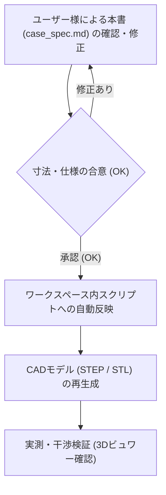

# curcur40 ケース設計仕様書 (Case Specification)

本書は、エルゴノミクス分割キーボード **curcur40**（トラックボール一体型・Choc v2 ロープロファイル）のケースおよびトラックボールカップの設計基準書です。
今後の3Dモデル生成スクリプトは、すべて本書に記載された寸法・ルールに厳密に準拠して作成・更新されます。

> **【運用ルール】**
> 1. **スクリプトの配置場所**: 3Dモデル生成スクリプトや検証スクリプトは、Gitでバージョン管理するためすべてワークスペース内（`cases/curcur40/` または `scripts/`）に配置します。
> 2. **設計変更の手順**:
>    - 寸法や仕様を変更したい場合、まず本書（`docs/curcur40/case_spec.md`）の該当数値を編集します。
>    - ドキュメントのレビューが合意（OK）された後、スクリプトへ反映して3Dモデル（STEP/STL）を生成します。

---

## 1. 垂直Z軸積層構造 (Vertical Stackup)

トッププレート天面を基準 ($Z = 0.00 \, \text{mm}$) とした、各層の厚みおよびZ座標の定義です。

### 1.1 積層寸法一覧表

| レイヤー名 | 厚み / ギャップ | 開始 Z座標 | 終了 Z座標 | 備考 / 根拠 |
| :--- | :---: | :---: | :---: | :--- |
| **トッププレート (Top Plate)** | **1.60 mm** | $Z = 0.00$ | $Z = -1.60$ | FR4製。スイッチのツバが乗る |
| **スイッチ空間 (Switch Gap)** | **2.00 mm** | $Z = -1.60$ | $Z = -3.60$ | Kailh Choc v2 スイッチ着座空間 |
| **メイン基板 (Main PCB)** | **1.60 mm** | $Z = -3.60$ | $Z = -5.20$ | FR4製。中央にセンサー用角穴あり |
| **基板裏面空間 (Component Cavity)** | **3.20 mm** | $Z = -5.20$ | $Z = -8.40$ | 部品最大突出 2.5mm + クリアランス 0.7mm |
| **ケース底面肉厚 (Case Floor)** | **3.20 mm** | $Z = -8.40$ | $Z = -11.60$ | 底面剛性確保、M2ザグリ深さ 1.3mm を内包 |
| **ケース全体厚 (Total Height)** | **11.60 mm** | $Z = 0.00$ | $Z = -11.60$ | トッププレート天面〜ケース外底面 |

### 1.2 基板裏面（B.Cu）部品の突出長と安全マージン

PCB裏面（$Z = -5.20 \, \text{mm}$）からケース内底面（$Z = -8.40 \, \text{mm}$）に向けて突出する部品の実測寸法です：

| 実装部品 | PCB裏面からの突出長 | 下端到達 Z座標 | ケース内底面 ($Z=-8.40$) とのクリアランス |
| :--- | :---: | :---: | :---: |
| **Kailh Choc ソケット** | 2.00 mm | $Z = -7.20$ | **1.20 mm** (完全非接触) |
| **TRRS ジャック (PJ-398A)** | 2.30 mm | $Z = -7.50$ | **0.90 mm** (完全非接触) |
| **PMW3360 センサー本体** | 2.20 mm | $Z = -7.40$ | **1.00 mm** (完全非接触) |

> **【設計結論】**
> すべての基板裏面部品は $Z = -7.50 \, \text{mm}$ より上で収まるため、ケース内底面（$Z = -8.40 \, \text{mm}$）に対して **最低でも 0.90 mm の完全な安全隙間** が確保されます。ケース底面にセンサー用の余計な掘り込み穴や貫通穴を開ける必要は一切ありません。

---

## 2. ねじ止め・ファスナ仕様 (Fastening Specifications)

購入済み部品に基づき、固定部品の規格をすべて統一します（パターンA：メスメススペーサー方式）。

### 2.1 締結部品の選定仕様
* **スペーサー**: M2 メスメススペーサー **長さ 5.50 mm**（外径 $\varnothing 3.0 \sim 3.5 \, \text{mm}$）
* **固定ネジ**: M2 小ねじ
  * ネジ呼び径: M2（外径 $2.0 \, \text{mm}$）
  * ネジ頭径: **$\varnothing 4.00 \, \text{mm}$**
  * ネジ頭厚み: **$0.80 \, \text{mm}$**
  * ネジ足長さ: **$4.00 \, \text{mm}$**

### 2.2 ケース底面の貫通穴とザグリ寸法
ケースを机に置いた際にネジ頭が机に干渉・傷をつけないよう、底面外側にザグリ（沈頭穴）を設けます。

| 箇所 | 加工形状 | 設計寸法 | 備考 |
| :--- | :--- | :---: | :--- |
| **ネジ貫通穴** | ストレート円筒 | **$\varnothing 2.40 \, \text{mm}$** | M2ネジ足（$\varnothing 2.0$）のスムーズな挿入公差 |
| **ネジ頭ザグリ穴** | 外側座繰り | **$\varnothing 4.60 \, \text{mm}$** | ネジ頭（$\varnothing 4.0$）＋周囲逃げ 0.3mm |
| **ザグリ深さ** | 底面からの深さ | **$1.30 \sim 1.50 \, \text{mm}$** | ネジ頭厚（$0.8$）に対し約0.5mm奥に沈む |
| **ザグリ残り肉厚** | 貫通部の実肉厚 | **$1.70 \sim 1.90 \, \text{mm}$** | ケース底面肉厚 3.2mm から十分な強度を維持 |

※トラックボールカップを固定する足面には、ネジ頭ザグリは不要（フラット面）です。

---

## 3. 外周ポート・開口部仕様 (Cutouts & Ports)

### 3.1 TRRS ジャック抜け穴（内側親指側面）
* **貫通穴径**: **$\varnothing 5.50 \, \text{mm}$**（半径 $2.75 \, \text{mm}$）
* **プラグ根元ザグリ径**: **$\varnothing 7.50 \, \text{mm}$**（半径 $3.75 \, \text{mm}$、深さ $2.0 \sim 2.5 \, \text{mm}$）
  * 市販の太めのTRRSケーブルプラグ外装がケース外壁に衝突せず、奥までしっかり挿さるように設計します。
* **中心高さ位置**:
  * ケース外底面（$Z = -11.60 \, \text{mm}$）から中心までの高さ: **`4.95 mm`**（$Z = -6.65 \, \text{mm}$）
  * ケース内底面（$Z = -8.40 \, \text{mm}$）から穴下端までの隙間: **`0.60 mm`**（ケース内底面を一切削らない安全配置）

### 3.2 USB-C ポート開口部（上側北面）
* **開口寸法**: 幅 **$12.50 \, \text{mm}$** $\times$ 高さ **$4.80 \, \text{mm}$**
* **コーナーR**: 四隅 $R = 1.20 \, \text{mm}$
* **中心高さ**: $Z = -6.65 \, \text{mm}$（PCB上のType-Cコネクタ中心に一致）

---

## 4. トラックボールカップ & 光学系仕様 (Trackball & Optics)

### 4.1 光学系アライメント
* **使用ボール**: 直径 **$\varnothing 34.0 \, \text{mm}$** トラックボール球（ペリックス製等）
* **光学レンズ (LM19-LSI)**:
  * PCBの**表面（F.Cu側）**、トラックボールカップの直下に配置。
* **光学センサー (PMW3360DM-T2QU)**:
  * PCBの**裏面（B.Cu側）**から上向きに差し込み実装。
  * 中央開口部がPCB角穴（$16.9 \times 8.7 \, \text{mm}$）を通って表面のレンズと受光結合。
  * PCB裏面からの突出長は最大 **$2.41 \, \text{mm}$**。
* **ケース底面との関係**:
  * ケース内底面は完全な**平坦（フラット）**とし、貫通穴や段差ポケットは設けません。

### 4.2 トラックボールカップ・保持爪仕様
* **爪の配置角度**: 
  * 安定保持の **120度等間隔爪（北側 90°、南東 330°、南西 210°）** を基本構成とする。
* **爪の形状**:
  * 球の出し入れがスムーズで折れにくい、外側から球の赤道上を包み込むアーチ形状。
  * 横幅は耐久性を担保しつつ可能な限りスリムなリブ構造。
* **カップ固定足**:
  * ケースまたはスペーサーに固定する締結ボス（M2ネジ貫通）。

---

## 5. 設計レビューと変更反映のフロー

ユーザー様が数値を変更したい場合は、以下の手順で行います：

本書の記載内容についてご確認いただき、修正点や追加したいご要望がございましたらお知らせください。承認をいただき次第、本仕様書に100%基づいたクリーンな生成スクリプトをワークスペースに作成いたします。
