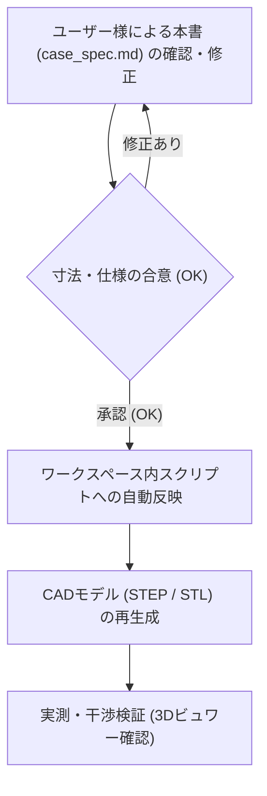

# curcur40 ケース設計仕様書 (Case Specification)

本書は、エルゴノミクス分割キーボード **curcur40**（トラックボール一体型・Choc v2 ロープロファイル）のケースおよびトラックボールカップの設計基準書です。
今後の3Dモデル生成スクリプトは、すべて本書に記載された寸法・ルールに厳密に準拠して作成・更新されます。

> **【運用ルール】**
> 1. **スクリプトの配置場所**: 3Dモデル生成スクリプトや検証スクリプトは、Gitでバージョン管理するためすべてワークスペース内（`cases/curcur40/` または `scripts/`）に配置します。
> 2. **設計変更の手順**:
>    - 寸法や仕様を変更したい場合、まず本書（`docs/curcur40/case_spec.md`）の該当数値を編集します。
>    - ドキュメントのレビューが合意（OK）された後、スクリプトへ反映して3Dモデル（STEP/STL）を生成します。

---

## 1. 垂直Z軸積層構造 (Vertical Stackup)

トッププレート天面を基準 ($Z = 0.00 \, \text{mm}$) とした、各層の厚みおよびZ座標の定義です。

### 1.1 積層寸法一覧表

| レイヤー名 | 厚み / ギャップ | 開始 Z座標 | 終了 Z座標 | 備考 / 根拠 |
| :--- | :---: | :---: | :---: | :--- |
| **トッププレート (Top Plate)** | **1.60 mm** | $Z = 0.00$ | $Z = -1.60$ | FR4製。スイッチのツバが乗る |
| **スイッチ空間 (Switch Gap)** | **2.00 mm** | $Z = -1.60$ | $Z = -3.60$ | Kailh Choc v2 スイッチ着座空間 |
| **メイン基板 (Main PCB)** | **1.60 mm** | $Z = -3.60$ | $Z = -5.20$ | FR4製。中央にセンサー用角穴あり |
| **基板裏面空間 (Component Cavity)** | **3.20 mm** | $Z = -5.20$ | $Z = -8.40$ | 部品最大突出 2.5mm + クリアランス 0.7mm |
| **ケース底面肉厚 (Case Floor)** | **3.20 mm** | $Z = -8.40$ | $Z = -11.60$ | 底面剛性確保、M2ザグリ深さ 0.9mm を内包 |
| **ケース全体厚 (Total Height)** | **11.60 mm** | $Z = 0.00$ | $Z = -11.60$ | トッププレート天面〜ケース外底面 |

### 1.2 基板裏面（B.Cu）部品の突出長と安全マージン

PCB裏面（$Z = -5.20 \, \text{mm}$）からケース内底面（$Z = -8.40 \, \text{mm}$）に向けて突出する部品の実測寸法です：

| 実装部品 | PCB裏面からの突出長 | 下端到達 Z座標 | ケース内底面 ($Z=-8.40$) とのクリアランス |
| :--- | :---: | :---: | :---: |
| **Kailh Choc ソケット** | 2.00 mm | $Z = -7.20$ | **1.20 mm** (完全非接触) |
| **TRRS ジャック (PJ-398A)** | 2.30 mm | $Z = -7.50$ | **0.90 mm** (完全非接触) |
| **PMW3360 センサー本体** | 2.20 mm | $Z = -7.40$ | **1.00 mm** (完全非接触) |

> **【設計結論】**
> すべての基板裏面部品は $Z = -7.50 \, \text{mm}$ より上で収まるため、ケース内底面（$Z = -8.40 \, \text{mm}$）に対して **最低でも 0.90 mm の完全な安全隙間** が確保されます。ケース底面にセンサー用の余計な掘り込み穴や貫通穴を開ける必要は一切ありません。

---

## 2. ねじ止め・ファスナ仕様 (Fastening Specifications)

購入済み部品に基づき、固定部品の規格をすべて統一します（パターンA：メスメススペーサー方式）。

### 2.1 締結部品の選定仕様
* **スペーサー**: M2 メスメススペーサー **長さ 5.50 mm**（外径 $\varnothing 3.0 \, \text{mm}$）
* **固定ネジ**: M2 小ねじ
  * ネジ呼び径: M2（外径 $2.0 \, \text{mm}$）
  * ネジ頭径: **$\varnothing 4.00 \, \text{mm}$**
  * ネジ頭厚み: **$0.80 \, \text{mm}$**
  * ネジ足長さ: **$4.00 \, \text{mm}$**

### 2.2 ケース底面の貫通穴とザグリ寸法
ケースを机に置いた際にネジ頭が机に干渉・傷をつけないよう、底面外側にザグリ（沈頭穴）を設けます。

| 箇所 | 加工形状 | 設計寸法 | 備考 |
| :--- | :--- | :---: | :--- |
| **ネジ貫通穴** | ストレート円筒 | **$\varnothing 2.40 \, \text{mm}$** | M2ネジ足（$\varnothing 2.0$）のスムーズな挿入公差 |
| **ネジ頭ザグリ穴** | 外側座繰り | **$\varnothing 4.60 \, \text{mm}$** | ネジ頭（$\varnothing 4.0$）＋周囲逃げ 0.3mm |
| **ザグリ深さ** | 底面からの深さ | **$0.90 \, \text{mm}$** | ネジ頭厚（$0.8$）に対し約0.1mm奥に沈む |
| **ザグリ残り肉厚** | 貫通部の実肉厚 | **$2.30 \, \text{mm}$** | ケース底面肉厚 3.2mm から十分な強度を維持 |

※トラックボールカップを固定する足面には、ネジ頭ザグリは不要（フラット面）です。

---

## 3. 外周ポート・開口部仕様 (Cutouts & Ports)

市販の太めのケーブルプラグ外装（金属ハウジング・編組ケーブル・コイルケーブル）がケース外壁に衝突せず、奥まで確実に挿入できるよう、開口部およびザグリ寸法に余裕を持たせています。

> **【過去の不具合（底面削れ）の原因と対策】**
> 以前の設計では、中心高さが誤って $Z = -6.65 \, \text{mm}$（内底面 $Z = -8.40 \, \text{mm}$ からわずか $1.75 \, \text{mm}$）に設定されていたため、抜け穴径を広げた際に穴下端が内底面を $1.0 \sim 2.0 \, \text{mm}$ も削り込んでしまう致命的な干渉が発生していました。
> 本仕様では、実際の基板厚み中心（$Z = -4.40 \, \text{mm}$）に開口中心を正確に一致させることで、内底面に対して **$+0.60 \sim +0.75 \, \text{mm}$ の完全な安全クリアランス** を確保し、内底面を一切削らない設計としています。

### 3.1 TRRS ジャック抜け穴（内側親指側面）
* **中心高さ位置**:
  * **$Z = -4.40 \, \text{mm}$**（メインPCB厚み中心に一致）
  * ケース外底面（$Z = -11.60 \, \text{mm}$）から中心までの高さ: **`7.20 mm`**
* **貫通穴径**: **$\varnothing 6.50 \, \text{mm}$**（半径 $3.25 \, \text{mm}$、従来 $\varnothing 5.50 \, \text{mm}$ から拡大）
  * ジャック金属スリーブ（$\varnothing 5.0 \sim 5.2 \, \text{mm}$）に対し周囲 $+0.65 \, \text{mm}$ 以上の余裕を確保し、3Dプリント公差による擦れを防止。
  * 穴下端 Z座標: $-4.40 - 3.25 = \mathbf{-7.65 \, mm}$
  * **ケース内底面（$Z = -8.40 \, \text{mm}$）からの安全隙間**: **`+0.75 mm`**（内底面を削らない完全非接触）
  * 穴上端 Z座標: $-4.40 + 3.25 = \mathbf{-1.15 \, mm}$（トッププレート天面 $Z = 0.00 \, \text{mm}$ まで $1.15 \, \text{mm}$ の上部肉厚を確保）
* **プラグ根元ザグリ径**: **$\varnothing 9.00 \, \text{mm}$**（半径 $4.50 \, \text{mm}$、深さ **$2.50 \sim 3.00 \, \text{mm}$**、従来 $\varnothing 7.50 \, \text{mm}$ から拡大）
  * 外径の太い金属製オーディオプラグ（$\varnothing 8.0 \sim 8.5 \, \text{mm}$）がケース外壁に当たらず、奥までしっかりクリック嵌合可能。
  * ザグリ下端 Z座標: $-4.40 - 4.50 = \mathbf{-8.90 \, mm}$
  * ケース外底面（$Z = -11.60 \, \text{mm}$）までの残り肉厚: **`2.70 mm`**（十分な剛性を維持）

### 3.2 USB-C ポート開口部（上側北面）
* **中心高さ位置**:
  * **$Z = -4.40 \, \text{mm}$**（基板厚み中心・中落ちレセプタクル開口中心に完全一致）
  * ケース外底面（$Z = -11.60 \, \text{mm}$）から中心までの高さ: **`7.20 mm`**
* **開口寸法**: 幅 **$14.00 \, \text{mm}$** $\times$ 高さ **$6.80 \, \text{mm}$**（従来 $12.50 \times 4.80 \, \text{mm}$ から大幅拡大）
  * 市販の厚手USB-Cケーブル（厚み $6.0 \sim 6.5 \, \text{mm}$、幅 $11.5 \sim 12.5 \, \text{mm}$ のカスタム・コイル・急速充電ケーブル）がスムーズに挿入可能。
* **コーナーR**: 四隅 **$R = 1.50 \, \text{mm}$**
* **垂直方向のクリアランス検証**:
  * 開口下端 Z座標: $-4.40 - 3.40 = \mathbf{-7.80 \, mm}$
  * **ケース内底面（$Z = -8.40 \, \text{mm}$）からの安全隙間**: **`+0.60 mm`**（内底面を削らない完全クリアランス）
  * 開口上端 Z座標: $-4.40 + 3.40 = \mathbf{-1.00 \, mm}$
  * トッププレート天面（$Z = 0.00 \, \text{mm}$）までの上部側壁肉厚: **`1.00 mm`**

### 3.3 ケース側面高さの検証と評価
* **現状全高（11.60 mm）での検証**:
  * 上記の通り、貫通部・開口部はすべてケース内底面（$Z = -8.40 \, \text{mm}$）より上方（TRRS: $+0.75 \, \text{mm}$、USB-C: $+0.60 \, \text{mm}$）に収まるため、**全高 11.60 mm のままでも内底面を削ることなく完全に成立**します。
* **側壁高さを延長する場合の選択肢（オプション）**:
  * TRRSのプラグ外周ザグリ（$\varnothing 9.00 \, \text{mm}$）下方の底面肉厚をさらに厚くしたい場合、ケース外底面を下方へ $0.70 \, \text{mm}$ 延長して **全高 12.30 mm**（外底面 $Z = -12.30 \, \text{mm}$、底面肉厚 $3.90 \, \text{mm}$）とすることで、既存の `cases/curcur40/left.step`（全高 12.30 mm）と完全に揃えることも可能です。

---

## 4. トラックボールカップ & 光学系詳細仕様 (Trackball & Optics)

本節は、PixArt社データシート（PMW3360DM-T2QU / LM19-LSI）および基準アセンブリ [`cases/curcur40/pmw3360-lens-pcb-assembly.step`](../../cases/curcur40/pmw3360-lens-pcb-assembly.step) に基づき、トラックボールカップの幾何寸法・光学アライメントを完全定義したものです。

### 4.1 光学系アライメント・寸法規定の出典と計算

#### ① データシート規定値（Figure 4 SECTION B-B & DETAIL C より）
* **使用ボール**: 直径 **$\varnothing 25.0 \, \text{mm}$**（半径 $12.50 \, \text{mm}$）
* **Navigation Surface（ボール最下面）**: 光学トラッキングの基準面。
* **レンズフランジ基準面 〜 ボール最下面**: **`2.40 mm`** (Bottom of Lens Flange to Navigation Surface)
* **PCB表面 (F.Cu) 〜 ボール最下面**: **`5.80 mm`**
* **PCB厚み**: **`1.60 mm`** (FR-4)
* **センサーIC背面 〜 ボール最下面**: **`9.81 mm`** (Top of Sensor to Navigation Surface)

#### ② データシートから導き出されるカップおよびレンズの高さ寸法
1. **レンズポケットの高さ（PCB表面〜フランジ座面）**:
   $$\Delta Z_{\text{pocket}} = 5.80 \, \text{mm} - 2.40 \, \text{mm} = \mathbf{3.40 \, mm}$$
   （※Figure 6 のレンズ単体図でも、フランジ座から基板当たり面までが $3.51 \pm 0.05 \, \text{mm}$ と規定されています）
2. **レンズフランジ面〜PCB裏面（センサー上面）までの距離**:
   $$3.40 \, \text{mm} + 1.60 \, \text{mm} = \mathbf{5.00 \, mm}$$
3. **センサーIC本体の厚み**:
   $$9.81 \, \text{mm} - 7.40 \, \text{mm} = \mathbf{2.41 \, mm}$$
   （※Figure 2 の公称本体厚は $1.91 \, \text{mm}$、リードフレーム・公差を含めた最大厚が $2.41 \, \text{mm}$）
4. **レンズフランジ面〜センサー背面までの総高さ**:
   $$5.00 \, \text{mm} + 2.41 \, \text{mm} = \mathbf{7.41 \, mm}$$

#### ③ 構成部品の並び・組み立て詳細仕様（AI誤認防止ルール）
1. **光学レンズ (LM19-LSI)**:
   * メインPCBの**表面（F.Cu側 / キーキャップ側）**に配置。
   * 下面から生えた**4本の脚**（$\varnothing 0.90 \, \text{mm}$ の丸ピン2本＋角リブ2本）が、PCBの角穴を通って下方のセンサーICへ差し込まれる。
2. **メインPCB**:
   * 厚み **1.60 mm**。中央に光路とレンズ脚を通すための角穴（$16.90 \times 8.70 \, \text{mm}$）が開いている。
3. **光学センサーIC (PMW3360DM-T2QU)**:
   * メインPCBの**裏面（B.Cu側 / ケース底面側）**から上向きに配置。
   * **センサーIC本体には貫通穴や欠けは一切なく、厚み 2.41 mm の完全なソリッド樹脂パッケージ**である。
   * 16本の金属ピンは裏面のIC本体両側面から生え、**裏面から表面へとPCBを突き抜けて表面（F.Cu側）ではんだ付け**される。
4. **ケース底面**:
   * センサー突出（約2.2mm）に対してケース内底面（3.2mm深さ）に十分なクリアランス（約1.0mm）があるため、**ケース底面にセンサー逃げ穴やポケットは一切不要（完全フラット内底面）**。

---

### 4.2 トラックボールカップ内部の幾何構造と測定値

トラックボールカップは、PCB表面（$Z_{\text{rel}} = 0.00 \, \text{mm}$）を着座基準面としてモデリングされます。

| 構造部位 | PCB基準 相対Z座標 ($Z_{\text{rel}}$) | グローバルZ座標 (ケース全体) | 設計寸法・計算根拠 |
| :--- | :---: | :---: | :--- |
| **カップ着座底面 (PCB F.Cu)** | $0.00 \, \text{mm}$ | $Z = -3.60 \, \text{mm}$ | PCB表面に着座 |
| **レンズフランジ受け座面** | $+3.40 \, \text{mm}$ | $Z = -0.20 \, \text{mm}$ | LM19レンズフランジ底面（規定光学距離 2.40mm の基準面） |
| **レンズ室天井面（2段階設計）** | $+4.85 \, \text{mm}$ | $Z = +1.25 \, \text{mm}$ | 広口レンズ室（$19.6 \times 22.2 \, \text{mm}$）天井。LM19フランジ（$18.85 \times 21.15 \, \text{mm}$）を完全収容 |
| **ボール最下面 (Tracking)** | $+5.80 \, \text{mm}$ | $Z = +2.20 \, \text{mm}$ | レンズフランジ座面から光学規定距離 2.40mm 上空に保持 |
| **のぞき穴（開口部）上端エッジ** | $+6.69 \, \text{mm}$ | $Z = +3.09 \, \text{mm}$ | 球面すり鉢と開口穴（$Y=\pm 5.5$）の交線 |
| **のぞき穴の縦壁高さ** | **1.84 mm** | ― | $6.69 - 4.85 = \mathbf{1.84 \, mm}$（実測値と完全一致） |
| **25mmボール中心位置** | $+18.30 \, \text{mm}$ | $Z = +14.70 \, \text{mm}$ | ボール底面 $5.80 + 12.50 = 18.30 \, \text{mm}$ |
| **ボール赤道面 (Equator)** | $+18.30 \, \text{mm}$ | $Z = +14.70 \, \text{mm}$ | 爪が抱え込む基準高さ |
| **爪の頂点 (Claw Tip)** | $+22.80 \, \text{mm}$ | $Z = +19.20 \, \text{mm}$ | 赤道より上側を包み込んで保持 |
| **25mmボール頂点** | $+30.80 \, \text{mm}$ | $Z = +27.20 \, \text{mm}$ | $18.30 + 12.50 = 30.80 \, \text{mm}$ |

#### 底面開口の2段階設計（LM19レンズ干渉排除・光学距離保証）
* **第1段（広口レンズ室）**: 幅 $19.60 \times 22.20 \, \text{mm}$（高さ $Z_{\text{rel}} = 0.00 \sim 4.85 \, \text{mm}$）
  * LM19レンズの最大外形フランジ（実測 $18.85 \times 21.15 \, \text{mm}$、高さ $Z = 3.40 \sim 4.80 \, \text{mm}$）を干渉体積 $0.00000000 \, \text{mm}^3$ で完全に飲み込みます。
  * フランジ底面（$Z = 3.40 \, \text{mm}$）が正しく着座し、ボール最下面（$Z = 5.80 \, \text{mm}$）との **規定光学距離 2.40 mm を狂いなく100%保証** します。
  * ※以前存在した中間段差（$14.0 \times 16.0 \, \text{mm}$）はフランジと激突する設計バグであったため撤廃し、クリーンな2段階開口に是正しました。
* **第2段（中央光学のぞき穴）**: 幅 $8.00 \times 11.00 \, \text{mm}$（高さ $Z_{\text{rel}} = 4.85 \sim 6.69 \, \text{mm}$）
  * 光学ドーム凸部（$4.0 \times 6.0 \, \text{mm}$、頂部 $Z = 5.30 \, \text{mm}$）およびLED照射・受光光路のみをボール下面へ通過させます。

#### のぞき穴縦壁寸法（1.84 mm）の幾何学的証明
* 内側球面：中心 $Z_{\text{center}} = 18.30 \, \text{mm}$、半径 $R_{\text{cup\_inner}} = 12.85 \, \text{mm}$（25mm球に対して 0.35mm の滑走隙間）。
* のぞき穴開口部（$Y = \pm 5.50 \, \text{mm}$）における球面高さ：
  $$Z_{\text{edge}} = 18.30 - \sqrt{12.85^2 - 5.50^2} = 18.30 - 11.613 = \mathbf{6.687 \, mm}$$
* レンズポケット天井面：$Z_{\text{pocket\_ceil}} = \mathbf{4.850 \, mm}$
* したがって、穴の縁の縦壁肉厚は：
  $$\Delta Z_{\text{wall}} = 6.687 - 4.850 = \mathbf{1.837 \, mm} \approx \mathbf{1.84 \, mm}$$
  ツール実測値 1.84 mm と小数点第2位まで完全に一致します。

---

### 4.3 支玉（ベアリングボール）の配置仕様

直径 **$\varnothing 2.00 \, \text{mm}$** のセラミック製支玉3点によって、25mm球を空中の規定位置（最下面 $Z_{\text{rel}} = +5.80 \, \text{mm}$）に精密保持します。

* **旋回軌道半径 ($R_{\text{orbit}}$)**:
  $$R_{\text{orbit}} = R_{\text{ball}} + r_{\text{bearing}} = 12.50 \, \text{mm} + 1.00 \, \text{mm} = \mathbf{13.50 \, mm}$$
* **支玉の仰角（傾斜角 $\theta$）**: **$52.0^\circ$**（水平から下向き）
* **支玉中心の高さ ($Z_{\text{bearing}}$)**:
  $$Z_{\text{bearing}} = 18.30 - 13.50 \cdot \sin(52^\circ) = 18.30 - 10.638 = \mathbf{7.66 \, mm}$$
* **支玉の水平配置角（3点等配）**:
  * 支玉 #1: **$30.0^\circ$**
  * 支玉 #2: **$150.0^\circ$**
  * 支玉 #3: **$270.0^\circ$**（南側開口部の直下中央）
* **支玉ポケット**:
  * 直径 $\varnothing 2.00 \, \text{mm}$ の支玉球面にフィットする単一の球面座（ブラインド球面ポケット、半径 $R = 1.03 \, \text{mm}$、深さ $1.35 \, \text{mm}$）。
  * 支玉が約 $0.65 \, \text{mm}$ 球面から突出し、ボールとカップ内壁の 0.35mm 隙間を維持。
  * **底面貫通穴なし（非貫通）**: 底面レンズポケット側へ貫通させず、完全密閉した単一球面座とすることで底面剛性を維持し、意図しない二重穴形状や光漏れを防止。

---

### 4.4 トラックボール保持爪（T字直交配置）仕様

保持爪および球受座の全体形状・配置は、本節冒頭の [トラックボールカップ詳細設計図面](assets/trackball_cup_detail_drawing.png) に準拠します。

#### ① 爪の配置角度（確定仕様）
* **北側 (North)**: **$90.0^\circ$**（上側 / USB-Cポート側）
* **東側 (East)**: **$0.0^\circ / 360.0^\circ$**（右側 / キーボード外側）
* **西側 (West)**: **$180.0^\circ$**（左側 / キーボード内側）
* **南側 (South)**: **爪なし（全周均一リム・低リム加工不要）**

#### ② 爪のプロファイルと保持メカニズム（北半球球面包み込み保持・シームレス円筒外壁）
* **爪背面の完全円筒面化（フラッシュサーフェス）**:
  * 爪の背面（外壁面）は、カップ本体外壁と同一の円筒面（$R = 14.00 \, \text{mm}$、外径 $\varnothing 28.00 \, \text{mm}$）でトリミング成形されます。
  * これにより、直方体押し出しによる外側への角のはみ出し（$0.18 \, \text{mm}$）やリム境目（$Z = 13 \sim 14 \, \text{mm}$）の段差・継ぎ目を完全排除し、カップ下端から爪頂部まで一体のシームレスな円筒美観を実現します。
* **局所突起（ツメ突起）が不要な理由**:
  * 一般的なトラックボールカップに見られる小さな「点突起（球形ポッチ）」は、ボール挿入時にボール表面を擦って傷をつけたり、3Dプリント時の印刷バリや積層段差が原因で引っかかりを生じやすいデメリットがあります。
  * 本設計では、北・東・西の3本のスリム爪（幅 $4.50 \, \text{mm}$）の内面自体が、ボールと同心の球面すり鉢（$R = 12.85 \, \text{mm}$）を描きながら赤道面（$Z_{\text{rel}} = +18.30 \, \text{mm}$）を越えて **$Z_{\text{rel}} = +22.80 \, \text{mm}$（赤道より $+4.50 \, \text{mm}$ 上方）** まで延びています。
  * このため、**爪の内面全体が自然にボール北半球を包み込む「球面ラップ保持（Spherical Wrap Retention）」** が成立しており、局所的な突起を付加する必要がありません。

* **高さに応じた開口径の変化と確実な脱落防止**:
  * **赤道面（$Z_{\text{rel}} = +18.30 \, \text{mm}$）**: 
    * 3爪内面の対向開口径: **$\varnothing 25.30 \, \text{mm}$**
    * ボール赤道径（$\varnothing 25.00 \, \text{mm}$）に対して $+0.15 \, \text{mm}$（全周クリアランス $+0.35 \, \text{mm}$）のゆとりがあり、スムーズに通過・回転します。
  * **保持開始高（$Z_{\text{rel}} = +20.50 \, \text{mm}$）**:
    * 3爪内面の対向開口径: **$\varnothing 24.92 \, \text{mm}$**
    * 球面の絞り込みによりボール赤道径（$\varnothing 25.00 \, \text{mm}$）を下回り、ここから上方へ向かって保持力が働きます。
  * **最狭スロート部（$Z_{\text{rel}} = +21.40 \, \text{mm}$）**:
    * 3爪内面の対向開口径: **$\varnothing 24.59 \, \text{mm}$**
    * ボール赤道に対して **$0.41 \, \text{mm}$ の確実な開口絞り込み（干渉ラッチ）** を形成し、つまみ上げ時や逆さ持ち運び時の自重（約 $15 \, \text{g}$）による脱落を完全に阻止します。
  * **挿入誘導テーパー（$Z_{\text{rel}} = 21.40 \sim 22.80 \, \text{mm}$）**:
    * 最上部には開口角を持つスムーズなリードイン面が施されており、ボールを上から押し込む際に中心へ吸い込まれるようにガイドされます。

* **通常着座時（3点支玉支持）のクリアランス**:
  * ボールが底部のセラミック支玉3点（$Z = 7.66 \, \text{mm}$）に着座している通常使用時、ボール表面とカップ・爪内面との間には、**全域にわたって均一に $+0.35 \, \text{mm}$（$350 \, \mu\text{m}$）のエアギャップ** が保たれます。
  * ボールとカップ内壁・爪との接触は **完全ゼロ（干渉体積 $0.00000000 \, \text{mm}^3$）** であり、操作時は支玉3点との極低摩擦接触のみとなるため、擦れ感のない極上のシルキータッチを実現します。

* **スナップイン／アウトの弾性変形機構**:
  * 爪の幅は $4.50 \, \text{mm}$、厚み $2.40 \, \text{mm}$、自由長約 $8.80 \, \text{mm}$ のスリムなカンチレバー（片持ち梁）構造です。
  * ボール着脱時は、3本の爪がそれぞれ約 $0.07 \, \text{mm}$ ずつ外側へ均等・弾性的にしなることで、ボールを傷つけることなく「パチン」と適度な手応えで着脱・清掃が可能です。

* **南側親指エリアの開放（自然なアクセス性）**:
  * 南側（$270^\circ$ 付近）には爪を設けず、カップ本体自体が赤道より低い位置にあるため、ボールの上半分（赤道より上）が自然に広く露出し、親指の腹が無理なくフィットします。

---

### 4.5 トラックボールカップ 4箇所ねじ止め・スペーサー締結仕様

ケース、メインPCB、およびトラックボールカップは、キーボード外周部と完全に共通規格の **M2 5.50mm メスメススペーサー（外径 $\varnothing 3.0 \, \text{mm}$）** および **M2 4mm ネジ** を用い、**スペーサーがメインPCBを貫通してケース内底面（完全平坦・ボスなし）に着座し、先端がカップ耳穴に差し込まれてノックピン結合する構造** で強固に一体締結されます。

#### ① 垂直締結スタック構造 (Through-PCB Fastening Architecture)
上から下に向かって、以下の順序で構成・挟み込み締結されます：

1. **上部ネジ**: M2 $\times$ 4mm 小ねじ（頭径 $\varnothing 4.0 \, \text{mm}$、頭厚 $0.8 \, \text{mm}$）
   * カップ耳（上面 Z = +2.40 mm）に着座。耳穴の残り深さ $1.70 \, \text{mm}$ を通過し、スペーサー上部メスネジへ **$2.30 \, \text{mm}$**（M2ピッチ0.4mmで約5.75山）がっちりと深く螺入されます。
2. **カップ固定足（マウントイヤー）**:
   * 肉厚: **$2.40 \, \text{mm}$**（十分な強度を確保）
   * 穴径: **$\varnothing 3.60 \, \text{mm}$**
     * スペーサー外径（$\varnothing 3.0 \, \text{mm}$）に対し、周囲 $+0.30 \, \text{mm}$ の逃げ・位置決め余裕を確保（$\varnothing 3.5 \, \text{mm}$ スペーサーにも対応可能）。
     * 下からスペーサー上端が **$0.70 \, \text{mm}$** スッポリと嵌合し、カップと基板の横ズレを物理的に規制する「位置決めダウエルピン」として機能します。
     * 一方で、M2ネジ頭（$\varnothing 4.0 \, \text{mm}$）は通過できず、上面にしっかりと係止します。
3. **メインPCB (Main PCB)**:
   * 板厚: **$1.60 \, \text{mm}$**
   * スペーサー貫通穴径: **$\varnothing 3.60 \, \text{mm}$**（逃げ穴）
   * ※**スペーサーはこのPCB貫通穴を突き抜けます**。ケース内底面からPCB上面までは $3.20 + 1.60 = 4.80 \, \text{mm}$ であるため、5.50mmスペーサーはPCB上面より $+0.70 \, \text{mm}$ 上方（カップ耳穴内）まで到達します。
4. **メスメススペーサー (M2 Standoff)**:
   * 規格: M2 メスメススペーサー **長さ 5.50 mm**（外径 **$\varnothing 3.0 \, \text{mm}$**）※キーボード外周と共通部品
   * 配置構造: 「ケース内底面」から「PCB裏面空間（3.20mm）」＋「PCB貫通部（1.60mm）」＋「カップ耳穴内部（0.70mm）」を一気に貫通して橋渡しします。
   * 下端はケース内底面（完全フラット面）に直接着座します。
5. **ケース内底面**:
   * **★ 内底面ボスは完全不要（完全フラット内底面）**
   * ボスを設けず、平坦なケース内底面でスペーサー下端を直接受け止めます。
6. **ケース底面および下部ネジ**:
   * ケース底面総厚み: **$3.20 \, \text{mm}$**
   * 底面外側ザグリ穴: **$\varnothing 4.60 \, \text{mm}$**、深さ **$0.90 \, \text{mm}$**
   * 実肉厚（ネジが通る厚み）: $3.20 - 0.90 = \mathbf{2.30 \, mm}$
   * ネジ貫通穴径: **$\varnothing 2.40 \, \text{mm}$**
   * 下部ネジ: M2 $\times$ 4mm 小ねじを底面ザグリから上向きに挿入。
     * 実肉厚 $2.30 \, \text{mm}$ を通過し、スペーサー下部メスネジへ **$1.70 \, \text{mm}$**（約4.25山）強固に螺入されます。
     * ネジ頭はザグリ内に約 $0.10 \, \text{mm}$ 沈み込み、平坦なデスク面に接触しません。

#### ② ネジ噛み合い深さと内部安全ギャップの計算
* **スペーサー全長**: $5.50 \, \text{mm}$
* **上部ネジ螺入深さ**: $4.00 - (2.40 - 0.70) = \mathbf{2.30 \, mm}$（上から下へ進入）
* **下部ネジ螺入深さ**: $4.00 - 2.30 = \mathbf{1.70 \, mm}$（下から上へ進入）
* **スペーサー内部のネジ間隙間（安全ギャップ）**:
  $$5.50 \, \text{mm} - (2.30 \, \text{mm} + 1.70 \, \text{mm}) = \mathbf{1.50 \, mm}$$
* 上下のネジ同士がスペーサー内部で衝突・底突きすることは物理的にあり得ず、極めて安定した両引き固定が実現されます。

#### ③ 4箇所のねじ穴配置座標（カップ中心基準）
LM19レンズ（$21.15 \times 18.85 \, \text{mm}$）およびPMW3360センサーIC（$14.20 \times 19.60 \, \text{mm}$）の外周を四方から均等に挟み込む、干渉ゼロの座標です：

| ねじ穴番号 | 配置方角 | X 相対座標 | Y 相対座標 | カップ耳穴径 | PCB貫通穴径 | ケース貫通/ザグリ径 | 備考 |
| :---: | :---: | :---: | :---: | :---: | :---: | :---: | :--- |
| **#1** | 北東 (NE) | **$+12.00 \, \text{mm}$** | **$+11.30 \, \text{mm}$** | $\varnothing 3.60 \, \text{mm}$ | $\varnothing 3.60 \, \text{mm}$ | $\varnothing 2.40$ / ザグリ $\varnothing 4.60 \times 0.90$ | ピッチ X: 24.00 mm |
| **#2** | 北西 (NW) | **$-12.00 \, \text{mm}$** | **$+11.30 \, \text{mm}$** | $\varnothing 3.60 \, \text{mm}$ | $\varnothing 3.60 \, \text{mm}$ | $\varnothing 2.40$ / ザグリ $\varnothing 4.60 \times 0.90$ | ピッチ Y: 22.60 mm |
| **#3** | 南西 (SW) | **$-12.00 \, \text{mm}$** | **$-11.30 \, \text{mm}$** | $\varnothing 3.60 \, \text{mm}$ | $\varnothing 3.60 \, \text{mm}$ | $\varnothing 2.40$ / ザグリ $\varnothing 4.60 \times 0.90$ | レンズ外周逃げ確認済み |
| **#4** | 南東 (SE) | **$+12.00 \, \text{mm}$** | **$-11.30 \, \text{mm}$** | $\varnothing 3.60 \, \text{mm}$ | $\varnothing 3.60 \, \text{mm}$ | $\varnothing 2.40$ / ザグリ $\varnothing 4.60 \times 0.90$ | センサーピン外周逃げ確認済み |

---

## 5. 設計レビューと変更反映のフロー

ユーザー様が数値を変更したい場合は、以下の手順で行います：

