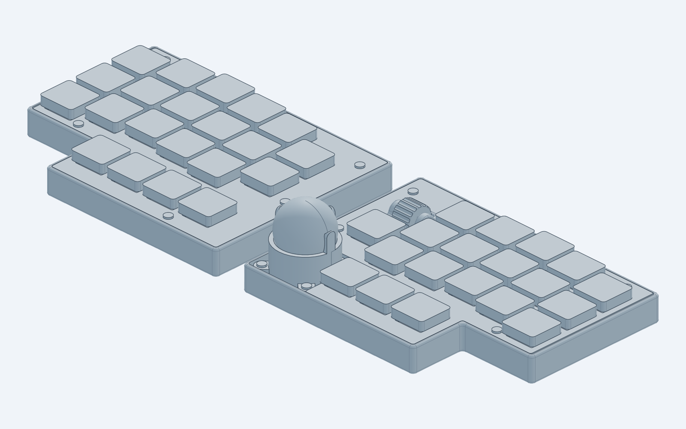
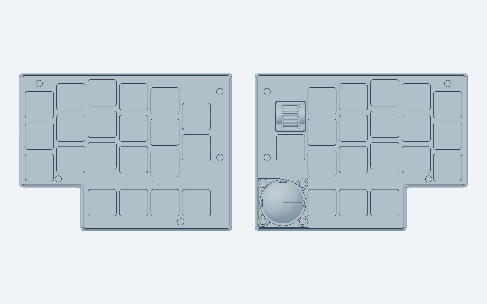
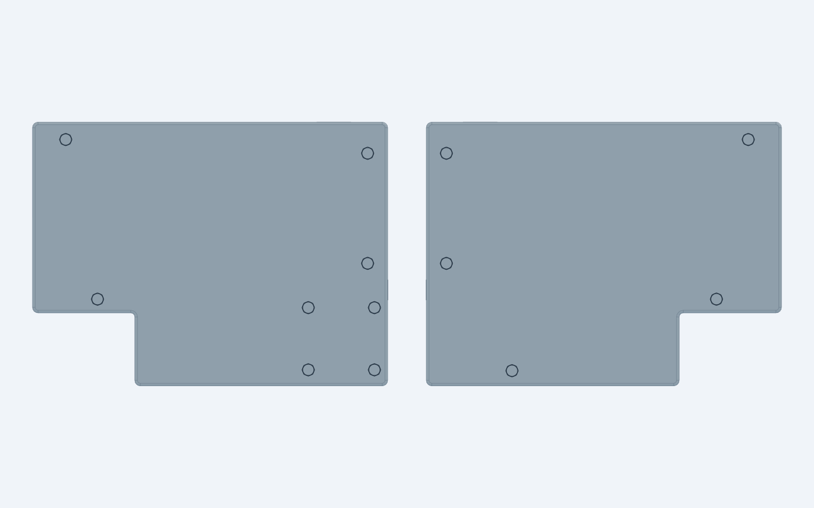
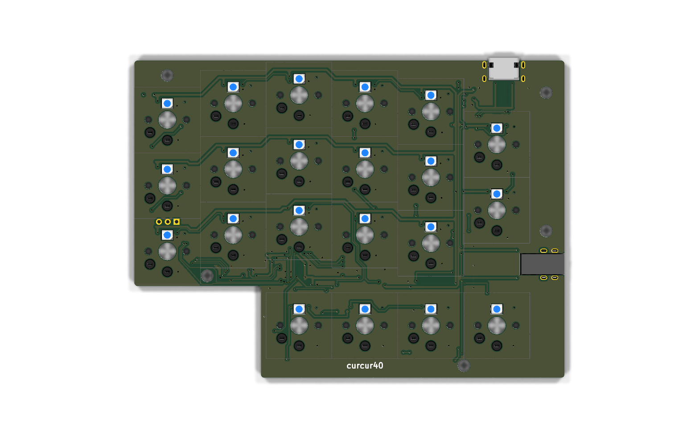
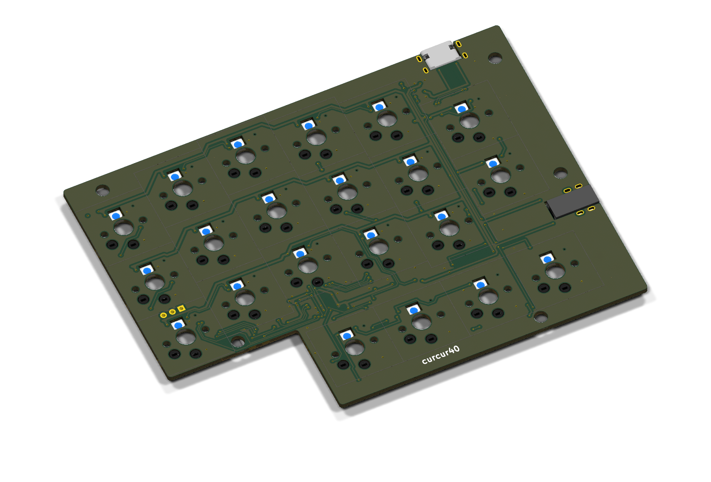
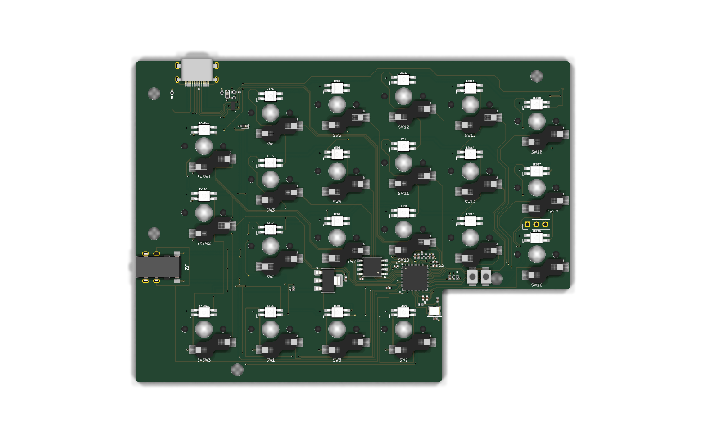
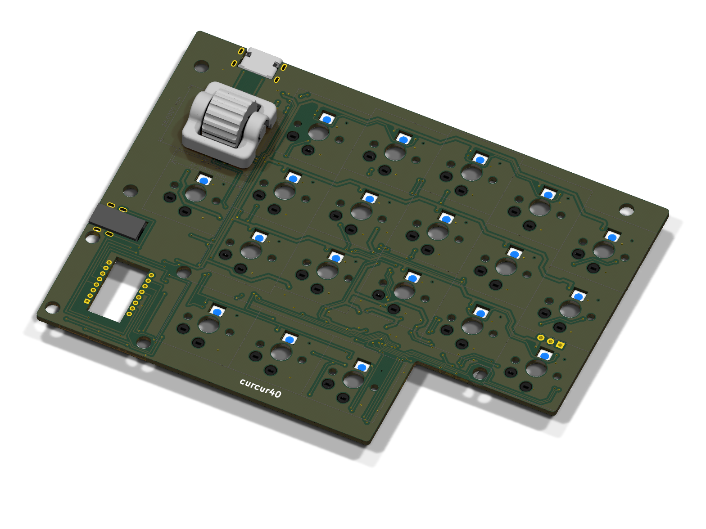
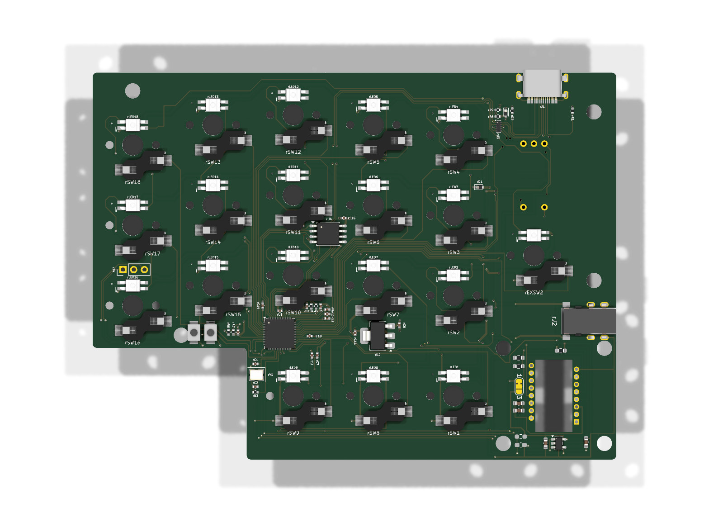
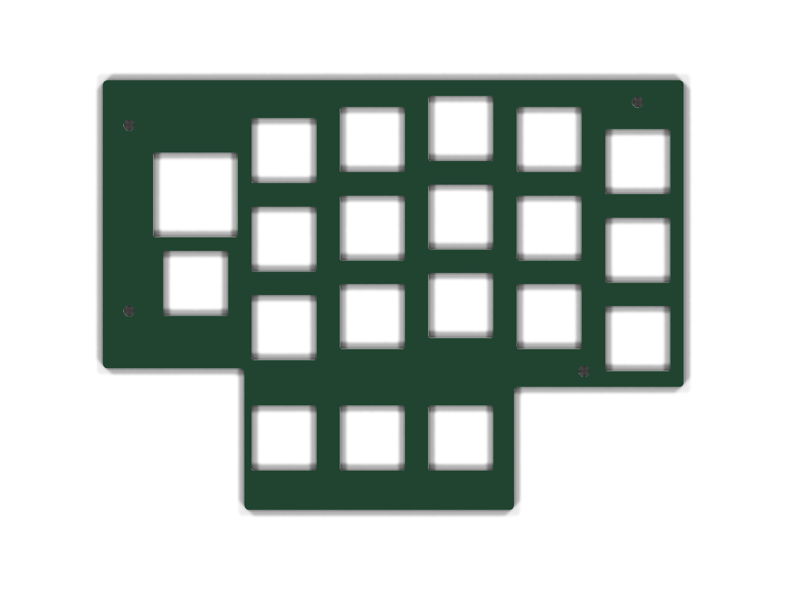

# curcur40 3D プレビュー・完成イメージギャラリー

KiCad 10.0 Raytracing（`kicad-cli pcb render`）および `cadgen` 3D CAD レンダラーで出力した **curcur40** の最新完成イメージ一覧です。

---

## 0. フルアセンブリ完成イメージ（3Dプリントケース + メイン基板 + トッププレート + 25mmトラックボール + CKW12エンコーダ）

左右3Dプリントトレイ型ボトムケース（底面 $Z = -12.30\text{ mm}$、内底面フラット $Z = -9.10\text{ mm}$）、1.6mm FR-4 メイン基板（$Z = -5.20 \sim -3.60\text{ mm}$）、1.6mm FR-4 トッププレート（$Z = -1.60 \sim 0.00\text{ mm}$）、右手シングルボード統合の PMW3360DM-T2QU 光学センサー＋LM19-LSI レンズ、Ø25mm トラックボール＆専用スナップインカップ（3爪スリムアーチ保持・3点セラミック球支持）、および右手人差し指内側の水平ローラーエンコーダ（CKW12）を組み合わせた最終完成イメージです。

- **13箇所 M2 5.50mm メス-メス スペーサー締結方式**：
  - 左手外周 5箇所 ＋ 右手外周 4箇所 ＋ トラックボールカップ固定耳 4箇所 ＝ **計 13箇所**すべてを **M2 メス-メス スペーサー（長さ 5.50mm, 外径 3.0mm）** と上下の **M2 × 4mm ネジ（計 26本）** で締結します。
  - スペーサー（$Z = -9.10 \sim -3.60\text{ mm}$）がメイン基板の **Ø3.60mm 貫通穴**を通り、基板上面（F.Cu, $Z = -3.60\text{ mm}$）と完全にツライチになる構造です。
  - ケース底面外側の 13箇所には **Ø4.60mm × 深さ 0.90mm のザグリ穴**を設け、底面側の M2 × 4mm ネジ頭（厚さ 0.80mm）がケース底面から突出しない設計（クリアランス 0.10mm）となっています。

### 斜視図（アイソメトリックビュー）

### 上面図（トップビュー）

### 底面図（ボトムビュー：13箇所 Ø4.6mm×0.9mm ザグリ穴）

---

## 1. 左手メイン基板 (`curcur40-left`)
- **構成**: 21キー（メイン 3×5 + 内側 1u×2 + 親指 1u×4）
- **制御回路**: RP2040（QFN-56）+ W25Q128JVSIQ（16MB QSPI Flash）+ USB Type-C（ESD保護・シリアル抵抗・VBUS逆流防止ダイオード搭載）+ TRRS/TRS 4極ジャック
- **外周固定穴**: 5箇所（Ø3.60mm 貫通穴、M2 5.50mm スペーサー挿通用）

### 表面（スイッチ差し込み面 / F.Cu）

### 斜視図（アイソメトリックビュー）

### 裏面（部品実装面 / B.Cu）

---

## 2. 右手メイン基板 (`curcur40-right`：PMW3360 シングルボード統合設計)
- **構成**: 19キー（メイン 3×5 + 内側下段 1u×1 + 親指外側 1u×3）+ 水平ローラーエンコーダ **CKW12**（`rEXSW1`: $(14.2875, 0.0000)\text{ mm}$）+ **25mm トラックボール光学センサー統合部**（中心 $(9.5250, 52.3875)\text{ mm}$）
- **シングルボード統合アーキテクチャ**:
  - 独立したセンサー子基板や6ピンヘッダー（旧 `rJ3`/`J1`）を廃止し、右手メイン基板に PMW3360DM-T2QU（`U1`）および 1.8V LDO（`U2`: TLV74318PDBVR）回路を直接統合しています。
  - 裏面（`B.Cu`）の電圧選択ジャンパ `JP1` は、**Pad 1（`+3V3R`）– Pad 2（`/V_{IO}`）間が基板の銅箔パターンで最初から直結（`SolderJumper_3_Bridged12`）** されており、手作業でのブリッジは不要です。
  - LDO 変更前の名残である `R4`（28kΩ）および `C5`（22nF）は **DNP（未実装）** 指定となっています。
- **固定穴・光学開口**:
  - 外周スペーサー貫通穴 4箇所（Ø3.60mm）+ トラックボールカップ固定用スペーサー貫通穴 4箇所（Ø3.60mm：中心 $(9.5250, 52.3875)\text{ mm}$ から $X \pm 12.00\text{ mm}, Y \pm 11.30\text{ mm}$）＝ 計 8箇所
  - PMW3360 光学窓＆LM19-LSI レンズ脚部用の矩形開口（$8.70 \times 16.90\text{ mm}$）

### 表面（スイッチ・トラックボールカップ搭載面 / F.Cu）

### 斜視図（アイソメトリックビュー）

### 裏面（SMD部品・PMW3360センサー実装面 / B.Cu）

---

## 3. FR-4 トッププレート (`plate-top-left` / `plate-top-right`)
- **材質・板厚**: FR-4（ガラスエポキシ基板材）、板厚 $1.60\text{ mm}$（$Z = -1.60 \sim 0.00\text{ mm}$）
- **ネジ穴仕様**: すべて **Ø2.40mm ストレート貫通穴（ザグリなし）**（左手 5箇所、右手 4箇所）。上から M2 × 4mm ネジを通してメイン基板表面とツライチの M2 5.50mm スペーサー上端へ締結します。
- **右手プレート形状**: CKW12 水平ローラーエンコーダ用の開口（$18.20 \times 18.20\text{ mm}$）および親指内側のトラックボールカップ領域を切り欠いた L字ノッチ形状。
- ※トレイ型3Dプリントボトムケースに統合されたため、旧ボトムプレートは廃止されています。

### 左手トッププレート (`plate-top-left`)

### 右手トッププレート (`plate-top-right`)

---

## 4. トラックボールカップ・光学スタックアップ検証モデル
[`cases/curcur40/`](../../cases/curcur40/) 配下の4つの3D検証モデルには、GUI（CAD Viewer等）の計測ツールで直接選択してボール底面（$Z_{\text{rel}} = +5.80\text{ mm}$）との距離（設計値 **$2.40\text{ mm}$**）を計測できるよう、レンズ側光学距離基準点（**`Lens_Optical_Ref_Point`**, $Z_{\text{rel}} = +3.40\text{ mm}$ / グローバル $Z = -0.20\text{ mm}$）が独立オブジェクトとしてプロットされています。

- [`pmw3360-lens-pcb-assembly.step`](../../cases/curcur40/pmw3360-lens-pcb-assembly.step)
- [`trackball-sensor-assembly.step`](../../cases/curcur40/trackball-sensor-assembly.step)
- [`trackball-cup-with-ball.step`](../../cases/curcur40/trackball-cup-with-ball.step)
- [`assembly-full.step`](../../cases/curcur40/assembly-full.step)
