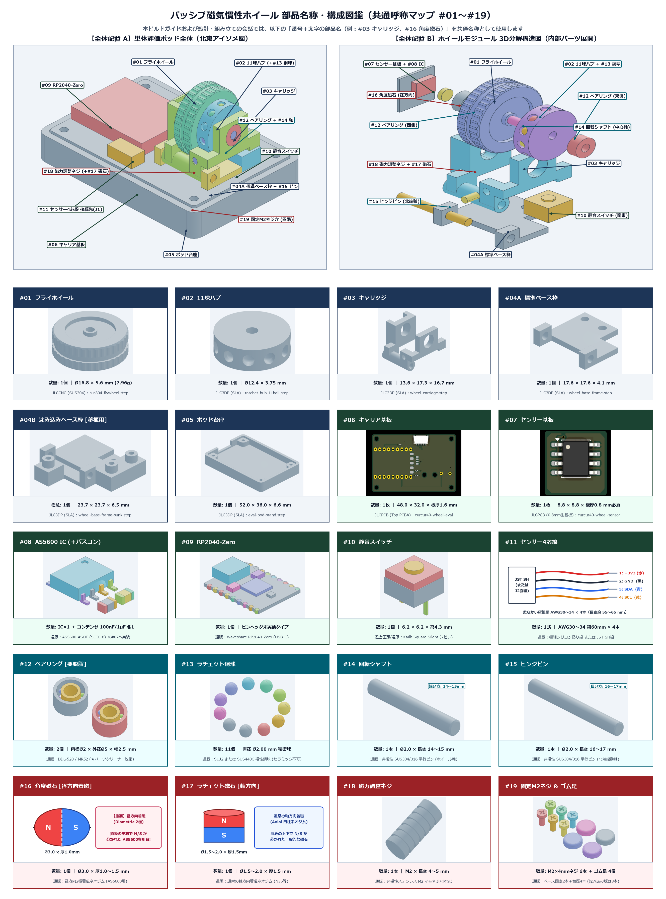

# パッシブ磁気慣性ホイール 単体評価ポッド（`curcur40-wheel-eval`）ビルドガイド

本ガイドは、電磁クラッチや巻線コイルを使わずに **「`#01` フライホイール（`SUS304` 7.96g）× `#12` 脱脂ベアリング × 渦電流ゼロの `#02` 11球ハブ＋`#13` ラチェット鋼球 × `#08` AS5600 IC」** で高速慣性スクロールと静音ミドルクリックを実現する **単体デスクトップ評価ポッド（`curcur40-wheel-eval`）** の資材調達・組み立て・ファームウェア書き込み・磁力チューニング手順書です。

---

## 部品名称・構成図鑑（共通呼称マップ `#01`〜`#19`）

本ビルドガイドおよび設計・組み立て時のやり取りでは、すべての部品を以下の **`#番号` ＋ 統一呼称（太字）** で呼びます。



| 番号 | 統一呼称 | 個数 | 区分・役割 |
| :---: | :--- | :---: | :--- |
| **`#01`** | **フライホイール** | 1個 | JLCCNC `SUS304` 切削ホイール（$\varnothing 16.8 \times 5.6\,\text{mm}$, $7.96\,\text{g}$） |
| **`#02`** | **11球ハブ** | 1個 | JLC3DP SLA 絶縁ラチェットハブ（`#13` 鋼球11個を保持） |
| **`#03`** | **キャリッジ** | 1個 | JLC3DP SLA 一体揺動インナーキャリッジ（ローター・基板・調整ネジを一体保持） |
| **`#04A`** | **標準ベース枠** | 1個 | JLC3DP SLA 基板表載せ固定枠（単体評価ポッド・標準版 `curcur40` 用） |
| **`#04B`** | **沈み込みベース枠** | *(1個)* | *(任意)* JLC3DP SLA 裏吊り固定枠（`curcur40-right` 沈み込み版への移植用） |
| **`#05`** | **ポッド台座** | 1個 | JLC3DP SLA 単体評価ポッド用卓上ケース（$52 \times 36 \times 6.6\,\text{mm}$） |
| **`#06`** | **キャリア基板** | 1枚 | JLCPCB `curcur40-wheel-eval`（$48 \times 32 \times 1.6\,\text{mm}$、`J1`・プルアップ抵抗実装済） |
| **`#07`** | **センサー基板** | 1枚 | JLCPCB `curcur40-wheel-sensor`（$8.8 \times 8.8\,\text{mm}$、**板厚 `0.8 mm` 指定必須**） |
| **`#08`** | **AS5600 IC** | 1式 | `AS5600-ASOT` 12-bit 磁気角度センサーIC（`SOIC-8`）＋ パスコン `100nF` / `1μF` |
| **`#09`** | **RP2040-Zero** | 1個 | `Waveshare RP2040-Zero` マイコンボード（ピンヘッダ未実装） |
| **`#10`** | **静音スイッチ** | 1個 | `Kailh Square Silent` 角形2ピン静音マイクロスイッチ（ミドルクリック用） |
| **`#11`** | **センサー4芯線** | 1式 | `#07` センサー基板 ↔ `#06` キャリア基板を繋ぐ極細4芯線（または JST SH 線） |
| **`#12`** | **ベアリング** | 2個 | `DDL-520` / `MR52`（$\varnothing 2 \times \varnothing 5 \times 2.5\,\text{mm}$、**必ずパーツクリーナーで脱脂**） |
| **`#13`** | **ラチェット鋼球** | 11個 | `SUJ2` / `SUS440C` **磁性精密鋼球** $\varnothing 2.00\,\text{mm}$（セラミック球不可） |
| **`#14`** | **回転シャフト** | 1本 | 非磁性 `SUS304` 平行ピン $\varnothing 2.0 \times 14\text{〜}15\,\text{mm}$（ホイール中心軸） |
| **`#15`** | **ヒンジピン** | 1本 | 非磁性 `SUS304` 平行ピン $\varnothing 2.0 \times 16\text{〜}17\,\text{mm}$（北端スイング軸） |
| **`#16`** | **角度磁石** | 1個 | **径方向2極着磁（Diametric）** ネオジム磁石 $\varnothing 3.0 \times 1.0\,\text{mm}$（`#14` 西端に接着） |
| **`#17`** | **ラチェット磁石** | 1個 | 通常の**軸方向着磁** ネオジム磁石 $\varnothing 1.5\text{〜}2.0 \times 1.5\,\text{mm}$（`#18` 先端に固定） |
| **`#18`** | **磁力調整ネジ** | 1本 | 非磁性ステンレス `M2 × 4〜5mm` イモネジ／小ねじ（`#03` 北東ボスへねじ込み） |
| **`#19`** | **固定M2ネジ（＋ゴム足）** | 1式 | `M2 × 4.0mm` ネジ × 6本（枠固定2＋台座固定4）＋ 台座裏面ゴム足 × 4個 |

> [!TIP]
> **単体評価ポッドから始めるメリット**
> 本ガイドで製作する **`#01` フライホイール・`#02` 11球ハブ・`#03` キャリッジ・`#07` センサー基板（`#08` 実装済）** は、そのまま将来の **`curcur40-right` Rev2（`#04A` 標準ベース枠 ／ `#04B` 沈み込みベース枠の両対応）** に無改造で移植・流用できる共通コアユニットです。まずは机上の単体 USB-C デバイスとして `#12` ベアリングの脱脂や `#18` 磁力調整ネジの感触をじっくり追い込むことができます。

---

## 目次

- **[部品名称・構成図鑑（共通呼称マップ `#01`〜`#19`）](#部品名称構成図鑑共通呼称マップ-0119)**
- **[Step 1: 資材一覧と入手経路・発注ガイド](#step-1-資材一覧と入手経路発注ガイド)**
  - [1-1. 全体構成の概要（4つの調達ルート）](#1-1-全体構成の概要4つの調達ルート)
  - [1-2. JLCPCB に発注するもの（基板 2種：`#06`, `#07`）](#1-2-jlcpcb-に発注するもの基板-2種06-07)
  - [1-3. JLCCNC に発注するもの（`#01` フライホイール）](#1-3-jlccnc-に発注するもの01-フライホイール)
  - [1-4. JLC3DP に発注するもの（SLA 高精細レジン造形パーツ：`#02`〜`#05`）](#1-4-jlc3dp-に発注するものsla-高精細レジン造形パーツ0205)
  - [1-5. 通販（Amazon・秋月電子・遊舎工房等）で購入するパーツ（`#08`〜`#19`）](#1-5-通販amazon秋月電子遊舎工房等で購入するパーツ0819)
  - [1-6. 発注前チェックリスト](#1-6-発注前チェックリスト)
- **[Step 2: 組み立て・脱脂・ハンダ付け・ファームウェア書き込み手順](#step-2-組み立て脱脂ハンダ付けファームウェア書き込み手順)**
  - [2-1. 必要な工具・ケミカル](#2-1-必要な工具ケミカル)
  - [2-2. Phase 1: `#09` RP2040-Zero 単体への QMK ファームウェア書き込み](#2-2-phase-1-09-rp2040-zero-単体への-qmk-ファームウェア書き込み)
  - [2-3. Phase 2: `#12` ベアリングの脱脂洗浄（★最重要ステップ）](#2-3-phase-2-12-ベアリングの脱脂洗浄最重要ステップ)
  - [2-4. Phase 3: 基板のハンダ付け（`#07` センサー基板 ＆ `#06` キャリア基板）](#2-4-phase-3-基板のハンダ付け07-センサー基板--06-キャリア基板)
  - [2-5. Phase 4: ローター（`#01`＋`#02`）と `#03` キャリッジの組み立て](#2-5-phase-4-ローター0102と-03-キャリッジの組み立て)
  - [2-6. Phase 5: `#04A` 標準ベース枠・`#05` ポッド台座への組み付けと `#18` 磁力調整](#2-6-phase-5-04a-標準ベース枠05-ポッド台座への組み付けと-18-磁力調整)
  - [2-7. Phase 6: PC 動作確認・分解能カスタマイズ・トラブルシューティング](#2-7-phase-6-pc-動作確認分解能カスタマイズトラブルシューティング)

---

# Step 1: 資材一覧と入手経路・発注ガイド

## 1-1. 全体構成の概要（4つの調達ルート）

単体評価ポッドを1台製作するための資材（`#01`〜`#19`）は、以下の **4ルート** で揃います（特殊な手巻きコイルや専用カスタムICは一切不要です）。

1. **JLCPCB（基板製造・PCBA）**: `#06` キャリア基板（$48.0 \times 32.0\,\text{mm}$）＋ `#07` センサー基板（$8.8 \times 8.8\,\text{mm}$、板厚 `0.8 mm`）
2. **JLCCNC（金属CNC切削）**: `#01` フライホイール（`SUS304` 削り出し $\varnothing 16.80 \times 5.60\,\text{mm}$）
3. **JLC3DP（SLA 3Dプリント）**: `#02` 11球ハブ・`#03` キャリッジ・`#04A` 標準ベース枠（＋任意 `#04B` 沈み込みベース枠）・`#05` ポッド台座
4. **国内通販（Amazon / 秋月電子 / 遊舎工房 / モノタロウ等）**: `#08` AS5600 IC・`#09` RP2040-Zero・`#10` 静音スイッチ・`#11` センサー4芯線・`#12` ベアリング・`#13` ラチェット鋼球・`#14` 回転シャフト・`#15` ヒンジピン・`#16` 角度磁石・`#17` ラチェット磁石・`#18` 磁力調整ネジ・`#19` 固定M2ネジ＆ゴム足

---

## 1-2. JLCPCB に発注するもの（基板 2種：`#06`, `#07`）

JLCPCB（[https://jlcpcb.com/](https://jlcpcb.com/)）にて以下の **2種類の基板** を発注します。

| 対象基板（統一呼称） | 基板サイズ・板厚 | 推奨発注形態 | ガーバー (ZIP) | BOM (CSV) | CPL (CSV) |
| :--- | :---: | :---: | :--- | :--- | :--- |
| **`#06` キャリア基板**<br>(`curcur40-wheel-eval`) | $48.0 \times 32.0\,\text{mm}$<br>**板厚 `1.6 mm`** | **PCB + PCBA**<br>（表面 `Top Side` 実装） | [GERBER-curcur40-wheel-eval.zip](../pcbs/inertia-wheel-eval/jlcpcb/production_files/GERBER-curcur40-wheel-eval.zip) | [BOM-curcur40-wheel-eval.csv](../pcbs/inertia-wheel-eval/jlcpcb/production_files/BOM-curcur40-wheel-eval.csv) | [CPL-curcur40-wheel-eval.csv](../pcbs/inertia-wheel-eval/jlcpcb/production_files/CPL-curcur40-wheel-eval.csv) |
| **`#07` センサー基板**<br>(`curcur40-wheel-sensor`) | $8.8 \times 8.8\,\text{mm}$<br>**板厚 `0.8 mm`** | **PCB のみ（手ハンダ）**<br>*(※面付け時のみPCBA可)* | [GERBER-curcur40-wheel-sensor.zip](../pcbs/inertia-wheel-sensor/jlcpcb/production_files/GERBER-curcur40-wheel-sensor.zip) | [BOM-curcur40-wheel-sensor.csv](../pcbs/inertia-wheel-sensor/jlcpcb/production_files/BOM-curcur40-wheel-sensor.csv) | [CPL-curcur40-wheel-sensor.csv](../pcbs/inertia-wheel-sensor/jlcpcb/production_files/CPL-curcur40-wheel-sensor.csv) |

### JLCPCB 発注時の注意点
* **`#06` キャリア基板 (`curcur40-wheel-eval`)**:
  * **PCB Thickness**: `1.6 mm`、**PCBA Assembly Side**: **`Top Side`**（`J1` JST SH 6ピンコネクタ `C160405`、I2C プルアップ抵抗 `R1/R2 4.7kΩ` `C25900`、パスコン `C1 100nF` `C1525` の計4点が自動実装されます）。
  * `U1`（`#09` RP2040-Zero）と `SW1`（`#10` 静音スイッチ）は後から手ハンダするため、PCBA 画面で Unplaced となっていて正常です。
* **`#07` センサー基板 (`curcur40-wheel-sensor`)**:
  * **PCB Thickness**: 必ず **`0.8 mm`** を選択してください（`#03` キャリッジ西側の $0.8\,\text{mm}$ 基板溝に収めるため）。
  * 単体サイズが $8.8 \times 8.8\,\text{mm}$ であり、JLCPCB の単体 PCBA 最小サイズ（$20 \times 20\,\text{mm}$）未満のため、**生基板（PCB のみ）で発注し、`#08` AS5600 IC（`1.27mm` ピッチ SOIC-8 で手ハンダ容易）とパスコン2個を手ハンダする** 方法が最も安価で手軽です。

---

## 1-3. JLCCNC に発注するもの（`#01` フライホイール）

JLC3DP / JLCCNC の **CNC Machining** サービス（[https://jlc3dp.com/cnc-machining-quote](https://jlc3dp.com/cnc-machining-quote)）へ STEP ファイルをアップロードして発注します。

| 対象パーツ（統一呼称） | 数量 | アップロードファイル | 推奨材質・表面仕上げ指定 |
| :--- | :---: | :--- | :--- |
| **`#01` フライホイール** | **1個〜** | [sus304-flywheel.step](../cases/inertia_wheel/sus304-flywheel.step) | - **Material**: **`Stainless Steel - SUS304`**（非磁性ステンレス）<br>- **Surface Finish**: **`As Machined (Ra 1.6 μm)`**（シルバー切削光沢仕上げ ※Bead Blasting にするとマットグレーになるため `As Machined` または `Polishing` 推奨）<br>- **Smallest Tolerance**: `±0.05 mm`（ISO 2768 fine / 軸穴 $\varnothing 2.02\,\text{mm}$） |

---

## 1-4. JLC3DP に発注するもの（SLA 高精細レジン造形パーツ：`#02`〜`#05`）

JLC3DP の **3D Printing** サービス（[https://jlc3dp.com/3d-printing-quote](https://jlc3dp.com/3d-printing-quote)）にて、以下の樹脂パーツを **SLA（光造形レジン：`8001` 半透明 / `Imagine Black` / `9600` 等）** で発注します。`#12` ベアリング圧入座や `#13` ラチェット鋼球スナップインポケットの寸法精度を出すため、MJF/FDM ではなく **SLA レジン** を推奨します。

| 対象パーツ（統一呼称） | 数量 | アップロード用 (STEP 推奨) | STL ファイル | 役割 |
| :--- | :---: | :--- | :--- | :--- |
| **`#02` 11球ハブ** | **1〜2個** | [ratchet-hub-11ball.step](../cases/inertia_wheel/ratchet-hub-11ball.step) | [ratchet-hub-11ball.stl](../cases/inertia_wheel/ratchet-hub-11ball.stl) | `#13` ラチェット鋼球×11個を電気絶縁保持 |
| **`#03` キャリッジ** | **1〜2個** | [wheel-carriage.step](../cases/inertia_wheel/wheel-carriage.step) | [wheel-carriage.stl](../cases/inertia_wheel/wheel-carriage.stl) | `#01`・`#07`・`#18` 等を一体保持して揺動 |
| **`#04A` 標準ベース枠** | **1個** | [wheel-base-frame.step](../cases/inertia_wheel/wheel-base-frame.step) | [wheel-base-frame.stl](../cases/inertia_wheel/wheel-base-frame.stl) | `#06` キャリア基板（および標準版 `curcur40`）固定用 |
| *(任意)* **`#04B` 沈み込みベース枠** | *(1個)* | [wheel-base-frame-sunk.step](../cases/inertia_wheel/wheel-base-frame-sunk.step) | [wheel-base-frame-sunk.stl](../cases/inertia_wheel/wheel-base-frame-sunk.stl) | 将来 `curcur40-right` 沈み込み版へ移植する際に使用 |
| **`#05` ポッド台座** | **1個** | [eval-pod-stand.step](../cases/inertia_wheel/eval-pod-stand.step) | [eval-pod-stand.stl](../cases/inertia_wheel/eval-pod-stand.stl) | `#06` キャリア基板の卓上ケース |

---

## 1-5. 通販（Amazon・秋月電子・遊舎工房等）で購入するパーツ（`#08`〜`#19`）

| 統一呼称 | 必要数 | 型番・寸法仕様 | 主な入手先 |
| :--- | :---: | :--- | :--- |
| **`#08` AS5600 IC（＋パスコン）** | **1式** | ams OSRAM **`AS5600-ASOT`**（`SOIC-8`）×1 ＋ チップコンデンサ `100nF` (`0402/0603`) ×1、`1μF` ×1 ※`#07` センサー基板へ手ハンダ | 秋月電子 / LCSC (`C499458`, `C1525`, `C52923`) / Mouser |
| **`#09` RP2040-Zero** | **1個** | **`Waveshare RP2040-Zero`**（ピンヘッダ未実装タイプ） | Amazon / 秋月電子 / スイッチサイエンス / AliExpress |
| **`#10` 静音スイッチ** | **1個** | **`Kailh Square Silent Micro Switch`**（$6.2 \times 6.2 \times 4.3\,\text{mm}$、2ピン角形静音スイッチ Red Dot） | 遊舎工房 / Amazon / AliExpress |
| **`#11` センサー4芯線** | **1式** | `AWG30`〜`AWG34` 極細シリコン被覆撚り線 または ポリウレタン銅線 約 $60\,\text{mm} \times 4$本（`#03` キャリッジ揺動を妨げない柔らかい細線、または片側カットした JST SH 6ピンケーブル） | 秋月電子 / オヤイデ電気 / Amazon |
| **`#12` ベアリング** | **2個** | **`DDL-520` / `MR52`**（内径 $\varnothing 2.0 \times$ 外径 $\varnothing 5.0 \times$ 幅 $2.5\,\text{mm}$、オープン形またはZZシールド形 ※**要脱脂**） | Amazon / モノタロウ / ラジコン模型店（ミネベア製推奨） |
| **`#13` ラチェット鋼球** | **11個** | **`SUJ2` ベアリング鋼球 直径 $\varnothing 2.00\,\text{mm}$**（※セラミック球は磁石に付かないため必ず**磁性のある鋼球 `SUJ2` または `SUS440C`** を選ぶこと！） | Amazon / モノタロウ（100個入 約250円） |
| **`#14` 回転シャフト** | **1本** | 非磁性 **`SUS304`（または `SUS316`）平行ピン $\varnothing 2.0 \times 14\text{〜}15\,\text{mm}$**（短い方：ホイール回転軸用） | Amazon / ミスミ / モノタロウ |
| **`#15` ヒンジピン** | **1本** | 非磁性 **`SUS304`（または `SUS316`）平行ピン $\varnothing 2.0 \times 16\text{〜}17\,\text{mm}$**（長い方：北端スイング軸用） | Amazon / ミスミ / モノタロウ |
| **`#16` 角度磁石** | **1個** | **径方向2極着磁（Diametric）ネオジム磁石 $\varnothing 3.0 \times 1.0 \sim 1.5\,\text{mm}$**（※必ず直径方向にN/Sが分かれた「径方向着磁／AS5600用」を選ぶこと） | AliExpress (`AS5600 diametric magnet 3x1` 等) / マグネット専門店 |
| **`#17` ラチェット磁石** | **1個** | 通常の**軸方向着磁**ネオジム磁石 **$\varnothing 1.5 \sim 2.0 \times 1.5\,\text{mm}$**（`N35` 程度） | Amazon / ハイキューパーツ（極小ネオジム磁石） |
| **`#18` 磁力調整ネジ** | **1本** | 非磁性ステンレス **`M2 × 4〜5mm` イモネジ（ホーローセット）または小ねじ** | Amazon / ホームセンター |
| **`#19` 固定M2ネジ ＆ ゴム足** | **1式** | ・`#04A` 枠固定（2本）＋`#05` 台座固定（4本）用：**`M2 × 4.0mm` 低頭/なべネジ × 6本**（※`#04B` 沈み込み版は3本）<br>・`#05` ポッド台座裏面用：直径 $6 \sim 8\,\text{mm}$ 貼り付け式ゴム足 × 4個 | 遊舎工房 / Amazon / ホームセンター |
| *(任意)* **2way比較用 Oリング** | *(1個)* | 内径 $\varnothing 15.0 \times$ 線径 $1.0\,\text{mm}$ シリコン／ニトリルOリング（`#01` 中央溝に装着してゴム感触も試したい場合のみ） | Amazon / モノタロウ |

---

## 1-6. 発注前チェックリスト

- [ ] **JLCPCB**: `#06` キャリア基板（`1.6mm` / Top PCBA）＋ `#07` センサー基板（**`0.8mm`** / 生基板）
- [ ] **JLCCNC**: `#01` フライホイール `sus304-flywheel.step`（`SUS304` / `As Machined` シルバー切削仕上げ）
- [ ] **JLC3DP**: `#02` 11球ハブ、`#03` キャリッジ、`#04A` 標準ベース枠、`#05` ポッド台座（すべて SLA レジン）
- [ ] **磁石・鋼球・ピンの磁性チェック**:
  - [ ] **`#16` 角度磁石** は **径方向2極着磁（Diametric）** であること（`#17` ラチェット磁石は通常の軸方向着磁）
  - [ ] **`#13` ラチェット鋼球** は **磁石にくっつく鋼球（`SUJ2` / `SUS440C`）** であること（※トラックボール用の白いセラミック球と混ぜないよう注意！）
  - [ ] **`#14` 回転シャフト・`#15` ヒンジピン** は **非磁性の `SUS304` / `SUS316`** であること

---
---

# Step 2: 組み立て・脱脂・ハンダ付け・ファームウェア書き込み手順

## 2-1. 必要な工具・ケミカル

| 工具・ケミカル | 用途 |
| :--- | :--- |
| **ブレーキ＆パーツクリーナー ＋ 小皿（ガラス瓶）** | `#12` ベアリング内部のグリスを完全に洗い流す（脱脂）ために使用します。 |
| **ハンダごて・細ハンダ・フラックス** | `#08` AS5600 IC、`#09` RP2040-Zero、`#10` 静音スイッチ、`#11` センサー4芯線のハンダ付けに使用します。 |
| **精密ドライバー（`#00`）または `0.9mm` 六角レンチ** | `#19` 固定M2ネジおよび `#18` 磁力調整ネジの回転に使用します。 |
| **瞬間接着剤（低白化ジェルタイプ）または 2液エポキシ** | `#14` 回転シャフト西端への `#16` 角度磁石と、`#18` 磁力調整ネジ先端への `#17` ラチェット磁石の固定に少量使用します。 |
| **デザインナイフ / カッターの刃先** | シールド付き `#12` ベアリング（`DDL-520ZZ`）のCリング・シールド板を外す際に使用します。 |

---

## 2-2. Phase 1: `#09` RP2040-Zero 単体への QMK ファームウェア書き込み

`#06` キャリア基板へハンダ付けする前に、`#09` RP2040-Zero 単体を USB-C ケーブルで PC に接続し、評価用 QMK ファームウェア（`curcur40_wheel_eval`）を書き込んで正常起動を確認します。

### ① ファームウェア（`.uf2`）のビルド
[`kbd_firmware/`](../kbd_firmware/) ディレクトリにて以下のコマンドを実行します：
```sh
cd kbd_firmware
kb=curcur40_wheel_eval make qmk-init
kb=curcur40_wheel_eval kr=rev1 km=default make qmk-compile
```
ビルドが完了すると `keyboards/curcur40_wheel_eval/qmk/qmk_firmware/.build/curcur40_wheel_eval_rev1_default.uf2` が生成されます。

### ② `#09` RP2040-Zero への書き込み
1. `#09` RP2040-Zero 上の小さな **`BOOT` ボタンを押したまま** PC に USB-C ケーブルを挿します（すでに接続中の場合は `BOOT` を押しながら `RESET` を1回押します）。
2. PC に **`RPI-RP2`** ドライブが表示されたら、生成された `.uf2` ファイルをドラッグ＆ドロップします。
3. 自動的に再起動し、HID マウス／キーボード複合デバイス **`curcur40 Inertia Wheel Eval Pod`** として認識されれば準備完了です（※本ファームウェアはセンサー未接続状態でもフリーズせず起動するよう設計されています）。

---

## 2-3. Phase 2: `#12` ベアリングの脱脂洗浄（★最重要ステップ）

> [!IMPORTANT]
> **新品の `#12` ベアリングをそのまま組まないでください！**
> 新品の `DDL-520ZZ` / `MR52` には防錆・高負荷用の粘度の高いグリスが封入されており、**未脱脂のままだと粘性抵抗で弾いても1秒未満で止まってしまいます**。以下の脱脂を行うことで、空転持続時間が一気に **3〜7秒以上** へ劇的に伸びます。

1. **シールド板の取り外し（両面オープン化）**
   - オープン形（シールドなし `DDL-520`）を購入した場合はそのまま手順2へ進みます。
   - 両面金属シールド形（`DDL-520ZZ`）の場合は、ルーペで見ながら外輪溝に嵌まっている極細のC字止め輪の切れ目にデザインナイフの刃先をそっと引っ掛けて外し、金属シールド板を外して内部のボールが見える状態にします（片面だけ外しても洗浄可能ですが、両面外すと最も洗浄効率が高くなります）。
2. **パーツクリーナー浸漬・回転洗浄**
   - ガラス小瓶や金属トレイに `#12` ベアリング2個を入れ、**速乾性ブレーキ＆パーツクリーナー** をベアリングが浸かるまで吹き付けます。
   - 液の中でピンセットや爪楊枝の先にベアリング内輪を通し、シャカシャカと軽く回して内部のグリスを完全に溶かし出します。
   - 一度液を捨て、もう一度新しいパーツクリーナーを吹き付けて仕上げ洗いし、キッチンペーパーの上で **3〜5分間完全に乾燥** させます。
3. **空転チェック**
   - `#14` 回転シャフト（$\varnothing 2.0\,\text{mm}$）に `#12` ベアリングを通し、指で軽く弾いて「シャーッ」と抵抗なく軽やかに回り続ければ脱脂成功です（※オイルは差さないドライ状態が最も長く回ります）。

---

## 2-4. Phase 3: 基板のハンダ付け（`#07` センサー基板 ＆ `#06` キャリア基板）

### ① `#07` センサー基板（`curcur40-wheel-sensor`：$8.8 \times 8.8 \times 0.8\,\text{mm}$）
1. **表面（`F.Cu`）**: `#08` AS5600 IC（`U1`, `SOIC-8`）の **1番ピン丸印／面取り側** を基板シルクの1番マークに合わせ、8ピンをハンダ付けします。
2. **裏面（`B.Cu`）**: `#08` 付属のパスコン `C1`（`100nF`）と `C2`（`1μF`）をハンダ付けします。
3. **4極配線パッド（`J1`）への `#11` センサー4芯線ハンダ付け**:
   - 裏面下端の4つのSMDパッド（シルク表記順に **`3V3` / `GND` / `SDA` / `SCL`**）に、長さ約 `55〜65mm` の `#11` センサー4芯線をハンダ付けします。

### ② `#06` キャリア基板（`curcur40-wheel-eval`：$48.0 \times 32.0 \times 1.6\,\text{mm}$）
1. **`U1`: `#09` RP2040-Zero の実装（基板西側）**:
   - USB-C コネクタが **西側外周（`-X` 側）** を向くように `#09` RP2040-Zero を `#06` キャリア基板表面のフットプリント上に載せ、端面のキャスタレーションを外側からハンダ付けして固定します。
2. **`SW1`: `#10` 静音スイッチの実装（基板東側・南東コーナー）**:
   - 基板東側のモジュール枠内・南東位置にある `SW1` スルーホール2穴に、表面側から `#10` 静音スイッチを底面が基板に密着するまで差し込み、裏面で2ピンをハンダ付けします。
   - **足切り**: 裏面に飛び出したスイッチの足が `#05` ポッド台座に当たらないよう、ハンダ山の上でニッパーで短くカットします。
3. **`#11` センサー4芯線の接続（JST SH コネクタ `J1` または 直結パッド `J2`）**:
   - **方法A（着脱式：推奨）**: `#11` センサー4芯線を片側 JST SH 6ピンプラグ（`Pin 1: +3V3`, `Pin 2: GND`, `Pin 3: SDA`, `Pin 4: SCL`）に繋ぎ、`#06` キャリア基板北側の `J1` コネクタへ挿します。
   - **方法B（直結式）**: `#06` キャリア基板中央にある4連直結パッド **`J2`（`1: +3V3` / `2: GND` / `3: SDA` / `4: SCL`）** へ `#11` センサー4芯線をそのままハンダ付けします（コネクタ無しでもすぐ動かせます！）。

| 信号名 | `#08` AS5600 IC ピン | `#07` センサー基板 `J1` | `#06` キャリア基板 `J1` / `J2` | `#09` RP2040-Zero ピン |
| :---: | :---: | :---: | :---: | :---: |
| **`+3V3`** | Pin 1 (`VDD5V`) & Pin 2 (`VDD3V3`) | Pad 1 | Pin 1 | `3V3` |
| **`GND`** | Pin 4 (`GND`) & Pin 8 (`DIR=GND`) | Pad 2 | Pin 2 | `GND` |
| **`SDA`** | Pin 6 (`SDA`) | Pad 3 | Pin 3（基板上 `R1 4.7kΩ` プルアップ済） | `GP4` (`I2C0 SDA`) |
| **`SCL`** | Pin 7 (`SCL`) | Pad 4 | Pin 4（基板上 `R2 4.7kΩ` プルアップ済） | `GP5` (`I2C0 SCL`) |
| **`SW_MID`** | ― | ― | Pin 5（基板上の `#10` `SW1` に内部接続済） | `GP6` (`MS_BTN3`) |

---

## 2-5. Phase 4: ローター（`#01`＋`#02`）と `#03` キャリッジの組み立て

1. **`#02` 11球ハブへの `#13` ラチェット鋼球スナップイン圧入**
   - `#02` 11球ハブの外周11箇所のポケット入口（$\varnothing 1.94\,\text{mm}$）に、**`#13` ラチェット鋼球（$\varnothing 2.00\,\text{mm}$）を11個** 順番に押し込みます。
   - 平らな机の上に鋼球を1粒置き、上から `#02` 11球ハブの穴を押し当てると「パチン」とスナップイン保持されます。11個すべてが奥まで均等に収まっていることを確認します。
2. **`#03` キャリッジへの脱脂済 `#12` ベアリング装着**
   - `#03` キャリッジの左右の軸受支柱にある $\varnothing 5.04\,\text{mm}$ 穴に、Phase 2 で脱脂した **`#12` ベアリングを左右1個ずつ** まっすぐ押し込みます。
3. **`#14` 回転シャフト・`#01` フライホイール・`#02` 11球ハブの同軸組み付け**
   - `#03` キャリッジの中央空間に **西側：`#01` フライホイール**、**東側：`#02` 11球ハブ** を並べて保持し、横から **`#14` 回転シャフト（短い方のピン：$14\text{〜}15\,\text{mm}$）** を **`[西 #12 ベアリング] → [#01 フライホイール] → [#02 11球ハブ] → [東 #12 ベアリング]`** の順に通します。
   - `#01` フライホイールと `#02` 11球ハブが左右ベアリングの内輪に軽く当たりつつ、`#03` キャリッジ内壁と一切擦れずに軽く空転する位置に合わせます（軸が緩い場合のみ、ホイール・ハブの軸穴内側に極少量の瞬間接着剤またはロックタイトを付けて固定します ※`#12` ベアリング内部には絶対に接着剤を入れないこと！）。
4. **西側シャフト端への `#16` 角度磁石接着 ＆ `#07` センサー基板装着**
   - 西ベアリングから外（西側）へ約 $1.0\,\text{mm}$ 出た `#14` 回転シャフト端面に、**`#16` 角度磁石（径方向2極着磁 $\varnothing 3.0 \times 1.0\,\text{mm}$）** を同軸に接着します。
   - `#03` キャリッジ西端の基板溝に **`#07` センサー基板** を、`#08` AS5600 IC パッケージ表面が `#16` 角度磁石と約 $0.5 \sim 0.8\,\text{mm}$ の非接触ギャップで正対する向き（IC面が内側＝東向き）で差し込み固定します。

---

## 2-6. Phase 5: `#04A` 標準ベース枠・`#05` ポッド台座への組み付けと `#18` 磁力調整

1. **`#06` キャリア基板への `#04A` 標準ベース枠固定**
   - `#06` キャリア基板の東側（`#10` 静音スイッチが立っている側）に `#04A` 標準ベース枠を載せ、`#19` 固定M2ネジ2本（`H5`, `H6`）で固定します。
2. **`#15` ヒンジピン連結（`#03` キャリッジの組み付け）**
   - `#04A` 標準ベース枠の上に Phase 4 で組んだ `#03` キャリッジを載せ、北端のヒンジ穴に **`#15` ヒンジピン（長い方のピン：$16\text{〜}17\,\text{mm}$）** を通して連結します。
   - `#01` フライホイール頂点を上から軽く押したとき、南東のストライカーが `#10` 静音スイッチを「コトッ」と静かにクリックし、指を離すとスイッチの復帰力で元の水平位置へ戻ることを確認します。
3. **`#05` ポッド台座への収納**
   - `#05` ポッド台座裏面の四隅にゴム足（`#19`）を貼り、上から `#06` キャリア基板を納めて四隅（`H1`〜`H4`）を `#19` 固定M2ネジ4本で固定します（西側の切り欠きに `#09` RP2040-Zero の USB-C ポートが揃います）。
4. **`#18` 磁力調整ネジによる「ノッチ感 ⇔ 慣性スピン持続時間」の無段階チューニング**
   - 先端に **`#17` ラチェット磁石**（軸方向着磁 $\varnothing 1.5 \sim 2.0 \times 1.5\,\text{mm}$）を吸着・接着した **`#18` 磁力調整ネジ** を、`#03` キャリッジ北東ボスのネジ穴へ北側からねじ込みます。
   - `#01` フライホイールを指で弾きながら `#18` 磁力調整ネジを少しずつ回してスイートスポットを探します：
     - **時計回りに締める（`#17` 磁石を `#02` 11球ハブへ近づける）**: 1ノッチごとの「コツ、コツ」という磁気ラチェット感が強くなります（近づけすぎると `#13` 鋼球に接触するため、必ず非接触ギャップ $\ge 0.2\,\text{mm}$ を保ちます）。
     - **反時計回りに緩める（`#17` 磁石を離す）**: 弾いたときに「トトトトト…」という微振動を伴いながら **3〜7秒間スーーッと回り続け、指で触れればピタッと止まる** 理想のバランス点が見つかります！

---

## 2-7. Phase 6: PC 動作確認・分解能カスタマイズ・トラブルシューティング

### ① PC での動作確認
1. USB-C ケーブルを `#09` RP2040-Zero に挿し、ブラウザや長いコードエディタ画面を開いてテストします：
   - **1ノッチ送り**: ゆっくり回したとき、磁気ノッチに合わせて正確に上下スクロールすること。
   - **高速フリック慣性スクロール**: 指で弾いて離したあと、`#01` フライホイールが物理的に回り続けている間ずっと高速スクロールし続け、指の腹で触れて止めた瞬間にスクロールもピタッと止まること。
   - **静音ミドルクリック**: `#01` フライホイールを押し込んだときに中クリック（`MS_BTN3`）が反応し、かつ高速回転を指で軽く止めたときには誤クリックしないこと。
   - **水平スクロール**: キーボードの `Shift` キーを押しながら回すと水平スクロールに切り替わること。

### ② スクロール分解能・回転方向のカスタマイズ（[`config.h`](../kbd_firmware/keyboards/curcur40_wheel_eval/qmk/qmk_firmware/rev1/config.h)）
好みに応じて [`rev1/config.h`](../kbd_firmware/keyboards/curcur40_wheel_eval/qmk/qmk_firmware/rev1/config.h) の定数を変更して再ビルドできます：
* **`#define WHEEL_NOTCHES_PER_REV 22`**（既定値 `22`）：
  * `11` に設定：`#13` ラチェット鋼球11個の磁気デテント1山につき厳密に `1` スクロールステップを出力
  * `22` に設定（推奨）：一般的なマウスホイールに近い約 $16.4^\circ$ 刻み（物理1山あたり `2` ステップ）
  * `36` に設定：`#01` フライホイール外周36フルートに一致する高密度ハイスピード出力（$10.0^\circ$ 刻み）
* **`#define WHEEL_INVERT_DIR 0`**：スクロール上下方向を逆にしたい場合は `1` に変更します。

### ③ トラブルシューティング
| 症状 | 主な原因と対処法 |
| :--- | :--- |
| **ミドルクリックは効くが、ホイールを回してもスクロールしない** | 1. `#11` センサー4芯線（`3V3, GND, SDA, SCL`）の並び順またはハンダ不良を確認。<br>2. `#16` 角度磁石が **径方向着磁（Diametric）** になっているか、および `#08` AS5600 IC との距離が離れすぎていないか（推奨ギャップ $0.4 \sim 1.2\,\text{mm}$）確認。 |
| **弾いても1秒以内にすぐ止まってしまう** | 1. `#12` ベアリングのグリス脱脂が不十分な可能性大 → パーツクリーナーで再洗浄して完全乾燥させる。<br>2. `#18` 磁力調整ネジを締めすぎて `#17` ラチェット磁石が `#13` ラチェット鋼球に近すぎる／擦れている → 反時計回りに半回転〜1回転緩める。 |
| **手を離して静止しているのに 1ステップ勝手に動くことがある** | 磁気デテントの山の頂点付近に止まった際の微小揺れの場合、[`config.h`](../kbd_firmware/keyboards/curcur40_wheel_eval/qmk/qmk_firmware/rev1/config.h) の `WHEEL_DEADBAND_LSB` を `6` から `10`〜`12` に増やすと完全にピタッと静止します。 |
