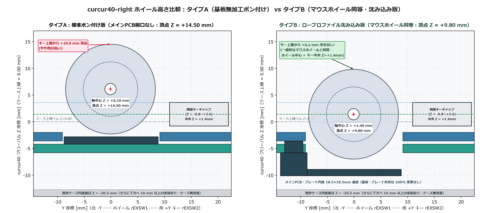
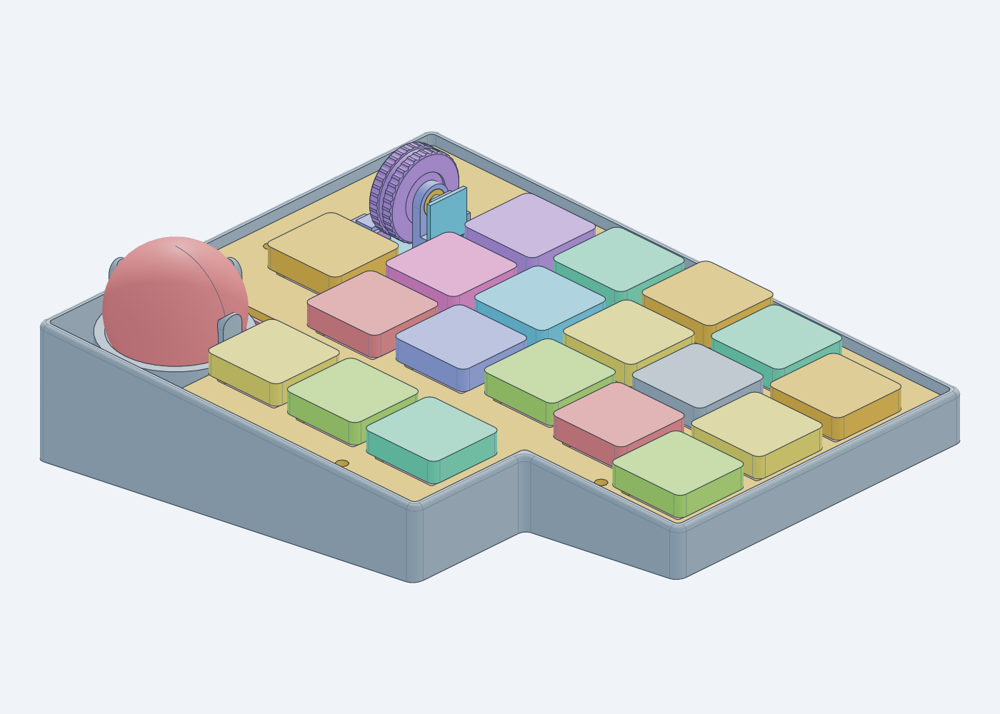

# パッシブ磁気慣性ホイールモジュール 設計仕様書（`curcur40-inertia-wheel`）

本書は、電磁クラッチ（ラチェット ⇔ フリースピン切替用のソレノイド・コイル・駆動回路）や外装カバーケースをあえて持たず、**「中空カップ型ステンレス削り出しホイール（内部にラチェットハブ格納） × 脱脂ミニチュアベアリング × 渦電流ゼロの非接触磁気ラチェット」** のみによって **『市販マウスのように内部メカを露見させないスマートな外観のまま、普段は心地よいノッチ感があり、弾けば微振動を伴いながら慣性で回り続け、指で触れればピタッと止まる』** 高速スクロールホイールモジュールの確定設計・試作データ仕様書です。

> [!TIP]
> **単体デスクトップ評価ポッドの組み立て・発注手順** については、専用ビルドガイド **[`docs/inertia_wheel_eval_buildguide_jp.md`](./inertia_wheel_eval_buildguide_jp.md)** を参照してください。

> [!IMPORTANT]
> **確定した基本設計方針（シンプル・外装カバー不要のスマート内蔵構造・外形不変）**
> 1. **単体試作先行 → `curcur40-right` Rev2 統合（2種類の高さバリエーション対応）**:
>    * まずは単体 USB-C デスクトップ試作機（`Waveshare RP2040-Zero` キャリア基板 ＋ ホイールモジュール ＋ 専用台座）として製作・調整します。
>    * `curcur40-right` への組み込みは、**タイプA（基板開口なし・ポン付け版：頂点 $Z=+14.76\,\text{mm}$）** と **タイプB（メインPCB内部開口＋クロススロットトッププレート・ロープロファイル沈み込み版：ホイール中心 $Z=+1.40\,\text{mm}$＝キーキャップ上下中央・頂点 $Z=+9.80\,\text{mm}$＝一般的なマウスホイール同等の浮き出し `+6.2 mm`）** の両方に対応します（**どちらもメインPCB・トッププレートの外形サイズおよび既存ケース `cases/right.step` は 100% 無変更**、ベース枠樹脂パーツ1点の差し替えのみで両対応！）。
> 2. **カップ型フライホイール（`#01`）内部への `#02` 内蔵9球ハブ格納 ＋ スリム丸耳キャリッジ（`#03`）**:
>    * 後付けの外装シュラウドカバーを被せるのではなく、**`#01` フライホイール自体を東面中空カップ構造（外径 $\varnothing 16.80 \times$ 幅 $5.46\,\text{mm}$、内径 $\varnothing 12.50 \times$ 深さ $3.30\,\text{mm}$）** とし、その内部へ **`#02` 内蔵9球ハブ（$\varnothing 12.40 \times 3.10\,\text{mm}$）と `#13` ラチェット鋼球9個を 100% 格納**（東リム端面から $0.12\,\text{mm}$ 奥へ退避）することで、外からラチェットハブが一切見えない構造とします。
>    * さらに **`#03` キャリッジ** のヒンジ・基板保持棚・ストライカー・`#18` 磁力調整ネジをすべてトッププレート（$Z = -2.00\,\text{mm}$）より下へ沈め、クロススロット開口の四隅で完全に目隠しします。
> 3. **電磁アクチュエータ＆変換マイコン全廃**: ソレノイド・巻線コイル・Hブリッジドライバ・変換用サブマイコン・`+5V` 電源配線をすべて廃止し、クラッチ消費電流 **`0.0 mA`**・故障箇所最小の純パッシブ機構とします。
> 4. **静音ミドルクリック標準搭載（一体揺動キャリッジ）**: `Kailh Square Silent (6.2 × 6.2 × 4.3 mm)` 静音スイッチを採用し、高速回転を指で止めた際に誤クリックせず、押し込み中も磁気ギャップが一切変化しない一体揺動構造とします。

---

## 0. 市販モジュール有無・先行製品／OSS実装実績と物理的根拠

### 0.1 `CKW12` のようにそのまま買える「1U高速スクロールホイール完成キット」は既にあるか？
* **結論：`18 × 18 mm`（1Uキー枠）に収まるキーボード向け「高速慣性スクロールモジュール」の市販キットは現時点で存在しません。**
  * 自作キーボード界隈で流通している水平ホイール系モジュール（廃番の Panasonic `EVQWGD001`、kuma氏 `CKW12`、はやしたろう氏 `THQWGD001` 等）は、いずれも **機械接点ブラシ式ロータリーエンコーダ（`EC05E` 等）＋ 軽量樹脂ホイール** の構成であるため、内部接点の摺動摩擦と板バネのクリック抵抗が大きく、指で弾いても慣性で空転しません。
  * 一方、AliExpress 等で入手できる **Logitech MX Master 3 / G502 用の交換ホイール保守部品** は、横幅・全長が約 $24 \sim 32\,\text{mm}$ あり専用マウント・専用フレキ形状のため、キーボードの 1U スイッチ枠（$18 \times 18\,\text{mm}$）には物理的に収まりません。

### 0.2 本設計の物理原理は「机上の空論・研究止まり」ではないか？（量産製品・OSSでの実証実績）
本モジュールが採用している **「金属カップ型フライホイール ＋ ボールベアリング支持 ＋ `AS5600` 非接触磁気角度センサー ＋ 永久磁石による非接触磁気ラチェット」** は、研究段階の未検証技術ではなく、**市販ハイエンドマウスおよび多数のオープンソースハードウェア実機で既に実用・量産されている枯れた技術の組み合わせ**（それを 1U サイズへ高密度パッケージングしたもの）です：

| 実績カテゴリ | 代表的な製品・OSSプロジェクト | 本モジュールとの共通原理・実証されている点 |
| :--- | :--- | :--- |
| **① 市販量産マウス** | **Logitech MagSpeed 搭載機** （MX Master 3 / 3S, MX Anywhere 3 等） | **中空カップ構造の削り出しステンレスホイール（内部にラチェット歯を内蔵）＋ ミニチュアベアリング ＋ 非接触磁気センサー ＋ 永久磁石による非接触磁気デテント** を採用。ラチェットモードのまま強く弾いた際に「微振動を伴いながら慣性で回り続け、指で触れれば止まる」挙動そのものが量産実証済み。 |
| **② 市販QMKデバイス (OSHW)** | **[Ploopy Knob](https://github.com/ploopyco/knob)** （カナダ Ploopy 社が製品販売中） | **`RP2040`（QMK Firmware）＋ `AS5600` 12-bit 磁気センサー ＋ ボールベアリング** という本機の評価ポッドと完全同一の回路・ファーム構成で市販・安定稼働している実績あり。 |
| **③ 自作キーボード慣性ホイール** | **[`adolto/zmk-driver-ams-as5600`](https://github.com/adolto/zmk-driver-ams-as5600)** **`Spin-maru`** 等 | 自作分割キーボード等で MX Master 風のフリースピン慣性スクロールを実現するために **ベアリング支持ホイール ＋ `AS5600`** を組み込んだ実機プロジェクトが複数公開・動作実証済み。 |
| **④ ミニマル磁気ホイール実機** | **[`torvalds/ScrollWheel`](https://github.com/torvalds/ScrollWheel)** （Linus Torvalds 氏製作） | `RP2350`（RP2040後継）＋ **`AS5600` 磁気角度センサー** による非接触スクロールホイール実機。機械式エンコーダのチャタリング・摩耗を根絶する構成として実証済み。 |

> [!NOTE]
> **実機製作において性能を左右する2つの勘所（失敗防止ポイント）**
> 1. **渦電流ブレーキの物理的遮断（設計で解決済み）**: 導電性の金属ホイールに直接ネオジム磁石を近づけるとレンツの法則（渦電流）で急制動がかかりますが、本設計では `#01` ホイール本体を非磁性 `SUS304` とし、カップ内径（$R=6.25\,\text{mm}$）より内側の軌道半径 $R=4.30\,\text{mm}$ に **非導電SLAレジン製 `#02` ハブ ＋ 互いに絶縁された独立 $\varnothing 2.0\,\text{mm}$ 鋼球9個** を軸方向配置しているため、磁石磁束が外周金属リムを横切らず渦電流ブレーキは発生しません。
> 2. **ミニチュアベアリングの脱脂洗浄（組み立て時に実施）**: 新品の `DDL-520 / MR52` ベアリングには高粘度グリスが封入されているため、組み立て前にパーツクリーナーでグリスを洗い流す（脱脂する）ことで空転持続時間が 1秒未満 → **3〜7秒以上** へ本来の性能を発揮します（手順は [`inertia_wheel_eval_buildguide_jp.md`](./inertia_wheel_eval_buildguide_jp.md) に詳述）。

---

## 1. 全体構造と2種類の高さバリエーション（標準版 vs ロープロファイル沈み込み版）

### 1.1 外装カバーなしで内部メカを隠す「カップ型ホイール × クロススロットプレート」（タイプB）

現行 `curcur40-right` のキーキャップ（$Z = -0.80 \sim +3.60\,\text{mm}$）の上下中央は **$Z = +1.40\,\text{mm}$** です。また、`rEXSW1` 直下の既存ケース（[`cases/right.step`](../cases/right.step)）内底面はテンティング傾斜により **$Z \approx -20.5\,\text{mm}$** と非常に深い空間が空いています。
**ホイール・キャリッジ・内蔵9球ハブ・センサー基板は100%共通のまま、ベース枠パーツのみを交換** することで、以下の2種類の実装高さを選択できます：

| 比較項目 | タイプA：標準ポン付け版 (`curcur40-right-with-inertia-wheel.step`) | タイプB：ロープロファイル沈み込み版【本命推奨】 (`curcur40-right-with-inertia-wheel-sunk.step`) |
| :--- | :---: | :---: |
| **ホイール回転軸高さ ($Z$)** | $Z = +6.36\,\text{mm}$ | **$Z = +1.40\,\text{mm}$（キーキャップ上下中央と完全一致！）** |
| **ホイール頂点高さ ($Z$)** | $Z = +14.76\,\text{mm}$ | **$Z = +9.80\,\text{mm}$（$-4.96\,\text{mm}$ 低背化）** |
| **キーキャップ上面からの浮き出し** | $+11.16\,\text{mm}$（やや背が高い） | **$+6.20\,\text{mm}$（一般的なマウスホイールと同等の自然な高さ！）** |
| **`#02` ハブ・`#03` 下部メカの見え方** | `#02` は `#01` カップ内部へ 100% 格納 | **`#02` は `#01` カップ内部格納 ＋ ヒンジ・SW・調整ネジはクロススロットトッププレート四隅の下へ完全隠蔽！** |
| **使用するベース枠パーツ** | [`wheel-base-frame.step`](../cases/inertia_wheel/wheel-base-frame.step) | **[`wheel-base-frame-sunk.step`](../cases/inertia_wheel/wheel-base-frame-sunk.step)**（基板裏面フランジ＋スペーサー柱一体型） |
| **メインPCB・プレート外形寸法** | **変更なし（0%）** | **変更なし（0%：外周輪郭は 100% 同一）** |
| **メインPCB・プレート内部加工** | 既存プレート開口 $18.2\times 18.2\,\text{mm}$ のみ （メインPCB開口なし） | メインPCBに $18.5\times 18.5\,\text{mm}$ 内窓、トッププレートに **幅 $6.6\,\text{mm}$ クロススロット開口** ＋ 周囲3箇所の M2 ネジ穴を追加 |
| **既存ケース (`cases/right.step`)** | **無改造（干渉 `0.000 mm³`）** | **無改造（干渉 `0.000 mm³`、ケース内壁・底面まで $\ge 3.65\,\text{mm}$ 余裕）** |

### 1.2 3D CAD / KiCad PCB プレビューギャラリー

| カップ型 `SUS304` ホイール単体 (`#01`) | ホイールモジュール単体 (22パーツ) |
| :---: | :---: |
|  |  |
| **タイプA：標準ポン付け版 (`Z_top = +14.8 mm`)** | **タイプB：沈み込み＋クロススロット版 (`Z_top = +9.8 mm`)** |
|  |  |
| **単体デスクトップ評価ポッド (`RP2040-Zero`)** | **評価キャリア基板 ＆ `AS5600` センサー小基板** |
|  |  |

---

## 2. コア機構設計（カップ型高慣性リム・内蔵9球渦電流ゼロラチェット・軸方向磁力調整・静音クリック）

### 2.1 ホイール本体：中空カップ型 `SUS304` シルバー削り出し（2way 外周仕上げ）
* **材質・慣性モーメント設計**: 非磁性オーステナイト系ステンレス **`SUS304`**（比重 **$7.93\,\text{g/cm}^3$**、単体質量 **$5.66\,\text{g}$**、内部の `#02` ハブ＋`#13` 鋼球9個＋軸を含む一体ローター質量 **$6.58\,\text{g}$**）。
* 東側に **$\varnothing 12.50 \times$ 深さ $3.30\,\text{mm}$ の中空カップ** を設けつつ、回転慣性モーメント（$J \propto R^4$）の **70%以上を生み出す外周領域（$R = 6.25 \sim 8.40\,\text{mm}$、肉厚 $1.65 \sim 2.15\,\text{mm}$）を無垢ステンレスのまま残す** ことで、スマートなマウスホイール幅（$5.46\,\text{mm}$）と長い慣性スピン持続時間を両立しています。
* **MX Master 3S 風「2way 外周プロファイル」**: 外周に **36本の横溝（フルート加工）** と中央 **幅 $1.30\,\text{mm} \times$ 深さ $0.50\,\text{mm}$ のセンターアクセント溝** を加工。金属むき出しでも、市販Oリング（$\varnothing 15.0 \times 1.0\,\text{mm}$）を嵌めても使える 2way 仕様です。

### 2.2 カップ内部へ100%隠れる「渦電流ゼロ ＆ JLC3DP 薄肉違反ゼロ」の内蔵9球・軸方向磁気ラチェット
* 非導電性 **SLA レジン製 `#02` 内蔵9球ハブ（外径 $\varnothing 12.40 \times$ 厚 $3.10\,\text{mm}$）** を `#01` カップ内部へ同軸格納（カップ端面から $0.12\,\text{mm}$ 奥へ退避し外部から完全不可視）。
* 東側端面の軌道半径 $R = 4.30\,\text{mm}$ 上に **$\varnothing 2.00\,\text{mm}$ 精密鋼球（`SUJ2`）× 9個** を軸方向スナップイン保持（入口径 $\varnothing 1.94\,\text{mm} \ge \varnothing 1.50\,\text{mm}$、ポケット間肉厚 $0.881\,\text{mm}$、外周肉厚 $0.870\,\text{mm}$、底肉厚 $0.870\,\text{mm}$、リップ高さ $0.854\,\text{mm}$ で **JLC3DP $0.80\,\text{mm}$ 基準を除外ゼロで完全クリア**）。

### 2.3 東側軸受下部「軸方向 M2ネジ磁力（ノッチ感 ⇔ 空転伸び）無段階調整」
* `#03` キャリッジの東側丸耳軸受支柱の下部（$Y_{\text{mod}} = -0.10\,\text{mm}, Z_{\text{mod}} = +6.25\,\text{mm}$、タイプB沈み込み版ではトッププレート $Z = -2.00\,\text{mm}$ より下の $Z = -2.90\,\text{mm}$ に隠蔽）に軸方向ネジ穴（$\varnothing 1.76\,\text{mm}$）を設け、先端に `#17` 磁石を付けた **`#18` M2 ステンレス調整ネジ** でカップ内部の `#13` 鋼球との軸方向ギャップを無段階に調整できます。

### 2.4 静音ミドルクリック機構（スリム丸耳・一体揺動キャリッジ）
* 北端の円筒ヒンジバレル（$\varnothing 2.00\,\text{mm}$ `SUS304` ピン）を支点に `#03` キャリッジ全体が一体揺動し、南東コーナーの **`Kailh Square Silent (6.2 × 6.2 × 4.3 mm)`** を押下します。押し込み中も磁気ギャップが不変で、スピン停止時に指で触れても誤クリックしません。

---

## 3. 製造・試作データ一式（全自動検証合格済み）

### 3.1 3D CAD モデル（[`cases/inertia_wheel/`](../cases/inertia_wheel/) ＆ [`cases/assemblies/`](../cases/assemblies/)）
生成・検証スクリプト：[`scripts/generate_inertia_wheel.py`](../scripts/generate_inertia_wheel.py)

| ファイル | 用途・発注プロセス | 外形寸法 [mm] | 検証結果 |
| :--- | :--- | :---: | :--- |
| [`sus304-flywheel.step`](../cases/inertia_wheel/sus304-flywheel.step) / `.stl` | JLCCNC `SUS304` 切削カップ型ホイール (`5.66 g`) | $16.77 \times 16.77 \times 5.46$ | 水密単一ソリッド・最小穴径 $1.60\,\text{mm}$ **PASS** |
| [`ratchet-hub.step`](../cases/inertia_wheel/ratchet-hub.step) / `.stl` | JLC3DP SLA 内蔵9球ラチェットハブ (`#01` 内部格納) | $12.40 \times 12.40 \times 3.10$ | 最小穴径 $1.94\,\text{mm}$・薄肉違反 `0` (除外 `0`) **PASS** |
| [`wheel-carriage.step`](../cases/inertia_wheel/wheel-carriage.step) / `.stl` | JLC3DP SLA スリム丸耳・一体揺動キャリッジ | $13.77 \times 15.87 \times 15.25$ | 最小穴径 $1.76\,\text{mm}$・薄肉違反 `0` (除外 `0`) **PASS** |
| [`wheel-base-frame.step`](../cases/inertia_wheel/wheel-base-frame.step) / `.stl` | JLC3DP SLA 標準ベース枠（評価ポッド／タイプA用） | $17.60 \times 17.60 \times 4.10$ | 最小穴径 $2.06\,\text{mm}$・薄肉違反 `0` (除外 `0`) **PASS** |
| [`wheel-base-frame-sunk.step`](../cases/inertia_wheel/wheel-base-frame-sunk.step) / `.stl` | JLC3DP SLA 沈み込みベース枠（タイプB低背版用） | $23.70 \times 23.70 \times 6.74$ | 最小穴径 $1.60\,\text{mm}$・薄肉違反 `0` (除外 `0`) **PASS** |
| [`eval-pod-stand.step`](../cases/inertia_wheel/eval-pod-stand.step) / `.stl` | JLC3DP SLA/MJF 単体評価ポッド台座 | $52.00 \times 36.00 \times 6.60$ | 最小穴径 $2.00\,\text{mm}$・薄肉違反 `0` (除外 `0`) **PASS** |
| [`inertia-wheel-module-assembly.step`](../cases/assemblies/inertia-wheel-module-assembly.step) | 標準モジュール検証アセンブリ (22パーツ) | ― | 全ペア `overlap = 0.00000000 mm³` **PASS** |
| [`inertia-wheel-module-sunk-assembly.step`](../cases/assemblies/inertia-wheel-module-sunk-assembly.step) | 沈み込みモジュール検証アセンブリ (22パーツ) | ― | 全ペア `overlap = 0.00000000 mm³` **PASS** |
| [`inertia-wheel-eval-pod-assembly.step`](../cases/assemblies/inertia-wheel-eval-pod-assembly.step) | 単体デスクトップ評価ポッド検証 (26パーツ) | ― | 全ペア `overlap = 0.00000000 mm³` **PASS** |
| [`curcur40-right-with-inertia-wheel.step`](../cases/assemblies/curcur40-right-with-inertia-wheel.step) | タイプA：無改造 `curcur40-right` 搭載検証 (46パーツ) | ― | 全ペア `overlap = 0.00000000 mm³`・可動隙間 $\ge 0.33\,\text{mm}$ **PASS** |
| [`curcur40-right-with-inertia-wheel-sunk.step`](../cases/assemblies/curcur40-right-with-inertia-wheel-sunk.step) | タイプB：沈み込み＋クロススロット版 `curcur40-right` 検証 (49パーツ) | ― | 全ペア `overlap = 0.00000000 mm³`・可動隙間 $\ge 0.32\,\text{mm}$ **PASS** |

### 3.2 KiCad 10.0 回路図・基板・JLCPCB 発注ファイル
* **`AS5600` センサーサブ基板（[`pcbs/inertia-wheel-sensor/`](../pcbs/inertia-wheel-sensor/)）**：$8.80 \times 8.80 \times 0.80\,\text{mm}$、ERC `0/0`・DRC `0/0/0`。
* **単体 USB-C 評価キャリア基板（[`pcbs/inertia-wheel-eval/`](../pcbs/inertia-wheel-eval/)）**：$48.00 \times 32.00 \times 1.60\,\text{mm}$、ERC `0/0`・DRC `0/0/0`。
* **`curcur40-right` Rev2（タイプB 沈み込み版）への統合時変更点（外形サイズ不変）**：
  * `rEXSW1` 中心 $(14.2875, 0.0000)\,\text{mm}$ に対し、メインPCBに **$18.50 \times 18.50\,\text{mm}$ ($R=0.50\,\text{mm}$) の内窓** と 3箇所の $\varnothing 3.70\,\text{mm}$ ボス貫通穴を設け、トッププレートには **四隅のヒンジ・静音スイッチ・ストライカーを上側から完全に覆い隠すクロススロット開口**（ホイールスリット幅 $6.60 \times 17.80\,\text{mm}$ ＋ 中央軸受アルコーブ、下からの1ピース挿入組立対応、全可動部クリアランス $\ge 0.32\,\text{mm}$）と 3箇所の $\varnothing 2.40\,\text{mm}$ M2 ネジ穴を設けるだけで、**基板・プレートの外形サイズと既存ケースを1ミリも変えず、外装カバー不要で市販マウスのような外観に仕上がります**。

### 3.3 単体評価用 QMK ファームウェア（[`kbd_firmware/keyboards/curcur40_wheel_eval/`](../kbd_firmware/keyboards/curcur40_wheel_eval/qmk/qmk_firmware/)）
* `Waveshare RP2040-Zero` 用 `1 kHz` ポーリング `AS5600` カスタムポインティングドライバ（[`wheel_eval.c`](../kbd_firmware/keyboards/curcur40_wheel_eval/qmk/qmk_firmware/rev1/wheel_eval.c)）収録・9球ハブに合わせた `WHEEL_NOTCHES_PER_REV = 18`（`9` / `18` / `36` 切替可）設定済み。

---

## 4. 入手可能な実部品リスト（BOM ＆ 概算コスト）

| 分類 | 部品名・型番 | 仕様・寸法 | 主な入手先 / コード | 単価目安 (1台分) |
| :--- | :--- | :--- | :--- | :---: |
| **`#01` カップ型フライホイール** | 特注ステンレスホイール (`SUS304`) | $\varnothing 16.80 \times 5.46\,\text{mm}$ ($5.66\,\text{g}$, カップ内蔵式) | JLCCNC (`sus304-flywheel.step`) | 約 \$6.00 (¥900) |
| **`#12` ベアリング (×2)** | ミニチュアステンレスベアリング **`DDL-520` / `MR52`** | 内径 $\varnothing 2.0 \times$ 外径 $\varnothing 5.0 \times$ 幅 $2.0\,\text{mm}$ オープン形 × 2個（脱脂使用） | Amazon / MonotaRO | 約 \$2.60 (¥400 / 2個) |
| **`#13` ラチェット鋼球** | 精密ベアリング鋼球 (`SUJ2`) | **$\varnothing 2.00\,\text{mm}$** × 9個使用 | Amazon / MonotaRO (`2mm SUJ2 鋼球`) | 約 \$1.50 (¥230 / 100個) |
| **`#14`/`#15` シャフト・ピン** | 非磁性ステンレス平行ピン (`SUS304`/`316`) | ホイール軸 $\varnothing 2.0 \times 10\text{〜}11\,\text{mm}$ ×1、ヒンジ軸 $\varnothing 2.0 \times 16\text{〜}17\,\text{mm}$ ×1 | Amazon / ミスミ / MonotaRO | 約 \$1.00 (¥150) |
| **`#18` 磁力調整ネジ** | M2 ステンレスイモネジ / 小ねじ | `M2 × 3〜4 mm`（東側軸受下部の軸方向ギャップ調整用） | ホームセンター / Amazon | 約 \$0.20 (¥30) |
| **`#08` 角度センサーIC** | ams OSRAM **`AS5600-ASOT`** | `SOIC-8`, 12-bit I2C 非接触磁気角度センサー | **LCSC `C499458`** / 秋月電子 | 約 \$1.10 (¥170) |
| **`#16` 角度磁石** | 径方向2極着磁（Diametric）NdFeB磁石 | $\varnothing 3.0 \times 0.85 \sim 1.0\,\text{mm}$ (`N35`) | AliExpress / マグネット専門店 | 約 \$0.50 (¥80) |
| **`#17` ラチェット磁石** | 軸方向着磁 小型ネオジム磁石 | $\varnothing 1.5 \sim 2.0 \times 1.0 \sim 1.5\,\text{mm}$ (`N35`) | Amazon / ハイキューパーツ | 約 \$0.30 (¥50) |
| **`#10` 静音スイッチ** | **`Kailh Square Silent 6.2×6.2×4.3mm`** | 静音角形マイクロスイッチ（Red Dot, $0.74\,\text{N}$） | 遊舎工房 / Amazon / AliExpress | 約 \$0.35 (¥55) |
| **コネクタ** | JST SH 6ピン横型 **`SM06B-SRSS-TB`** | `curcur40` トラックボール基板と完全同一型番 | **LCSC `C160405`** | 約 \$0.15 (¥25) |
| **Oリング (任意)** | 極細シリコン / NBR Oリング | 内径 $\varnothing 15.0 \times$ 線径 $1.0\,\text{mm}$（2way比較用） | Amazon / MonotaRO | 約 \$0.20 (¥30) |
| **樹脂筐体パーツ** | ベース枠（標準／沈み込み）＋ スリム丸耳キャリッジ ＋ 内蔵9球ハブ ＋ 台座 | 高精度 SLA レジン造形 | JLC3DP SLA (`8001` 等) | 約 \$3.20 (¥480) |
| **単体評価キャリア** | **`Waveshare RP2040-Zero`** ＋ 評価基板 | Stage 1 単体 USB-C テストベッド (`48 × 32 mm`) | Amazon / JLCPCB | 約 \$3.50 (¥530) |
| **合計（概算）** | ― | **ホイールモジュール単体 約 ¥2,600** ＋ 単体評価キャリア 約 ¥530 | ― | **約 ¥3,130** |
