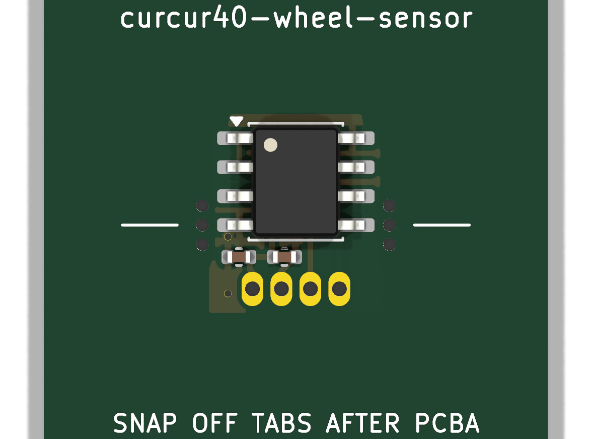
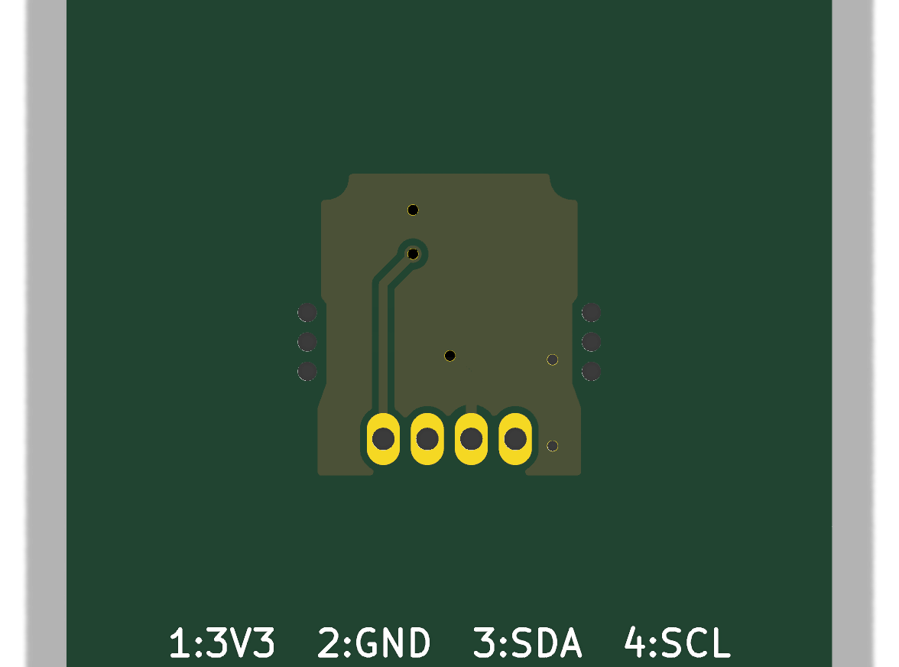
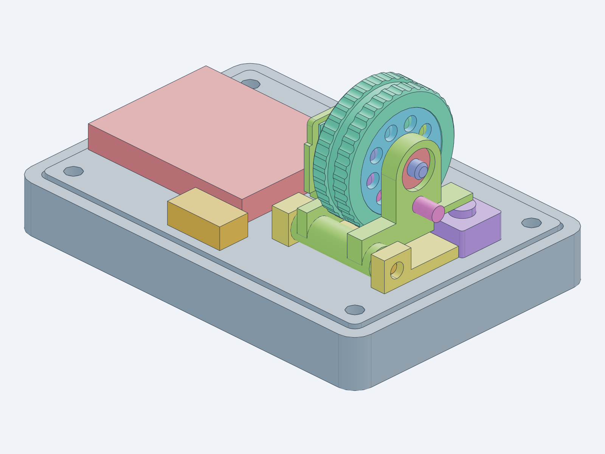
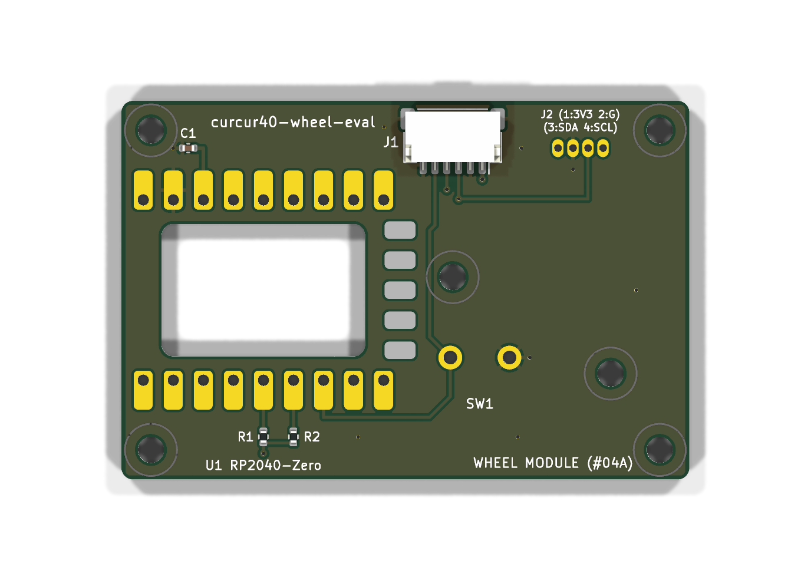
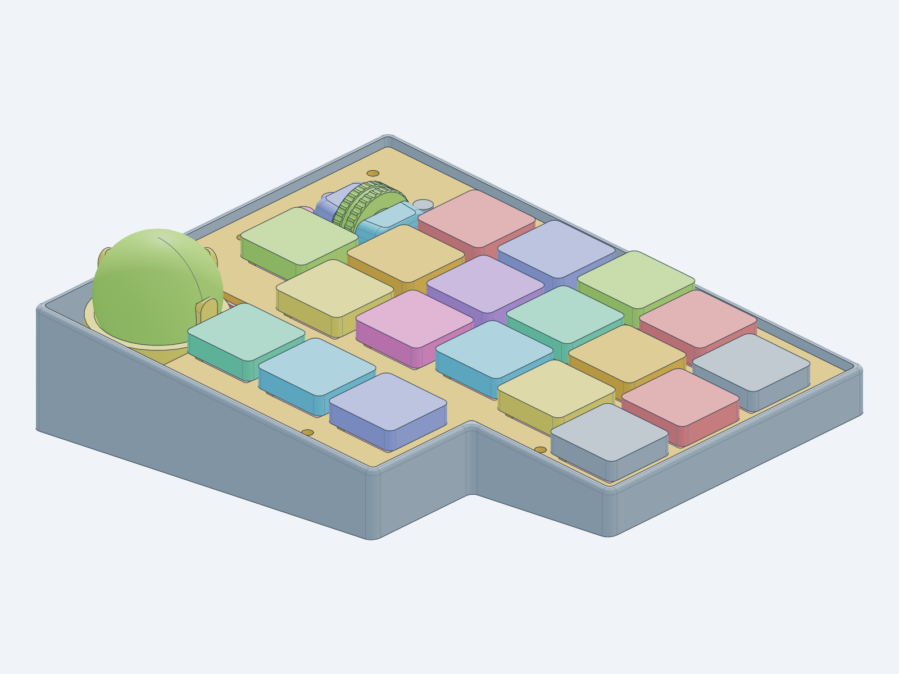

# パッシブ磁気慣性ホイールモジュール 設計仕様書

本書は、電磁クラッチ（ソレノイド・コイル・駆動回路）を持たない純パッシブ構成でありながら、**「中空カップ型ステンレス削り出しフライホイール（内蔵9球ラチェットハブ格納） × 脱脂ミニチュアベアリング × 渦電流ゼロの非接触磁気ラチェット × `AS5600` 磁気角度センサー」** によって **『普段は心地よいノッチ感があり、弾けば微振動を伴いながら慣性で回り続け、指で触れればピタッと止まる』** 高速スクロール＆静音ミドルクリックを実現する汎用ホイールモジュールのハードウェア設計仕様書です。

---

## モジュール全体構成（3層アーキテクチャ）

本設計は、`CKW12` 等の汎用エンコーダモジュールと同様に **「ホイールコアユニット単体」が特定のキーボードやケースに依存せず独立して成立** し、組み合わせる **ベースフレーム部品を差し替えるだけ** で「平坦な基板上へのオンボード実装」と「薄型キーボード基板への沈み込み実装」の両方に対応できるよう階層化されています。

| 階層 | 役割・対象読者 | 構成パーツ | 詳細セクション |
| :--- | :--- | :--- | :--- |
| **① ホイールコアユニット** *(共通モジュール本体)* | 単独で成立する高速慣性スクロール＋静音ミドルクリック機構（1U枠 $18 \times 18\,\text{mm}$ 相当に収まる共通コア） | `#01` カップ型 `SUS304` ホイール、`#02` 内蔵9球ハブ＋`#13` 鋼球×9、`#03` 揺動キャリッジ、`#07`＋`#08` `AS5600` 段付きセンサー基板、`#10` 静音スイッチ、`#12` ベアリング×2＋`SUS304` 内輪シム1枚、`#14`/`#15` ピン、`#16`/`#17`/`#18` 磁石・M2磁力調整ネジ | **[第2章](#2-ホイールコアユニット仕様単独モジュール定義)** |
| **② オンボード実装** *(テスト基板・利用者向けサンプル)* | 平坦なプリント基板の表面へそのままネジ2本で載せる標準実装サンプル・単体 USB-C 評価ポッド | **① コアユニット** ＋ **`#04A` オンボードベース枠**（[`wheel-base-frame.step`](../cases/inertia_wheel/wheel-base-frame.step)） *(＋単体評価用 `#06` キャリア基板・`#09` RP2040-Zero・`#05` 台座)* | **[第3章](#3-テスト基板によるオンボード実装サンプルと利用手順)** ＆ **[専用ビルドガイド](./inertia_wheel_eval_buildguide_jp.md)** |
| **③ 沈み込み実装** *(キーボードメイン基板への最適化)* | 薄型キーボード（`curcur40-right`）の基板内窓へ沈み込ませ、キーキャップ高さと調和させた低背・目隠し実装 | **① コアユニット（100%共通）** ＋ **`#04B` 沈み込みベース枠**（[`wheel-base-frame-sunk.step`](../cases/inertia_wheel/wheel-base-frame-sunk.step)） ＋ **`#20` ホイールカバー×2個**（[`wheel-cover.step`](../cases/inertia_wheel/wheel-cover.step)） | **[第4章](#4-キーボードメイン基板への組み込み最適化沈み込みフレームツインカバー)** |

> [!IMPORTANT]
> **オンボード実装（②）と沈み込み実装（③）の差異点**
> * **構造部品の違いはマウント枠（`#04A` `wheel-base-frame.step` ⇔ `#04B` `wheel-base-frame-sunk.step`）と外装カバー（`#20` `wheel-cover.step` の有無）のみ** です。可動ローター・揺動キャリッジ・磁気ラチェット・センサー基板からなる **① ホイールコアユニットは 100% 同一** であり、北端の `#15` ヒンジピン1本を抜くだけでテスト基板からメイン基板へそのまま移植できます。
> * ミドルクリック用 `#10` 静音スイッチ（コア内相対位置 $(+6.20, +5.70)\,\text{mm}$ 共通）のみ、② オンボード実装では基板スルーホールへ直接ハンダ付けし、③ 沈み込み実装ではメイン基板下にある `#04B` ベース枠の専用ポケット底面へ載せてリード線2本で配線します。

---

## 1. 開発背景・先行製品実績と物理原理

### 1.1 市販 1U ホイールモジュールとの違い
* **`18 × 18 mm`（1U キー枠）に収まるキーボード向け「高速慣性スクロールモジュール」の市販キットは現時点で存在しません。**
  * 自作キーボード向けの既存水平ホイールモジュール（廃番の Panasonic `EVQWGD001`、kuma氏 `CKW12`、はやしたろう氏 `THQWGD001` 等）はいずれも **機械接点ブラシ式ロータリーエンコーダ（`EC05E` 等）＋ 軽量樹脂ホイール** の構成であり、接点の摺動摩擦と板バネのクリック抵抗が大きいため、指で弾いても慣性で空転しません。
  * 一方、市販マウス用の交換ホイール保守部品（Logitech MX Master 3 / G502 用等）は横幅・全長が約 $24 \sim 32\,\text{mm}$ あり専用マウント・専用フレキ形状のため、キーボードの 1U スイッチ枠には物理的に収まりません。

### 1.2 量産マウス・オープンソースハードウェア（OSHW）での実証実績
本モジュールが採用する **「金属カップ型フライホイール ＋ ボールベアリング支持 ＋ `AS5600` 非接触磁気角度センサー ＋ 永久磁石による非接触磁気ラチェット」** は、量産マウスおよび多数の実機プロジェクトで実証済みの技術を 1U 相当サイズへ高密度パッケージングした構成です：

| 実績カテゴリ | 代表的な製品・OSSプロジェクト | 本モジュールとの共通原理・実証されている点 |
| :--- | :--- | :--- |
| **① 市販量産マウス** | **Logitech MagSpeed 搭載機** （MX Master 3 / 3S, MX Anywhere 3 等） | **中空カップ構造の削り出しステンレスホイール（内部にラチェット歯を内蔵）＋ ミニチュアベアリング ＋ 非接触磁気センサー ＋ 永久磁石による非接触磁気デテント** を採用。ラチェット状態のまま強く弾いた際に「微振動を伴いながら慣性で回り続け、指で触れれば止まる」挙動そのものが量産実証済み。 |
| **② 市販QMKデバイス (OSHW)** | **[Ploopy Knob](https://github.com/ploopyco/knob)** （カナダ Ploopy 社製品） | **`RP2040`（QMK Firmware）＋ `AS5600` 12-bit 磁気センサー ＋ ボールベアリング** という本機のテスト基板と同一の回路・ファームウェア構成で市販・安定稼働している実績あり。 |
| **③ 自作キーボード慣性ホイール** | **[`adolto/zmk-driver-ams-as5600`](https://github.com/adolto/zmk-driver-ams-as5600)** **`Spin-maru`** 等 | 自作分割キーボード等でフリースピン慣性スクロールを実現するために **ベアリング支持ホイール ＋ `AS5600`** を組み込んだ実機プロジェクトが複数公開・動作実証済み。 |
| **④ ミニマル磁気ホイール実機** | **[`torvalds/ScrollWheel`](https://github.com/torvalds/ScrollWheel)** （Linus Torvalds 氏製作） | `RP2350`（RP2040後継）＋ **`AS5600` 磁気角度センサー** による非接触スクロールホイール実機。機械式エンコーダのチャタリング・摩耗を根絶する構成として実証済み。 |

### 1.3 性能を決める2つの物理的要件
1. **渦電流ブレーキの物理的遮断（設計で解決済み）**:
   導電性の金属ホイールに直接ネオジム磁石を近づけるとレンツの法則（渦電流）で急制動がかかります。本設計では `#01` ホイール本体を非磁性 `SUS304` とし、カップ内径（$R=6.25\,\text{mm}$）より内側の軌道半径 $R=4.30\,\text{mm}$ に **非導電 SLA レジン製 `#02` ハブ ＋ 互いに絶縁された独立 $\varnothing 2.0\,\text{mm}$ 鋼球9個** を軸方向配置することで、磁石磁束が外周金属リムを横切らず渦電流ブレーキが発生しない構造としています。
2. **ミニチュアベアリングの脱脂洗浄（組み立て時に実施）**:
   新品の `DDL-520`（内径 $\varnothing 2.0 \times$ 外径 $\varnothing 5.0 \times$ 幅 $1.5\,\text{mm}$ オープン形）ベアリングには防錆油・グリスが付着しているため、組み立て前にパーツクリーナーで油分を洗い流す（ドライ脱脂する）ことで、空転持続時間が 1秒未満 → **3〜7秒以上** へ本来の性能を発揮します。

---

## 2. ホイールコアユニット仕様（単独モジュール定義）

| `#01` カップ型 `SUS304` フライホイール単体 | ホイールコア＋オンボード枠アセンブリ (`25` パーツ) |
| :---: | :---: |
|  |  |

### 2.1 モジュール固有座標系と主要寸法（特定キーボード非依存）
ホイールコアユニットは、組み込み先の基板やケースに依存しない以下の **モジュール固有座標系 $(X_{\text{mod}}, Y_{\text{mod}}, Z_{\text{mod}})$** で定義されます：

* **座標原点 $(0, 0, 0)$ の定義**:
  * **$X_{\text{mod}} = 0.00\,\text{mm}$**: `#01` カップ型フライホイールの左右（東西）中央面（ホイール幅 $5.46\,\text{mm} \rightarrow X_{\text{mod}} \in [-2.73, +2.73]\,\text{mm}$）
  * **$Y_{\text{mod}} = 0.00\,\text{mm}$**: モジュール外枠の南北中央（ホイール回転軸は北へオフセットした $Y_{\text{mod}} = -0.10\,\text{mm}$）
  * **$Z_{\text{mod}} = 0.00\,\text{mm}$**: ベースフレーム基準面（`#10` 静音マイクロスイッチ底面の着座基準面）

| 項目 | モジュール座標・寸法値 | 備考 |
| :--- | :---: | :--- |
| **ホイール外径 × リム幅** | $\varnothing 16.80\,\text{mm} \times 5.46\,\text{mm}$ | 外周36フルート溝 ＋ 中央Oリング溝（幅 $1.30 \times$ 深さ $0.50\,\text{mm}$） |
| **ホイール回転軸位置** | $(Y_{\text{mod}}, Z_{\text{mod}}) = (-0.10, +10.55)\,\text{mm}$ | ホイール下端 $Z_{\text{mod}} = +2.15\,\text{mm}$ 〜 ホイール頂点 **$Z_{\text{mod}} = +18.95\,\text{mm}$** |
| **揺動ヒンジピン軸位置** | $(Y_{\text{mod}}, Z_{\text{mod}}) = (-6.85, +2.15)\,\text{mm}$ | 北端 $\varnothing 2.00\,\text{mm}$ 平行ピン（`#15`）で任意のベースフレームと1軸連結 |
| **静音クリックスイッチ中心** | $(X_{\text{mod}}, Y_{\text{mod}}, Z_{\text{mod}}) = (+6.20, +5.70, +0.02)\,\text{mm}$ | コーナーで `#03` キャリッジのストライカーを受け止める |
| **キャリッジ＋基板占有幅** | $X_{\text{mod}} \in [-7.84, +7.50]\,\text{mm}$（全幅 $15.34\,\text{mm}$） | `#07` センサー基板（$X_{\text{mod}} \in [-7.80, -7.00]$）および `#10` スイッチを含む |
| **オンボード枠込み外形** | **$18.83 \times 17.78 \times 18.95\,\text{mm}$** | 対角2点M2固定ラグ（`H5`, `H6`、スパン $17.50\,\text{mm}$）込みの外形寸法 |

### 2.2 コア内部の4つの機構要素
1. **中空カップ型 `SUS304` フライホイール（`#01` [`sus304-flywheel.step`](../cases/inertia_wheel/sus304-flywheel.step)）**:
   * 非磁性オーステナイト系ステンレス `SUS304` 削り出し（比重 $7.93\,\text{g/cm}^3$、単体質量 **$5.39\,\text{g}$**、`#02` ハブ＋`#13` 鋼球9個＋`#14` 軸＋内輪シム＋`#16` 磁石を含む一体ローター質量 **$6.40\,\text{g}$**）。
   * 東面に **内径 $\varnothing 12.50 \times$ 深さ $3.30\,\text{mm}$ の中空カップ**、西面に `#03` 西側丸耳先端を $0.58\,\text{mm}$ 受け入れる **$\varnothing 9.60 \times$ 深さ $0.93\,\text{mm}$ の軸受逃がしポケット**（中央に `DDL-520` 内輪端面のみを受ける $\varnothing 2.84\,\text{mm}$ ボス付）を設けつつ、慣性モーメント（$J \propto R^4$）の大部分を担う外周リム（$R = 6.25 \sim 8.40\,\text{mm}$）を無垢のまま残すことで、スリムな幅（$5.46\,\text{mm}$）と高い回転慣性を両立しています。金属そのままでも市販Oリング（$\varnothing 15.0 \times 1.0\,\text{mm}$）を装着しても使える 2way 外周プロファイルです。
2. **カップ内部格納・9球磁気ラチェットハブ（`#02` [`ratchet-hub.step`](../cases/inertia_wheel/ratchet-hub.step) ＋ `#13` 精密鋼球9個）**:
   * 非導電 SLA レジン製ハブ（$\varnothing 12.40 \times 3.10\,\text{mm}$）を `#01` カップ内部へ同軸格納（東リム端面から $0.12\,\text{mm}$ 奥へ退避し、外部からラチェットハブが一切見えない構造）。さらに `#02` ハブ東端（$X_{\text{mod}} = +2.61\,\text{mm}$）と東側 `DDL-520` ベアリング回転内輪（$X_{\text{mod}} = +3.10\,\text{mm}$）の間に **`SUS304` 精密内輪シムリング（`M2 × Ø3.0 × 0.5 mm`、`#12` 付属）** を1枚挟むことで、外輪には一切触れずに一体ローター（ホイール・シャフト・角度磁石）の軸方向ガタを **$0.04\,\text{mm}$** 以内に拘束し、`AS5600` エアギャップと磁気ラチェット距離を常に一定に保ちます。
   * 軌道半径 $R = 4.30\,\text{mm}$ 上に $\varnothing 2.00\,\text{mm}$ 磁性鋼球（`SUJ2` G20）× 9個を軸方向スナップイン保持します（最小穴径 $\varnothing 1.94\,\text{mm} \ge 1.50\,\text{mm}$、最小肉厚 $0.854\,\text{mm} \ge 0.80\,\text{mm}$ で JLC3DP 造形基準を除外ゼロでクリア）。
3. **スリム丸耳・一体揺動キャリッジ ＆ 抜け止めテーパー M2 磁力調整（`#03` [`wheel-carriage.step`](../cases/inertia_wheel/wheel-carriage.step)）**:
   * 左右の脱脂ミニチュアベアリング（NMB ミネベアミツミ `DDL-520` オープン形：内径 $\varnothing 2.0 \times$ 外径 $\varnothing 5.0 \times$ 幅 $1.5\,\text{mm}$、`#12`）、西側の `#07` センサー基板保持棚（南北Y方向の位置決めチーク＋中央 $5.10\,\text{mm}$ `J1` ハンダ逃げ窓付）、および東側丸耳支柱下部（$Y_{\text{mod}} = -0.10, Z_{\text{mod}} = +6.25\,\text{mm}$）の **連続テーパー軸方向 M2 磁力調整ネジ穴（東口 $\varnothing 1.82 \rightarrow$ 西口 $\varnothing 1.52\,\text{mm}$ セルフタッピング＆磁石抜け止めテーパー穴）** を単一フレームに統合。北端ヒンジバレル幅は $12.00\,\text{mm}$（$X_{\text{mod}} \in [-5.55, +6.45]\,\text{mm}$、内径 $\varnothing 2.06\,\text{mm}$）で、`#15` 平行ピン B種h7（$\varnothing 2.0 \times 16.0\,\text{mm}$、端面面取り $c \approx 0.35\,\text{mm}$）に対してベース枠左右耳への十分な掛かり代と抜け止めマージンを確保しています。
   * 先端に `#17` ネオジム磁石（二六製作所 `NE218` $\varnothing 1.50 \times 1.50\,\text{mm}$, N40）を付けた `#18` `SUS304` `DIN916` 六角穴付きホーローセット（`M2 × 4.0mm`、メイン基板内窓に対して $0.60\,\text{mm}$ クリアランス）のねじ込み量だけで、磁気ノッチの強さとフリースピン持続時間のバランスを無段階にチューニングできます（西口が $\varnothing 1.52\,\text{mm}$ に絞られているため、イモネジがテーパーで確実に止まり `#17` 磁石がホイールカップ内へ脱落するのを防ぎます）。
   * ホイールを上から押すと北端 `#15` ヒンジピンを支点にキャリッジ全体が微小揺動し、`#10` `Kailh Square Silent (6.2 × 6.2 × 4.3 mm)`（公表寸法図：ハウジング厚 $3.35\,\text{mm}$、プランジャ $\varnothing 3.00\,\text{mm}$、自由位置 $FP = 4.30 \pm 0.15\,\text{mm}$、動作位置 $OP = 4.10 \pm 0.20\,\text{mm}$、プリトラベル $PT = 0.20 \pm 0.1\,\text{mm}$、端子ピッチ $5.00 \pm 0.18\,\text{mm}$・長さ $3.30 \pm 0.2\,\text{mm}$、公称作動ストローク $0.26\,\text{mm} / 1.12^\circ$）を静かにクリックします（クラッチ電流 **`0.0 mA`**）。`#04B` 沈み込みベース枠のポケット底面には端子ピッチ $5.00\,\text{mm}$ の2本のTHT端子（`(+3.70, +5.70)` / `(+8.70, +5.70)`）が余裕をもって貫通する $\varnothing 1.60\,\text{mm} \times 2$ ピン貫通穴（中心 `(+3.85, +5.70)` / `(+8.55, +5.70)`、ポケット東西壁面と段差なし）があり、スイッチの2本の金属端子が底面下へ貫通して前後・左右の抜け止め（ダボ）として機能するとともに、底面側でそのままリード線2本をハンダ付けできます。
4. **`AS5600` 同軸段付きセンサーサブ基板（`#07` [`curcur40-wheel-sensor`](../pcbs/inertia-wheel-sensor/) ＋ `#08` IC）**:
   * 板厚 **`0.8 mm`**・表面片面 `Top Side` PCBA で `AS5600-ASOT`（12-bit 非接触磁気角度センサー、I2C 固定アドレス `0x36`）とパスコン2個を工場実装済み。下端 `J1` の4極ワイヤパッドは揺動クリックの繰り返し屈曲に強い **$\varnothing 0.65\,\text{mm}$ スルーホール（PTH）ランド** 仕様です。
   * $22.0 \times 22.0\,\text{mm}$ の捨て基板枠からインセット配置された左右のマウスバイトタブ（折れ残り耳が外周から飛び出さない設計）を折り取ると、下部幅 $8.20\,\text{mm}$・上部幅 $8.00\,\text{mm} \times$ 高さ $9.40\,\text{mm}$ の段付き小型基板となります。`U1` パッケージ中心が回転軸高さ $Z_{\text{mod}} = +10.55\,\text{mm}$ と完全同軸（偏心 **`0.00 mm`**）に配置され、`#14` シャフト（`SUS303` 平行ピン B種h7 $\varnothing 2.0 \times 10.0\,\text{mm}$、$X_{\text{mod}} \in [-3.85, +6.15]\,\text{mm}$）西端の `#16` 径方向2極着磁磁石（**$\varnothing 4.0 \times 1.0\,\text{mm}$**、$X_{\text{mod}} \in [-4.85, -3.85]\,\text{mm}$）と公称 **`0.59 mm`**（JEDEC 最大パッケージ厚 $A_{\max} = 1.75\,\text{mm}$ 時でも **`0.39 mm`**）の非接触エアギャップで同軸対向します。

| `#07` センサー基板 表面（`0.8mm` Top PCBA・段付き輪郭） | `#07` センサー基板 裏面（4極ワイヤパッド） |
| :---: | :---: |
|  |  |

### 2.3 ホスト基板との電気インターフェース（`CKW12` 等の代わりに組み込む際の配線仕様）
本コアモジュールを任意のマイコン基板（RP2040 / Pro Micro 互換等）へ接続するために必要な信号は、**I2C 4線 ＋ ミドルクリックスイッチ 2線の計5信号** のみです（6ピン JST SH コネクタ `SM06B-SRSS-TB` 1個に集約可能）：

| ピン番号 (JST SH 基準) | 信号名 | 接続先（モジュール側） | ホストマイコン側の要件 |
| :---: | :---: | :--- | :--- |
| **Pin 1** | `+3V3` | `#07` センサー基板 `Pad 1` (`VDD5V` & `VDD3V3` 直結, 3.3V動作) | `3.3V` 電源出力（消費電流 約 `1.5〜6.5 mA`） |
| **Pin 2** | `GND` | `#07` センサー基板 `Pad 2`（センサー GND） | グランド共通 |
| **Pin 3** | `SDA` | `#07` センサー基板 `Pad 3` (`AS5600` Pin 6 `SDA`) | ハードウェア I2C `SDA`（ホスト側で `4.7kΩ` プルアップ） |
| **Pin 4** | `SCL` | `#07` センサー基板 `Pad 4` (`AS5600` Pin 7 `SCL`) | ハードウェア I2C `SCL`（ホスト側で `4.7kΩ` プルアップ、`400 kHz` 推奨） |
| **Pin 5** | `SW_MID` | `#10` 静音スイッチ 片側端子 | 任意の GPIO 入力（内部プルアップ有効・Active-Low、またはダイレクトキーピン） |
| **Pin 6** | `GND` | `#10` 静音スイッチ もう片側端子（スイッチ GND リターン） | グランド共通（`curcur40-right` の `rJ5` および `curcur40-wheel-eval` の `J1` で `Pin 2` と共通 GND 結線済） |

---

## 3. テスト基板によるオンボード実装サンプルと利用手順

| 単体デスクトップ評価ポッド全体 (`curcur40-wheel-eval`) | `#06` キャリア基板 (`48.0 × 32.0 × 1.6 mm`) |
| :---: | :---: |
|  |  |

### 3.1 リファレンス評価ポッド（`curcur40-wheel-eval`）の位置づけ
第2章のホイールコアユニットに **`#04A` オンボードベース枠（[`wheel-base-frame.step`](../cases/inertia_wheel/wheel-base-frame.step)）** を組み合わせ、平坦なテスト基板（`#06` [`curcur40-wheel-eval`](../pcbs/inertia-wheel-eval/)）の上にそのまま実装したサンプル構成です。
* キーボード本体へ組み込む前の **単体での回転感触・磁力バランス調整のテストベッド** として機能するとともに、`#05` ポッド台座（[`eval-pod-stand.step`](../cases/inertia_wheel/eval-pod-stand.step)）に収めることで **単体 USB-C デスクトップ高速スクロールデバイス** としてそのまま実用できます。

### 3.2 任意の平坦な基板へオンボード実装する際のフットプリント設計寸法（`#04A` 使用時）
テスト基板（`#06` `curcur40-wheel-eval`）では、`curcur40-right` と同じ向き（北側 `-Y_kicad` に `#15` ヒンジピンが来る `rot180` 配置：基板上のモジュール中心 $(X_0, Y_0)$ に対して $(X_{\text{pcb}}, Y_{\text{pcb}}) = (X_0 - X_{\text{mod}}, Y_0 + Y_{\text{mod}})$）で以下の穴・パッドを配置しています：

* **占有コートヤード**: $X_{\text{mod}} \in [-8.38, +10.45]\,\text{mm}$、$Y_{\text{mod}} \in [-8.78, +9.00]\,\text{mm}$（$18.83 \times 17.78\,\text{mm}$）
* **`#04A` 対角2点 M2 ネジ貫通穴（重心・クリック荷重点を跨ぐ $17.50\,\text{mm}$ スパン）**:
  * `H5`: $(X_{\text{mod}}, Y_{\text{mod}}) = (-4.85, +7.05)\,\text{mm}$ ／ `rot180` 基板相対 $(+4.85, +7.05)\,\text{mm}$（推奨基板ドリル径 $\varnothing 2.20\,\text{mm}$ NPTH、裏面M2ナット締結）
  * `H6`: $(X_{\text{mod}}, Y_{\text{mod}}) = (+8.50, -1.10)\,\text{mm}$ ／ `rot180` 基板相対 $(-8.50, -1.10)\,\text{mm}$（推奨基板ドリル径 $\varnothing 2.20\,\text{mm}$ NPTH、裏面M2ナット締結）
* **`#10` 静音スイッチ（`SW1`）スルーホールパッド（2箇所）**: スイッチ中心 $(X_{\text{mod}}, Y_{\text{mod}}) = (+6.20, +5.70)\,\text{mm}$（`rot180` 基板相対 $(-6.20, +5.70)\,\text{mm}$）に対し、端子ピッチ $5.00\,\text{mm}$、平ピン（$0.80 \times 0.40\,\text{mm}$、対角 $0.894\,\text{mm}$）に対応する推奨ドリル径 **$\varnothing 1.10\,\text{mm}$**
* **テスト基板 `#06` 固有の実装配慮**: `U1`（`Waveshare RP2040-Zero`）は端面キャスタレーション表面実装と `2.54 mm` ピンヘッダ実装（$\varnothing 0.85\,\text{mm}$ PTH）の両方に対応するデュアルフットプリントとし、基板中央に `RP2040-Zero` 裏面部品の浮きを防ぐ **$17.20 \times 11.20\,\text{mm}$ 逃がしくり抜き窓** を設けています。

### 3.3 リファレンス QMK ファームウェア仕様（[`kbd_firmware/keyboards/curcur40_wheel_eval/`](../kbd_firmware/keyboards/curcur40_wheel_eval/qmk/qmk_firmware/)）
`Waveshare RP2040-Zero` 向けに実装済みのカスタムポインティングドライバ（[`wheel_eval.c`](../kbd_firmware/keyboards/curcur40_wheel_eval/qmk/qmk_firmware/rev1/wheel_eval.c)）を収録しており、他の QMK キーボードへもそのまま移植できます：
* **`1 kHz` 高速ポーリング（`1 ms` レートリミッタ付）＆ 角度ラップアラウンド処理**: `AS5600` の `RAW ANGLE (0x0C..0x0D)` 12-bit 値（`0..4095`）を `400 kHz` I2C（`I2CD0`）で `1 ms` 周期で読み取り、`0 ⇔ 4095` 境界を跨ぐ高速フリック回転でも符号反転しない差分計算を実装。回転方向（`WHEEL_INVERT_DIR = 1` 既定）も `curcur40-right` と完全一致しています。
* **微小振動デッドバンド（`WHEEL_DEADBAND_LSB = 6`）＋ 分数アキュムレータ**: 磁気デテント頂点付近での静止時ジッタを抑えつつ、1回転あたりの出力ステップ数（`WHEEL_NOTCHES_PER_REV = 9 / 18 / 36`、既定値 `18`）を端数切り捨て誤差なく蓄積出力。
* **短縮 I2C タイムアウト（`2 ms`）＋ 自動バスリカバリ**: タイムアウトを `2 ms` に抑えてミドルクリック応答の遅延を防ぎつつ、センサー未接続起動やホットプラグ・ノイズによる連続通信エラー時には `200 ms` バックオフ周期で `i2c_init()` バス再初期化と `AS5600` 再設定を自動実行します。

### 3.4 資材調達・組み立て・チューニング手順（利用者向けビルドガイド）
部品の購入先リスト、JLCPCB / JLCCNC / JLC3DP への発注設定、`#12` ベアリングの脱脂洗浄、ハンダ付け、QMK 書き込み、`#18` ネジによる磁力チューニングの全手順は、以下の専用ビルドガイドにまとめています：
* **[パッシブ磁気慣性ホイール 単体評価ポッド ビルドガイド（`docs/inertia_wheel_eval_buildguide_jp.md`）](./inertia_wheel_eval_buildguide_jp.md)**

---

## 4. キーボードメイン基板への組み込み最適化（沈み込みフレーム＆ツインカバー）

第2章のホイールコアユニットを、ロープロファイル分割キーボード **`curcur40-right`**（Kailh Choc V2 スイッチ採用、トッププレート上面 $Z = -2.00\,\text{mm}$、隣接キーキャップ上面 $Z = +3.60\,\text{mm}$）の右手内側上部 $(14.2875, 0.0000)\,\text{mm}$ へ統合した本番採用設計です。

### 4.1 沈み込みベース枠（`#04B`）によるロープロファイル実装仕様

`curcur40-right` のホイール搭載位置直下は、テンティングケース（[`cases/right.step`](../cases/right.step)）の内底面が **$Z \approx -20.5\,\text{mm}$** と深く空いています。**ホイールコアユニット自体は一切変更せず**、マウント枠を **`#04B` 沈み込みベース枠（[`wheel-base-frame-sunk.step`](../cases/inertia_wheel/wheel-base-frame-sunk.step)）** にすることで、以下のように高さと外観を最適化しています：

| 項目 | テスト基板オンボード実装（第3章：`#04A`） | キーボード本体沈み込み実装（本章：`#04B` ＋ `#20`×2） [`curcur40-right-with-inertia-wheel-sunk.step`](../cases/assemblies/curcur40-right-with-inertia-wheel-sunk.step) |
| :--- | :---: | :---: |
| **使用するマウント部品** | [`wheel-base-frame.step`](../cases/inertia_wheel/wheel-base-frame.step)（カバーなし） | **[`wheel-base-frame-sunk.step`](../cases/inertia_wheel/wheel-base-frame-sunk.step)** ＋ **[`wheel-cover.step`](../cases/inertia_wheel/wheel-cover.step) × 2個** |
| **コア基準面高さ ($Z_{\text{mod}}=0$)** | キャリア基板表面に着座 | **$Z = -12.55\,\text{mm}$（メインPCB下へ $-8.36\,\text{mm}$ 沈み込み）** |
| **ホイール回転軸高さ ($Z$)** | キャリア基板表面 $+10.55\,\text{mm}$ | **$Z = -2.00\,\text{mm}$（トッププレート上面と完全一致）** |
| **ホイール頂点高さ ($Z$)** | キャリア基板表面 $+18.95\,\text{mm}$ | **$Z = +6.40\,\text{mm}$（キー上面 $+3.60\,\text{mm}$ から $+2.80\,\text{mm}$ の自然な突出）** |
| **直下キー（`rEXSW2`）との左右位置** | ―（単体評価ポッド） | **直下キー `rEXSW2` 左右中央と完全一致（$X_{\text{step}} = 28.5750\,\text{mm}$）** |
| **基板・軸受・調整ネジの外観** | 露出（観察・評価用） | **`#20` ツインカバーが `#07` 基板と軸受丸耳を完全目隠し**（`#18` ネジも基板下 $Z=-6.30\,\text{mm}$ へ隠蔽） |
| **メインPCB・プレートの外形輪郭** | ― | **変更なし（0%：外周サイズは 100% 同一）** |
| **既存ケース（`cases/right.step`）** | ― | **無改造（干渉 `0.000 mm³`、内底面まで $4.40\,\text{mm}$ 以上の余裕）** |

### 4.2 沈み込み断面構造と `#20` ツインスナップカバー（[`wheel-cover.step`](../cases/inertia_wheel/wheel-cover.step)）

* **主張を抑えたエッジ曲面ピラミッド造形（ホイール外形からはみ出さない）**:
  トッププレート（$Z = -2.00\,\text{mm}$）より上に出る `#07` 段付きセンサー基板上端（$Z = +1.30\,\text{mm}$）と `#03` キャリッジの軸受丸耳を覆い隠すため、ホイール際（南北長 $15.40\,\text{mm}$）から外側端（$14.00\,\text{mm}$、片側幅 $6.17\,\text{mm}$）へ絞った台形ピラミッドの全稜線を滑らかな曲面（軒 $R = 3.00\,\text{mm}$、稜 $R = 1.30 \sim 1.80\,\text{mm}$、頂部 $R = 1.40\,\text{mm}$）で繋いでいます。**軸方向から見たカバーの側面シルエットは $\varnothing 16.80\,\text{mm}$ ホイール外形より全高にわたって $0.48\,\text{mm}$ 内側**（自動検証の下限 $0.30\,\text{mm}$）に収まり、上から見てもホイールからはみ出しません。カバー頂点は **$Z = +2.68\,\text{mm}$**（隣接キーキャップ上面 $+3.60\,\text{mm}$ より **$0.92\,\text{mm}$ 低く**、ホイール頂点 $+6.40\,\text{mm}$ より **$3.72\,\text{mm}$ 低い**）のため、スクロール操作時に指へ一切引っ掛かりません。
* **クリック揺動の全ストロークを逃がす内部形状**:
  ホイールを押すとキャリッジが北端ヒンジ周りに揺動し、軸受丸耳・`#16` 磁石・`AS5600`・`#07` 基板が一緒に動きます（`#10` 静音スイッチのプランジャ自由位置 $FP = 4.30\,\text{mm}$ に対し公称 $0.26\,\text{mm}$ / $1.12^\circ$ でスイッチON、さらにプランジャを $0.50\,\text{mm}$ 押し切ったフルオーバートラベル角 $2.34^\circ$、ストライカー移動量 $0.56\,\text{mm}$）。カバー内部の軸受丸耳トンネル（$R = 4.21\,\text{mm}$、中心を $0.34\,\text{mm}$ 下げた円筒）と基板・IC 収納ポケット（$Y_{\text{axle}} \pm 5.11\,\text{mm}$、天井 $0.85\,\text{mm}$ 面取り）は、この揺動の全ストロークを掃引した包絡＋クリアランス（$0.30\,\text{mm}$ ＋ カバーの遊び）で形成しており、静止〜フルオーバートラベルまで可動部とカバー・トッププレート・メイン基板の隙間を **$\ge 0.30\,\text{mm}$** に保ちます（`generate_inertia_wheel.py` の `verify_click_swing` で自動検証）。
* **同一1部品の $180^\circ$ 水平回転による左右対称共用**:
  上記トンネル・ポケットは $Y = Y_{\text{axle}}$ に関して完全鏡面対称（揺動方向の反転も包絡に含む）に設計されているため、**左右別パーツを作る必要がなく、同一の `wheel-cover.step` を2個プリントして片方を $180^\circ$ 水平回転させるだけ** でホイールの東西両側（西側：基板目隠し、東側：シンメトリー外観カバー）にそのまま装着できます。
* **キースイッチ方式のワンタッチスナップ固定と ±0.10 mm 位置決め**:
  カバー南北の片持ちスナップ脚（板厚 $0.85\,\text{mm}$、幅 $1.80\,\text{mm}$、ラッチ爪幅 $1.28\,\text{mm}$、外側エッジ $0.26\,\text{mm}$ 面取り）先端の $0.28\,\text{mm}$ ラッチ爪が、板厚 $1.60\,\text{mm}$ トッププレートの裏面（$Z = -3.63\,\text{mm}$）へ上からパチンと引っ掛かります。スナップ脚は幅 $2.00\,\text{mm}$（$|X| = 3.85 \sim 5.85\,\text{mm}$）のプレート窓で左右 **$\pm 0.10\,\text{mm}$** に位置決めされ、カバー〜ホイール間隙間は公称 $0.40\,\text{mm}$（カバーが最大にずれても $0.30\,\text{mm}$ 以上）を確保します。先に `#04B` 沈み込み枠を共通の M2 5.50mm スペーサー 3個と上下 M2 × 4.0mm ネジ 6本でしっかり締結・動作確認してから、最後に上から被せるだけで位置ずれなく固定できます。

### 4.3 メイン基板・トッププレート・ファームウェアへの統合仕様（外周サイズ・ケース不変）
`curcur40-right` のメイン基板・トッププレート・ファームウェアへ沈み込み実装を統合した仕様は以下の通りです：
1. **メイン基板（[`curcur40-right.kicad_pcb`](../pcbs/right/curcur40-right.kicad_pcb)）内部開口 ＆ `rJ5` コネクタ**:
   * 中央内窓：**$18.50 \times 18.50\,\text{mm}$**（中心 $(14.2875, 0.0000)\,\text{mm}$、四隅 $R = 0.50\,\text{mm}$）
   * 共通 M2 5.50mm スペーサー通過穴（3箇所、$\varnothing 3.30\,\text{mm}$ `Edge.Cuts` 円穴）：`W1` $(2.0875, -1.9000)$、`W2` $(2.0875, +5.8000)$、`W3` $(16.2875, -12.2000)\,\text{mm}$
   * 裏面 `B.Cu` の $(15.8000, 32.0000)\,\text{mm}$（西向き開口）に JST SH 6ピンコネクタ **`rJ5` (`SM06B-SRSS-TB`, `C160405`)**、`I2C0` プルアップ抵抗 `rR11`/`rR12` (`4.7kΩ`)、パスコン `rC18` (`100nF`) を PCBA 実装し、`rU1` (`RP2040`) の `GPIO24` (`I2C0 SDA`), `GPIO25` (`I2C0 SCL`), `GPIO7` (`/KEYEX1` 静音中クリック `[4, 6]`) へ接続。
2. **トッププレート（[`plate-top-right.kicad_pcb`](../plates/pcb/plate-top-right.kicad_pcb)、板厚 $1.60\,\text{mm}$）内部開口**:
   * 中央ホイールスリット（$6.08 \times 18.16\,\text{mm}$：クリック全ストローク時もホイールとの隙間 $\ge 0.30\,\text{mm}$）＋ ツインカバーの下へ完全に隠れる開口（軸受・磁石・`AS5600` 揺動用コア窓 $16.40 \times 8.40\,\text{mm}$、`#07` 基板揺動窓 $|X| = 6.65 \sim 8.20\,\text{mm} \times Y_{\text{axle}} \pm 5.30\,\text{mm}$、スナップ脚位置決め窓 $|X| = 3.85 \sim 5.85\,\text{mm}$（幅 $2.00\,\text{mm}$）$\times Y_{\text{axle}} \pm 5.43\,\text{mm}$、左右仕切り歯幅 $0.81 / 0.80\,\text{mm} \ge 0.80\,\text{mm}$、凹内角 $R = 0.25\,\text{mm}$、計36頂点ポリゴン。すべてカバー外形の $0.30\,\text{mm}$ 以上内側に隠れることを自動検証）
   * M2 ネジ貫通穴（3箇所、$\varnothing 2.40\,\text{mm}$）：`W1`〜`W3` の M2 5.50mm スペーサー（$Z = -9.10 \sim -3.60\,\text{mm}$）をトッププレートと `#04B` フランジ（上面 $Z = -9.10\,\text{mm}$、下面 $Z = -11.50\,\text{mm}$、肉厚 $2.40\,\text{mm}$、穴径 $\varnothing 2.40\,\text{mm}$）で挟み、上下から M2 × 4.0mm ネジ 計6本（上3本＋下3本、スペーサー内ネジ間隙間 $1.50\,\text{mm}$）で締結（外周・トラックボールカップと完全同一の締結仕様）
3. **複合ポインティング QMK / Vial ファームウェア（[`curcur40_scroll.c`](../kbd_firmware/keyboards/curcur40/qmk/qmk_firmware/rev1/curcur40_scroll.c)）**:
   * 右手マイコン上で SPI1 接続の `PMW3360` トラックボール（2D慣性ドラッグスクロール対応）と I2C0 接続の `AS5600` パッシブ磁気慣性ホイール（1回転 18ノッチ分解能、`Shift` またはカスタムキー `WHL_HRZ` による水平スクロール切替）を単一の複合カスタムポインティングドライバに統合。

---

## 5. 製造データ一覧・検証結果・構成別 BOM

### 5.1 3D CAD モデル一覧（生成・自動検証スクリプト：[`scripts/generate_inertia_wheel.py`](../scripts/generate_inertia_wheel.py), [`scripts/generate_full_assembly.py`](../scripts/generate_full_assembly.py)）

| 区分 | ファイル | 役割・製造プロセス | 外形寸法 [mm] | 自動検証結果 |
| :--- | :--- | :--- | :---: | :--- |
| **① コア共通** | [`sus304-flywheel.step`](../cases/inertia_wheel/sus304-flywheel.step) / `.stl` | `#01` JLCCNC `SUS304` カップ型ホイール (`5.39 g`) | $16.77 \times 16.77 \times 5.46$ | 水密単一ソリッド・最小穴径 $1.60\,\text{mm}$ **PASS** |
| **① コア共通** | [`ratchet-hub.step`](../cases/inertia_wheel/ratchet-hub.step) / `.stl` | `#02` JLC3DP SLA 内蔵9球ラチェットハブ | $12.40 \times 12.40 \times 3.10$ | 最小穴径 $1.94\,\text{mm}$・薄肉違反 `0` (除外 `0`) **PASS** |
| **① コア共通** | [`wheel-carriage.step`](../cases/inertia_wheel/wheel-carriage.step) / `.stl` | `#03` JLC3DP SLA スリム丸耳・揺動キャリッジ | $13.77 \times 15.87 \times 14.30$ | 最小穴径 $1.52\,\text{mm}$・薄肉違反 `0` (除外 `0`) **PASS** |
| **② オンボード** | [`wheel-base-frame.step`](../cases/inertia_wheel/wheel-base-frame.step) / `.stl` | `#04A` JLC3DP SLA オンボードベース枠（対角2点M2固定） | $18.83 \times 17.78 \times 4.10$ | 最小穴径 $2.02\,\text{mm}$・薄肉違反 `0` (除外 `0`) **PASS** |
| **② 評価ポッド** | [`eval-pod-stand.step`](../cases/inertia_wheel/eval-pod-stand.step) / `.stl` | `#05` JLC3DP SLA/MJF 単体評価ポッド台座（`M2×6mm` 対応） | $52.00 \times 36.00 \times 7.60$ | 最小穴径 $1.76\,\text{mm}$・薄肉違反 `0` (除外 `0`) **PASS** |
| **③ 沈み込み** | [`wheel-base-frame-sunk.step`](../cases/inertia_wheel/wheel-base-frame-sunk.step) / `.stl` | `#04B` JLC3DP SLA 沈み込みベース枠（メイン基板用） | $23.35 \times 23.70 \times 5.50$ | 最小穴径 $1.60\,\text{mm}$・薄肉違反 `0` (除外 `0`) **PASS** |
| **③ 沈み込み** | [`wheel-cover.step`](../cases/inertia_wheel/wheel-cover.step) / `.stl` | `#20` JLC3DP SLA ホイールカバー（×2個・180°対称共用） | $7.23 \times 15.40 \times 6.17$ | 最小穴径 $3.60\,\text{mm}$・薄肉違反 `0` (除外 `30`：スナップ脚のみ)・側面シルエット ホイール外形内 $0.48\,\text{mm}$ **PASS** |
| **検証モデル** | [`inertia-wheel-module-assembly.step`](../cases/assemblies/inertia-wheel-module-assembly.step) | コア＋`#04A` オンボード枠アセンブリ (`25` パーツ) | ― | 全ペア干渉 `0.00000000 mm³` **PASS** |
| **検証モデル** | [`inertia-wheel-module-sunk-assembly.step`](../cases/assemblies/inertia-wheel-module-sunk-assembly.step) | コア＋`#04B` 沈み込み枠＋`#20` カバー＋スペーサー/下部ネジ (`33` パーツ) | ― | 全ペア干渉 `0.00000000 mm³` **PASS** |
| **検証モデル** | [`inertia-wheel-eval-pod-assembly.step`](../cases/assemblies/inertia-wheel-eval-pod-assembly.step) | 単体デスクトップ評価ポッド全体 (`37` パーツ) | ― | 全ペア干渉 `0.00000000 mm³` **PASS** |
| **検証モデル** | [`curcur40-right-with-inertia-wheel-sunk.step`](../cases/assemblies/curcur40-right-with-inertia-wheel-sunk.step) | `curcur40-right` 右手単体沈み込み検証 (`62` パーツ) | ― | 全ペア干渉 `0.00000000 mm³`・可動隙間（クリック全ストローク $0 \sim 2.34^\circ$）$\ge 0.30\,\text{mm}$ **PASS** |
| **検証モデル** | [`assembly-full-desk.step`](../cases/assemblies/assembly-full-desk.step) / [`assembly-full.step`](../cases/assemblies/assembly-full.step) | `curcur40` 左右フルアセンブリ統合検証 (`141` パーツ) | ― | 全ペア干渉 `0.00000000 mm³`・`rJ5`/ケース隙間 $9.13\,\text{mm}$ **PASS** |

### 5.2 KiCad 10.0 回路図・基板データ（発注データ一括生成：[`scripts/export_jlcpcb.py`](../scripts/export_jlcpcb.py)）
* **`#07` センサー基板（[`pcbs/inertia-wheel-sensor/`](../pcbs/inertia-wheel-sensor/)）**: 【① コア共通】$22.00 \times 22.00\,\text{mm}$ 捨て基板枠付 $\rightarrow$ インセットマウスバイト折り取り後 $8.20/8.00 \times 9.40 \times 0.80\,\text{mm}$、表面片面 `Top Side` Economic PCBA（`U1 AS5600-ASOT` `C499458` 回転軸同軸配置、`C1 100nF` `C1525`、`C2 1μF` `C52923` 工場実装済、`J1` $\varnothing 0.65\,\text{mm}$ PTH ワイヤパッド）、ERC `0/0`・DRC `0/0/0`。
* **`#06` キャリア基板（[`pcbs/inertia-wheel-eval/`](../pcbs/inertia-wheel-eval/)）**: 【② テスト基板】$48.00 \times 32.00 \times 1.60\,\text{mm}$（`U1` 裏面部品逃がし用 $17.20 \times 11.20\,\text{mm}$ くり抜き窓付）、表面片面 `Top Side` Economic PCBA（`J1 SM06B-SRSS-TB` `C160405`、`R1/R2 4.7kΩ` `C25900`、`C1 100nF` `C1525` 工場実装済）、ERC `0/0`・DRC `0/0/0`。

### 5.3 構成別部品表（BOM ＆ 概算コスト）

#### A. ホイールコアユニット共通部品（どの実装形態でも必須のコア一式：選定部品は [`docs/parts_spec.md`](./parts_spec.md) 参照）
| 番号・呼称 | 部品名・型番 | 仕様・寸法 | 主な入手先 | 単価目安 |
| :--- | :--- | :--- | :--- | :---: |
| **`#01` カップ型フライホイール** | 特注ステンレスホイール (`SUS304`) | $\varnothing 16.80 \times 5.46\,\text{mm}$ ($5.39\,\text{g}$) | JLCCNC (`sus304-flywheel.step`) | 約 ¥900 |
| **`#02` 内蔵9球ハブ ＋ `#03` キャリッジ** | SLA レジン造形コア樹脂部品 2点 | ハブ $\varnothing 12.4\times 3.1$ ＋ キャリッジ $13.8\times 15.9\times 14.3$ | JLC3DP SLA (`ratchet-hub`, `wheel-carriage`) | 約 ¥200 |
| **`#07`＋`#08` センサー基板 PCBA** | `curcur40-wheel-sensor` (`AS5600` 実装済) | 折って段付き $8.2/8.0\times 9.40\times 0.8\,\text{mm}$ | JLCPCB `0.8mm` Top PCBA (`C499458`) | 約 ¥270 |
| **`#10` 静音スイッチ** | `Kailh Square Silent 6.2×6.2×4.3mm` | 2ピン静音角形マイクロスイッチ (`Red Dot`) | Amazon / 遊舎工房 / AliExpress | 約 ¥55 |
| **`#11` センサー6芯線** | JST SH 1.0mm 6P 片側ハウジング端子付ケーブル | 長さ約 $60\text{〜}75\,\text{mm}$ にカットして使用 | Amazon (`Moechando SH1.0mm 6P` 等) | 約 ¥60 |
| **`#12` ベアリング (×2) ＋ 内輪シム (×1)** | NMB `DDL-520` オープン形 ＋ `SUS304` 精密シムリング | $\varnothing 2.0 \times \varnothing 5.0 \times 1.5\,\text{mm}$ × 2個（要脱脂）＋ `M2 × Ø3.0 × 0.5mm` シム 1枚 | モノタロウ (`09538112` ＋ `M2×3×0.5` シム) | 約 ¥450 |
| **`#13` ラチェット鋼球 (×9)** | 精密ベアリング磁性鋼球 (`SUJ2` G20) | $\varnothing 2.00\,\text{mm}$ × 9個（※セラミック不可） | モノタロウ (`40413721`) | 約 ¥30 |
| **`#14`/`#15` シャフト・ピン** | ステンレス平行ピン B種h7 (`SUS303`) | 回転軸 $\varnothing 2\times 10\,\text{mm}$、ヒンジ軸 $\varnothing 2\times 16\,\text{mm}$ | モノタロウ (`42155775` / `42155811`) | 約 ¥150 |
| **`#16` 角度磁石 ＋ `#17` ラチェット磁石** | 径方向着磁 $\varnothing 4.0\times 1.0$ ＋ 軸方向着磁 $\varnothing 1.5\times 1.5$ | `AS5600` 用 Diametric `D4x1mm` ＋ 二六製作所 `NE218` (N40) | AliExpress ＋ 二六製作所 (`NE218`) | 約 ¥150 |
| **`#18` 磁力調整ネジ** | 非磁性ステンレス `SUS304` `DIN916` `M2 × 4mm` | 六角穴付きホーローセット（イモネジ）× 1本 | AliExpress / 通販 | 約 ¥30 |
| *(任意)* **2way比較用 Oリング** | 極細シリコン / NBR Oリング | 内径 $\varnothing 15.0 \times$ 線径 $1.0\,\text{mm}$ | Amazon / MonotaRO | *(約 ¥30)* |

#### B. オンボード実装・単体テスト基板用 追加部品（評価ポッドとして組む場合：＋約 ¥920）
| 番号・呼称 | 部品名・型番 | 仕様・寸法 | 主な入手先 | 単価目安 |
| :--- | :--- | :--- | :--- | :---: |
| **`#04A` オンボードベース枠** | `wheel-base-frame.step` | $18.83 \times 17.78 \times 4.10\,\text{mm}$（対角2点M2固定・基板上載せ枠） | JLC3DP SLA | 約 ¥100 |
| **`#05` ポッド台座** | `eval-pod-stand.step` | $52.0 \times 36.0 \times 7.60\,\text{mm}$（`M2×6mm` 対応卓上ケース） | JLC3DP SLA / MJF | 約 ¥200 |
| **`#06` キャリア基板 ＋ `#09` マイコン** | `curcur40-wheel-eval` ＋ `Waveshare RP2040-Zero` | $48 \times 32 \times 1.6\,\text{mm}$ Top PCBA ＋ USB-C マイコン | JLCPCB ＋ スイッチサイエンス / Amazon | 約 ¥550 |
| **`#19` 固定M2ネジ・ナット ＆ ゴム足** | `M2 × 6.0mm` ネジ × 6本 ＋ `M2` ナット × 2個 ＋ ゴム足 × 4個 | `#04A` 対角固定2組（`H5`/`H6`＋M2ナット）＋ `#05` 台座四隅固定4本 | Amazon / モノタロウ / ホームセンター | 約 ¥70 |

#### C. キーボードメイン基板（沈み込み実装）用 追加部品（`curcur40-right` へ組む場合：＋約 ¥340）
| 番号・呼称 | 部品名・型番 | 仕様・寸法 | 主な入手先 | 単価目安 |
| :--- | :--- | :--- | :--- | :---: |
| **`#04B` 沈み込みベース枠** | `wheel-base-frame-sunk.step` | $23.35 \times 23.70 \times 5.50\,\text{mm}$（3点フランジ肉厚 $2.40\,\text{mm}$ 枠） | JLC3DP SLA | 約 ¥120 |
| **`#20` ホイールカバー (×2個)** | `wheel-cover.step` × **2個** | $15.4 \times 6.17 \times 7.23\,\text{mm}$（180°対称スナップカバー） | JLC3DP SLA（タフレジン推奨） | 約 ¥140 |
| **`#19` M2 5.50mmスペーサー (×3個) ＋ M2ネジ (×6本)** | M2 メス-メス $5.50\,\text{mm}$ スペーサー（$\varnothing 3.0\,\text{mm}$）× 3個 ＋ `M2 × 4.0mm` ネジ × 6本 | キーボード外周・TBカップと完全共通規格で上下からサンドイッチ締結 | Amazon / 遊舎工房 / ヒロセ電機 | 約 ¥80 |
