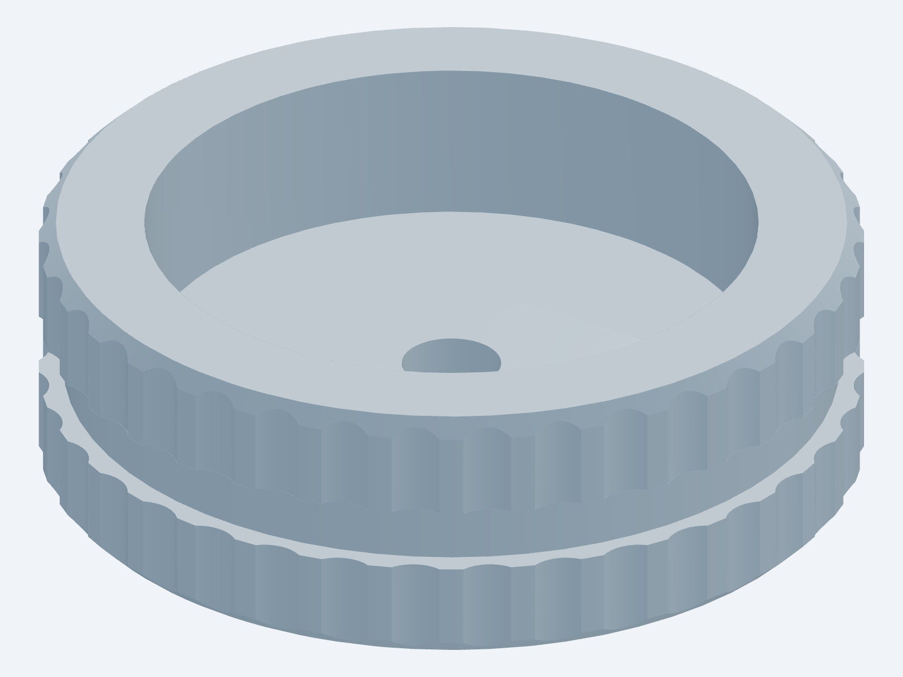
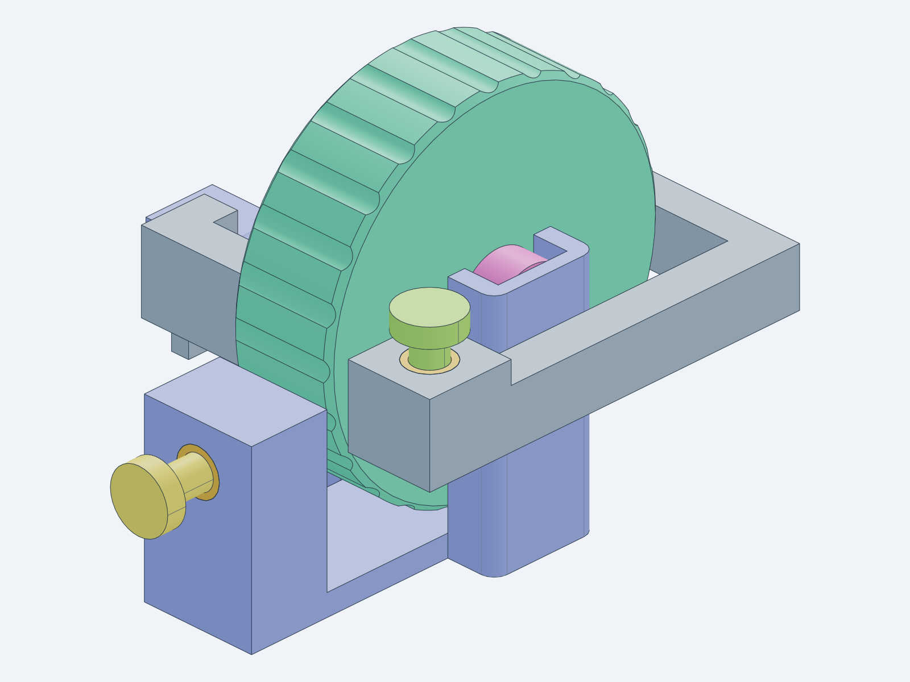
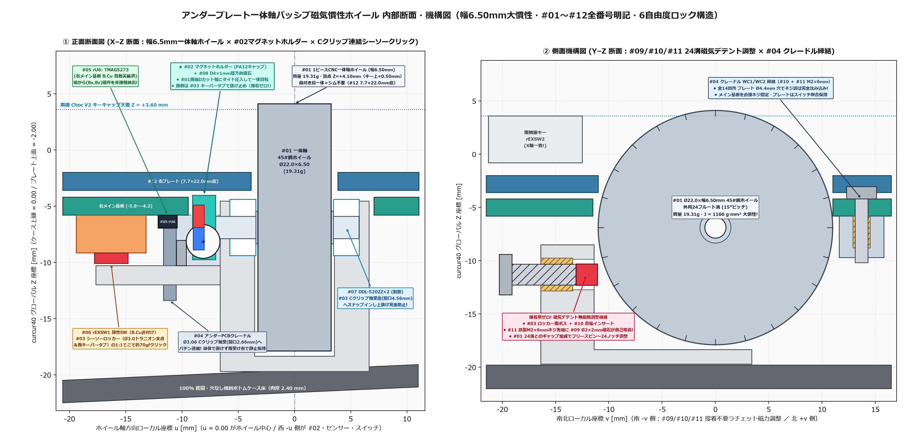

# アンダープレート一体軸パッシブ磁気慣性ホイール 設計仕様書

本書は、電磁クラッチ（ソレノイド・コイル・駆動回路）や専用サブ基板・手配線ハーネス・接着剤・シムリング・スナップカバーを一切使わずに、**「1ピース一体軸 `45# Steel` CNC フライホイール（$\varnothing 22.00 \times 6.50\,\text{mm}$, $19.31\,\text{g}$） × 脱脂 `DDL-520ZZ` ミニチュアベアリング × 接着剤ゼロの24溝非接触磁気デテント × 右メイン基板 PCBA 直実装 3Dホールセンサー（`TMAG5273`）」** によって、**『普段は心地よい24ノッチ感があり、指で弾けば大慣性（$J \approx 1160\,\text{g}\cdot\text{mm}^2$）で数秒間回り続け、指で触れれば瞬時にピタッと止まる』** 高速慣性スクロール＆静音ミドルクリックを実現するハードウェア・ファームウェア設計仕様書です。

---

## 0. やさしい図解：小学生でもわかる！「3つのしくみ」と `#02` の場所

部品が多く見えるホイール機構も、実は **「① 重い鉄のコマと空中コンパス」「② 24個の鉄の山と磁石ネジ」「③ 公園のシーソー」** の3つのシンプルな原理だけで動いています。バネも、接着剤（ボンド）も、切れやすい細い電線も一切使っていません。

### 0.1 高速スクロールのしくみと `#02 マグネットホルダー` の場所（「重い鉄のコマ × 空中コンパス」）
* **なぜ一度はじくと「シューーーッ！」と長く回り続けるの？**
  軽いプラスチックではなく、**幅 $6.50\,\text{mm}$・重さ $19.31\,\text{g}$（10円玉4枚分以上のズッシリ感！）** の「`#01` 鉄のコマ」を、2個のミニチュアベアリング（`#07`）で支えているからです。自転車の車輪と同じで、指ではじけば重さの勢い（慣性）で何秒も回り続け、止めたいときは指先で軽く触れるだけでその瞬間にピタッと止まります。
* **`#02 マグネットホルダー` はどこで何をしているの？**
  `#01` 鉄のコマから左（キーボード内側）へ伸びた「かまぼこ型（Dカット）の鉄の軸」の先端にスポッと刺さっている**小さな丸いキャップが `#02 マグネットホルダー`** です。中に **`#08` 赤青2極磁石（N極・S極）** を入れて軸と一緒にくるくる回します。右側は鉄の軸の段差、左側は `#03` ロッカーから立ち上がる **「抜け止め壁（キーパータブ）」** に挟まれているため、**接着剤ゼロでも絶対に抜け落ちません**。
* **どうやって回転を読み取っているの？（こすれゼロ！）**
  右メイン基板の裏面に最初から付いている **`#05` 空中コンパス（3D磁気センサー `rU6: TMAG5273`）** が、`#08` 磁石に一切触れずに空中から「いま磁石が何時の方角を向いているか」を毎秒約1,000回キャッチします。こすれる部品がゼロなのでブレーキがかかりません。

### 0.2 ノッチ（カリカリ感）調整のしくみ（「24個の鉄の山 × 磁石つきネジの距離あそび」）
* **`#01` 鉄のコマの外周には 24個の「山」と「谷」** が彫られています。そのすぐ南側（親指側）のトンネル（`#03` 南ボス＋`#10` 真鍮インサート）に **`#11` 鉄のネジ** をねじ込み、ネジの先端に **`#09` 小さな磁石** を磁力でパチンとくっつけます（ボンド不要！）。
* 磁石は遠い「谷」より近い「山」を強く引っ張るため、コマが回るたびに山から山へ **1周24回の「カチ・カチ・カチ！」という気持ちいいノッチ感** が生まれます。
* **ドライバー1本でいつでも好みの重さに変身！**:
  * **ネジを右へ回して磁石を近づける** → 磁力が強まり「カチカチ！」としっかり止まる24ノッチモード
  * **ネジを左へ回して磁石を遠ざける** → 磁力がフワッと弱まり、引っかかりゼロの「ツルツル無限スピン」モード
  * 空中の磁力で引っ張っているだけなので、プラスチックのツメやバネと違って **何万回まわしても一生すり減りません**。

### 0.3 背面スイッチへのミドルクリックのしくみ（「公園のシーソーで基板ウラの赤いボタンを下からポチッ！」）
* ホイールを支えている `#03 シーソーロッカー` は、文字どおり **「公園のシーソー」** になっています。
* 真ん中の丸い支点棒（直径 $\varnothing 3.00\,\text{mm}$）は、下側を `#04 クレードル` のU字みぞ、上側を右メイン基板の裏面（わずか $0.05\,\text{mm}$ のすき間！）でガタなくキャッチされています。
* 指でシーソーの右側（`#01` ホイール）を下にグッと押すと（わずか $0.26\,\text{mm}$ 沈むだけ）、支点の反対側にある左うでが **「上」に向かって持ち上がり**、基板の裏に逆さまに付いた **`#06` 静音スイッチ (`rEXSW1`) の赤いボタンを下からポチッ！** と押します。
* 支点から右（$8.12\,\text{mm}$）と左（$8.18\,\text{mm}$）のうでの長さがほぼ **`1 : 1`** なので、約 **$70\,\text{gf}$** の軽快な力で静かにミドルクリックでき、手を離せば `#04` の「やすみ台（戻りストッパー）」でピタッと静止します。

---

## 1. 第一原理からの設計思想（複雑さの徹底排除）

従来の自作キーボード用ホイール機構で発生しがちだった「部品点数の肥大化・接着剥がれ・シム調整・極細線の断線・カバー干渉・ガタつき」を第一原理から見直し、以下のゼロベース統合アーキテクチャを採用しています。

| 設計課題 | 旧来のアプローチで起きやすい無理 | 本設計（アンダープレート一体軸方式）の解決策 |
| :--- | :--- | :--- |
| **① 軸・シム・同軸度** | 別体平行ピン＋オープン軸受＋極薄シムリング重ね | **`steel-flywheel.step` に $\varnothing 2.90\,\text{mm}$ 内輪当たり段付き肩・$\varnothing 1.98\,\text{mm}$ ジャーナル・西Dカット軸を1ピース一体切削**。標準両シールド **`DDL-520ZZ`（幅 $2.30\,\text{mm}$）** を挿し、`#03` の **Cクリップスナップ軸受座** へパチンと嵌めるだけでシムリング不要・上抜けゼロ。 |
| **② 大慣性と幅広操作感・低背化の両立** | 細いホイールは指掛かりが薄く、軸を上に出すと背が高くなる | テンティングケース内の深い空間（$Z \approx -21\,\text{mm}$）を活かし、回転軸をプレート下 **$Z = -6.90\,\text{mm}$** に配置。**外径 $\varnothing 22.00\,\text{mm}$ × 幅 $6.50\,\text{mm}$・質量 $19.31\,\text{g}$（$J \approx 1160\,\text{g}\cdot\text{mm}^2$）** の幅広・大慣性を確保しつつ、頂点 **$Z = +4.10\,\text{mm}$（キー天面比わずか $+0.50\,\text{mm}$）** の超低背を実現。 |
| **③ センサー基板と手配線** | 同軸対向のために極小サブ基板を垂直立て＋6芯手配線 | 右メイン基板 `B.Cu` のホイール窓横に **3軸リニアホールIC `rU6`（`TMAG5273A1QDBVR`, PCBA自動実装）** を配置し、軸端横（off-axis）から回転磁界 $(B_x, B_z)$ を直接ベクトル復調。**サブ基板・JST SH コネクタ・手配線ケーブルを完全ゼロ化**。 |
| **④ 磁気ラチェット構造** | 非磁性ホイール＋別体樹脂ハブ＋磁性鋼球多数 | ホイール自体を **強磁性炭素鋼 `45# Steel`（S45C）＋無電解ニッケルめっき** で製作し、外周の **24本の丸溝（$15^\circ$ ピッチ）** を指掛けローレット兼・磁気ラチェット歯として共用。別体ハブも鋼球もゼロ。 |
| **⑤ 磁石固定と接着剤排除** | 回転軸端やイモネジ先端への瞬間接着剤点付け | 角度磁石（`#08` `D4×1mm` 径方向着磁）は **`#02` マグネットホルダー** に入れ `#01` 軸段差と **`#03` 一体キーパータブ** で両方向ロック。ラチェット磁石（`#09` `NE280`）は **鉄製 `M2×6.0mm` ネジ先端に自己磁力で吸着**。**接着剤完全ゼロ**。 |
| **⑥ 外装カバーとプレート固定** | 軸受・基板を隠すスナップカバーやスイッチ頼みのプレート保持 | 機構全体がトッププレート下面（$Z = -3.60\,\text{mm}$）より下に収まるため、**トッププレート開口は $7.70 \times 22.00\,\text{mm}$ の角丸長穴1つだけ**。さらに外周8箇所の段付きボスでトッププレート自体を直接ネジ固定するため、スイッチ未装着でも単体で完全拘束。 |

---

## 2. 機械構造・ジオメトリ仕様

| `#01` 1ピース一体軸 `45# Steel` ホイール (`6.50 mm` 幅) | アンダープレートホイール単体アセンブリ (`14` パーツ) | `curcur40-right` 実装プレビュー |
| :---: | :---: | :---: |
|  |  |  |

### 2.1 座標系定義（回転軸中心ローカル座標 $(u, v, w)$ ⇔ グローバル座標）
右手メイン基板上のホイール回転軸中心 **$(x_{\text{pcb}}, y_{\text{pcb}}) = (15.4500, -2.0000)\,\text{mm}$**（フルアセンブリ STEP 座標 **$(X_{\text{step}}, Y_{\text{step}}, Z_{\text{step}}) = (+29.7375, -55.1500, -6.9000)\,\text{mm}$**）を原点 $(u, v, w) = (0, 0, 0)$ とする平行移動座標系で定義します：
* **$u = x_{\text{pcb}} - 15.4500$**（$+u$: 東＝キーマトリクス側、$-u$: 西＝キーボード内側）
* **$v = -(y_{\text{pcb}} + 2.0000)$**（$+v$: 北＝PC側USBポート方向、$-v$: 南＝親指トラックボール方向）
* **$w = Z_{\text{step}} - (-6.9000)$**（メイン基板 `B.Cu`: $w = +1.10$ / `F.Cu`: $w = +2.70$、トッププレート: $w \in [+3.30, +4.90]$）

### 2.2 4つの製造パーツ詳細仕様（[`cases/inertia_wheel/`](../cases/inertia_wheel/)）

1. **`#01` 1ピース一体軸スチールホイール（[`steel-flywheel.step`](../cases/inertia_wheel/steel-flywheel.step) — JLCCNC `45# Steel` + 無電解ニッケルめっき）**:
   * **外周リム**: 外径 **$\varnothing 22.00\,\text{mm}$** × **幅 $6.50\,\text{mm}$**（$u \in [-3.25, +3.25]\,\text{mm}$）。外周に半径 $R = 1.00\,\text{mm}$ の丸溝フルートを **$15^\circ$ ピッチで 24本** 加工（指先のゆとりあるグリップ幅と強磁性24ノッチ磁気デテント極を兼用）。
   * **一体内輪ショルダー**: $u \in [-3.45, -3.25]$ および $[+3.25, +3.45]\,\text{mm}$ に外径 **$\varnothing 2.90\,\text{mm}$** の段付き肩を一体旋削。`DDL-520ZZ` の内輪端面（外径 $\approx \varnothing 2.9\text{〜}3.0\,\text{mm}$）のみに当接し、外輪・シールドには一切擦れずに左右位置を拘束します（シムリングゼロ）。
   * **一体ベアリングジャーナル ＆ 西側Dカット軸**: $u \in [-7.98, +5.72]\,\text{mm}$（全長 $13.70\,\text{mm}$）の **$\varnothing 1.98\,\text{mm}$** 一体軸。東端 $+5.72\,\text{mm}$ は東ベアリング外端（$+5.75\,\text{mm}$）より $0.03\,\text{mm}$ 内側へ退避させてロッカー壁との接触を防止し、西端 $u \in [-7.98, -6.98]\,\text{mm}$ に回り止め Dカット平面（$w \ge +0.71\,\text{mm}$ 除去、$+u$ 側ストッパー段差 $u = -6.98\,\text{mm}$）を設けています。
   * **質量・回転慣性**: 体積 $2459.8\,\text{mm}^3$、質量 **$19.31\,\text{g}$**、軸回り慣性モーメント **$J \approx 1160\,\text{g}\cdot\text{mm}^2$**（旧 $4.4\,\text{mm}$ 幅比で約 $1.47$ 倍の大慣性）。

2. **`#02` 接着剤ゼロ マグネットホルダー（[`magnet-holder.step`](../cases/inertia_wheel/magnet-holder.step) — JLC3DP MJF/SLS PA12）**:
   * 外径 **$\varnothing 5.72\,\text{mm}$** × 長さ **$2.05\,\text{mm}$**（$u \in [-9.05, -7.00]\,\text{mm}$、JLC3DP MJF/SLS 最小造形基準適合、ポケット外周肉厚 $0.84\,\text{mm} \ge 0.80\,\text{mm}$）。
   * 東側（$u \in [-8.00, -7.00]$）のタイトな Dカット穴（$\varnothing 2.00\,\text{mm}$, D平面 $w = +0.72\,\text{mm}$）を `#01` 西側Dカット軸へ圧入し、東端は軸の Dカット段差（$u = -6.98$）で位置決めされます。西側（$u \in [-9.05, -8.00]$）の **$\varnothing 4.04 \times$ 深さ $1.05\,\text{mm}$ ポケット** に `#08` `D4×1mm` 径方向2極着磁磁石を収納し、西側は `#03` ロッカーの一体成形 **キーパータブ（$u \in [-10.50, -9.62]$）** が機械的に抜け止めするため、**接着剤なしで `#02` も `#08` も絶対に脱落しません**。

3. **`#03` シーソーロッカー（[`wheel-rocker.step`](../cases/inertia_wheel/wheel-rocker.step) — JLC3DP MJF/SLS PA12）**:
   * 外形 $24.27 \times 21.60 \times 15.15\,\text{mm}$。左右耳（$u \in [-6.62, -3.55]$ ＆ $[+3.55, +6.62]$）の $\varnothing 5.04\,\text{mm}$ 軸受座は、上開口幅を **$4.56\,\text{mm}$（抱き角 $>220^\circ$ の Cクリップスナップイン形状）** に絞っており、脱脂した **`DDL-520ZZ` × 2個** を上からパチンと押し込むだけで上方向浮きを **$0.060\,\text{mm}$ 以下に完全ロック** します。
   * **一体 $\varnothing 3.00\,\text{mm}$ トラニオン支点軸・キーパータブ・中クリックてこ比**: $(u_{\text{piv}}, w_{\text{piv}}) = (-8.12, -0.45)\,\text{mm}$（軸天面 $w = +1.05 \Leftrightarrow Z = -5.85\,\text{mm}$、右メイン基板 `B.Cu` $Z = -5.80\,\text{mm}$ とのクリアランス **$0.05\,\text{mm}$**）に南北一対の一体成形 **$\varnothing 3.00\,\text{mm}$ トラニオン円筒軸** を備え、縦横の支点ガタを極小化しています。ホイール荷重点（$L_{\text{east}} = 8.12\,\text{mm}$）から支点を挟んで西側ストライカー（$u = -16.30 \rightarrow L_{\text{west}} = 8.18\,\text{mm}$、ほぼ **$1:1$ レバー比**）が静音スイッチ `rEXSW1` を下から押し上げ、指先荷重 **約 $70\,\text{gf}$**（押下角 $2.20^\circ$・沈み量 $0.26\,\text{mm}$）の歯切れよい静音ミドルクリックを実現します。西アーム上面（$u \in [-10.50, -9.62], w \in [-5.10, -1.15]$）には `#02`/`#08` 抜け止め用の **一体キーパータブ** を備えます。
   * **南側 接着剤ゼロ磁気デテント調整ボス**: 南側下部（$w = -4.40 \Leftrightarrow Z = -11.30\,\text{mm}$, $v \in [-16.40, -11.40]\,\text{mm}$）の $\varnothing 2.85\,\text{mm}$ 水平貫通穴に `#10` `M2×L3.0` 真鍮インサートを熱圧入し、南からねじ込む `#11` 鉄製 `M2×6.0mm` ネジ先端に `#09` $\varnothing 2.0 \times 2.0\,\text{mm}$ 磁石（`NE280`）を自己吸着させて、24溝とのギャップを無段階チューニングします。

4. **`#04` アンダーPCBクレードル（[`wheel-cradle.step`](../cases/inertia_wheel/wheel-cradle.step) — JLC3DP MJF/SLS PA12）**:
   * 外形 $21.37 \times 24.50 \times 7.60\,\text{mm}$（$Z = -13.40 \sim -5.80\,\text{mm}$）。対角2箇所（`WC1 (7.80, -9.80)`, `WC2 (22.40, 6.00)`）のボスに `M2×L3.0` 真鍮インサートを圧入し、右メイン基板 `F.Cu` から統一 `M2×6.0mm` ネジ2本で固定します。
   * 左右の上開き **$\varnothing 3.08\,\text{mm}$ U字サドル**（片側クリアランス $0.04\,\text{mm}$、横方向頬当てクリアランス $0.07\,\text{mm}$）と右メイン基板 `B.Cu`（天井隙間 $0.05\,\text{mm}$）で `#03` の $\varnothing 3.00\,\text{mm}$ トラニオン支点軸を精密保持し、西端の戻りストッパーブリッジ（天面 $w = -5.16\,\text{mm}$、アーム底面との隙間 $0.06\,\text{mm}$）がスイッチ予圧ゼロの静止位置を正確に受け止めます。

### 2.3 固定自由度・稼働自由度（6-DOF）の自動拘束検証 (`verify_6dof_constraints`)
単純な「静止時の干渉ゼロ・クリアランス確保」だけでなく、**「固定されるべき自由度が機械的ストッパーで確実にロックされ、稼働すべき自由度だけが干渉ゼロで滑らかに動くこと」** を [`scripts/generate_inertia_wheel.py`](../scripts/generate_inertia_wheel.py) および [`scripts/generate_full_assembly.py`](../scripts/generate_full_assembly.py) 内で自動アサート検証しています：
1. **ホイール回転自由度 (`Rx` $0^\circ \sim 360^\circ$)**: 全回転角で全周辺部品との干渉体積 `0.00000000 mm³`。
2. **ベアリング＆ホイール 5自由度ロック**: `#03` Cクリップ座（開口 $4.56\,\text{mm}$）と `#01` 内輪段付き肩により、`±u, ±v, -w` および上方向 `+w`（最大浮き $\le 0.060\,\text{mm}$ で機械的ストッパー接触 `overlap_volume > 0`）を完全拘束。
3. **`#02` マグネットホルダー＆`#08` 磁石 6自由度ロック**: `#01` Dカット軸段差（`+u` ＆軸回り相対回転）と `#03` 西キーパータブ（`-u`）により全方向抜け止めを自動確認。
4. **`#03` シーソー支点＆クリック運動**: トラニオン軸の上下左右ガタ $\le 0.05 \sim 0.09\,\text{mm}$、`+2.20°` 押下時に `rEXSW1` プランジャのみを確実に押し込み（他部品干渉 `0.00000000 mm³`）、逆方向（ホイール持ち上げ `-1.20°`）は `#04` 西ストッパーが即時阻止。
5. **基板・トッププレート・カップ単体 6自由度ロック**: キースイッチを1個も挿していない状態でも、ケースの段付きボス8箇所（`L1..L3, L5, R1..R3, R5`）と `M2×6.0mm` ネジだけで左右トッププレート・左右メイン基板・センサー基板・トラックボールカップがすべて `±X, ±Y, ±Z` に完全固定されることを自動検証済み。

---

## 3. オンボード 3D ホール磁気センシング ＆ ファームウェア信号処理

### 3.1 Off-Axis 2成分磁気ベクトル検出原理
* 回転軸西端の `D4×1mm` 径方向2極着磁磁石が1回転すると、その西側にある右メイン基板 `B.Cu` 上の 3軸リニアホールセンサー **`rU6`（`TMAG5273A1QDBVR`）** 位置では、基板水平成分 $B_x$（ダイポール軸方向で振幅約2倍）と基板法線成分 $B_z$ が互いに $90^\circ$ 位相のずれた正弦波・余弦波として回転します。
* これにより、磁石の軸延長線上に別基板を垂直に立てる必要が一切なく、メイン基板裏面の SMD IC 1個だけで $0^\circ \sim 360^\circ$ の絶対回転角を非接触で連続復調できます。

### 3.2 高速フリック対応 QMK / Vial ドライバ（[`curcur40_scroll.c`](../kbd_firmware/keyboards/curcur40/qmk/qmk_firmware/rev1/curcur40_scroll.c)）
1. **デュアルセンサー自動プローブ（`TMAG5273` ＆ `TLV493D-A1B6` 両対応）**:
   * 起動時およびバスリカバリ時に `I2C0`（`GP24`/`GP25`, `400 kHz`）上で TI `TMAG5273`（A1:`0x35`, B1:`0x22`, C1:`0x78`, D1:`0x44`）を優先検出し、未検出時はピン互換の Infineon `TLV493D-A1B6`（`0x5E`, `0x1F`）へ自動フォールバックします。
2. **`XZX` 擬似同時サンプリングによる高速スピン位相スキュー除去（`TMAG5273`）**:
   * `TMAG5273` を連続変換モード（`CONV_AVG = 4x` $\approx 950\,\text{Hz}$、感度レンジ `±40 mT` / `±80 mT`）かつ **`MAG_CH_EN = XZX` モード** で駆動します。チップ内部で `X1 → Z → X2` の順にAD変換し $(X_1 + X_2)/2$ と $Z$ の時刻重心を完全一致させるため、指で強く弾いた **毎分千回転クラスの高速フリースピン中でも角度位相遅れが発生しません**。
3. **適応型 Max/Min 包絡線正規化 ＋ 16-bit 整数 CORDIC `atan2`**:
   * Off-axis 配置特有の $B_x$・$B_z$ 振幅比（約 $2:1$）および磁石個体差・温度ドリフトを、実行時の指数減衰付き適応包絡線トラッカで正規化したうえで 16-bit 整数 `atan2` により高精度角度へ変換します。
4. **物理24溝と 1:1 対応する `24 notches/rev` 出力**:
   * デッドバンドヒステリシスで静止時の微小ノイズを遮断しつつ、端数アキュムレータにより **`WHEEL_NOTCHES_PER_REV = 24`**（物理24フルート溝と完全 1:1 同期）で滑らかにスクロール出力します（`Shift` または `WHL_HRZ` キー押下中は水平スクロールへ自動切替）。

---

## 4. 製造データ・DFM＆6-DOF自動検証結果・BOM

### 4.1 3D CAD モデル一覧（[`scripts/generate_inertia_wheel.py`](../scripts/generate_inertia_wheel.py)）

| 区分 | ファイル | 製造プロセス・材質 | 外形寸法 [mm] | 自動 DFM・干渉・6-DOF検証結果 |
| :--- | :--- | :--- | :---: | :--- |
| **`#01` ホイール** | [`steel-flywheel.step`](../cases/inertia_wheel/steel-flywheel.step) / `.stl` | JLCCNC **`45# Steel` + 無電解Niめっき** (`19.31 g`) | $22.00 \times 22.00 \times 13.70$ | 幅 $6.50\,\text{mm}$・一体段付き軸・水密単一ソリッド **PASS** |
| **`#02` ホルダー** | [`magnet-holder.step`](../cases/inertia_wheel/magnet-holder.step) / `.stl` | JLC3DP **MJF / SLS PA12** | $5.72 \times 5.72 \times 2.05$ | 最小穴径 $2.00\,\text{mm}$・`<0.80mm` 薄肉 **`0`件** **PASS** |
| **`#03` ロッカー** | [`wheel-rocker.step`](../cases/inertia_wheel/wheel-rocker.step) / `.stl` | JLC3DP **MJF / SLS PA12** | $24.27 \times 21.60 \times 15.15$ | Cクリップ座・最小穴径 $2.85\,\text{mm}$・`<0.80mm` 薄肉 **`0`件** **PASS** |
| **`#04` クレードル** | [`wheel-cradle.step`](../cases/inertia_wheel/wheel-cradle.step) / `.stl` | JLC3DP **MJF / SLS PA12** | $21.37 \times 24.50 \times 7.60$ | 最小穴径 $2.85\,\text{mm}$・`<0.80mm` 薄肉 **`0`件** **PASS** |
| **単体検証** | [`inertia-wheel-assembly.step`](../cases/assemblies/inertia-wheel-assembly.step) | ホイール機構単体アセンブリ (`14` パーツ) | ― | 静止 $0^\circ$・押下 $2.20^\circ$ 干渉ゼロ ＆ 6-DOF 全拘束 **PASS** |
| **右手検証** | [`curcur40-right-wheel-assembly.step`](../cases/assemblies/curcur40-right-wheel-assembly.step) | 右手ケース＋基板＋プレート＋ホイール (`66` パーツ) | ― | 全ペア干渉 `0.00000000 mm³`・プレート直固定 6-DOF **PASS** |

### 4.2 ホイール関連部品表（BOM：購入先URL・詳細は [`docs/parts_spec.md`](./parts_spec.md) 参照）

| 番号・呼称 | 部品名・型番 | 数量 | 仕様・ポイント | 主な調達先 |
| :--- | :--- | :---: | :--- | :--- |
| **`#01` 一体軸ホイール** | `steel-flywheel.step` | **1個** | `45# Steel` ＋ `Electroless Nickel Plating` ($\varnothing 22.0 \times 6.50\,\text{mm}$, $19.31\,\text{g}$) | JLCCNC |
| **`#02`〜`#04` 樹脂3部品** | `magnet-holder`, `wheel-rocker`, `wheel-cradle` | **各1個** | MJF / SLS `PA12` ナイロン（ケースと一括造形可） | JLC3DP |
| **`#05` 3DホールIC (`rU6`)** | `TMAG5273A1QDBVR` (`SOT-23-6`, LCSC `C3716049`) | *(PCBA済)* | 右メイン基板 `B.Cu` に自動実装済（個別購入・配線不要） | JLCPCB PCBA |
| **`#06` 静音中クリックSW (`rEXSW1`)** | `Kailh Square Silent 6.2×6.2×4.3mm` | **1個** | 右メイン基板 `B.Cu` へ直付け THT 2ピンはんだ | Amazon (`B0FF9Y9DB8`) 等 |
| **`#07` ミニチュアベアリング** | NMB ミネベアミツミ **`DDL-520ZZ`** | **2個** | 内径 $\varnothing 2 \times$ 外径 $\varnothing 5 \times$ 幅 **$2.30\,\text{mm}$** 両シールド（要脱脂・Cクリップ保持） | モノタロウ (`09538365`) |
| **`#08` 角度検出磁石** | ネオジム磁石 **`D4×1mm`（★径方向2極着磁）** | **1個** | $\varnothing 4.0 \times 1.0\,\text{mm}$ Diametric（`#02` ポケット＋`#03` キーパータブで保持） | AliExpress (`1005010201889003`) |
| **`#09` ラチェット磁石** | 二六製作所 **`NE280`**（軸方向着磁） | **1個** | $\varnothing 2.0 \times 2.0\,\text{mm}$ 円柱（鉄製 `M2×6mm` ネジ先端に自己磁力吸着） | 二六製作所 (`NE280`) |
| **`#10` 真鍮インサート** | ローレット真鍮ヒートセットインサート | **3個** *(全体17個)* | `M2 × L=3.0 × OD=3.2mm`（クレードル2個＋ロッカー南1個、本体と完全共通） | Amazon / AliExpress |
| **`#11` 統一固定・調整ネジ** | 強磁性（鉄／ニッケルめっき鋼）精密ネジ | **3本** *(全体17本)* | `M2 × 6.0mm`（クレードル固定2本＋南デテント調整1本、本体と完全共通） | モノタロウ / Amazon |
