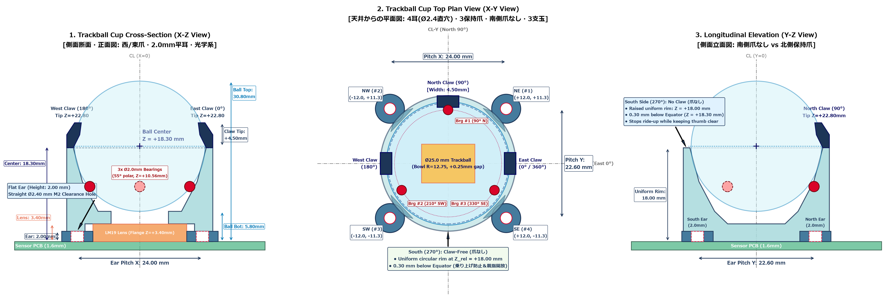
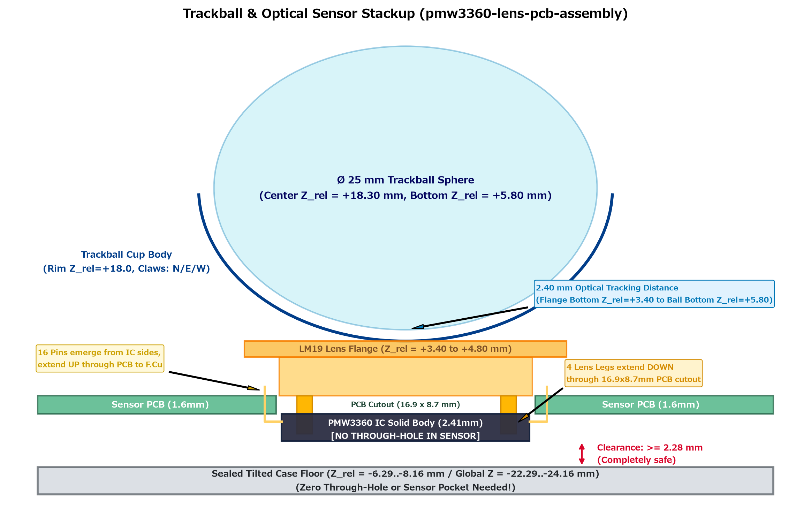
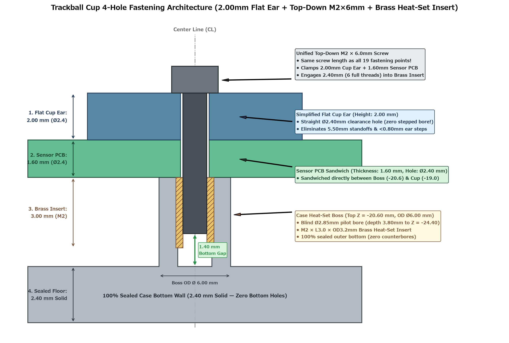

# curcur40 トラックボール・光学系・2D慣性スクロール設計仕様書 (`trackball_spec.md`)

本書は、右手親指部に搭載される 25 mm 光学式トラックボール機構（トラックボールカップ、PMW3360DM-T2QU + LM19-LSI 光学アライメント、および QMK / Vial ファームウェアの 2D 慣性ドラッグスクロール処理）の設計仕様と設計根拠を定義します。

- 対応スクリプト: [`scripts/generate_trackball_cup.py`](../scripts/generate_trackball_cup.py), [`scripts/generate_sensor_assemblies.py`](../scripts/generate_sensor_assemblies.py)
- 対応ファームウェア: [`curcur40_scroll.c`](../kbd_firmware/keyboards/curcur40/qmk/qmk_firmware/rev1/curcur40_scroll.c), [`curcur40_scroll.h`](../kbd_firmware/keyboards/curcur40/qmk/qmk_firmware/rev1/curcur40_scroll.h)
- 全体の Z軸スタックアップ・ケースボス座標（`TB1`〜`TB4`）の定義は [`docs/case_spec.md`](./case_spec.md)、購入部材は [`docs/buildguide_jp.md`](./buildguide_jp.md) を参照してください。

---

## 1. 低プロファイル沈み込み構造の設計方針

25 mm 球を採用しつつ親指の自然なホームポジション高さに抑えるため、PMW3360 センサー回路を右手メイン基板（`Z = -5.80 〜 -4.20 mm`）から `-14.80 mm` 下段の独立サブ基板 [`curcur40-pmw3360`](../pcbs/pmw3360/curcur40-pmw3360.kicad_pcb)（`Z = -20.60 〜 -19.00 mm`、中心 `x_pcb = 28.5750 mm, y_pcb = 47.6250 mm`）へ分離しています。

- **閉円形トッププレート開口と沈み込みリム**: カップ円形リム天面をトッププレート下面（`Z = -3.60 mm`）よりさらに `1.40 mm` 奥の **`Z = -5.00 mm`** に配置し、右トッププレートの閉じた円形開口（**`⌀28.625 mm`**、カップ外径 `⌀28.00 mm` に対して全周均一ギャップ `0.3125 mm`）で外周を囲んでいます。
- **ボール頂点と爪頂点の低背化**: 25 mm ボール頂点は **`Z = +11.80 mm`**（Choc V2 キーキャップ天面 `Z = +3.60 mm` から `+8.20 mm`）、3本のボール保持爪の頂点は **`Z = +3.80 mm`** となり、キーキャップ天面とほぼ同じ高さに収まります。

---

## 2. 光学系アライメントと寸法根拠（PMW3360DM-T2QU + LM19-LSI）

PixArt 公式データシート（PMW3360DM-T2QU / LM19-LSI Figure 4 SECTION B-B & DETAIL C：[公式ダウンロード URL](https://www.pixart.com/_getfs.php?tb=product&id=10&fs=ck2_fs_en) ／ [製品ページ](https://www.pixart.com/products-detail/10/PMW3360DM-T2QU) ※データシート PDF は転載禁止のためリポジトリへ同梱せず公式 URL を参照）および基準アセンブリ [`pmw3360-lens-pcb-assembly.step`](../cases/assemblies/pmw3360-lens-pcb-assembly.step) に基づく光学距離の設計値です。

### 2.1 データシート規定値とスタック高さ
- **使用ボール**: 直径 **`⌀25.0 mm`**（半径 `12.50 mm`）
- **レンズフランジ底面 〜 ボール最下面（Navigation Surface）**: **`2.40 mm`**（規定光学距離）
- **センサー基板表面（`F.Cu`）〜 ボール最下面**: **`5.80 mm`**
- **センサー基板板厚**: **`1.60 mm`**（FR-4）
- **センサーIC パッケージ底面 〜 ボール最下面**: **`9.81 mm`**（IC 本体厚み `2.41 mm`）

これらから、センサー基板表面（`F.Cu` = 相対基準 `Z_rel = 0.00 mm` / グローバル `Z = -19.00 mm`）に対する各部の高さが一意に定まります：
- **レンズフランジ着座面**: `Z_rel = +3.40 mm`（`5.80 - 2.40 = 3.40 mm` / グローバル `Z = -15.60 mm`）
- **センサーIC 上面（`B.Cu` 密着面）〜 レンズフランジ座面**: `5.00 mm`（`3.40 + 1.60 = 5.00 mm`）

### 2.2 センサー・レンズ・基板の機械的インターフェース（設計根拠）
1. **LM19-LSI 光学レンズ（`F.Cu` 側配置）**:
   - センサーサブ基板の表面（`Z = -19.00 mm`）に載り、下面から伸びる 4本の脚（`⌀0.90 mm` 丸ガイドポスト 2本 ＋ 角アライメントリブ 2本）が基板中央の角穴（`16.90 × 8.70 mm`）を通って裏面のセンサーIC へ嵌合します。
   - **非対称丸ガイドポストの設計根拠**: 実部品および実フットプリント [`PMW3360DM-T2QU_16Pin.kicad_mod`](../pcbs/common/kbd/kicad-footprints/kbd.pretty/PMW3360DM-T2QU_16Pin.kicad_mod)（[`monkeypad/pmw3360-breakout`](https://github.com/monkeypad/pmw3360-breakout) / [`siderakb/pmw3360-pcb`](https://github.com/siderakb/pmw3360-pcb) 準拠）における丸ガイドポスト穴（`⌀1.70 mm`）は、センサー中心基準で **`(-7.10, +3.30) mm`** および **`(+6.70, -3.40) mm`** の非対称配置であり、基板角穴（`±8.45 × ±4.35 mm`）の内側に余裕をもって収まります。また `11.80°` 傾斜内底面により未カットの丸ガイドポスト先端下にも `0.71 mm` 以上のクリアランスが確保されます。
2. **PMW3360DM-T2QU センサーIC（`B.Cu` 側配置）**:
   - 基板裏面（`Z = -20.60 mm`）から差し込み、表面（`F.Cu`）で 16ピンをはんだ付けします。ピン先端はカップ底面の広口レンズ室（`19.60 × 22.20 mm`、天井 `Z_rel = +4.85 mm`）内で干渉しないよう短く切り揃えます。

### 2.3 3D CAD 検証用 光学距離基準面（`Lens_Optical_Ref_Point`）
CAD ビューア上で 25 mm ボール最下面（`Trackball_25mm`）との規定光学距離（**`2.4000 mm`**）を直接クリック計測できるよう、以下の 4つの検証用アセンブリ STEP モデルには光軸中心のレンズフランジ着座面に独立オブジェクト **`Lens_Optical_Ref_Point`**（`⌀0.70 mm` 円形基準面）を含めています：
- [`pmw3360-lens-pcb-assembly.step`](../cases/assemblies/pmw3360-lens-pcb-assembly.step) — `(0.0000, 0.0000, +3.4000) mm`
- [`trackball-cup-with-ball.step`](../cases/assemblies/trackball-cup-with-ball.step) — `(0.0000, 0.0000, +3.4000) mm`
- [`assembly-full.step`](../cases/assemblies/assembly-full.step) — `(42.8625, -104.7750, -15.6000) mm`
- [`assembly-full-desk.step`](../cases/assemblies/assembly-full-desk.step) — デスク水平変換後の光軸座面

---

## 3. トラックボールカップ幾何仕様と支持球力学 (`trackball-cup.step`)

### 3.1 カップ各部の Z座標一覧

| 構造部位 | センサーPCB基準 `Z_rel` | グローバル `Z` | 設計寸法・役割 |
| :--- | :---: | :---: | :--- |
| **カップ着座底面（Sensor PCB `F.Cu`）** | `0.00 mm` | `-19.00 mm` | センサーサブ基板表面に密着 |
| **4箇所フラット固定耳 天面** | `+2.00 mm` | `-17.00 mm` | 外径 `⌀6.00 mm`・ストレート貫通穴 `⌀2.40 mm`。`M2 × 6.0 mm` ネジ頭が着座 |
| **レンズフランジ受け座面** | `+3.40 mm` | `-15.60 mm` | LM19 レンズフランジ底面（光学距離 `2.40 mm` 基準面） |
| **広口レンズ室 天井面** | `+4.85 mm` | `-14.15 mm` | `19.60 × 22.20 mm`。LM19 フランジ（`18.85 × 21.15 mm`）を収容 |
| **25mmボール最下面（Navigation Surface）** | `+5.80 mm` | `-13.20 mm` | レンズ座面から `2.40 mm` 上空に保持 |
| **光学のぞき穴 上端エッジ** | `+6.58 mm` | `-12.42 mm` | 内球面（`R = 12.75 mm`）と開口穴の交線 |
| **3点セラミック支持球 中心** | `+10.56 mm` | `-8.44 mm` | 底面極から開き角 `55.0°`（水平半径 `R_xy = 11.06 mm`） |
| **カップ円形リム天面** | `+14.00 mm` | `-5.00 mm` | プレート下面より `1.40 mm` 奥。3本爪のバネ長 `7.67 mm` を確保 |
| **25mmボール中心（赤道面）** | `+18.30 mm` | `-0.70 mm` | ボール最下面 `-13.20 + 12.50 = -0.70 mm` |
| **ボール保持爪 頂点** | `+22.80 mm` | `+3.80 mm` | 赤道より上を保持（最狭スロート径 `⌀24.59 mm` at `Z_rel = +21.67 mm`） |
| **25mmボール頂点** | `+30.80 mm` | `+11.80 mm` | キーキャップ天面（`+3.60 mm`）比 `+8.20 mm` |

### 3.2 高位置 55.0° セラミック支持球による乗り上げ防止力学
- **配置**: 旋回軌道半径 `R_orbit = 13.50 mm`、**底面極からの開き角 `55.0°`**（水平からの俯角 `35.0°`、`Z_rel = +10.56 mm`、水平軌道半径 `R_xy = 11.06 mm`）、方位角 **`90°`（北・上フリック正面受け）, `210°`（南西）, `330°`（南東）** の 3点等配に `⌀2.00 mm` セラミック球（ZrO2 / Si3N4）を配置しています。
- **スナップイン保持**: 入口径 `⌀1.95 mm` のブラインド球面座（`R = 1.03 mm`、外壁面まで肉厚 `1.91 mm`）へパチンと圧入保持されます。
- **乗り上げ防止根拠**: 上方向フリックに対して限界横力比 `F_h / F_v = 1.43`、最弱谷間（南 `270°` 等）でも `F_h / F_v = 0.71` を確保しており、軽量な 25 mm 球（約 10 g）を高速フリックしても支持球への乗り上げや浮き上がりが発生しません。

### 3.3 内球面クリアランス・T字3本爪・4点共締め構造
- **内球面クリアランス**: 内球面半径 `R = 12.75 mm`（内径 `⌀25.50 mm`）とし、25 mm ボールとの間に均一エアギャップ **`+0.25 mm`** を確保しています。
- **素手着脱できる T字3本爪**: カップ外壁と同一円筒面（`⌀28.00 mm`）の 3本爪（北 `90°`・東 `0°`・西 `180°`、幅 `4.50 mm`、南側は親指干渉防止のため爪なし開放）を採用。円形リム天面を `Z = -5.00 mm` に下げたことで **`7.67 mm` の弾性バネ長** が確保され、底面に押し出し穴がない密閉ケースでも上から素手で着脱でき、逆さにしてもボールが落下しません。
- **4箇所共締め構造（`TB1`〜`TB4`）**:

  カップ固定耳（厚さ `2.00 mm`、ストレート穴 `⌀2.40 mm`、カップ中心相対 `(±12.00, ±11.30) mm`）とセンサーサブ基板（厚さ `1.60 mm`、穴 `⌀2.40 mm`）を重ね、ケース下段ボス天面（`Z = -20.60 mm`、盲穴深さ `3.80 mm`）の真鍮ヒートセットインサートへ上から統一 **`M2 × 6.0 mm` ネジ 4本** で一括締結します（有効螺合長 `2.40 mm` ＝ 6.0山、穴底余裕 `1.40 mm`）。

---

## 4. 2D 慣性ドラッグスクロール ファームウェア設計

[`curcur40_scroll.c`](../kbd_firmware/keyboards/curcur40/qmk/qmk_firmware/rev1/curcur40_scroll.c) にて、物理的な慣性ホイールとは独立に、25 mm トラックボールを用いた **2D 慣性ドラッグスクロール（Kinetic Flick & Brake）** を実装しています。

1. **発動モードとカスタムキーコード**:
   - `SCRL_MO`（`QK_KB_0` / `USER00`）ホールド中、`SCRL_TG`（`QK_KB_1` / `USER01`）トグル中、または `CURCUR40_SCROLL_LAYER`（デフォルト Layer `3`）有効中は高速 2D 慣性スクロールとして動作します（分周比 `CURCUR40_DRAGSCROLL_DIVISOR = 24.0`、斜めブレを抑える主軸ロック比 `2.5`）。
   - `SCRL_SL`（`QK_KB_2` / `USER02`）ホールド中は慣性を無効化した低速精密ドラッグスクロール（分周比 `48.0`）となります。
2. **フリック慣性発射と指数減衰**:
   - 親指でボールを弾いて離した際（`14 ms` 以上の無入力ギャップ検出時）、直前の移動速度が閾値（`0.022 counts/ms`）を超えていれば初速ブースト（`×1.25`、上限 `0.220`）をかけて慣性コースティングを開始し、`8 ms` 周期で減衰係数 `0.988` を乗じながら滑らかに減速します。
3. **タッチ即停止 ＆ OS ズーム誤爆ガード**:
   - 慣性スクロール中にボールへ軽く触れる（累積 `8 counts` 以上の微小入力または逆方向入力）か、マウスボタン押下／`SCRL_MO` 解放を行うと即座に速度をゼロへ制動します。
   - 慣性惰走中に `Ctrl` / `Alt` / `GUI` 修飾キーが押された場合も即座に慣性をキャンセルし、ブラウザ等で意図しない画面拡大縮小（`Ctrl + Scroll`）が暴発するのを防ぎます。
