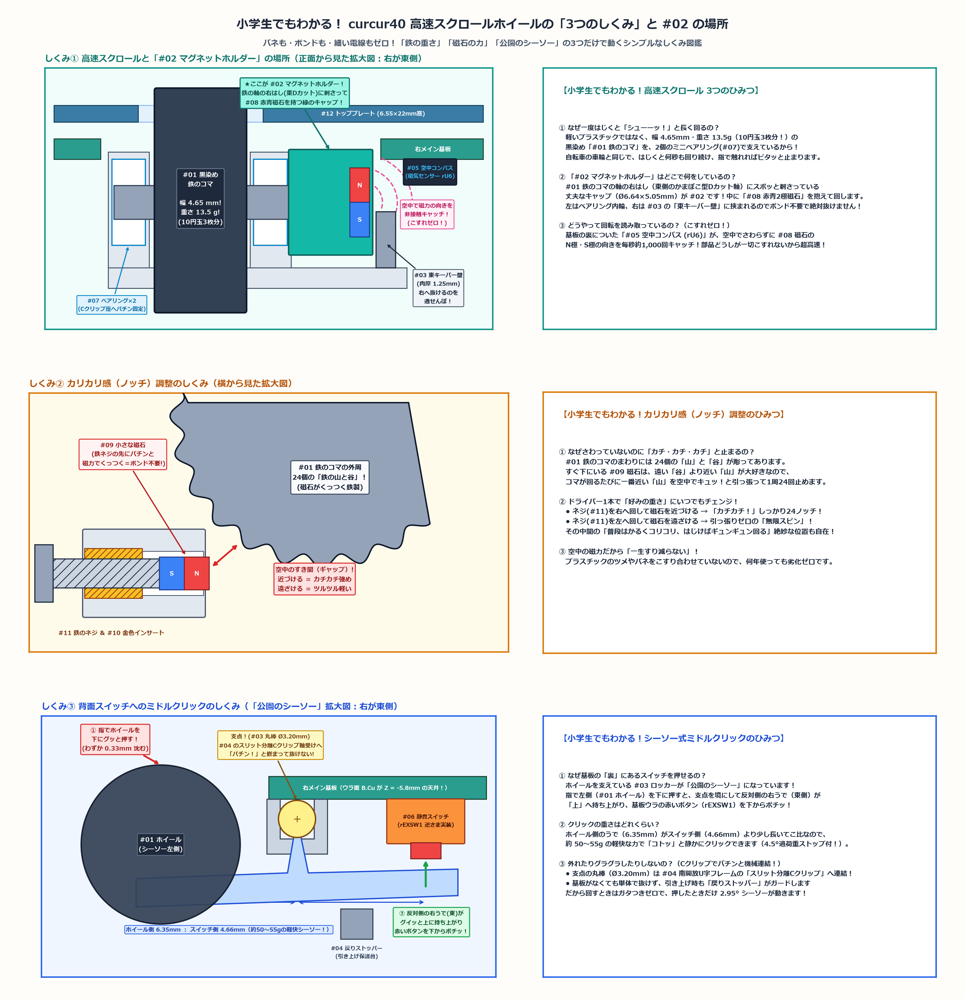
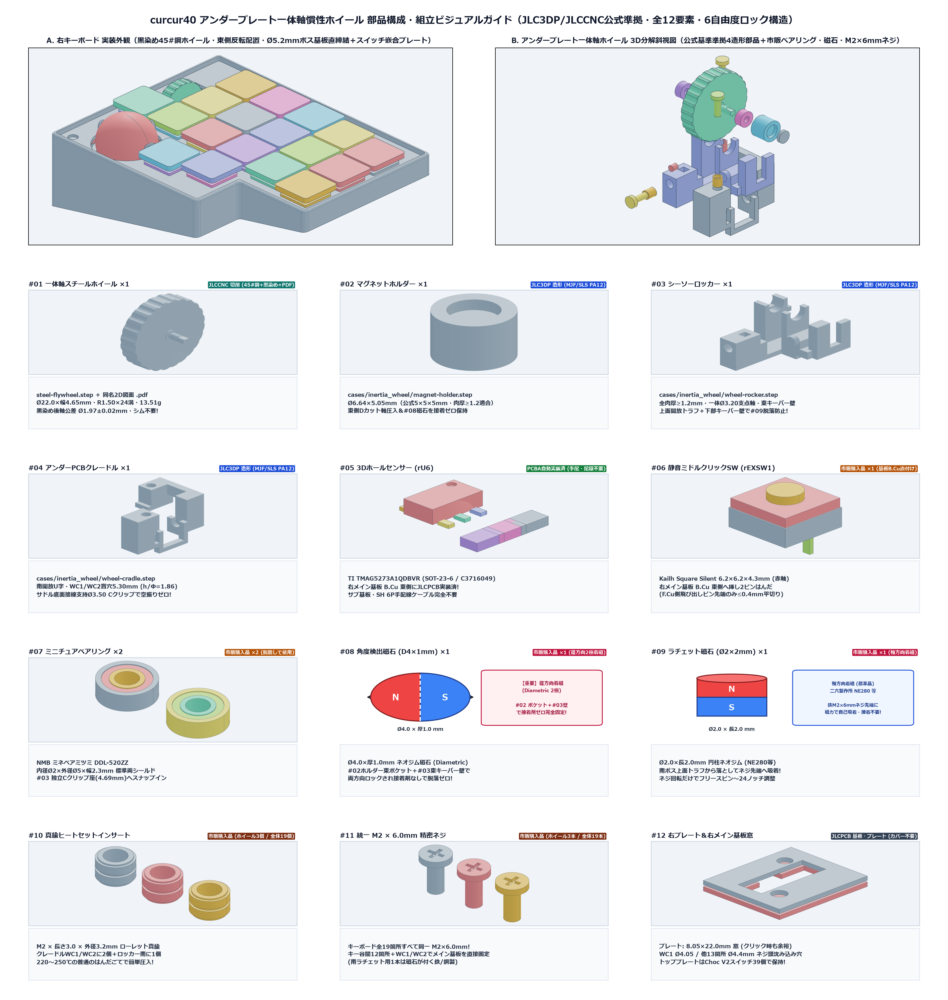
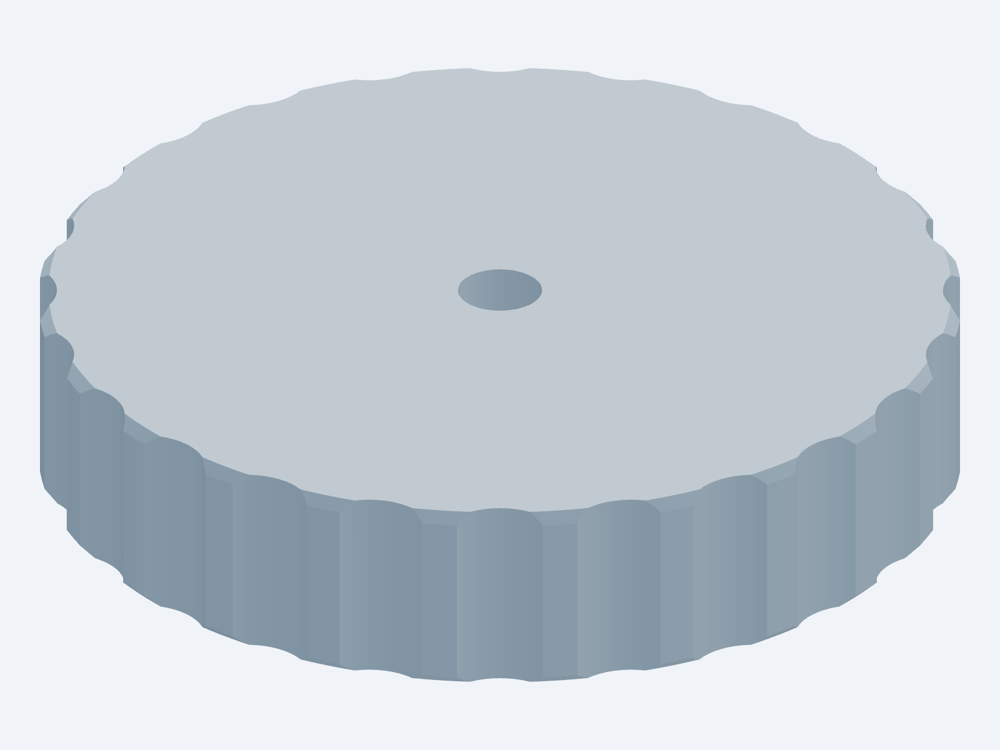
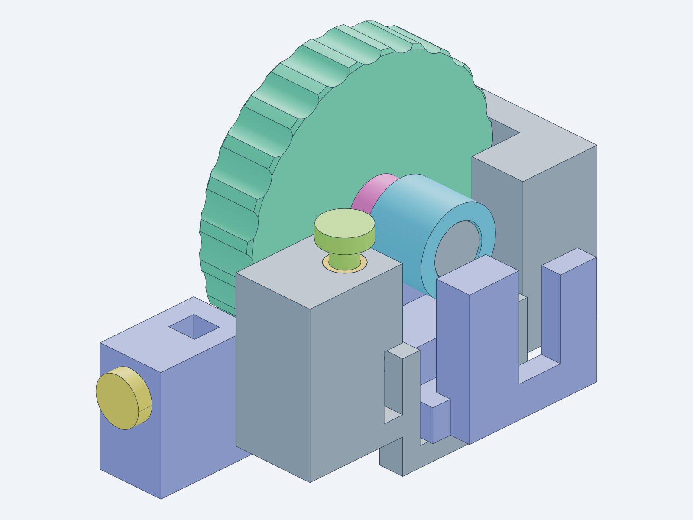
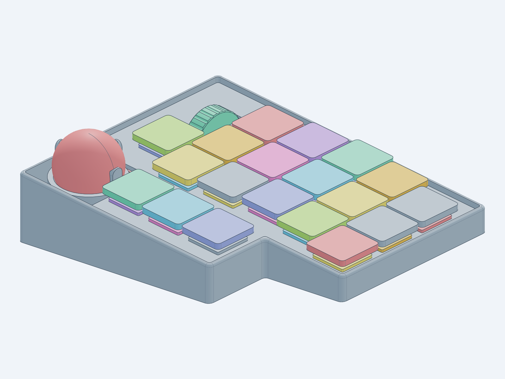
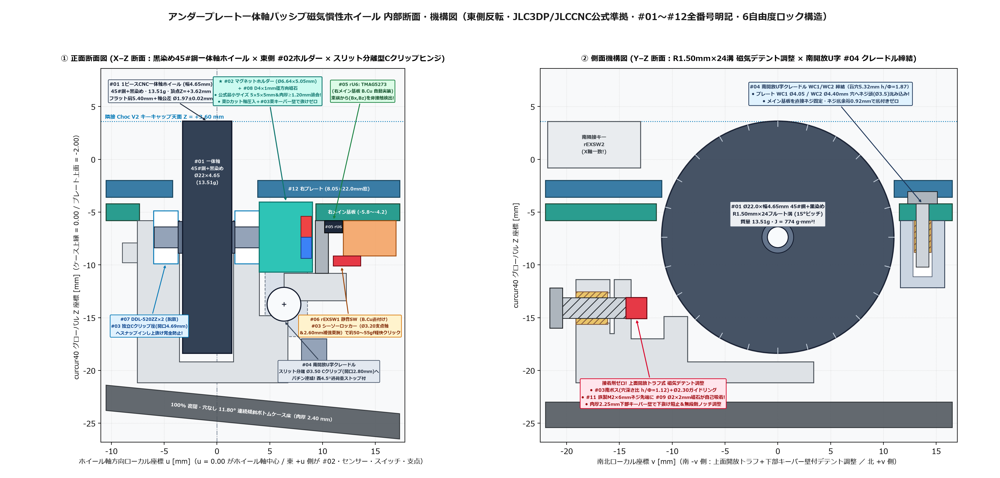

# curcur40 アンダープレート一体軸パッシブ磁気慣性ホイール設計仕様書 (`wheel_spec.md`)

本書は、右手人差し指内側に搭載される **アンダープレート一体軸パッシブ磁気慣性ホイール**（1ピース `45# Steel` フライホイール、接着剤・シム・配線不要の機械保持構造、非接触磁気デテント、および右メイン基板オンボード 3D ホールセンサーによる角度復調ファームウェア）の設計仕様と設計根拠を定義します。

- 対応スクリプト: [`scripts/generate_inertia_wheel.py`](../scripts/generate_inertia_wheel.py), [`scripts/generate_inertia_wheel_diagram.py`](../scripts/generate_inertia_wheel_diagram.py)
- 対応ファームウェア: [`curcur40_scroll.c`](../kbd_firmware/keyboards/curcur40/qmk/qmk_firmware/rev1/curcur40_scroll.c), [`curcur40_scroll.h`](../kbd_firmware/keyboards/curcur40/qmk/qmk_firmware/rev1/curcur40_scroll.h)
- 体験型インタラクティブ図解: **[`docs/wheel_mechanism_guide.html`](./wheel_mechanism_guide.html)**（ホイールの慣性スピン・ノッチ調整・シーソークリックをブラウザ上で操作可能）
- 購入部材・発注手順は [`docs/buildguide_jp.md`](./buildguide_jp.md)、自動検証基準は [`scripts/README.md`](../scripts/README.md) を参照してください。

---

## 1. 機構の動作原理（3つの基本要素）

電磁クラッチや専用サブ基板・手配線ハーネス・接着剤・シムリングを使わず、以下の 3つの物理要素のみで「24ノッチのラチェット感」「指で弾いた際の長時間フリースピン」「指先で触れた瞬間の即停止」「静音ミドルクリック」を両立しています。

1. **大慣性ローターと非接触 3D 磁気センシング（摩擦ブレーキゼロ）**:
   - 質量 **`13.51 g`**（慣性モーメント `J = 773.6 g·mm²`）の 1ピース炭素鋼フライホイール（`#01`）を、脱脂した 2個のミニチュアベアリング `DDL-520ZZ`（`#07`）で支持します。
   - 東側の Dカット軸端に差し込んだ `#02` マグネットホルダー（`⌀6.64 × 5.05 mm`）内の径方向 2極着磁磁石（`#08`, `D4 × 1 mm`）の回転磁界を、右メイン基板 `B.Cu` に実装された 3軸ホールセンサー `rU6`（`#05`, `TMAG5273`）が空中から非接触で毎秒約 1,000回読み取ります。
   - `#02` ホルダーの西側は東ベアリング内輪、東側は `#03` ロッカーの一体キーパー壁（ギャップ `0.25 mm`）で挟まれるため、接着剤なしで `#02` も `#08` 磁石も抜け落ちません。
2. **外周 24溝と自己吸着磁石ネジによる無段階磁気デテント（摩耗ゼロ）**:
   - 強磁性 `45# Steel` ホイールの外周に彫られた 24本のフルート溝（山と谷）に対し、南側ボスの真鍮インサート（`#10`）にねじ込んだ鉄製 `M2 × 6.0 mm` ネジ（`#11`）先端へ `⌀2.0 × 2.0 mm` 円柱磁石（`#09`, `NE280`）を磁力で自己吸着させて対向させます。
   - ネジの回転角でギャップを変えれば、明快な 24ノッチ感から無抵抗に近いフリースピンまで無段階に調整でき、非接触のため機械的摩耗も発生しません（北端の下部キーパー壁により、最奥まで締めても磁石がホイールへ飛び移ることはありません）。
3. **Cクリップスナップイン支点のシーソーロッカーによる背面スイッチ押下**:
   - ホイールを支持する `#03` ロッカーの左右支点軸（`⌀3.20 mm`）は、`#04` クレードルのスリット分離型 Cクリップ軸受（内径 `⌀3.50 mm`・上開口 `2.80 mm`）へ上からスナップイン連結されます。
   - ホイールを上から押すと（沈み込み約 `0.33 mm`）、支点を挟んで反対側の北東アームが持ち上がり、右メイン基板裏面の静音マイクロスイッチ `rEXSW1`（`#06`）を下からクリックします（てこ比 `6.35 : 4.66` により操作荷重 約 `50 〜 55 gf`、強押し時は西側ハードストップがスイッチを保護）。

---

## 2. 設計方針と機械ジオメトリ仕様

| `#01` 1ピース一体軸 `45# Steel` ホイール (`4.65 mm` 幅) | アンダープレートホイール単体アセンブリ | `curcur40-right` 実装プレビュー |
| :---: | :---: | :---: |
|  |  |  |

### 2.1 座標系定義（回転軸ローカル座標 `(u, v, w)` ⇔ グローバル座標）
右手メイン基板上の南側隣接キー `rEXSW2` `(14.2875, 23.8125)` の X中心線と交わる回転軸基準点 **`(x_pcb, y_pcb) = (14.2875, +2.7625) mm`**（フルアセンブリ STEP 座標 **`(X_step, Y_step, Z_step) = (+28.5750, -59.9125, -7.3800) mm`**）をローカル原点 `(u, v, w) = (0, 0, 0)` と定義します：
- **`u = x_pcb - 14.2875`**（`+u`: 東＝キーマトリクス・支点・`rU6`/`rEXSW1` 側、`-u`: 西＝キーボード内側端）
- **`v = -(y_pcb - 2.7625)`**（`+v`: 北＝PC側 USB ポート方向、`-v`: 南＝親指トラックボール方向）
- **`w = Z_step - (-7.3800)`**（メイン基板 `B.Cu`: `w = +1.58` / `F.Cu`: `w = +3.18`、トッププレート: `w ∈ [+3.78, +5.38]`）

東側の `#02` マグネットホルダー（長さ `5.05 mm`）と東ベアリングを隣接キー `rSW3` の手前に収めつつ最大リム幅 `4.65 mm` を確保するため、ホイールリム実体 `u ∈ [-3.25, +1.40] mm` および右トッププレート開口 `u ∈ [-4.20, +2.35] mm`（`6.55 × 22.00 mm`）の左右中心は **`u = -0.9250 mm`（`x_pcb = 13.3625 mm`）** に同心配置しています。回転軸を `Z = -7.38 mm` に置いたことで、`⌀22.00 mm` ホイールでありながら頂点高さは **`Z = +3.62 mm`**（キーキャップ天面 `+3.60 mm` とほぼツライチ）に揃います。

### 2.2 製造委託パーツ 4種の詳細仕様（[`cases/inertia_wheel/`](../cases/inertia_wheel/)）

1. **`#01` 1ピース一体軸スチールホイール（[`steel-flywheel.step`](../cases/inertia_wheel/steel-flywheel.step) ＋ 同名 2D 公差図面 [`steel-flywheel.pdf`](../cases/inertia_wheel/steel-flywheel.pdf)）**:
   - **材質・表面処理**: JLCCNC **`45# Steel`（S45C 強磁性炭素鋼）** ＋ **`Blackening`（四三酸化鉄黒染め：膜厚 `≤ 2 µm` で軸太りゼロ＆防錆）**。
   - **外周リム**: 外径 **`⌀22.00 mm`**（クレスト実寸 `21.90 mm`）× 幅 **`4.65 mm`**（`u ∈ [-3.25, +1.40] mm`）。外周に JLCCNC 最小工具半径基準（`Tool ⌀2.0 mm, Min R = 1.5 mm`）準拠の **`R = 1.50 mm`・深さ `0.45 mm` フルート溝（谷径 `⌀21.10 mm`）を `15°` ピッチで 24本** 加工。
   - **一体内輪フラットショルダー ＆ DIN 509 旋削逃げ溝**: `u ∈ [-3.70, +1.70] mm`（スパン厳密 **`5.400 mm`**）に外径 `⌀3.00 mm` の垂直段付き肩を一体旋削し、肩付け根 2箇所に DIN 509 E形準拠 `R = 0.20 mm` 逃げ溝（首径 `⌀1.60 mm`）を設けて `DDL-520ZZ` 内輪端面を浮きゼロで着座させます（別体シムリング不要）。
   - **一体ベアリングジャーナル ＆ 東側 Dカット軸**: `u ∈ [-5.95, +6.50] mm`（全長 `12.45 mm`）の公称 `⌀1.970 mm` 一体軸。同梱の [`steel-flywheel.pdf`](../cases/inertia_wheel/steel-flywheel.pdf) にて **黒染め後軸径 `⌀1.97 ±0.02 mm`（`1.950 〜 1.990 mm`：`DDL-520ZZ` 内径 `⌀2.000 -0.004/+0 mm` へ確実挿入）** を指定します。東端 `u ∈ [+5.15, +6.50] mm` の Dカット平面（中心から `+0.68 mm`）切り上がりにも `R = 1.50 mm` 工具スイープ逃げを付与。
   - **物理特性**: 体積 `1721.5 mm³`、質量 **`13.51 g`**、軸回り慣性モーメント **`J = 773.6 g·mm²`**。

2. **`#02` マグネットホルダー（[`magnet-holder.step`](../cases/inertia_wheel/magnet-holder.step) — JLC3DP MJF / SLS PA12）**:
   - **外形**: 外径 `⌀6.64 mm` × 長さ `5.05 mm`（`u ∈ [+4.00, +9.05] mm`、バウンディングボックス **`6.64 × 6.64 × 5.05 mm`**）。単一モデルのまま JLC3DP 最小造形サイズ（`5.0 × 5.0 × 5.0 mm`）および全肉厚 `≥ 1.20 mm` を満たします。
   - **内部構造**: 西側は `1.25 mm` 丸穴導入部（`⌀2.10 mm`）＋ `1.40 mm` Dカット穴（D平面 `w = +0.73 mm`、合計深さ `2.65 mm`）、中央に厚さ `1.20 mm` 隔壁、東側に `#08` `D4 × 1 mm` 磁石を収める `⌀4.20 × 深さ 1.20 mm` ポケットを備えます。

3. **`#03` シーソーロッカー（[`wheel-rocker.step`](../cases/inertia_wheel/wheel-rocker.step) — JLC3DP MJF / SLS PA12）**:
   - **外形・軸受座**: `19.85 × 28.22 × 14.84 mm`（`Z = -21.20 〜 -6.36 mm`、全壁厚 `≥ 1.20 mm`）。左右耳の `⌀5.12 mm` 軸受座は上開口幅 `4.69 mm` の独立片持ち弾性 Cクリップと西側端壁により、`DDL-520ZZ` 2個を上抜けゼロでスナップ保持します。
   - **支点軸・ストライカー・過荷重ストップ**: `(u_piv, w_piv) = (+6.35, -6.97) mm`（`Z = -14.35 mm`）に一体 `⌀3.20 mm` トラニオン支点軸を備え、厚さ `2.60 mm` の東アーム＋北東ストライカー（初期隙間 `0.02 mm`）が `+2.95°` 揺動時に `rEXSW1` を `0.28 mm` 押し上げます。強押し時（`+3.88°`）には西耳北面の過荷重ストップノーズ（静止隙間 `0.95 mm`）が `#04` クレードルの受け棚に当接してスイッチ底打ちを防ぎます。
   - **南側磁気デテント調整ボス**: `(u_det, w_det) = (-0.95, -6.70) mm`（`Z = -14.08 mm`, `v ∈ [-19.12, -8.55] mm`）に、①南端 `⌀2.85 × 3.20 mm` インサート穴＋円錐導入部、②上から `#09` 磁石を投入できる幅 `2.30 mm` 上面開放ドロップイントラフ、③`⌀2.30 mm` ガイドリング、④磁石の飛び移りを防ぐ肉厚 `2.25 mm` 北端下部キーパー壁を一体化しています。

4. **`#04` アンダーPCBクレードル（[`wheel-cradle.step`](../cases/inertia_wheel/wheel-cradle.step) — JLC3DP MJF / SLS PA12）**:
   - **外形・盲穴ボス**: `19.05 × 27.60 × 16.00 mm`（`Z = -21.80 〜 -5.80 mm`、全壁厚 `≥ 1.00 mm`）の南開放 U字フレーム。対角 2箇所（`WC1 (7.3375, -5.0375)`, `WC2 (21.2375, 10.7625)`）に **`⌀2.85 × 深さ 5.30 mm` 止まり穴**（穴深さ比 `h/Φ = 1.86 ≤ 3.0`、底肉厚 `≥ 1.03 mm`、`M2 × 6.0 mm` ネジ先端底余裕 `0.90 mm`）を備えます。
   - **スリット分離型 Cクリップスナップインヒンジ**: 奥壁との間に幅 `1.65 mm` の開放スリットを設けた肉厚 `1.55 mm` Cクリップ爪と **サドル底面接線支持 `⌀3.50 mm` ボア**（`#03` の `⌀3.20 mm` 軸に対し `+0.30 mm` 嵌合クリアランス、入口スロート幅 `2.80 mm`）により、公差遊びを上側へ逃がして重力沈み込み（クリック空振り）を防止しつつ、単体でも抜け落ちずに連結されます。東側の下部ブリッジ（隙間 `0.40 mm`）がホイールの不意な引き上げも阻止します。

---

## 3. オンボード 3D ホール磁気センシング ＆ ファームウェア信号処理

### 3.1 Off-Axis 2成分磁気ベクトル検出原理
回転軸東端の `D4 × 1 mm` 径方向 2極着磁磁石が 1回転すると、その東側にある右メイン基板 `B.Cu` 上の 3軸リニアホールセンサー **`rU6`（`TMAG5273A1QDBVR`、座標 `(25.3200, +2.7625)` 回転 `+90°`）** の位置では、基板水平成分 `B_x` と基板法線成分 `B_z` が互いに `90°` 位相のずれた正弦波・余弦波として変化します。これにより別基板を垂直に立てることなく、メイン基板裏面の SMD IC 1個で `0° 〜 360°` の絶対回転角を連続復調できます。

### 3.2 QMK / Vial ホイール信号処理設計（[`curcur40_scroll.c`](../kbd_firmware/keyboards/curcur40/qmk/qmk_firmware/rev1/curcur40_scroll.c)）
1. **デュアルセンサー自動プローブ（`TMAG5273` ＆ `TLV493D-A1B6` 両対応）**:
   - 起動時およびバスリカバリ時に `I2C0`（`GP24` SDA / `GP25` SCL, `400 kHz`）上で TI `TMAG5273`（`0x35`, `0x22`, `0x78`, `0x44`）を優先検出し、未検出時はピン互換の Infineon `TLV493D-A1B6`（`0x5E`, `0x1F`、右手系整合 `(-By, -Bz)` ＆ `FRM` カウンタ凍結監視対応）へ自動フォールバックします。
2. **`XZX` 擬似同時サンプリングによる高速スピン位相スキュー除去**:
   - `TMAG5273` を連続変換モード（`CONV_AVG = 4x` ≈ `3.1 kSPS`、感度レンジ `±80 mT`［`A2` 系は `±266 mT`］）かつ **`MAG_CH_EN = XZX`** で駆動します。内部で `X1 → Z → X2` の順に変換して `(X1 + X2) / 2` と `Z` のサンプリング時刻重心を一致させるため、毎分千回転クラスの高速フリースピン中でも角度位相遅れが発生しません。
3. **4象限対称ロック適応包絡線正規化 ＋ 12-bit 整数 CORDIC `atan2`**:
   - Off-axis 配置における `|B_x| : |B_z|` 振幅比（実配置で約 `1.40 : 1`、起動直後から初期ゲイン補正を適用）や磁石個体差・温度ドリフトを、全 4象限の対称ピーク到達後にロックする適応包絡線トラッカで正規化し、12-bit 整数 CORDIC `atan2` で角度へ変換します。
4. **静止アンカー・クリックブランキング・`24 notches/rev` 出力**:
   - 熱雑音監視アンカー（`CURCUR40_WHEEL_IDLE_NOISE_LSB = 5`）とデッドバンドヒステリシス（`12 LSB`）により停止後 `60 ms` で端数をクリアし、さらに中クリック（`GP7`）状態変化の前後 `25 ms`（`CURCUR40_WHEEL_CLICK_BLANK_MS`）の微小角度揺れをマスクしてクリック時の誤スクロールを防止します。
   - 回転中は物理 24溝と 1:1 対応する **`24 notches/rev`（`15.0°/step`）** で出力し、`WHL_HRZ`（`QK_KB_3` / `USER03`）押下中は水平スクロール（`H-Wheel`）へ切り替わります（`Shift` キー併用時は OS 標準の `Shift + 縦スクロール` に委譲）。
