# curcur40 3D完成イメージ & プレビューガイド

設計完了した **curcur40** のフルアセンブリ（3Dプリントケース＋スイッチプレート＋Kailh Choc v1 キーキャップ40個＋CKW12水平ロータリーエンコーダ＋25mmトラックボール）および各基板の3Dレンダリング画像です。

> [!IMPORTANT]
> **ご指摘いただいた2点の確認・修正を反映済みです**
> 1. **CKW12 水平ロータリーエンコーダ (`rEXSW1`) のスクロール方向**:
>    - 公式リポジトリ (`kumamuk-git/CKW12`) の基板 (`ckw12_top.kicad_pcb`) および公式3D CAD (`ckw12_housing.stp` / `ckw12_wheel.stp`) を照合した結果、現在の回路図・PCB・スイッチプレート（`180°` 配置：上側3ピン `A, C, B`、下側2ピン `S1, S2`）は **物理的な回転軸がX軸（左右方向）＝ホイールの回転（スクロール方向）がY軸（上下方向・マウスホイールと同じ方向）** で既に正しく設計されていました。
>    - 前回のプレビューで左右スクロールに見えていたのは、プレビュー生成スクリプト内の簡易円柱モデルの軸向き指定ミスのみが原因でした。今回、公式の3D STEPモデル ([ckw12_housing.stp](../pcbs/common/kbd/3dmodels/ckw12_housing.stp) / [ckw12_wheel.stp](../pcbs/common/kbd/3dmodels/ckw12_wheel.stp)) を [CKW12.kicad_mod](../pcbs/common/kbd/kicad-footprints/kbd.pretty/CKW12.kicad_mod) および [assembly-full.step](../cases/curcur40/assembly-full.step) に組み込み、KiCad 3Dビューアーとフルアセンブリの両方で正確な縦スクロールホイールが表示されるよう修正しました。
> 2. **右手側 25mmトラックボール＆カップの左移動（`-0.5u` = `-9.5250 mm`）**:
>    - [work/new-custom.kle](../work/new-custom.kle) の定義（`"Trackball"` 幅 `1.5u` が上段内側列より左へ `0.5u` 張り出し、右端が `rSW1` の1u境界と一致）に基づき、トラックボールおよび保持カップの中心を従来の `x = 17.05 mm`（PCBセンサー穴 `15.0 mm`）から **`-0.5u`（`-9.5250 mm`）左の `(x, y) = (7.5250, 52.3875) mm`** へ移動しました。
>    - これにより、右手親指キー `rSW1`（中心 `x = 33.3375 mm`、キーキャップ左端 `x = 24.6375 mm`）に対して、**25mmトラックボール球体右端（`x = 20.0250 mm`）から `4.61 mm` の隙間**、**トラックボールカップ外周右端（`x = 21.7250 mm`）からも `2.91 mm` の隙間**が確保され、キーと一切干渉しなくなりました。

---

## 1. フルアセンブリ完成イメージ（ケース＋プレート＋キー＋エンコーダ＋25mmトラックボール）

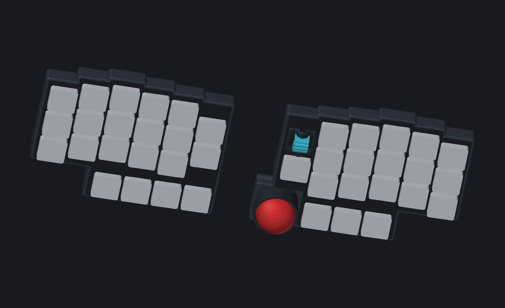

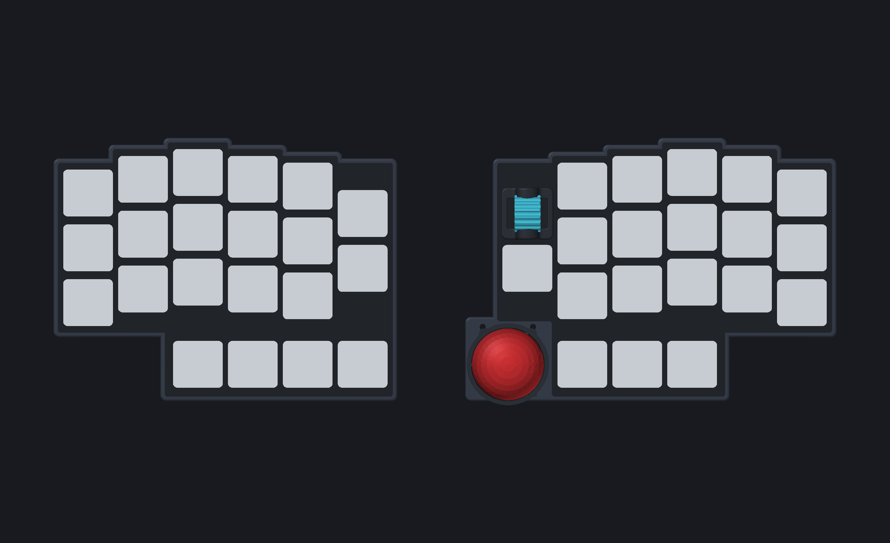

- **左手側（21キー）**: 3×5 メインキー ＋ 内側2キー（`EXSW1`, `EXSW2`）＋ 下段親指4キー（`SW9`, `SW8`, `SW1`, `EXSW3`）
- **右手側（19キー ＋ エンコーダ ＋ 25mmトラックボール）**:
  - 内側上段（`rEXSW1`）: **CKW12 水平ローラーエンコーダ**（公式3Dモデル反映・上下スクロール方向）
  - 内側中段（`rEXSW2`）: 1u Choc キー
  - 親指内側（`(7.5250, 52.3875)`）: **25mm トラックボール**（赤色球体 ＋ ベアリング保持カップ、`rSW1` キーキャップまで `4.61 mm` / カップ外周まで `2.91 mm` のクリアランス確保）
  - 親指下段3キー: `rSW1`, `rSW8`, `rSW9`

---

## 2. メインPCB & PMW3360基板（KiCad 3Dレイトレーシング）

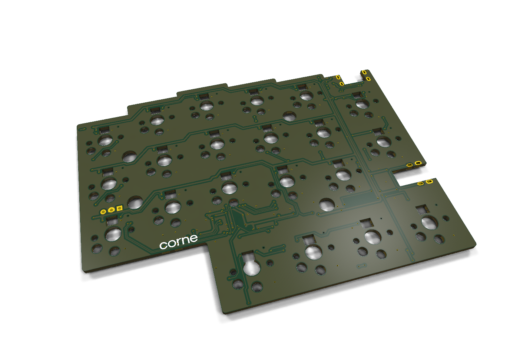
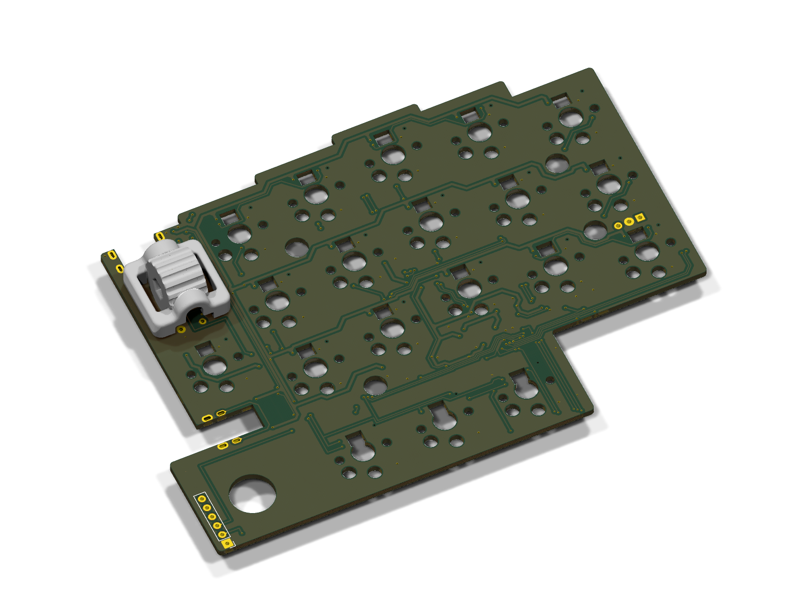
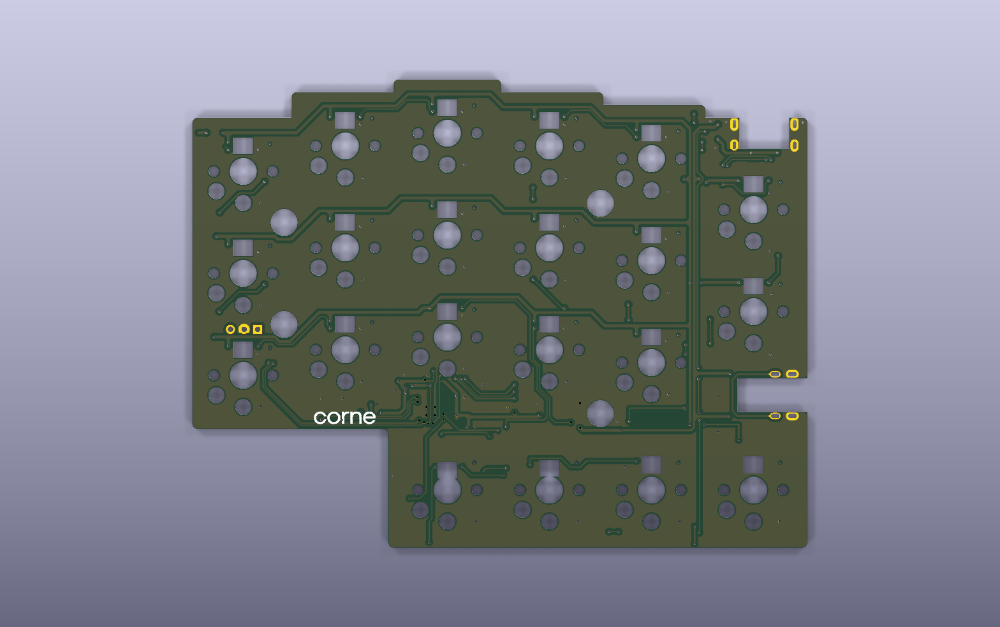
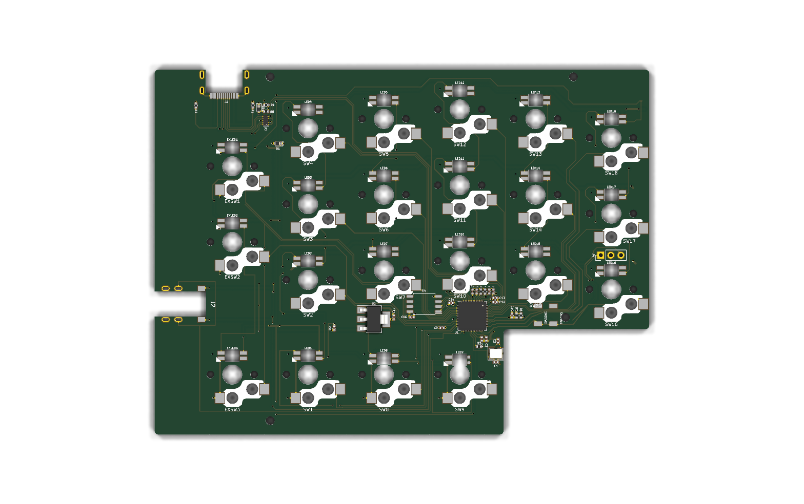
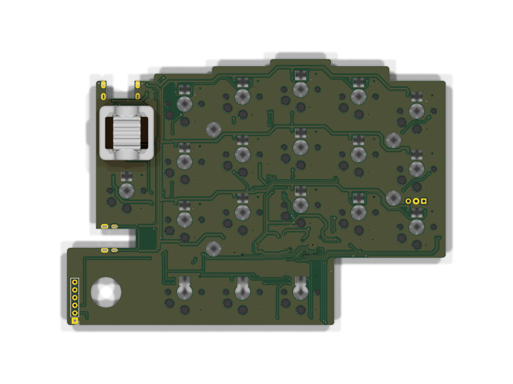
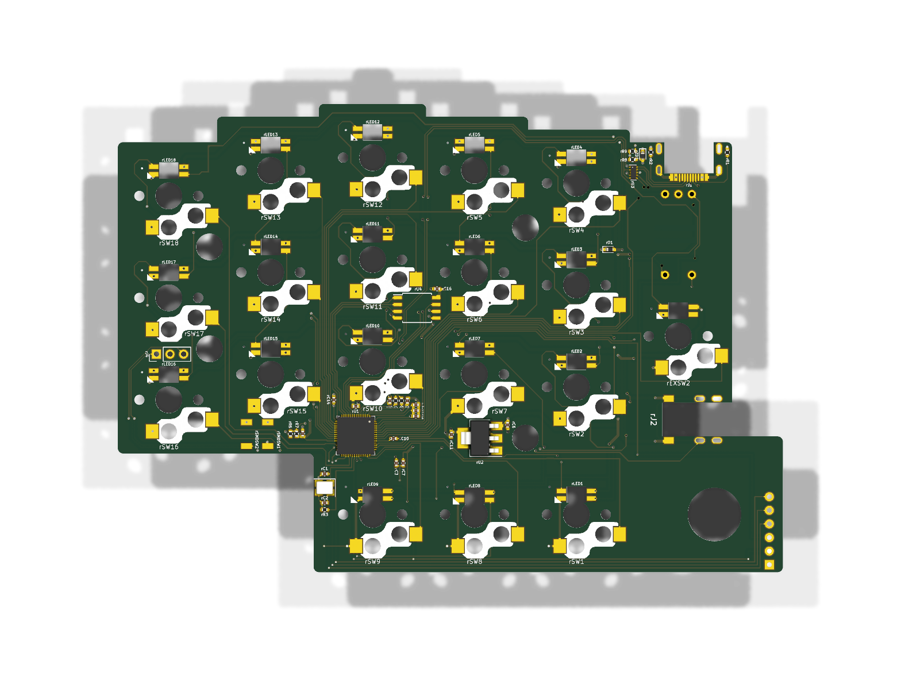
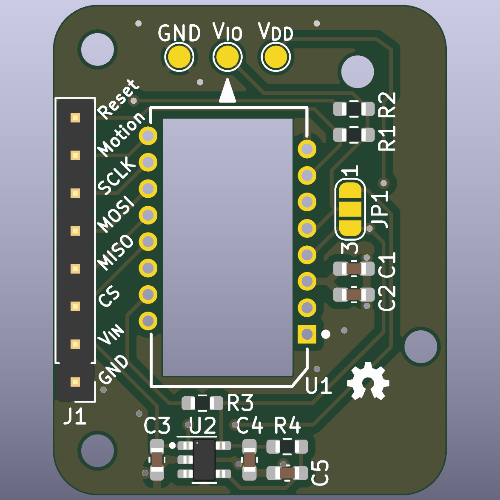

---

## 3. スイッチプレート（FR-4 1.6mm トッププレート）

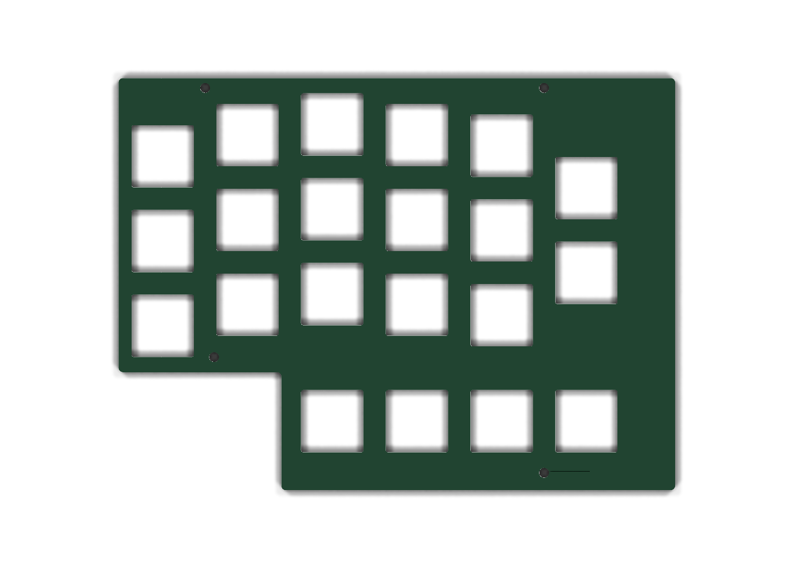
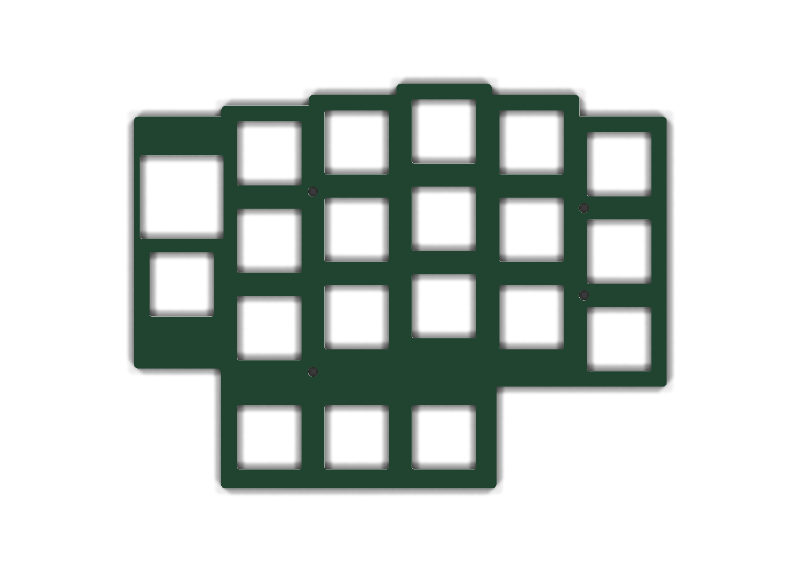

---

## 4. 手元のツールでインタラクティブに3D確認する方法

### 方法A：KiCad の「3D ビューアー」で見る（基板・実装部品・プレート）
1. **KiCad 10.0** で以下の `.kicad_pcb` ファイルを開きます：
   - 左手メイン基板: [curcur40-left.kicad_pcb](../pcbs/curcur40/left/curcur40-left.kicad_pcb)
   - 右手メイン基板: [curcur40-right.kicad_pcb](../pcbs/curcur40/right/curcur40-right.kicad_pcb)
   - PMW3360センサー基板: [curcur40-pmw3360.kicad_pcb](../pcbs/curcur40/pmw3360/curcur40-pmw3360.kicad_pcb)
   - トッププレート（左／右）: [plate-top-left.kicad_pcb](../plates/curcur40/pcb/plate-top-left.kicad_pcb) / [plate-top-right.kicad_pcb](../plates/curcur40/pcb/plate-top-right.kicad_pcb)
   - ボトムプレート（左／右）: [plate-bottom-left.kicad_pcb](../plates/curcur40/pcb/plate-bottom-left.kicad_pcb) / [plate-bottom-right.kicad_pcb](../plates/curcur40/pcb/plate-bottom-right.kicad_pcb)
2. メニューの **「表示 (View)」→「3D ビューアー (3D Viewer)」**（ショートカット: **`Alt + 3`**）を押すと、マウスドラッグで自由に360°回転・ズームして確認できます。

### 方法B：3D CAD / スライサーソフトで完成品アセンブリやケースを見る
3Dプリント用ケースと、キーキャップ・エンコーダ・25mmトラックボールを組み合わせたフルアセンブリの3Dモデルも出力済みです：
- **フルアセンブリ（左右ケース＋プレート＋全キー＋エンコーダ＋25mmトラックボール）**:
  - [assembly-full.step](../cases/curcur40/assembly-full.step)
- **単体3Dモデル（STEP / STL）**:
  - 左ケース: [left.step](../cases/curcur40/left.step) / [left.stl](../cases/curcur40/left.stl)
  - 右ケース: [right.step](../cases/curcur40/right.step) / [right.stl](../cases/curcur40/right.stl)
  - トラックボール保持カップ: [trackball-cup.step](../cases/curcur40/trackball-cup.step) / [trackball-cup.stl](../cases/curcur40/trackball-cup.stl)

これらは **FreeCAD**、**Fusion 360**、3Dプリンタ用スライサー（**Bambu Studio** / **PrusaSlicer** / **Cura**）、またはブラウザの [3dviewer.net](https://3dviewer.net/) などにドラッグ＆ドロップするだけでインタラクティブに回転・断面確認ができます。
